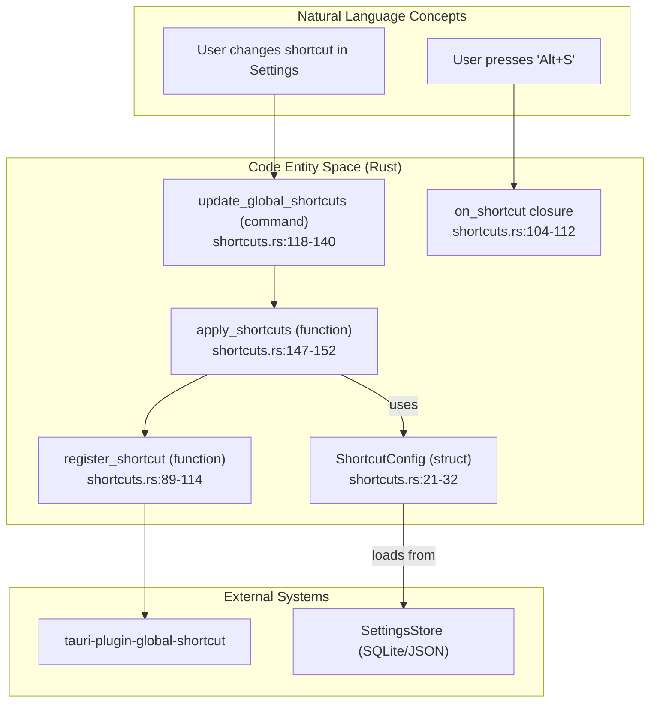
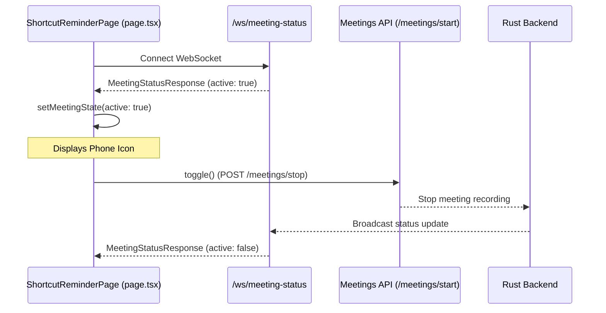
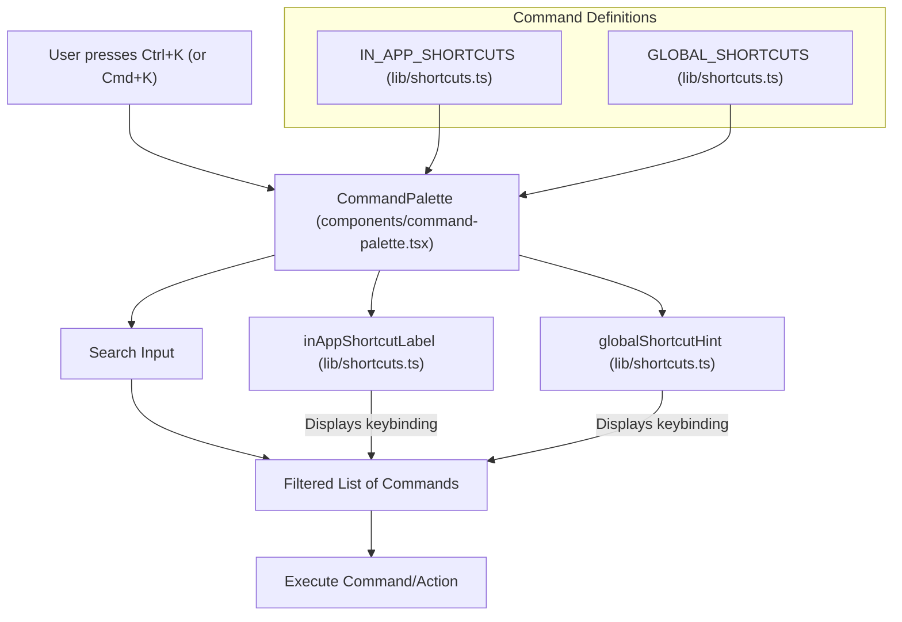

<!-- source: DeepWiki mcp.deepwiki.com · repo screenpipe/screenpipe · page 3.6 Global Shortcuts · fetched 2026-10-26 -->

# Global Shortcuts

Relevant source files

The following files were used as context for generating this wiki page:

- [apps/screenpipe-app-tauri/app/(main)/settings/page.tsx](apps/screenpipe-app-tauri/app/(main)/settings/page.tsx)
- [apps/screenpipe-app-tauri/app/chat/page.tsx](apps/screenpipe-app-tauri/app/chat/page.tsx)
- [apps/screenpipe-app-tauri/app/shortcut-reminder/page.test.tsx](apps/screenpipe-app-tauri/app/shortcut-reminder/page.test.tsx)
- [apps/screenpipe-app-tauri/app/shortcut-reminder/page.tsx](apps/screenpipe-app-tauri/app/shortcut-reminder/page.tsx)
- [apps/screenpipe-app-tauri/components/__tests__/command-palette.test.tsx](apps/screenpipe-app-tauri/components/__tests__/command-palette.test.tsx)
- [apps/screenpipe-app-tauri/components/__tests__/shortcut-guide.test.tsx](apps/screenpipe-app-tauri/components/__tests__/shortcut-guide.test.tsx)
- [apps/screenpipe-app-tauri/components/chat/chat-tab-strip.test.tsx](apps/screenpipe-app-tauri/components/chat/chat-tab-strip.test.tsx)
- [apps/screenpipe-app-tauri/components/chat/chat-tab-strip.tsx](apps/screenpipe-app-tauri/components/chat/chat-tab-strip.tsx)
- [apps/screenpipe-app-tauri/components/chat/standalone/chat-title-menu.test.tsx](apps/screenpipe-app-tauri/components/chat/standalone/chat-title-menu.test.tsx)
- [apps/screenpipe-app-tauri/components/chat/standalone/chat-title-menu.tsx](apps/screenpipe-app-tauri/components/chat/standalone/chat-title-menu.tsx)
- [apps/screenpipe-app-tauri/components/command-palette.tsx](apps/screenpipe-app-tauri/components/command-palette.tsx)
- [apps/screenpipe-app-tauri/components/settings/__tests__/shortcut-section.test.tsx](apps/screenpipe-app-tauri/components/settings/__tests__/shortcut-section.test.tsx)
- [apps/screenpipe-app-tauri/components/settings/team-section.test.tsx](apps/screenpipe-app-tauri/components/settings/team-section.test.tsx)
- [apps/screenpipe-app-tauri/components/shortcut-guide.tsx](apps/screenpipe-app-tauri/components/shortcut-guide.tsx)
- [apps/screenpipe-app-tauri/lib/__tests__/close-tab-shortcut.test.ts](apps/screenpipe-app-tauri/lib/__tests__/close-tab-shortcut.test.ts)
- [apps/screenpipe-app-tauri/lib/__tests__/shortcuts.test.ts](apps/screenpipe-app-tauri/lib/__tests__/shortcuts.test.ts)
- [apps/screenpipe-app-tauri/lib/analytics/command-palette.test.ts](apps/screenpipe-app-tauri/lib/analytics/command-palette.test.ts)
- [apps/screenpipe-app-tauri/lib/analytics/command-palette.ts](apps/screenpipe-app-tauri/lib/analytics/command-palette.ts)
- [apps/screenpipe-app-tauri/lib/close-tab-shortcut.ts](apps/screenpipe-app-tauri/lib/close-tab-shortcut.ts)
- [apps/screenpipe-app-tauri/lib/shortcuts.ts](apps/screenpipe-app-tauri/lib/shortcuts.ts)
- [apps/screenpipe-app-tauri/src-tauri/src/native_overlay_win.rs](apps/screenpipe-app-tauri/src-tauri/src/native_overlay_win.rs)
- [apps/screenpipe-app-tauri/src-tauri/src/native_shortcut_reminder.rs](apps/screenpipe-app-tauri/src-tauri/src/native_shortcut_reminder.rs)
- [apps/screenpipe-app-tauri/src-tauri/src/overlay_health.rs](apps/screenpipe-app-tauri/src-tauri/src/overlay_health.rs)
- [apps/screenpipe-app-tauri/src-tauri/src/window/capture_protection.rs](apps/screenpipe-app-tauri/src-tauri/src/window/capture_protection.rs)
- [apps/screenpipe-app-tauri/src-tauri/swift/shortcut_reminder.swift](apps/screenpipe-app-tauri/src-tauri/swift/shortcut_reminder.swift)
- [apps/screenpipe-app-tauri/src-tauri/swift/shortcut_reminder_tests.swift](apps/screenpipe-app-tauri/src-tauri/swift/shortcut_reminder_tests.swift)
- [crates/screenpipe-overlay-win/src/actions.rs](crates/screenpipe-overlay-win/src/actions.rs)
- [crates/screenpipe-overlay-win/src/layout.rs](crates/screenpipe-overlay-win/src/layout.rs)
- [crates/screenpipe-overlay-win/src/preview.rs](crates/screenpipe-overlay-win/src/preview.rs)
- [crates/screenpipe-overlay-win/src/render.rs](crates/screenpipe-overlay-win/src/render.rs)
- [crates/screenpipe-overlay-win/src/state.rs](crates/screenpipe-overlay-win/src/state.rs)
- [crates/screenpipe-overlay-win/src/text.rs](crates/screenpipe-overlay-win/src/text.rs)
- [crates/screenpipe-overlay-win/src/window.rs](crates/screenpipe-overlay-win/src/window.rs)

This document describes the global keyboard shortcut system in Screenpipe's desktop application. Global shortcuts allow users to control the application from anywhere in the operating system, even when Screenpipe windows are not focused.

## Purpose and Scope

The global shortcuts system provides system-wide keyboard bindings for common operations:
- Showing/hiding the main overlay window.
- Starting and stopping recording.
- Controlling audio recording.
- Opening the AI chat window.
- Opening the search modal.
- Locking the privacy vault.

The system is implemented using `tauri-plugin-global-shortcut` and integrates with platform-specific native overlays, such as the macOS SwiftUI shortcut reminder and Windows click-through overlays.

**Sources:** [apps/screenpipe-app-tauri/src-tauri/src/shortcuts.rs:5-32](), [apps/screenpipe-app-tauri/src-tauri/src/shortcuts.rs:147-152]()

---

## Shortcut Types and Defaults

Screenpipe maintains a distinction between **Global Shortcuts** (always active) and **Window-Specific Shortcuts** (active only when the app is focused).

| Shortcut Type | Default (macOS) | Default (Windows/Linux) | Function | Scope |
|--------------|----------------------|-------------------|----------|-------|
| `show_screenpipe` | `⌘⌃S` | `Alt+S` | Toggle main overlay visibility | Global |
| `start_recording` | `Super+Alt+U` | `Super+Alt+U` | Emit recording start event | Global |
| `stop_recording` | `Super+Alt+X` | `Super+Alt+X` | Emit recording stop event | Global |
| `start_audio` | `Super+Ctrl+A` | `Alt+Shift+A` | Enable audio recording | Global |
| `stop_audio` | `Super+Ctrl+Z` | `Alt+Shift+Z` | Disable audio recording | Global |
| `show_chat` | `⌘⌃L` | `Alt+L` | Toggle standalone chat window | Global |
| `search` | `⌘⌃K` | `Alt+K` | Open search modal | Global |
| `lock_vault` | - | - | Lock the privacy vault | Global |

**Sources:** [apps/screenpipe-app-tauri/src-tauri/src/shortcuts.rs:40-69](), [apps/screenpipe-app-tauri/app/shortcut-reminder/page.tsx:68-73]()

---

## Architecture Overview

The system bridges high-level user intent with low-level OS shortcut registration via a centralized `ShortcutConfig` and registration logic.

### Natural Language to Code Entity Mapping

This diagram maps user-facing shortcut concepts to their internal Rust representations and registration logic.

Title: Global Shortcut Registration Flow

**Sources:** [apps/screenpipe-app-tauri/src-tauri/src/shortcuts.rs:21-32](), [apps/screenpipe-app-tauri/src-tauri/src/shortcuts.rs:118-140](), [apps/screenpipe-app-tauri/src-tauri/src/shortcuts.rs:147-152]()

---

## Handler Logic and Main Thread Deferral

Shortcut handlers are executed within a `std::panic::catch_unwind` block to prevent crashes from crossing the FFI boundary [apps/screenpipe-app-tauri/src-tauri/src/shortcuts.rs:106-110]().

### Main Thread Execution
Handlers must defer UI-related work to the main thread to avoid deadlocks or threading violations:
1. **Window Toggling**: The `show_screenpipe` handler uses `app.run_on_main_thread()` to check window visibility and toggle state [apps/screenpipe-app-tauri/src-tauri/src/shortcuts.rs:156-182]().
2. **Timeline Check**: The "show" shortcut is ignored if `disable_timeline` is enabled in the settings [apps/screenpipe-app-tauri/src-tauri/src/shortcuts.rs:163-171]().
3. **Event Emission**: Shortcuts for recording and audio emit Tauri events (e.g., `shortcut-start-recording`) to the frontend [apps/screenpipe-app-tauri/src-tauri/src/shortcuts.rs:224-226]().

**Sources:** [apps/screenpipe-app-tauri/src-tauri/src/shortcuts.rs:156-182](), [apps/screenpipe-app-tauri/src-tauri/src/shortcuts.rs:224-226]()

---

## Shortcut Reminder Overlay

The `ShortcutReminderPage` provides a visual overlay to remind users of active shortcuts. It is particularly active during meetings and uses a native SwiftUI implementation on macOS for performance.

### Meeting Integration Logic

The overlay is "meeting-aware," using a WebSocket to track meeting status and allow manual toggling.

Title: Meeting State and Shortcut Overlay Interaction

### Key Components:
- **`useMeetingOverlay`**: Manages the meeting-related state for the overlay, including active meeting ID, app, and transcript items [apps/screenpipe-app-tauri/app/shortcut-reminder/page.tsx:103]().
- **`applyReminderSettings`**: Reads shortcut settings from the `SettingsStore` and formats them for display on the overlay [apps/screenpipe-app-tauri/app/shortcut-reminder/page.tsx:130-175]().
- **`AudioEqualizer`**: Visualizes audio activity based on speech ratio [apps/screenpipe-app-tauri/app/shortcut-reminder/page.tsx:33]().
- **`ShortcutReminderController` (macOS)**: A native SwiftUI implementation that provides an audio-reactive pill that expands on hover, utilizing `AnimationTick` for smooth 60fps LERP-based animations [apps/screenpipe-app-tauri/src-tauri/swift/shortcut_reminder.swift:100-148](). This controller also handles health state updates pushed from Rust [apps/screenpipe-app-tauri/src-tauri/swift/shortcut_reminder.swift:90-93]().

**Sources:** [apps/screenpipe-app-tauri/app/shortcut-reminder/page.tsx:103](), [apps/screenpipe-app-tauri/app/shortcut-reminder/page.tsx:130-175](), [apps/screenpipe-app-tauri/app/shortcut-reminder/page.tsx:33](), [apps/screenpipe-app-tauri/src-tauri/swift/shortcut_reminder.swift:100-148](), [apps/screenpipe-app-tauri/src-tauri/swift/shortcut_reminder.swift:90-93]()

---

## Dynamic Updates and Configuration

Users can rebind shortcuts in the Settings UI. When a change occurs, the frontend invokes the `update_global_shortcuts` command.

### Persistence Flow
1. **Tauri Command**: `update_global_shortcuts` receives new strings for show, start/stop recording, and audio shortcuts [apps/screenpipe-app-tauri/src-tauri/src/shortcuts.rs:118-126]().
2. **Re-registration**: The backend calls `apply_shortcuts`, which first unregisters all current bindings using `global_shortcut.unregister_all()` before applying the new configuration [apps/screenpipe-app-tauri/src-tauri/src/shortcuts.rs:147-151]().
3. **Validation**: The `register_shortcut` function ensures shortcuts are only registered if they are not empty and not explicitly disabled [apps/screenpipe-app-tauri/src-tauri/src/shortcuts.rs:95-97]().

**Sources:** [apps/screenpipe-app-tauri/src-tauri/src/shortcuts.rs:118-140](), [apps/screenpipe-app-tauri/src-tauri/src/shortcuts.rs:147-151](), [apps/screenpipe-app-tauri/src-tauri/src/shortcuts.rs:95-97]()

---

## Command Palette

The command palette (`CommandPalette` component) provides a searchable interface for various application actions, including those triggered by global shortcuts. It uses `IN_APP_SHORTCUTS` and `GLOBAL_SHORTCUTS` definitions to display available commands and their associated keybindings.

Title: Command Palette Interaction Flow

The `CommandPalette` component [apps/screenpipe-app-tauri/components/command-palette.tsx]() is responsible for:
- Listening for the `command_menu` shortcut [apps/screenpipe-app-tauri/lib/shortcuts.ts:80-84]().
- Displaying a modal with a search input.
- Filtering commands based on user input.
- Executing selected commands.
- Displaying associated keyboard shortcuts using `inAppShortcutLabel` [apps/screenpipe-app-tauri/lib/shortcuts.ts:133-163]() and `globalShortcutHint` [apps/screenpipe-app-tauri/lib/shortcuts.ts:121-130]().

**Sources:** [apps/screenpipe-app-tauri/components/command-palette.tsx](), [apps/screenpipe-app-tauri/lib/shortcuts.ts:80-84](), [apps/screenpipe-app-tauri/lib/shortcuts.ts:133-163](), [apps/screenpipe-app-tauri/lib/shortcuts.ts:121-130]()

---

## Platform-Specific Implementation Details

### macOS Shortcut Reminder Overlay
The macOS shortcut reminder is implemented in Swift using SwiftUI, providing a native and performant overlay.
- **`shortcut_reminder.swift`**: Contains the SwiftUI view logic and FFI bindings for communication with the Rust backend [apps/screenpipe-app-tauri/src-tauri/swift/shortcut_reminder.swift]().
- **`gatedLevel`, `gatedBehavior`, `gatedOrderFront`**: Functions to control window level, collection behavior, and ordering, especially for non-intrusive E2E testing [apps/screenpipe-app-tauri/src-tauri/swift/shortcut_reminder.swift:29-50]().
- **`shortcutSetActionCallback`**: Registers a C callback from Rust to handle actions triggered by the overlay (e.g., dismiss, open window, toggle meeting) [apps/screenpipe-app-tauri/src-tauri/swift/shortcut_reminder.swift:57-59]().
- **`shortcutSetHealthState`**: Receives recording health state updates from Rust and passes them to the `ShortcutReminderController` [apps/screenpipe-app-tauri/src-tauri/swift/shortcut_reminder.swift:81-96]().
- **`OverlayMetrics`**: An `ObservableObject` in Swift that holds various metrics and health states, published to the SwiftUI view [apps/screenpipe-app-tauri/src-tauri/swift/shortcut_reminder.swift:100-148]().

**Sources:** [apps/screenpipe-app-tauri/src-tauri/swift/shortcut_reminder.swift](), [apps/screenpipe-app-tauri/src-tauri/swift/shortcut_reminder.swift:29-50](), [apps/screenpipe-app-tauri/src-tauri/swift/shortcut_reminder.swift:57-59](), [apps/screenpipe-app-tauri/src-tauri/swift/shortcut_reminder.swift:81-96](), [apps/screenpipe-app-tauri/src-tauri/swift/shortcut_reminder.swift:100-148]()

### Windows Click-Through Overlay
On Windows, the overlay is a pure `windows-rs` implementation in `crates/screenpipe-overlay-win`.
- **`window.rs`**: Manages the Win32 window creation, message pump, and rendering for the overlay [crates/screenpipe-overlay-win/src/window.rs]().
- **`WS_EX_LAYERED | WS_EX_NOACTIVATE`**: Window styles used to create a click-through, non-activating popup window [crates/screenpipe-overlay-win/src/window.rs:55]().
- **`show_brand_context_menu`**: Handles the right-click context menu for the overlay, offering options like "Hide for 1 hour" or "Settings..." [crates/screenpipe-overlay-win/src/window.rs:94-128]().
- **`Overlay` struct**: A handle to the overlay thread, allowing updates and commands to be sent to the overlay window [crates/screenpipe-overlay-win/src/window.rs:151-154]().
- **`layout.rs`**: Defines the geometry and hit-testing logic for the overlay in device-independent pixels, ensuring consistency with the macOS version [crates/screenpipe-overlay-win/src/layout.rs]().

**Sources:** [crates/screenpipe-overlay-win/src/window.rs](), [crates/screenpipe-overlay-win/src/window.rs:55](), [crates/screenpipe-overlay-win/src/window.rs:94-128](), [crates/screenpipe-overlay-win/src/window.rs:151-154](), [crates/screenpipe-overlay-win/src/layout.rs]()

---

