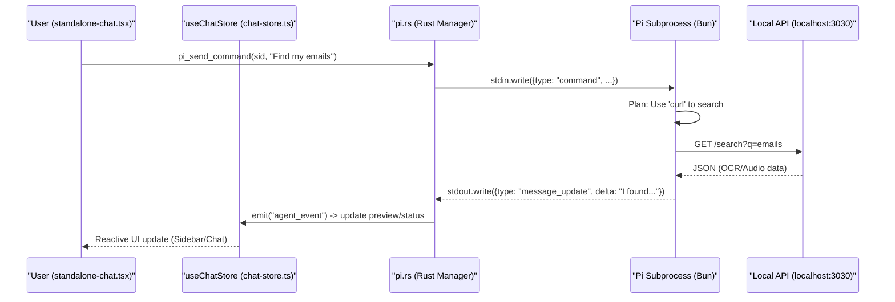

<!-- source: DeepWiki mcp.deepwiki.com · repo screenpipe/screenpipe · page 4.1 Pi Coding Agent · fetched 2026-10-26 -->

# Pi Coding Agent

<details>
<summary>Relevant source files</summary>

The following files were used as context for generating this wiki page:

- [.github/workflows/gateway-e2e.yml](.github/workflows/gateway-e2e.yml)
- [.github/workflows/release-gateway-container.yml](.github/workflows/release-gateway-container.yml)
- [.github/workflows/test-frontend.yml](.github/workflows/test-frontend.yml)
- [apps/screenpipe-app-tauri/components/__tests__/chat-sidebar-focus.test.tsx](apps/screenpipe-app-tauri/components/__tests__/chat-sidebar-focus.test.tsx)
- [apps/screenpipe-app-tauri/components/__tests__/chat-sidebar-grouping.test.ts](apps/screenpipe-app-tauri/components/__tests__/chat-sidebar-grouping.test.ts)
- [apps/screenpipe-app-tauri/components/chat-sidebar.tsx](apps/screenpipe-app-tauri/components/chat-sidebar.tsx)
- [apps/screenpipe-app-tauri/components/chat/chat-history-view.tsx](apps/screenpipe-app-tauri/components/chat/chat-history-view.tsx)
- [apps/screenpipe-app-tauri/components/chat/standalone/hooks/__tests__/chat-turn-intents.test.ts](apps/screenpipe-app-tauri/components/chat/standalone/hooks/__tests__/chat-turn-intents.test.ts)
- [apps/screenpipe-app-tauri/components/chat/standalone/hooks/__tests__/pi-event-handlers.test.ts](apps/screenpipe-app-tauri/components/chat/standalone/hooks/__tests__/pi-event-handlers.test.ts)
- [apps/screenpipe-app-tauri/components/chat/standalone/hooks/__tests__/pi-terminal-error.test.tsx](apps/screenpipe-app-tauri/components/chat/standalone/hooks/__tests__/pi-terminal-error.test.tsx)
- [apps/screenpipe-app-tauri/components/chat/standalone/hooks/pi-event-handlers.ts](apps/screenpipe-app-tauri/components/chat/standalone/hooks/pi-event-handlers.ts)
- [apps/screenpipe-app-tauri/components/chat/standalone/hooks/pi-steering-helpers.ts](apps/screenpipe-app-tauri/components/chat/standalone/hooks/pi-steering-helpers.ts)
- [apps/screenpipe-app-tauri/components/chat/standalone/hooks/use-chat-composer-shell.ts](apps/screenpipe-app-tauri/components/chat/standalone/hooks/use-chat-composer-shell.ts)
- [apps/screenpipe-app-tauri/components/chat/standalone/hooks/use-chat-session-runtime.test.tsx](apps/screenpipe-app-tauri/components/chat/standalone/hooks/use-chat-session-runtime.test.tsx)
- [apps/screenpipe-app-tauri/components/chat/standalone/hooks/use-chat-session-runtime.ts](apps/screenpipe-app-tauri/components/chat/standalone/hooks/use-chat-session-runtime.ts)
- [apps/screenpipe-app-tauri/components/chat/standalone/hooks/use-chat-turn-intents.ts](apps/screenpipe-app-tauri/components/chat/standalone/hooks/use-chat-turn-intents.ts)
- [apps/screenpipe-app-tauri/components/chat/standalone/hooks/use-pi-foreground-events.ts](apps/screenpipe-app-tauri/components/chat/standalone/hooks/use-pi-foreground-events.ts)
- [apps/screenpipe-app-tauri/components/chat/standalone/hooks/use-pi-steering-transport.ts](apps/screenpipe-app-tauri/components/chat/standalone/hooks/use-pi-steering-transport.ts)
- [apps/screenpipe-app-tauri/components/chat/standalone/message-content.answer-recovery.test.tsx](apps/screenpipe-app-tauri/components/chat/standalone/message-content.answer-recovery.test.tsx)
- [apps/screenpipe-app-tauri/components/hooks/use-chat-conversations.ts](apps/screenpipe-app-tauri/components/hooks/use-chat-conversations.ts)
- [apps/screenpipe-app-tauri/components/pipe-install-dialog.tsx](apps/screenpipe-app-tauri/components/pipe-install-dialog.tsx)
- [apps/screenpipe-app-tauri/components/pipe-store.tsx](apps/screenpipe-app-tauri/components/pipe-store.tsx)
- [apps/screenpipe-app-tauri/components/settings/pipes-section.tsx](apps/screenpipe-app-tauri/components/settings/pipes-section.tsx)
- [apps/screenpipe-app-tauri/components/standalone-chat.tsx](apps/screenpipe-app-tauri/components/standalone-chat.tsx)
- [apps/screenpipe-app-tauri/e2e/specs/chat-sidebar-pipe-inventory.spec.ts](apps/screenpipe-app-tauri/e2e/specs/chat-sidebar-pipe-inventory.spec.ts)
- [apps/screenpipe-app-tauri/knip.json](apps/screenpipe-app-tauri/knip.json)
- [apps/screenpipe-app-tauri/lib/__tests__/chat-storage.test.ts](apps/screenpipe-app-tauri/lib/__tests__/chat-storage.test.ts)
- [apps/screenpipe-app-tauri/lib/__tests__/chat-store.test.ts](apps/screenpipe-app-tauri/lib/__tests__/chat-store.test.ts)
- [apps/screenpipe-app-tauri/lib/__tests__/context-pruning.test.ts](apps/screenpipe-app-tauri/lib/__tests__/context-pruning.test.ts)
- [apps/screenpipe-app-tauri/lib/__tests__/pi-event-router.test.ts](apps/screenpipe-app-tauri/lib/__tests__/pi-event-router.test.ts)
- [apps/screenpipe-app-tauri/lib/__tests__/save-conversation-race.test.tsx](apps/screenpipe-app-tauri/lib/__tests__/save-conversation-race.test.tsx)
- [apps/screenpipe-app-tauri/lib/cache.ts](apps/screenpipe-app-tauri/lib/cache.ts)
- [apps/screenpipe-app-tauri/lib/chat-storage.ts](apps/screenpipe-app-tauri/lib/chat-storage.ts)
- [apps/screenpipe-app-tauri/lib/chat/__tests__/conversation-title.test.ts](apps/screenpipe-app-tauri/lib/chat/__tests__/conversation-title.test.ts)
- [apps/screenpipe-app-tauri/lib/chat/__tests__/provider-errors.test.ts](apps/screenpipe-app-tauri/lib/chat/__tests__/provider-errors.test.ts)
- [apps/screenpipe-app-tauri/lib/chat/conversation-title.ts](apps/screenpipe-app-tauri/lib/chat/conversation-title.ts)
- [apps/screenpipe-app-tauri/lib/chat/provider-errors.ts](apps/screenpipe-app-tauri/lib/chat/provider-errors.ts)
- [apps/screenpipe-app-tauri/lib/hooks/use-pipe-favorites.ts](apps/screenpipe-app-tauri/lib/hooks/use-pipe-favorites.ts)
- [apps/screenpipe-app-tauri/lib/model-metadata.test.ts](apps/screenpipe-app-tauri/lib/model-metadata.test.ts)
- [apps/screenpipe-app-tauri/lib/model-metadata.ts](apps/screenpipe-app-tauri/lib/model-metadata.ts)
- [apps/screenpipe-app-tauri/lib/pipe-execution-status.ts](apps/screenpipe-app-tauri/lib/pipe-execution-status.ts)
- [apps/screenpipe-app-tauri/lib/stores/chat-store.ts](apps/screenpipe-app-tauri/lib/stores/chat-store.ts)
- [apps/screenpipe-app-tauri/lib/stores/pi-event-router.ts](apps/screenpipe-app-tauri/lib/stores/pi-event-router.ts)
- [apps/screenpipe-app-tauri/lib/utils/chat-sidebar-grouping.ts](apps/screenpipe-app-tauri/lib/utils/chat-sidebar-grouping.ts)
- [apps/screenpipe-app-tauri/scripts/eval-pi-compaction.ts](apps/screenpipe-app-tauri/scripts/eval-pi-compaction.ts)
- [apps/screenpipe-app-tauri/scripts/eval-pi-extensions.ts](apps/screenpipe-app-tauri/scripts/eval-pi-extensions.ts)
- [apps/screenpipe-app-tauri/scripts/webdriver-transport.test.ts](apps/screenpipe-app-tauri/scripts/webdriver-transport.test.ts)
- [apps/screenpipe-app-tauri/src-tauri/src/pi.rs](apps/screenpipe-app-tauri/src-tauri/src/pi.rs)
- [apps/screenpipe-app-tauri/src-tauri/src/pi_command_queue.rs](apps/screenpipe-app-tauri/src-tauri/src/pi_command_queue.rs)
- [apps/screenpipe-app-tauri/vitest.config.ts](apps/screenpipe-app-tauri/vitest.config.ts)
- [crates/screenpipe-core/Cargo.toml](crates/screenpipe-core/Cargo.toml)
- [crates/screenpipe-core/assets/extensions/context-pruning.ts](crates/screenpipe-core/assets/extensions/context-pruning.ts)
- [crates/screenpipe-core/assets/pi-context-compaction.test.ts](crates/screenpipe-core/assets/pi-context-compaction.test.ts)
- [crates/screenpipe-core/assets/pi-transport-cause.patch](crates/screenpipe-core/assets/pi-transport-cause.patch)
- [crates/screenpipe-core/assets/pi-transport-cause.test.ts](crates/screenpipe-core/assets/pi-transport-cause.test.ts)
- [crates/screenpipe-core/src/agents/bash_env.rs](crates/screenpipe-core/src/agents/bash_env.rs)
- [crates/screenpipe-core/src/agents/mod.rs](crates/screenpipe-core/src/agents/mod.rs)
- [crates/screenpipe-core/src/agents/pi.rs](crates/screenpipe-core/src/agents/pi.rs)
- [crates/screenpipe-core/src/agents/pi_compaction.rs](crates/screenpipe-core/src/agents/pi_compaction.rs)
- [crates/screenpipe-core/src/pipes/favorites.rs](crates/screenpipe-core/src/pipes/favorites.rs)
- [crates/screenpipe-core/src/pipes/mod.rs](crates/screenpipe-core/src/pipes/mod.rs)
- [crates/screenpipe-engine/src/pipe_store.rs](crates/screenpipe-engine/src/pipe_store.rs)
- [crates/screenpipe-engine/src/pipes_api.rs](crates/screenpipe-engine/src/pipes_api.rs)
- [crates/screenpipe-engine/src/routes/pipe_store.rs](crates/screenpipe-engine/src/routes/pipe_store.rs)
- [crates/screenpipe-gateway/Dockerfile](crates/screenpipe-gateway/Dockerfile)
- [docs/evidence/cloud-connection-copy/before-after.png](docs/evidence/cloud-connection-copy/before-after.png)
- [docs/pr-assets/recents-source-picker/after-dark.jpg](docs/pr-assets/recents-source-picker/after-dark.jpg)
- [docs/pr-assets/recents-source-picker/before-dark.jpg](docs/pr-assets/recents-source-picker/before-dark.jpg)

</details>


This document describes the Pi coding agent integration in Screenpipe. Pi is a CLI-based coding agent (`@earendil-works/pi-coding-agent`) that runs as a managed subprocess and communicates via JSON-RPC over stdin/stdout. Screenpipe uses Pi for interactive AI chat, automated data analysis, and scheduled pipe execution.

---

## Architecture Overview

Pi is integrated as a long-lived process for chat sessions and as a one-off execution engine for pipes. The system uses a multi-layered architecture to bridge the Tauri frontend, the Rust backend, and the external Bun-based Pi process.

### Component Topology

```mermaid
graph TB
    subgraph "Desktop App (Tauri Frontend)"
        CHAT["StandaloneChat<br/>standalone-chat.tsx"]
        SIDEBAR["ChatSidebar<br/>chat-sidebar.tsx"]
        STORE["useChatStore<br/>chat-store.ts"]
        BUS["mountAgentEventBus<br/>bus.ts"]
    end
    
    subgraph "Tauri Backend (Rust)"
        PIM["PiManager<br/>pi.rs"]
        POOL["PiPool<br/>HashMap&lt;sid, PiManager&gt;"]
        EXECUTOR["PiExecutor<br/>crates/screenpipe-core/.../pi.rs"]
    end
    
    subgraph "External Process"
        CLI["pi --rpc-mode<br/>@earendil-works/pi-coding-agent"]
        BUN["Bun Runtime"]
    end

    CHAT -->|TAURI_INVOKE| RustInv["pi_start / pi_send_command"]
    RustInv --> PIM
    PIM --> POOL
    POOL -->|stdin/stdout| CLI
    CLI -->|JSON-RPC| PIM
    PIM -->|app.emit('agent_event')| BUS
    BUS -->|dispatch| STORE
    STORE -->|reactive sync| SIDEBAR
    EXECUTOR -->|one-off run| CLI
```

**Sources:** [apps/screenpipe-app-tauri/src-tauri/src/pi.rs:5-15](), [apps/screenpipe-app-tauri/components/standalone-chat.tsx:105-120](), [apps/screenpipe-app-tauri/lib/stores/pi-event-router.ts:8-20](), [crates/screenpipe-core/src/agents/pi.rs:7-10]()

---

## PiManager & Process Management

The `PiManager` struct in `src-tauri/src/pi.rs` manages the lifecycle of a single Pi subprocess. It maintains the stdin handle for sending commands and spawns a dedicated thread to read and parse stdout.

### Implementation Details
- **Spawning**: Pi is launched via `bun`. On Windows, Screenpipe handles `.cmd` and `.exe` bun shims by resolving the actual JS entrypoint using `resolve_bun_global_entrypoint` to avoid path resolution failures in non-standard install directories. [apps/screenpipe-app-tauri/src-tauri/src/pi.rs:153-182]()
- **RPC Mode**: For interactive chat, Pi is launched with a protocol-driven mode to enable persistent JSON-RPC communication. [apps/screenpipe-app-tauri/src-tauri/src/pi.rs:7-8]()
- **I/O Handling**: Uses `read_lines_lossy` to read bytes from the subprocess. This ensures that invalid UTF-8 sequences (common when tools output binary data or complex logs) do not crash the reader, replacing them with `U+FFFD`. [apps/screenpipe-app-tauri/src-tauri/src/pi.rs:51-72]()
- **Batching**: To improve UI performance, text deltas are batched in Rust using `TEXT_DELTA_EMIT_BATCH_MS` (50ms) and `TEXT_DELTA_EMIT_BATCH_CHARS` (1200 chars) before being emitted to the frontend. [apps/screenpipe-app-tauri/src-tauri/src/pi.rs:75-76]()
- **Title Generation**: Sessions prefixed with `__title:` (`TITLE_SESSION_PREFIX`) bypass the batching logic to ensure titles stream visibly token-by-token. [apps/screenpipe-app-tauri/src-tauri/src/pi.rs:78-80]()

### Multi-Session Architecture
Screenpipe maintains a pool of active Pi sessions. This allows the app to manage multiple concurrent agent sessions (e.g., background pipes and foreground chats) without interference. The frontend uses `sessionId` to uniquely identify these across the event bus. [apps/screenpipe-app-tauri/lib/stores/chat-store.ts:6-21](), [apps/screenpipe-app-tauri/src-tauri/src/pi.rs:104-111]()

**Sources:** [apps/screenpipe-app-tauri/src-tauri/src/pi.rs:153-195](), [apps/screenpipe-app-tauri/src-tauri/src/pi.rs:51-76](), [apps/screenpipe-app-tauri/src-tauri/src/pi.rs:78-80]()

---

## JSON-RPC Protocol & Event Routing

Communication follows a standard request/response pattern over the process pipes.

### Event Routing (Agent Event Bus)
Pi emits events (streaming chunks, tool starts, thinking blocks) which are captured by Rust and emitted as a unified `agent_event` topic. The `mountAgentEventBus` in the frontend provides a registration-based dispatcher:
- `registerForeground`: Routes events to the active chat window.
- `registerDefault`: Routes events to background routers like `PiEventRouter`.

[apps/screenpipe-app-tauri/lib/stores/pi-event-router.ts:43-55]()

### Session Status Mapping
The `statusForEvent` function in `pi-event-router.ts` maps raw agent events to high-level UI states used in the `SessionRecord`:

| Event Type | UI `SessionStatus` | Visual Indicator |
| :--- | :--- | :--- |
| `thinking_start` | `thinking` | Pulsing Indicator |
| `tool_execution_start` | `tool` | Tool Execution Icon |
| `agent_start` / `text_delta` | `streaming` | Live Pulse |
| `agent_end` / `turn_end` | `idle` | Solid Dot |
| `error` | `error` | Red Alert |

**Sources:** [apps/screenpipe-app-tauri/lib/stores/pi-event-router.ts:125-169](), [apps/screenpipe-app-tauri/lib/stores/chat-store.ts:33-39]()

---

## State Management: Chat Store

Screenpipe uses a centralized `useChatStore` (Zustand) to manage agent states across the application. This store is the source of truth for the `ChatSidebar` and `StandaloneChat`.

### Data Flow & Persistence
1. **Live Updates**: The `PiEventRouter` listens to the event bus and updates the `SessionRecord` in the store with `preview` snippets and `status` changes. [apps/screenpipe-app-tauri/lib/stores/pi-event-router.ts:175-180]()
2. **Background Sync**: Content is accumulated for background sessions. When a turn ends, `PiEventRouter` triggers `saveConversationFile` to persist the session to `~/.screenpipe/chats/`. [apps/screenpipe-app-tauri/lib/stores/pi-event-router.ts:56-61]()
3. **Session Recovery**: On app launch, `useChatConversations` hydrates the store by calling `listConversations` and `loadConversationFile`. [apps/screenpipe-app-tauri/components/hooks/use-chat-conversations.ts:166-173]()

**Sources:** [apps/screenpipe-app-tauri/lib/stores/chat-store.ts:6-21](), [apps/screenpipe-app-tauri/lib/stores/pi-event-router.ts:8-13](), [apps/screenpipe-app-tauri/components/hooks/use-chat-conversations.ts:31-43]()

---

## Skills & Installation

Pi's capabilities are defined by its environment and installed packages.

### Skill Implementation
Pi acts as the engine for **Pipes**. A pipe is a markdown file (`pipe.md`) that contains a prompt and configuration. Screenpipe executes these via `PiExecutor`, which sets up the environment:
- `SCREENPIPE_API_URL`: Points to the local or cloud API. [crates/screenpipe-core/src/agents/pi.rs:100-100]()
- `SCREENPIPE_LOCAL_API_KEY`: Auth for the local server. [crates/screenpipe-core/src/agents/pi.rs:171-176]()
- **Local API Skill**: Pi is trained to use the local REST API at `http://localhost:3030` to query screen activity and audio. [apps/screenpipe-app-tauri/components/settings/pipes-section.tsx:196-200]()

### Automated Setup
The system automatically manages the Pi installation:
- **Package**: `@earendil-works/pi-coding-agent@0.84.1`. [crates/screenpipe-core/src/agents/pi.rs:96-96]()
- **Installation**: Handled via `bun install -g`. Rust monitors the installation status via the `PI_INSTALL_DONE` atomic flag and captures errors in `PI_INSTALL_ERROR`. [apps/screenpipe-app-tauri/src-tauri/src/pi.rs:113-121]()

**Sources:** [crates/screenpipe-core/src/agents/pi.rs:100](), [crates/screenpipe-core/src/agents/pi.rs:171-176](), [apps/screenpipe-app-tauri/components/settings/pipes-section.tsx:196-200](), [crates/screenpipe-core/src/agents/pi.rs:96](), [apps/screenpipe-app-tauri/src-tauri/src/pi.rs:113-121]()

---

## Data Flow: Natural Language to Code

This diagram illustrates how a user's natural language request moves through the system entities to become a running process and back to the UI.



**Sources:** [apps/screenpipe-app-tauri/components/standalone-chat.tsx:50-58](), [apps/screenpipe-app-tauri/src-tauri/src/pi.rs:77-90](), [apps/screenpipe-app-tauri/lib/stores/pi-event-router.ts:175-180]()

---

## Chat UI Internals

The chat user interface is a complex React component (`StandaloneChat`) that orchestrates various hooks and sub-components to provide a rich, interactive experience. It handles message composition, streaming rendering, tool presentation, and state synchronization.

For details, see [Chat UI Internals](#4.1.1).

**Sources:** [apps/screenpipe-app-tauri/components/standalone-chat.tsx:1-2691]()

---

