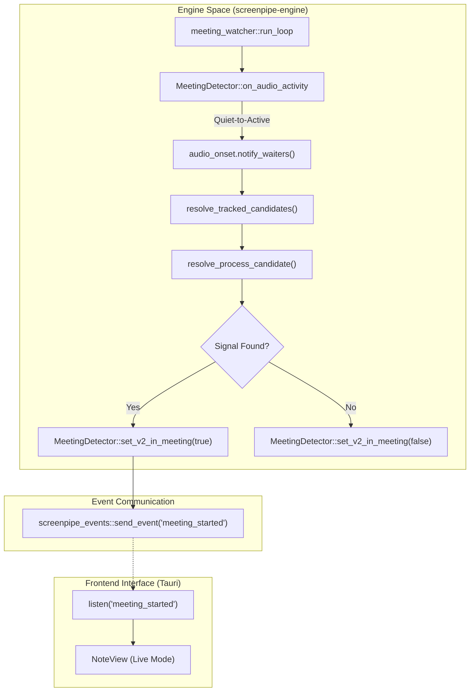
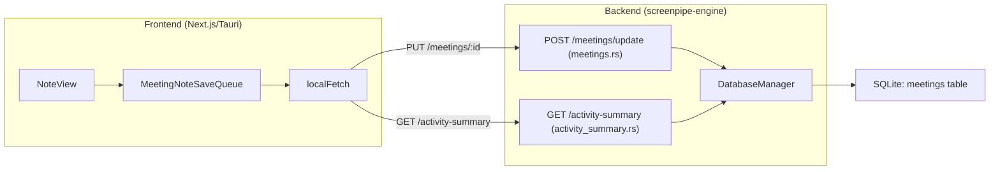

<!-- source: DeepWiki mcp.deepwiki.com · repo screenpipe/screenpipe · page 4.5 Meetings & Activity Intelligence · fetched 2026-10-26 -->

# Meetings & Activity Intelligence

Relevant source files

The following files were used as context for generating this wiki page:

- [apps/screenpipe-app-tauri/app/(main)/layout.tsx](apps/screenpipe-app-tauri/app/(main)/layout.tsx)
- [apps/screenpipe-app-tauri/components/activity-ledger.test.tsx](apps/screenpipe-app-tauri/components/activity-ledger.test.tsx)
- [apps/screenpipe-app-tauri/components/activity-ledger.tsx](apps/screenpipe-app-tauri/components/activity-ledger.tsx)
- [apps/screenpipe-app-tauri/components/meeting-calendar-reminder.tsx](apps/screenpipe-app-tauri/components/meeting-calendar-reminder.tsx)
- [apps/screenpipe-app-tauri/components/meeting-notes/calendar-nudge.tsx](apps/screenpipe-app-tauri/components/meeting-notes/calendar-nudge.tsx)
- [apps/screenpipe-app-tauri/components/meeting-notes/coming-up.test.tsx](apps/screenpipe-app-tauri/components/meeting-notes/coming-up.test.tsx)
- [apps/screenpipe-app-tauri/components/meeting-notes/coming-up.tsx](apps/screenpipe-app-tauri/components/meeting-notes/coming-up.tsx)
- [apps/screenpipe-app-tauri/components/meeting-notes/copy-meeting.test.ts](apps/screenpipe-app-tauri/components/meeting-notes/copy-meeting.test.ts)
- [apps/screenpipe-app-tauri/components/meeting-notes/copy-meeting.ts](apps/screenpipe-app-tauri/components/meeting-notes/copy-meeting.ts)
- [apps/screenpipe-app-tauri/components/meeting-notes/index.tsx](apps/screenpipe-app-tauri/components/meeting-notes/index.tsx)
- [apps/screenpipe-app-tauri/components/meeting-notes/list-view-recording.test.tsx](apps/screenpipe-app-tauri/components/meeting-notes/list-view-recording.test.tsx)
- [apps/screenpipe-app-tauri/components/meeting-notes/list-view.tsx](apps/screenpipe-app-tauri/components/meeting-notes/list-view.tsx)
- [apps/screenpipe-app-tauri/components/meeting-notes/meeting-summary-lifecycle.test.ts](apps/screenpipe-app-tauri/components/meeting-notes/meeting-summary-lifecycle.test.ts)
- [apps/screenpipe-app-tauri/components/meeting-notes/meeting-summary-lifecycle.ts](apps/screenpipe-app-tauri/components/meeting-notes/meeting-summary-lifecycle.ts)
- [apps/screenpipe-app-tauri/components/meeting-notes/meeting-summary-run.test.ts](apps/screenpipe-app-tauri/components/meeting-notes/meeting-summary-run.test.ts)
- [apps/screenpipe-app-tauri/components/meeting-notes/meeting-summary-run.ts](apps/screenpipe-app-tauri/components/meeting-notes/meeting-summary-run.ts)
- [apps/screenpipe-app-tauri/components/meeting-notes/meeting-summary-stream.test.ts](apps/screenpipe-app-tauri/components/meeting-notes/meeting-summary-stream.test.ts)
- [apps/screenpipe-app-tauri/components/meeting-notes/meeting-summary-stream.ts](apps/screenpipe-app-tauri/components/meeting-notes/meeting-summary-stream.ts)
- [apps/screenpipe-app-tauri/components/meeting-notes/meeting-workspace.test.tsx](apps/screenpipe-app-tauri/components/meeting-notes/meeting-workspace.test.tsx)
- [apps/screenpipe-app-tauri/components/meeting-notes/meeting-workspace.tsx](apps/screenpipe-app-tauri/components/meeting-notes/meeting-workspace.tsx)
- [apps/screenpipe-app-tauri/components/meeting-notes/note-view.tsx](apps/screenpipe-app-tauri/components/meeting-notes/note-view.tsx)
- [apps/screenpipe-app-tauri/components/meeting-notes/past-meetings.test.tsx](apps/screenpipe-app-tauri/components/meeting-notes/past-meetings.test.tsx)
- [apps/screenpipe-app-tauri/components/meeting-notes/past-meetings.tsx](apps/screenpipe-app-tauri/components/meeting-notes/past-meetings.tsx)
- [apps/screenpipe-app-tauri/components/meeting-notes/receipts.test.tsx](apps/screenpipe-app-tauri/components/meeting-notes/receipts.test.tsx)
- [apps/screenpipe-app-tauri/components/meeting-notes/receipts.tsx](apps/screenpipe-app-tauri/components/meeting-notes/receipts.tsx)
- [apps/screenpipe-app-tauri/components/meeting-notes/replay-audio.test.tsx](apps/screenpipe-app-tauri/components/meeting-notes/replay-audio.test.tsx)
- [apps/screenpipe-app-tauri/components/meeting-notes/replay-audio.tsx](apps/screenpipe-app-tauri/components/meeting-notes/replay-audio.tsx)
- [apps/screenpipe-app-tauri/components/meeting-notes/replay-strip.test.tsx](apps/screenpipe-app-tauri/components/meeting-notes/replay-strip.test.tsx)
- [apps/screenpipe-app-tauri/components/meeting-notes/replay-strip.tsx](apps/screenpipe-app-tauri/components/meeting-notes/replay-strip.tsx)
- [apps/screenpipe-app-tauri/components/meeting-notes/transcript-panel-performance.test.tsx](apps/screenpipe-app-tauri/components/meeting-notes/transcript-panel-performance.test.tsx)
- [apps/screenpipe-app-tauri/components/meeting-notes/transcript-panel.tsx](apps/screenpipe-app-tauri/components/meeting-notes/transcript-panel.tsx)
- [apps/screenpipe-app-tauri/components/rewind/timeline/daily-summary.test.tsx](apps/screenpipe-app-tauri/components/rewind/timeline/daily-summary.test.tsx)
- [apps/screenpipe-app-tauri/components/rewind/timeline/daily-summary.tsx](apps/screenpipe-app-tauri/components/rewind/timeline/daily-summary.tsx)
- [apps/screenpipe-app-tauri/components/settings/__tests__/notifications-settings.reminders.test.tsx](apps/screenpipe-app-tauri/components/settings/__tests__/notifications-settings.reminders.test.tsx)
- [apps/screenpipe-app-tauri/components/settings/ai-settings.tsx](apps/screenpipe-app-tauri/components/settings/ai-settings.tsx)
- [apps/screenpipe-app-tauri/components/settings/apple-calendar-card.tsx](apps/screenpipe-app-tauri/components/settings/apple-calendar-card.tsx)
- [apps/screenpipe-app-tauri/components/settings/ics-calendar-card.tsx](apps/screenpipe-app-tauri/components/settings/ics-calendar-card.tsx)
- [apps/screenpipe-app-tauri/components/settings/notification-registry.ts](apps/screenpipe-app-tauri/components/settings/notification-registry.ts)
- [apps/screenpipe-app-tauri/components/settings/notifications-settings.tsx](apps/screenpipe-app-tauri/components/settings/notifications-settings.tsx)
- [apps/screenpipe-app-tauri/docs/assets/pr/activity-page-reliability.jpg](apps/screenpipe-app-tauri/docs/assets/pr/activity-page-reliability.jpg)
- [apps/screenpipe-app-tauri/e2e/specs/meeting-replay-player.spec.ts](apps/screenpipe-app-tauri/e2e/specs/meeting-replay-player.spec.ts)
- [apps/screenpipe-app-tauri/e2e/specs/meeting-workspace-tabs.spec.ts](apps/screenpipe-app-tauri/e2e/specs/meeting-workspace-tabs.spec.ts)
- [apps/screenpipe-app-tauri/e2e/specs/timeline-daily-summary.spec.ts](apps/screenpipe-app-tauri/e2e/specs/timeline-daily-summary.spec.ts)
- [apps/screenpipe-app-tauri/lib/calendar-nudge.test.tsx](apps/screenpipe-app-tauri/lib/calendar-nudge.test.tsx)
- [apps/screenpipe-app-tauri/lib/daily-summary-pi.test.ts](apps/screenpipe-app-tauri/lib/daily-summary-pi.test.ts)
- [apps/screenpipe-app-tauri/lib/daily-summary-pi.ts](apps/screenpipe-app-tauri/lib/daily-summary-pi.ts)
- [apps/screenpipe-app-tauri/lib/daily-summary-prompt-evals.test.ts](apps/screenpipe-app-tauri/lib/daily-summary-prompt-evals.test.ts)
- [apps/screenpipe-app-tauri/lib/daily-summary-prompt.ts](apps/screenpipe-app-tauri/lib/daily-summary-prompt.ts)
- [apps/screenpipe-app-tauri/lib/dev/browser-engine-mock.ts](apps/screenpipe-app-tauri/lib/dev/browser-engine-mock.ts)
- [apps/screenpipe-app-tauri/lib/events/types.ts](apps/screenpipe-app-tauri/lib/events/types.ts)
- [apps/screenpipe-app-tauri/lib/first-run/recent-activity.test.ts](apps/screenpipe-app-tauri/lib/first-run/recent-activity.test.ts)
- [apps/screenpipe-app-tauri/lib/first-run/recent-activity.ts](apps/screenpipe-app-tauri/lib/first-run/recent-activity.ts)
- [apps/screenpipe-app-tauri/lib/first-run/summarize-with-ai.session.test.ts](apps/screenpipe-app-tauri/lib/first-run/summarize-with-ai.session.test.ts)
- [apps/screenpipe-app-tauri/lib/first-run/summarize-with-ai.test.ts](apps/screenpipe-app-tauri/lib/first-run/summarize-with-ai.test.ts)
- [apps/screenpipe-app-tauri/lib/first-run/summarize-with-ai.ts](apps/screenpipe-app-tauri/lib/first-run/summarize-with-ai.ts)
- [apps/screenpipe-app-tauri/lib/utils/calendar.test.ts](apps/screenpipe-app-tauri/lib/utils/calendar.test.ts)
- [apps/screenpipe-app-tauri/lib/utils/calendar.ts](apps/screenpipe-app-tauri/lib/utils/calendar.ts)
- [apps/screenpipe-app-tauri/lib/utils/generate-title-with-preset.ts](apps/screenpipe-app-tauri/lib/utils/generate-title-with-preset.ts)
- [apps/screenpipe-app-tauri/lib/utils/meeting-context.test.ts](apps/screenpipe-app-tauri/lib/utils/meeting-context.test.ts)
- [apps/screenpipe-app-tauri/lib/utils/meeting-context.ts](apps/screenpipe-app-tauri/lib/utils/meeting-context.ts)
- [apps/screenpipe-app-tauri/scripts/eval-daily-summary-prompt.ts](apps/screenpipe-app-tauri/scripts/eval-daily-summary-prompt.ts)
- [apps/screenpipe-app-tauri/src-tauri/src/activity_history.rs](apps/screenpipe-app-tauri/src-tauri/src/activity_history.rs)
- [apps/screenpipe-app-tauri/src-tauri/src/calendar.rs](apps/screenpipe-app-tauri/src-tauri/src/calendar.rs)
- [apps/screenpipe-app-tauri/src-tauri/src/calendar/reminders.rs](apps/screenpipe-app-tauri/src-tauri/src/calendar/reminders.rs)
- [apps/screenpipe-app-tauri/src-tauri/src/calendar/reminders/tests.rs](apps/screenpipe-app-tauri/src-tauri/src/calendar/reminders/tests.rs)
- [apps/screenpipe-app-tauri/src-tauri/src/calendar/snapshots.rs](apps/screenpipe-app-tauri/src-tauri/src/calendar/snapshots.rs)
- [apps/screenpipe-app-tauri/src-tauri/src/google_calendar.rs](apps/screenpipe-app-tauri/src-tauri/src/google_calendar.rs)
- [apps/screenpipe-app-tauri/src-tauri/src/meeting_live_notes.rs](apps/screenpipe-app-tauri/src-tauri/src/meeting_live_notes.rs)
- [crates/screenpipe-audio/src/meeting_detector.rs](crates/screenpipe-audio/src/meeting_detector.rs)
- [crates/screenpipe-audio/src/meeting_processes.rs](crates/screenpipe-audio/src/meeting_processes.rs)
- [crates/screenpipe-connect/src/calendar.rs](crates/screenpipe-connect/src/calendar.rs)
- [crates/screenpipe-connect/src/ics_calendar.rs](crates/screenpipe-connect/src/ics_calendar.rs)
- [crates/screenpipe-connect/src/whatsapp/gateway.mjs](crates/screenpipe-connect/src/whatsapp/gateway.mjs)
- [crates/screenpipe-connect/src/whatsapp/mod.rs](crates/screenpipe-connect/src/whatsapp/mod.rs)
- [crates/screenpipe-core/assets/pipes/meeting-summary/pipe.md](crates/screenpipe-core/assets/pipes/meeting-summary/pipe.md)
- [crates/screenpipe-db/src/db/activity_ledger.rs](crates/screenpipe-db/src/db/activity_ledger.rs)
- [crates/screenpipe-engine/src/activity_ledger.rs](crates/screenpipe-engine/src/activity_ledger.rs)
- [crates/screenpipe-engine/src/cli/connection.rs](crates/screenpipe-engine/src/cli/connection.rs)
- [crates/screenpipe-engine/src/meeting_watcher/audio_process/events.rs](crates/screenpipe-engine/src/meeting_watcher/audio_process/events.rs)
- [crates/screenpipe-engine/src/meeting_watcher/audio_process/lifecycle.rs](crates/screenpipe-engine/src/meeting_watcher/audio_process/lifecycle.rs)
- [crates/screenpipe-engine/src/meeting_watcher/audio_process/macos.rs](crates/screenpipe-engine/src/meeting_watcher/audio_process/macos.rs)
- [crates/screenpipe-engine/src/meeting_watcher/audio_process/mod.rs](crates/screenpipe-engine/src/meeting_watcher/audio_process/mod.rs)
- [crates/screenpipe-engine/src/meeting_watcher/audio_process/model.rs](crates/screenpipe-engine/src/meeting_watcher/audio_process/model.rs)
- [crates/screenpipe-engine/src/meeting_watcher/audio_process/resolve.rs](crates/screenpipe-engine/src/meeting_watcher/audio_process/resolve.rs)
- [crates/screenpipe-engine/src/meeting_watcher/audio_process/state.rs](crates/screenpipe-engine/src/meeting_watcher/audio_process/state.rs)
- [crates/screenpipe-engine/src/meeting_watcher/audio_process/suppress.rs](crates/screenpipe-engine/src/meeting_watcher/audio_process/suppress.rs)
- [crates/screenpipe-engine/src/meeting_watcher/audio_process/tests.rs](crates/screenpipe-engine/src/meeting_watcher/audio_process/tests.rs)
- [crates/screenpipe-engine/src/meeting_watcher/mod.rs](crates/screenpipe-engine/src/meeting_watcher/mod.rs)
- [crates/screenpipe-engine/src/meeting_watcher/shared/calendar.rs](crates/screenpipe-engine/src/meeting_watcher/shared/calendar.rs)
- [crates/screenpipe-engine/src/meeting_watcher/shared/ignore.rs](crates/screenpipe-engine/src/meeting_watcher/shared/ignore.rs)
- [crates/screenpipe-engine/src/meeting_watcher/shared/mod.rs](crates/screenpipe-engine/src/meeting_watcher/shared/mod.rs)
- [crates/screenpipe-engine/src/meeting_watcher/shared/profiles.rs](crates/screenpipe-engine/src/meeting_watcher/shared/profiles.rs)
- [crates/screenpipe-engine/src/meeting_watcher/shared/signal_match.rs](crates/screenpipe-engine/src/meeting_watcher/shared/signal_match.rs)
- [crates/screenpipe-engine/src/meeting_watcher/shared/telemetry.rs](crates/screenpipe-engine/src/meeting_watcher/shared/telemetry.rs)
- [crates/screenpipe-engine/src/meeting_watcher/ui_scan/lifecycle.rs](crates/screenpipe-engine/src/meeting_watcher/ui_scan/lifecycle.rs)
- [crates/screenpipe-engine/src/meeting_watcher/ui_scan/macos.rs](crates/screenpipe-engine/src/meeting_watcher/ui_scan/macos.rs)
- [crates/screenpipe-engine/src/meeting_watcher/ui_scan/mod.rs](crates/screenpipe-engine/src/meeting_watcher/ui_scan/mod.rs)
- [crates/screenpipe-engine/src/meeting_watcher/ui_scan/tests.rs](crates/screenpipe-engine/src/meeting_watcher/ui_scan/tests.rs)
- [crates/screenpipe-engine/src/meeting_watcher/ui_scan/windows.rs](crates/screenpipe-engine/src/meeting_watcher/ui_scan/windows.rs)
- [crates/screenpipe-engine/src/piggyback_telemetry.rs](crates/screenpipe-engine/src/piggyback_telemetry.rs)
- [crates/screenpipe-engine/src/routes/activity_ledger.rs](crates/screenpipe-engine/src/routes/activity_ledger.rs)
- [crates/screenpipe-engine/src/routes/activity_summary.rs](crates/screenpipe-engine/src/routes/activity_summary.rs)
- [crates/screenpipe-engine/src/routes/activity_summary_hybrid_tests.rs](crates/screenpipe-engine/src/routes/activity_summary_hybrid_tests.rs)
- [crates/screenpipe-engine/src/routes/meeting_summary_status.rs](crates/screenpipe-engine/src/routes/meeting_summary_status.rs)
- [crates/screenpipe-engine/src/routes/meetings.rs](crates/screenpipe-engine/src/routes/meetings.rs)
- [crates/screenpipe-engine/tests/fixtures/slack-missing-browser-diagnostic.txt](crates/screenpipe-engine/tests/fixtures/slack-missing-browser-diagnostic.txt)
- [crates/screenpipe-screen/src/browser_utils/macos.rs](crates/screenpipe-screen/src/browser_utils/macos.rs)
- [crates/screenpipe-screen/src/browser_utils/mod.rs](crates/screenpipe-screen/src/browser_utils/mod.rs)
- [docs/images/meeting-workspace-responsive.jpg](docs/images/meeting-workspace-responsive.jpg)
- [docs/pr-assets/meeting-receipt-chat/after-dark.png](docs/pr-assets/meeting-receipt-chat/after-dark.png)
- [docs/pr-assets/meeting-receipt-chat/after-light.png](docs/pr-assets/meeting-receipt-chat/after-light.png)

Screenpipe provides a comprehensive intelligence layer for meetings and daily activities. This system automatically detects when a user is in a call, facilitates real-time note-taking, integrates with local calendars, and generates structured summaries of user activity.

## Meeting Detection Engine

The meeting detection system uses a multi-modal approach, combining audio activity signals with process tracking and UI-element scanning.

### Architecture and Signal Philosophy

The engine identifies meetings by monitoring both native applications (Zoom, Teams, Slack) and browser-based calls (Google Meet).
- **`MeetingDetector`**: A lightweight state holder in the audio pipeline that tracks audio activity timestamps (`last_audio_activity_ms`) and provides flags like `is_in_meeting()` to gate expensive transcription or scanning tasks [crates/screenpipe-audio/src/meeting_detector.rs:67-90]().
- **`audio_onset`**: A `Notify` mechanism that fires on quiet-to-active transitions (quiet defined by `AUDIO_RECENCY_WINDOW_MS` of 45s), allowing the detection loop to wake immediately [crates/screenpipe-audio/src/meeting_detector.rs:17-22](), [crates/screenpipe-audio/src/meeting_detector.rs:105-105]().
- **`resolve_meeting_status_from`**: An Axum route helper that queries the database and manual meeting state to determine if a meeting is currently active [crates/screenpipe-engine/src/routes/meetings.rs:180-212]().

### Candidate Resolution
The system attributes audio-input processes to meeting platforms using several strategies:
- **Native Matching**: Mapping bundle IDs (macOS) or executable names (Windows) to known platforms like Zoom or Slack [crates/screenpipe-engine/src/meeting_watcher/audio_process/tests.rs:116-134]().
- **Browser Evidence**: Correlating mic-holding browser processes with active-tab URLs or window titles (e.g., matching `meet.google.com` or Google Meet's `xxx-yyyy-zzz` code shape) [crates/screenpipe-engine/src/meeting_watcher/audio_process/resolve.rs:131-171]().
- **AX Resolution**: Walking the accessibility tree to find "leave" or "mute" buttons when URL evidence is missing [crates/screenpipe-engine/src/meeting_watcher/audio_process/resolve.rs:42-56]().

### Detection Flow

Sources: [crates/screenpipe-audio/src/meeting_detector.rs:151-165](), [crates/screenpipe-engine/src/meeting_watcher/audio_process/resolve.rs:8-14](), [crates/screenpipe-engine/src/routes/meetings.rs:180-212](), [apps/screenpipe-app-tauri/components/meeting-notes/note-view.tsx:102-103]()

## Meeting Notes & Calendar Integration

The frontend provides a dedicated interface for managing meetings, combining historical records with upcoming calendar events.

### Meeting Notes UI
The `NoteView` component serves as the primary hub for meeting intelligence [apps/screenpipe-app-tauri/components/meeting-notes/note-view.tsx:153-169](). It features:
- **`NoteEditor`**: A focused editor supporting real-time autosave via `MeetingNoteSaveQueue` with an 800ms debounce [apps/screenpipe-app-tauri/components/meeting-notes/note-view.tsx:88-105]().
- **Drag-and-Drop**: Supports dropping images directly into notes. Since Tauri delivers file drops at the webview level, the component performs a hit-test against the note's bounding box using `rootRef` and `devicePixelRatio` [apps/screenpipe-app-tauri/components/meeting-notes/note-view.tsx:208-217]().
- **`TranscriptPanel`**: Displays real-time and historical transcripts, grouping consecutive segments by speaker [apps/screenpipe-app-tauri/components/meeting-notes/transcript-panel.tsx:40-50]().

### Calendar & Enrichment
Screenpipe integrates with local calendars to pre-populate meeting metadata.
- **`findOverlappingEvent`**: Matches the meeting time range against `CalendarEvent` data to automatically fill in titles and attendees [apps/screenpipe-app-tauri/lib/utils/calendar.ts:80-83]().
- **URL Extraction**: Automatically parses meeting links (Zoom, Meet, Teams) from location and description fields using `calendarEventMeetingLink` [apps/screenpipe-app-tauri/lib/utils/calendar.ts:79-82]().

### Data Flow for Meeting Management

Sources: [apps/screenpipe-app-tauri/components/meeting-notes/note-view.tsx:98-103](), [crates/screenpipe-engine/src/routes/meetings.rs:26-33](), [apps/screenpipe-app-tauri/lib/utils/meeting-context.ts:218-225]()

## Live Streaming & Audio Intelligence

The `start_meeting_streaming_loop` coordinates real-time transcription during meetings [crates/screenpipe-audio/src/meeting_streaming/controller.rs:76-82]().

### Streaming Lifecycle
- **`ActiveMeetingStream`**: Tracks the state of an ongoing meeting, including `audio_frames_seen` and `voiced_audio_seen` to suppress false-positive "stall" notifications if the room is silent [crates/screenpipe-audio/src/meeting_streaming/controller.rs:47-68]().
- **Stall Detection**: If no transcripts flow for 60 seconds (`STALL_NOTIFY_THRESHOLD`) despite voiced audio being detected, the system fires a notification [crates/screenpipe-audio/src/meeting_streaming/controller.rs:44-45]().
- **Background Suppression**: When active, the streaming loop can set `audio_tap.set_background_suppressed(true)` to prioritize real-time resources [crates/screenpipe-audio/src/meeting_streaming/controller.rs:86-88]().

### Speaker Identification & Grouping
The `groupConsecutiveSpeakerTurns` function collapses raw audio chunks into readable turns. Consecutive chunks from the same speaker within a 10-second (`MAX_GAP_MS`) window are merged to prevent single-word lines from drowning AI prompts [apps/screenpipe-app-tauri/lib/utils/meeting-context.ts:141-167]().

## Activity Intelligence & Summarization

Screenpipe generates high-level summaries by bundling multimodal activity data.

### Activity Context Bundling
The `fetchActivitySummary` function aggregates data for a meeting's time range [apps/screenpipe-app-tauri/lib/utils/meeting-context.ts:218-225]():
- **`AppUsage`**: Tracks application focus time and frame counts [apps/screenpipe-app-tauri/lib/utils/meeting-context.ts:10-16]().
- **`EditedFile`**: Captures file paths from editors via AXDocument (macOS) [apps/screenpipe-app-tauri/lib/utils/meeting-context.ts:190-196]().
- **`WindowActivity`**: Details specific window names and browser URLs visited during the session [apps/screenpipe-app-tauri/lib/utils/meeting-context.ts:18-24]().

### Activity Ledger
The `ActivityLedger` component [apps/screenpipe-app-tauri/components/activity-ledger.tsx:193-193]() provides a UI for reviewing past activity. It allows users to select a time range (e.g., "Today", "Last 24 hours", "Last 7 days", or custom) and view a summary of their activity within that period [apps/screenpipe-app-tauri/components/activity-ledger.tsx:189-209]().
- **`ActivityHistoryDocument`**: Represents the structured output of the activity summarization process, containing `ActivityHistoryEntry` objects [apps/screenpipe-app-tauri/components/activity-ledger.tsx:100-107]().
- **`generateActivityHistory`**: A Tauri command that triggers the backend to generate an activity history for a given time range [apps/screenpipe-app-tauri/components/activity-ledger.test.tsx:102-103](). This command uses the `PiCodingAgent` to interpret raw screen and audio data into coherent human activities [apps/screenpipe-app-tauri/src-tauri/src/activity_history.rs:41-44]().
- **`PersistedActivityHistory`**: The generated activity history is persisted locally to avoid re-computation [apps/screenpipe-app-tauri/src-tauri/src/activity_history.rs:75-78]().

### Daily/Activity Summaries
The system can generate daily summaries using the `runDailySummaryWithPi` function [apps/screenpipe-app-tauri/lib/daily-summary-pi.ts:1-1](). This leverages the `PiCodingAgent` to create a narrative of the user's day. The `Meeting Summary` pipe [crates/screenpipe-core/assets/pipes/meeting-summary/pipe.md:1-1](), triggered by the `meeting_ended` event, automatically summarizes meetings and saves the summary back to the meeting record. This pipe uses a series of `curl` commands to fetch meeting details, transcript, accessibility data, parsed data, and OCR data from the local API [crates/screenpipe-core/assets/pipes/meeting-summary/pipe.md:47-81]().

### Shortcut Reminder Overlay
To improve user activation, Screenpipe includes a `ShortcutTracker` component that renders a "shortcut reminder" overlay [apps/screenpipe-app-tauri/app/(main)/layout.tsx:12-12](). This overlay is registered as a separate route (`/shortcut-reminder`) and handles focus recovery for the Tauri WKWebView on macOS to ensure keyboard shortcuts always trigger [apps/screenpipe-app-tauri/app/(main)/layout.tsx:41]().

| Feature | Implementation | Key Files |
| :--- | :--- | :--- |
| **Meeting Detection** | AX Tree, Audio Onset, Process Resolution | `meeting_detector.rs`, `resolve.rs`, `meetings.rs` |
| **Live Streaming** | Coordinator Loop, Deepgram/Whisper | `controller.rs`, `transcript-panel.tsx` |
| **Calendar Sync** | Local Calendar API, URL Parsing | `calendar.ts`, `note-view.tsx` |
| **Activity Bundle** | SQL Aggregation (App/Window/File) | `meeting-context.ts`, `activity_summary.rs` |
| **Speaker Grouping** | Temporal & Identity Merging | `meeting-context.ts`, `audio-transcript.tsx` |
| **Activity Ledger** | UI for historical activity review | `activity-ledger.tsx`, `activity_history.rs` |
| **Daily Summaries** | AI-driven summarization of daily activity | `daily-summary-pi.ts`, `pipe.md` |

Sources: [crates/screenpipe-audio/src/meeting_detector.rs:38-58](), [crates/screenpipe-audio/src/meeting_streaming/controller.rs:76-111](), [apps/screenpipe-app-tauri/lib/utils/meeting-context.ts:141-167](), [apps/screenpipe-app-tauri/components/meeting-notes/note-view.tsx:198-217](), [apps/screenpipe-app-tauri/app/(main)/layout.tsx:41](), [apps/screenpipe-app-tauri/components/activity-ledger.tsx:193-193](), [apps/screenpipe-app-tauri/src-tauri/src/activity_history.rs:41-44](), [apps/screenpipe-app-tauri/lib/daily-summary-pi.ts:1-1](), [crates/screenpipe-core/assets/pipes/meeting-summary/pipe.md:1-1]()

---

