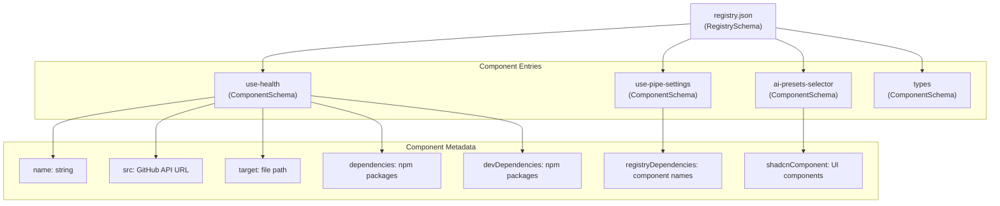
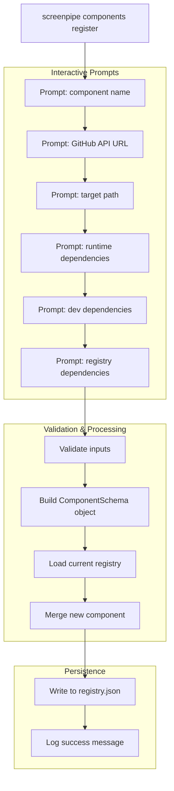
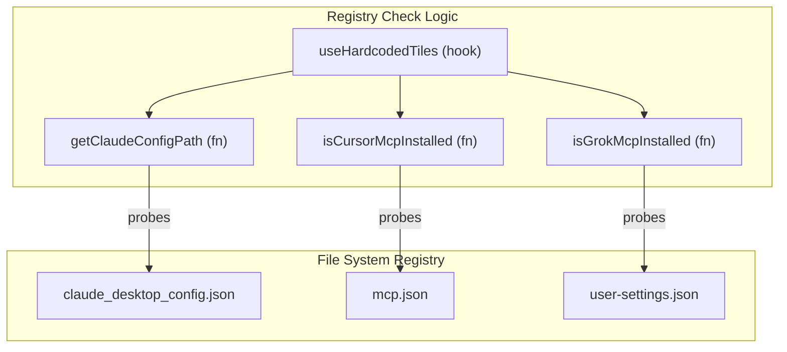
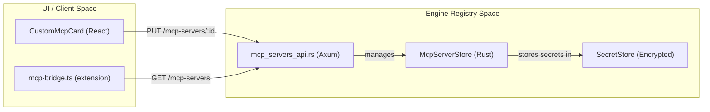

<!-- source: DeepWiki mcp.deepwiki.com · repo screenpipe/screenpipe · page 5.3 Component Registry · fetched 2026-10-26 -->

# Component Registry

<details>
<summary>Relevant source files</summary>

The following files were used as context for generating this wiki page:

- [apps/screenpipe-app-tauri/bun.lock](apps/screenpipe-app-tauri/bun.lock)
- [apps/screenpipe-app-tauri/components/settings/__tests__/ai-tools-card.test.tsx](apps/screenpipe-app-tauri/components/settings/__tests__/ai-tools-card.test.tsx)
- [apps/screenpipe-app-tauri/components/settings/ai-tools-card.tsx](apps/screenpipe-app-tauri/components/settings/ai-tools-card.tsx)
- [apps/screenpipe-app-tauri/e2e/helpers/app-launcher.ts](apps/screenpipe-app-tauri/e2e/helpers/app-launcher.ts)
- [apps/screenpipe-app-tauri/e2e/specs/onboarding-background-ai-tools.spec.ts](apps/screenpipe-app-tauri/e2e/specs/onboarding-background-ai-tools.spec.ts)
- [apps/screenpipe-app-tauri/lib/__tests__/ai-tools-mcp.test.ts](apps/screenpipe-app-tauri/lib/__tests__/ai-tools-mcp.test.ts)
- [apps/screenpipe-app-tauri/lib/ai-tools-mcp.ts](apps/screenpipe-app-tauri/lib/ai-tools-mcp.ts)
- [apps/screenpipe-app-tauri/package.json](apps/screenpipe-app-tauri/package.json)
- [apps/screenpipe-app-tauri/src-tauri/src/skills.rs](apps/screenpipe-app-tauri/src-tauri/src/skills.rs)
- [crates/screenpipe-engine/src/cli/agent.rs](crates/screenpipe-engine/src/cli/agent.rs)

</details>


The Component Registry is a reusable component system that allows pipes and desktop application features to share common functionality through a centralized registry. Components can include React hooks, utility functions, UI components, and TypeScript utilities. The registry enables developers to add pre-built components to their pipes using the `screenpipe components add` command, automatically resolving dependencies and installing required packages.

## Registry Structure

The component registry is stored as a JSON file. Each entry in the registry defines a component with its metadata, source location, installation target, and dependency graph.



**Sources:** [apps/screenpipe-app-tauri/src-tauri/capabilities/main.json:265-275](), [apps/screenpipe-app-tauri/src-tauri/gen/schemas/capabilities.json:1-1]()

## Component Schema

Each component in the registry follows a standardized schema with the following fields:

| Field | Type | Required | Description |
|-------|------|----------|-------------|
| `name` | string | Yes | Unique component identifier, used as the registry key |
| `src` | string | Yes | GitHub API URL for the source code |
| `target` | string | Yes | Relative path where the component should be installed in the pipe |
| `dependencies` | string[] | No | NPM runtime dependencies (e.g., `lodash`, `@screenpipe/browser`) |
| `devDependencies` | string[] | No | NPM development dependencies |
| `registryDependencies` | string[] | No | Other components from the registry that this component depends on |
| `shadcnComponent` | string[] | No | shadcn/ui components that should be installed alongside |

**Sources:** [apps/screenpipe-app-tauri/src-tauri/capabilities/main.json:265-280]()

## Register Command

The `register` command allows developers to add new components to the registry via `screenpipe components register`. It provides an interactive prompt-based workflow to collect metadata and update the registry.



**Sources:** [apps/screenpipe-app-tauri/src-tauri/capabilities/main.json:265-270]()

## Connection & Agent Registry

The application maintains a registry of "Hardcoded Tiles" and "Connections" to manage AI agents and third-party integrations. This system extends the component registry concept to external AI tools and MCP servers.

### AI Tool Detection and Connection

The `detectAiTools` function [apps/screenpipe-app-tauri/lib/ai-tools-mcp.ts:82-117]() identifies supported AI tools installed on the user's system by checking for specific configuration files or directories in the user's home directory. Once detected, the `connectAiToolTargets` function [apps/screenpipe-app-tauri/lib/ai-tools-mcp.ts:128-132]() can be used to install the necessary Screenpipe skills and MCP server configurations for these tools.

The `isToolConnected` function [apps/screenpipe-app-tauri/components/settings/ai-tools-card.tsx:94-117]() determines if a tool is connected by checking for both the MCP entry and the installation of relevant skills.

```mermaid
graph TD
    A[User's System] --> B{detectAiTools()};
    B --> C{Check for config files/dirs};
    C -- ".claude.json" --> D[Claude Code];
    C -- ".codex" --> E[Codex];
    C -- ".cursor" --> F[Cursor];
    C -- ".gemini" --> G[Gemini CLI];
    C -- ".openclaw" --> H[OpenClaw];
    C -- ".hermes" --> I[Hermes];
    C -- ".runner" --> J[Runner];
    C -- ".codeium/windsurf" --> K[Windsurf (Devin Desktop)];
    C -- "VS Code config" --> L[VS Code];
    C -- "Grok Bot detection" --> M[Grok Bot];

    D -- "isClaudeCodeMcpInstalled()" --> N{Connected?};
    E -- "isCodexMcpInstalled()" --> N;
    F -- "isCursorMcpInstalled()" --> N;
    G -- "isGeminiMcpInstalled()" --> N;
    H -- "isOpenclawMcpInstalled()" --> N;
    I -- "isHermesMcpInstalled()" --> N;
    J -- "isRunnerMcpInstalled()" --> N;
    K -- "isWindsurfMcpInstalled()" --> N;
    L -- "isVscodeMcpInstalled()" --> N;
    M -- "isGrokBotConnected()" --> N;

    N -- "true" --> O[Tool is connected];
    N -- "false" --> P[Tool is not connected];

    Q[connectAiToolTargets()] --> R[Install MCP config and skills];
    R --> S[AI Tool can use Screenpipe];

    style B fill:#f9f,stroke:#333,stroke-width:2px
    style N fill:#f9f,stroke:#333,stroke-width:2px
    style Q fill:#f9f,stroke:#333,stroke-width:2px
```
**Sources:**
- `detectAiTools`: [apps/screenpipe-app-tauri/lib/ai-tools-mcp.ts:82-117]()
- `isToolConnected`: [apps/screenpipe-app-tauri/components/settings/ai-tools-card.tsx:94-117]()
- `connectAiToolTargets`: [apps/screenpipe-app-tauri/lib/ai-tools-mcp.ts:128-132]()
- `CONNECT_ALL_TOOL_IDS`: [apps/screenpipe-app-tauri/lib/ai-tools-mcp.ts:44-56]()
- `CONNECT_ALL_TOOL_NAMES`: [apps/screenpipe-app-tauri/lib/ai-tools-mcp.ts:58-74]()

### Background AI Tool Setup

The `connect_detected_ai_tools_in_background` function [apps/screenpipe-app-tauri/src-tauri/src/skills.rs:174-182]() runs as a background task to automatically detect and connect supported AI tools. This process is designed to be non-blocking and resilient to temporary issues like API key unavailability. It respects user opt-out preferences stored in `ai_tool_auto_connect_opt_out_dir` [apps/screenpipe-app-tauri/src-tauri/src/skills.rs:51-52]().

```mermaid
graph TD
    A[App Startup] --> B{connect_detected_ai_tools_in_background()};
    B --> C{background_ai_tools_home()};
    C -- "Returns home directory" --> D{Read opt-out markers};
    D -- "ai_tool_auto_connect_opt_out_dir()" --> E[Opt-out directory];
    D --> F{wait_for_background_api_key()};
    F -- "API Key available" --> G{Detect AI Tools};
    G --> H{Filter out opted-out tools};
    H --> I[Connect remaining tools];
    I --> J[Install skills and MCP configs];
    J --> K[Log success/failure];
    F -- "API Key unavailable (retry)" --> F;
    C -- "No home directory" --> L[Skip setup];
```
**Sources:**
- `connect_detected_ai_tools_in_background`: [apps/screenpipe-app-tauri/src-tauri/src/skills.rs:174-182]()
- `background_ai_tools_home`: [apps/screenpipe-app-tauri/src-tauri/src/skills.rs:119-141]()
- `ai_tool_auto_connect_opt_out_dir`: [apps/screenpipe-app-tauri/src-tauri/src/skills.rs:51-52]()
- `set_ai_tool_auto_connect_opt_out`: [apps/screenpipe-app-tauri/src-tauri/src/skills.rs:105-117]()
- `AI_TOOL_AUTO_CONNECT_TARGETS`: [apps/screenpipe-app-tauri/src-tauri/src/skills.rs:40-42]()
- `maybe_prompt_connect_detected`: [crates/screenpipe-engine/src/cli/agent.rs:144-184]()

### MCP Command Building

The `buildMcpConfig` function [apps/screenpipe-app-tauri/lib/ai-tools-mcp.ts:150-174]() constructs the command and environment variables needed to launch the `screenpipe-mcp` server for an AI tool. It prioritizes using the bundled `bun` executable for performance and self-containment, falling back to `npx` if `bun` is not available. It also resolves the local API key for authentication.

```mermaid
graph TD
    A[buildMcpConfig(opts)] --> B{resolveLocalApiKeyForMcp()};
    B -- "API Key" --> C[Prepare environment variables];
    C --> D{opts.forceNpx?};
    D -- "Yes" --> E[Command: "npx", Args: ["-y", "screenpipe-mcp@latest"]];
    D -- "No" --> F{commands.bunCheck()};
    F -- "Bun available" --> G[Command: bun_path, Args: ["x", "screenpipe-mcp@latest"]];
    F -- "Bun not available" --> H[Warn and fallback to npx];
    H --> E;
    E --> I[Return McpCommand];
    G --> I;
```
**Sources:**
- `buildMcpConfig`: [apps/screenpipe-app-tauri/lib/ai-tools-mcp.ts:150-174]()
- `resolveLocalApiKeyForMcp`: [apps/screenpipe-app-tauri/lib/ai-tools-mcp.ts:128-143]()
- `commands.bunCheck`: [apps/screenpipe-app-tauri/lib/ai-tools-mcp.ts:163-166]()

### Connection Registry Schema
The `CONNECTION_CATEGORY_BY_ID` map serves as the single source of truth for grouping integrations [apps/screenpipe-app-tauri/lib/constants/connections.ts:20-140]().

| Category | Example IDs |
|----------|-------------|
| `Desktop` | `claude`, `cursor`, `warp`, `claude-code` |
| `AI` | `ollama`, `lmstudio`, `custom-mcp` |
| `Notes` | `obsidian`, `notion`, `logseq` |
| `Communication` | `slack`, `discord`, `whatsapp`, `telegram` |

### Hardcoded Tile Detection
The `useHardcodedTiles` hook acts as a dynamic registry that probes the local filesystem to detect installed AI agents and their MCP configurations [apps/screenpipe-app-tauri/lib/hooks/use-hardcoded-tiles.ts:108-170]().



**Sources:** [apps/screenpipe-app-tauri/lib/hooks/use-hardcoded-tiles.ts:21-39](), [apps/screenpipe-app-tauri/lib/hooks/use-hardcoded-tiles.ts:55-60](), [apps/screenpipe-app-tauri/lib/hooks/use-hardcoded-tiles.ts:102-106](), [apps/screenpipe-app-tauri/lib/constants/connections.ts:20-140]()

## MCP Server Registry

Screenpipe implements a specialized registry for user-supplied Model Context Protocol (MCP) servers. Unlike hardcoded integrations, these are dynamic instances stored in a local configuration file.

### Storage Model
- **Public Config:** Server ID, name, and URL are stored in `~/.screenpipe/mcp_servers.json` [crates/screenpipe-connect/src/mcp_servers.rs:13-16]().
- **Secret Store:** Sensitive data like header values and OAuth tokens are stored in the `SecretStore` under `mcp:{id}` [crates/screenpipe-connect/src/mcp_servers.rs:17-19]().

### Registry API
The `McpServersState` manages the registry through an HTTP API exposed by the engine [crates/screenpipe-engine/src/mcp_servers_api.rs:31-34]().

| Endpoint | Method | Role |
|----------|--------|------|
| `/mcp-servers` | `GET` | Lists all registered servers (no secrets) [crates/screenpipe-engine/src/mcp_servers_api.rs:120-134]() |
| `/mcp-servers/:id` | `PUT` | Creates or replaces a server entry [crates/screenpipe-engine/src/mcp_servers_api.rs:153-230]() |
| `/mcp-servers/:id` | `DELETE` | Removes a server from the registry [crates/screenpipe-engine/src/mcp_servers_api.rs:253-265]() |



**Sources:** [crates/screenpipe-connect/src/mcp_servers.rs:5-21](), [crates/screenpipe-engine/src/mcp_servers_api.rs:119-150](), [crates/screenpipe-engine/src/mcp_servers_api.rs:153-230]()

## Security & Capabilities

Registry operations and component interactions are governed by the Tauri capability system. The `main.json` capability file defines the allowed filesystem scopes for component installation and registry access.

- **FS Scopes:** Components and registries are restricted to `$HOME/.screenpipe`, `$APPDATA`, and specific application config directories like `.cursor`, `Claude`, or `Obsidian` [apps/screenpipe-app-tauri/src-tauri/capabilities/main.json:143-241]().
- **Shell Permissions:** Allows the UI to execute specific `screenpipe pipe` subcommands (list, download, enable, update, delete) as part of the registry management [apps/screenpipe-app-tauri/src-tauri/capabilities/main.json:265-300]().
- **Remote Scopes:** The registry can communicate with specific domains for updates and AI provider integrations, including `api.screenpipe.com` and `*.openai.com` [apps/screenpipe-app-tauri/src-tauri/capabilities/main.json:9-17]().

**Sources:** [apps/screenpipe-app-tauri/src-tauri/capabilities/main.json:9-17](), [apps/screenpipe-app-tauri/src-tauri/capabilities/main.json:143-241](), [apps/screenpipe-app-tauri/src-tauri/capabilities/main.json:265-300]()

---

