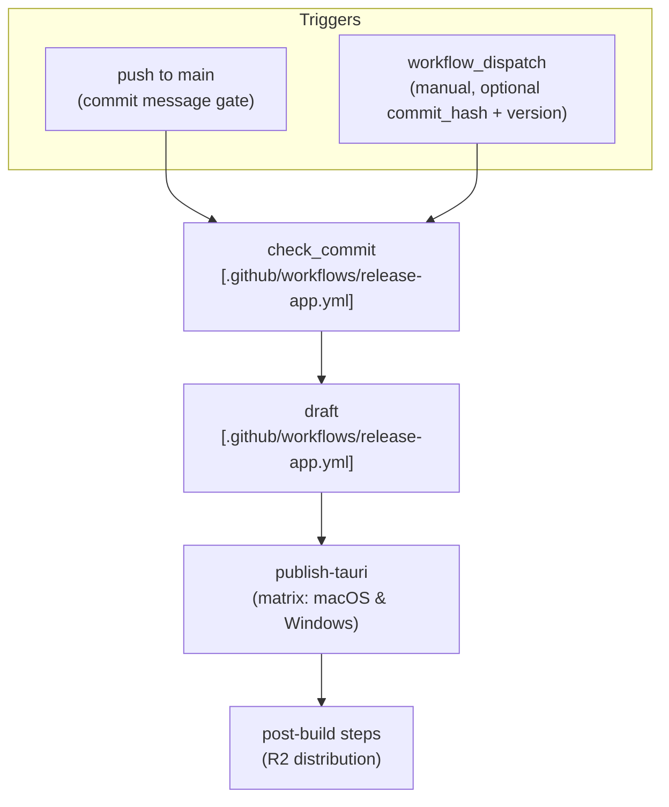
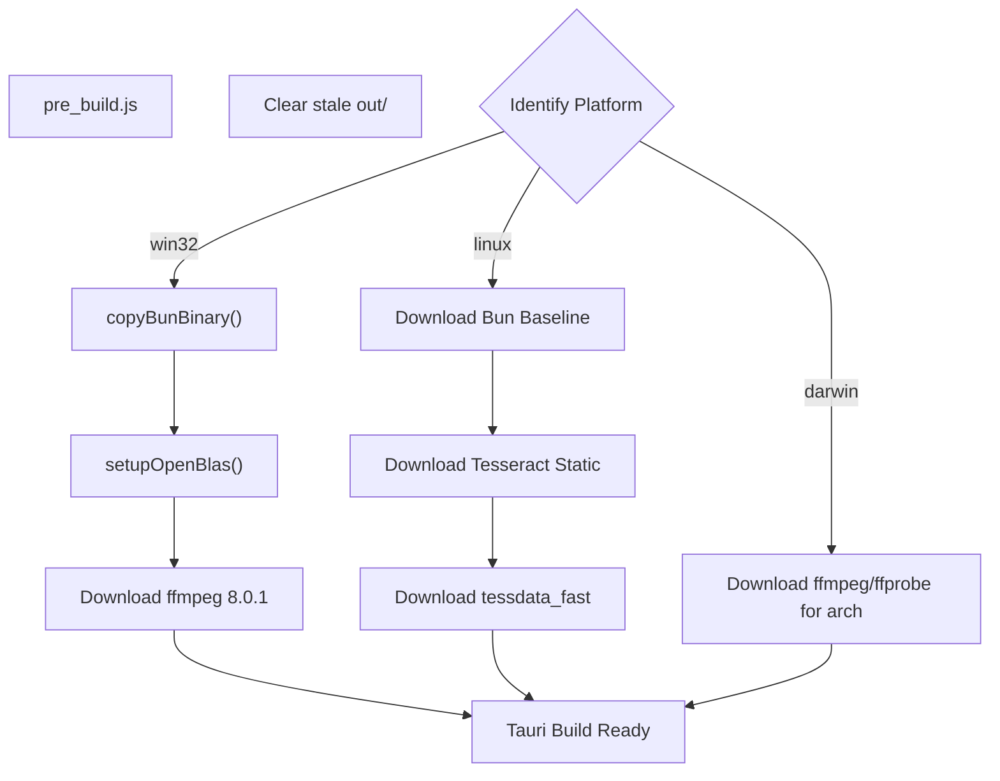
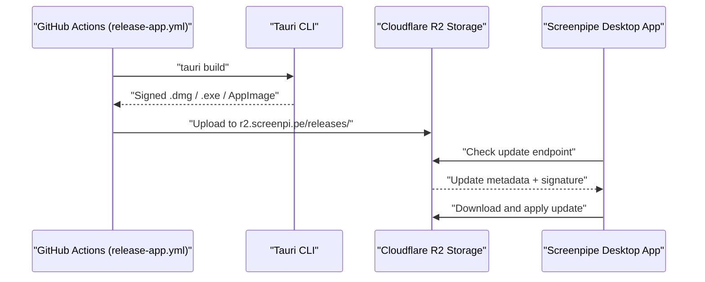

<!-- source: DeepWiki mcp.deepwiki.com · repo screenpipe/screenpipe · page 6.1 Desktop App Release · fetched 2026-10-26 -->

# Desktop App Release

Relevant source files

The following files were used as context for generating this wiki page:

- [.github/scripts/assert_windows_audio_rms.ps1](.github/scripts/assert_windows_audio_rms.ps1)
- [.github/scripts/release-workflows.test.ts](.github/scripts/release-workflows.test.ts)
- [.github/scripts/setup-ninja-windows.ps1](.github/scripts/setup-ninja-windows.ps1)
- [.github/workflows/benchmark.yml](.github/workflows/benchmark.yml)
- [.github/workflows/ci.yml](.github/workflows/ci.yml)
- [.github/workflows/e2e-test.yml](.github/workflows/e2e-test.yml)
- [.github/workflows/release-app.yml](.github/workflows/release-app.yml)
- [.github/workflows/release-cli.yml](.github/workflows/release-cli.yml)
- [.github/workflows/release-enterprise.yml](.github/workflows/release-enterprise.yml)
- [.github/workflows/style.yml](.github/workflows/style.yml)
- [.github/workflows/windows-integration-test.yml](.github/workflows/windows-integration-test.yml)
- [apps/screenpipe-app-tauri/src-tauri/tauri.beta.conf.json](apps/screenpipe-app-tauri/src-tauri/tauri.beta.conf.json)
- [apps/screenpipe-app-tauri/src-tauri/tauri.conf.json](apps/screenpipe-app-tauri/src-tauri/tauri.conf.json)
- [apps/screenpipe-app-tauri/src-tauri/tauri.enterprise.conf.json](apps/screenpipe-app-tauri/src-tauri/tauri.enterprise.conf.json)
- [apps/screenpipe-app-tauri/src-tauri/tauri.linux.conf.json](apps/screenpipe-app-tauri/src-tauri/tauri.linux.conf.json)
- [apps/screenpipe-app-tauri/src-tauri/tauri.macos.conf.json](apps/screenpipe-app-tauri/src-tauri/tauri.macos.conf.json)
- [apps/screenpipe-app-tauri/src-tauri/tauri.prod.conf.json](apps/screenpipe-app-tauri/src-tauri/tauri.prod.conf.json)
- [apps/screenpipe-app-tauri/src-tauri/tauri.windows.conf.json](apps/screenpipe-app-tauri/src-tauri/tauri.windows.conf.json)

This page documents the GitHub Actions workflows and build configuration that produce distributable desktop application artifacts for Screenpipe. It covers the release gate logic, platform build matrix, dependency setup, macOS code signing and notarization, Windows packaging, and distribution via Cloudflare R2.

---

## Workflow Overview

The primary release workflow is defined in `.github/workflows/release-app.yml`. It manages the end-to-end process from source code to signed binaries and distribution.

**Workflow Diagram: release-app.yml job graph**

Sources: [.github/workflows/release-app.yml:4-33]()

---

## Release Gating & Runner Selection

The `check_commit` job determines whether a release build should proceed and identifies available runners.

### Commit Message Gate
The workflow parses the first line of the commit message to set release flags using `grep`:

| Commit prefix | Output Flag |
|---|---|
| `Bump app` or `release-app` | `should_release=true` |
| `release-app-publish` | `should_publish=true` |
| `release-app-skip-test` | `should_test=false` |

Sources: [.github/workflows/release-app.yml:95-123]()

### Runner Selection
Runner selection is dynamic, prioritizing high-performance runners for specialized hardware.

- **macOS ARM Runner**: Defaults to `screenpipe-release-macos` (self-hosted) or `macos-latest` (GitHub-hosted) if `force_github_runners` is true. [`.github/workflows/release-app.yml:138-139`]()
- **macOS x64 Runner**: Defaults to `screenpipe-release-macos` (self-hosted) or `macos-26` (GitHub-hosted) if `force_github_runners` is true. [`.github/workflows/release-app.yml:139-140`]()
- **Windows Runner**: Defaults to `screenpipe-release-windows` (self-hosted) or `windows-2022` (GitHub-hosted) if `force_github_runners` is true. [`.github/workflows/release-app.yml:140-141`]()
- **Windows ARM Runner**: Defaults to `screenpipe-release-windows-arm64` (self-hosted) or `windows-11-arm` (GitHub-hosted) if `force_github_runners` is true. [`.github/workflows/release-app.yml:141-142`]()
- **Linux Runner**: Defaults to `screenpipe-release-linux` (self-hosted) or `ubuntu-24.04` (GitHub-hosted) if `force_github_runners` is true. [`.github/workflows/release-app.yml:142-143`]()

Sources: [.github/workflows/release-app.yml:125-144]()

---

## Build Matrix & Cargo Features

The `publish-tauri` job uses a strategy matrix to build for multiple architectures with specific hardware optimizations.

| Target Triple | Runner | Features |
|---|---|---|
| `aarch64-apple-darwin` | `macos-latest` (or self-hosted) | `metal, parakeet-mlx, rfdetr-mlx, redact-onnx-coreml` |
| `x86_64-apple-darwin` | `macos-latest` (or self-hosted) | `metal, redact-onnx-coreml` |
| `x86_64-pc-windows-msvc` | `windows-2022` (or self-hosted) | (Standard production features) |
| `aarch64-pc-windows-msvc` | `windows-11-arm` (or self-hosted) | (Standard production features) |
| `x86_64-unknown-linux-gnu` | `ubuntu-latest` (or self-hosted) | `redact-onnx-ort` |

### Feature Flags
- `metal`: Enables Apple GPU acceleration for screen capture and processing. [`.github/workflows/release-cli.yml:146-149`]()
- `parakeet-mlx`: Optimized transcription for Apple Silicon using the MLX framework. [`.github/workflows/release-cli.yml:146-149`]()
- `rfdetr-mlx`: Real-time object/UI detection optimized for Apple Silicon. [`.github/workflows/release-cli.yml:146-149`]()
- `redact-onnx-coreml`: Hardware-accelerated PII redaction using CoreML. [`.github/workflows/release-cli.yml:146-149`]()
- `redact-onnx-ort`: ONNX Runtime for redaction on Linux.

Sources: [.github/workflows/release-app.yml:163-176](), [.github/workflows/release-cli.yml:146-149]()

---

## Pre-Build Infrastructure

Before `tauri build` executes, the workflow runs `scripts/pre_build.js` using Bun to stage native dependencies and clear stale artifacts.

### Native Dependency Staging
The `pre_build.js` script handles platform-specific binary requirements:
- **Cleanup**: Removes any stale `out/` directory to ensure the app doesn't ship a stale UI if `next build` fails.
- **Windows**: Downloads ONNX Runtime (v1.24.2) and stages it for the build system. [`.github/workflows/e2e-test.yml:179-182`]()
- **Bun Sidecar**: Copies the `bun` binary to `src-tauri` with a target triple suffix (e.g., `bun-x86_64-pc-windows-msvc.exe`) so Tauri can bundle it as a sidecar.
- **Linux**: Downloads a baseline `bun` variant for broader glibc compatibility and stages English Tesseract language data (`eng.traineddata`) for the AppImage.
- **OpenBLAS**: Sets up OpenBLAS for Windows, downloading from `OpenMathLib/OpenBLAS` and flattening the directory structure for MSVC linking.

**Logic Flow: pre_build.js execution**

Sources: [apps/screenpipe-app-tauri/scripts/pre_build.js:13-186](), [apps/screenpipe-app-tauri/scripts/setup_openblas.js:31-91](), [.github/workflows/e2e-test.yml:179-182]()

---

## macOS Notarization & Signing

macOS builds require a hardened runtime and notarization to bypass Gatekeeper.

**macOS Release Flow:**
1. **Keychain Setup**: Creates a temporary keychain on the runner to import the `APPLE_CERTIFICATE`. [`.github/workflows/release-cli.yml:164-168`]()
2. **Codesign**: Signs the binary with `--options runtime` using the `APPLE_SIGNING_IDENTITY`. [`.github/workflows/release-cli.yml:169-171`]()
3. **Notarization**: Submits the binary (wrapped in a zip for `notarytool`) using Apple ID credentials and `xcrun notarytool submit`. [`.github/workflows/release-cli.yml:176-187`]()

Sources: [.github/workflows/release-cli.yml:146-188]()

---

## Windows Packaging & Signing

Windows releases are packaged as installers and signed to ensure authenticity.

### Code Signing and Driver Installation
- **Scream Driver**: For E2E and integration testing, the workflow signs and installs the Scream virtual audio driver to simulate audio capture. This involves generating a temporary certificate and using `signtool sign`. [`.github/workflows/e2e-test.yml:99-108`](), [`.github/workflows/windows-integration-test.yml:160-166`]()
- **Audio Regression Tests**: Uses `assert_windows_audio_rms.ps1` to verify audio capture by generating a sine wave stimulus and polling the `/health` endpoint for RMS levels. [`.github/scripts/assert_windows_audio_rms.ps1:100-212`]()

### Enterprise Releases
The `release-enterprise.yml` workflow builds artifacts with specific configurations:
- **Intune Packaging**: Creates `.intunewin` files for enterprise MDM deployment. [`.github/workflows/release-enterprise.yml:7`]()
- **Path Length Workarounds**: To avoid `MAX_PATH` limitations on Windows, the workflow creates a directory junction `C:\t` linked to the build target. [`.github/workflows/release-enterprise.yml:167-170`]()

Sources: [.github/workflows/release-enterprise.yml:7-47](), [.github/workflows/e2e-test.yml:99-108](), [.github/scripts/assert_windows_audio_rms.ps1:100-212](), [.github/workflows/windows-integration-test.yml:160-166]()

---

## Linux AppImage Repacking

Linux distribution utilizes a specialized repacking process to ensure portability across different distributions (e.g., Debian, Ubuntu).

### Dependency Bundling
The `bundle-appimage-runtime-deps.sh` script is used to post-process the AppImage `squashfs-root`:
- **Library Extraction**: Uses `ldd` to identify dynamic dependencies of `ffmpeg`, `tesseract`, and the main binary.
- **Runtime Isolation**: Copies identified libraries (excluding core system libs like `libc`) into `usr/lib` within the AppImage.
- **RPATH Patching**: Uses `patchelf` to set the `RUNPATH` to `$ORIGIN/../lib`, ensuring the bundled libraries are preferred at runtime.
- **OpenBLAS Integration**: Explicitly bundles `libopenblas.so.0` as it is often missed by standard deployment tools when pulled via BLAS shims.

Sources: [.github/workflows/linux-appimage-smoke.yml:172-197](), [.github/scripts/linux/bundle-appimage-runtime-deps.sh:1-143]()

---

## Tauri Configuration Variants

Screenpipe uses multiple Tauri configuration files to manage different build targets and environments. These files are located in `apps/screenpipe-app-tauri/src-tauri/`.

- **`tauri.conf.json`**: The default development configuration. It defines the `productName` as "screenpipe" and `identifier` as "screenpi.pe". The `devUrl` is set to `http://localhost:1420`. Updater endpoints are empty, and icons are sourced from `icons/dev/`. [apps/screenpipe-app-tauri/src-tauri/tauri.conf.json:1-127]()
- **`tauri.prod.conf.json`**: The production configuration for the standard consumer application. It also uses "screenpipe" as `productName` and "screenpi.pe" as `identifier`. It enables updater artifacts and specifies the updater endpoint `https://screenpipe.com/api/app-update/stable/{{target}}-{{arch}}/{{current_version}}`. [apps/screenpipe-app-tauri/src-tauri/tauri.prod.conf.json:1-137]()
- **`tauri.beta.conf.json`**: Similar to `tauri.prod.conf.json` but targets a beta updater endpoint: `https://screenpipe.com/api/app-update/beta/{{target}}-{{arch}}/{{current_version}}`.
- **`tauri.enterprise.conf.json`**: Configuration for the enterprise version. It sets `productName` to "screenpipe enterprise" and `identifier` to "screenpi.pe.enterprise". The updater endpoint points to `https://screenpipe.com/api/app-update/enterprise/{{target}}-{{arch}}/{{current_version}}`. For Windows, it specifies `installMode: "perMachine"` for NSIS installers and `webviewInstallMode: "skip"`. [apps/screenpipe-app-tauri/src-tauri/tauri.enterprise.conf.json:1-147]()
- **`tauri.macos.conf.json`**: Contains macOS-specific bundle configurations, such as `entitlements` and `hardenedRuntime`.
- **`tauri.windows.conf.json`**: Contains Windows-specific bundle configurations, including NSIS installer settings like `headerImage`, `sidebarImage`, `installerIcon`, and `installerHooks`. It also defines resources to be bundled, such as `ffmpeg`, `onnxruntime`, `VulkanRT-License.txt`, `wer`, `openblas`, and `vcredist` DLLs. [apps/screenpipe-app-tauri/src-tauri/tauri.windows.conf.json:1-32]()
- **`tauri.linux.conf.json`**: Contains Linux-specific bundle configurations, including `deb` and `appimage` settings.

These configurations allow for tailored builds for different platforms, release channels (stable, beta, enterprise), and development environments.

Sources: [apps/screenpipe-app-tauri/src-tauri/tauri.conf.json:1-127](), [apps/screenpipe-app-tauri/src-tauri/tauri.prod.conf.json:1-137](), [apps/screenpipe-app-tauri/src-tauri/tauri.beta.conf.json](), [apps/screenpipe-app-tauri/src-tauri/tauri.enterprise.conf.json:1-147](), [apps/screenpipe-app-tauri/src-tauri/tauri.macos.conf.json](), [apps/screenpipe-app-tauri/src-tauri/tauri.windows.conf.json:1-32](), [apps/screenpipe-app-tauri/src-tauri/tauri.linux.conf.json]()

---

## Distribution via Cloudflare R2

Screenpipe uses Cloudflare R2 for artifact distribution. This infrastructure supports both manual downloads and the Tauri auto-updater.

**Data Flow: Build to Distribution**

Sources: [.github/workflows/release-app.yml:159-160](), [.github/workflows/release-enterprise.yml:6-9]()

---

