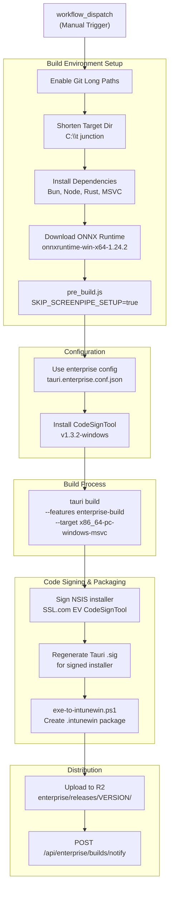
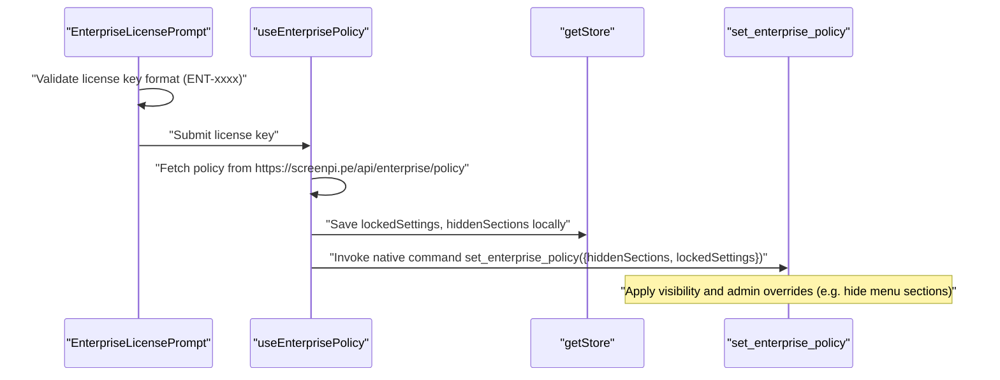
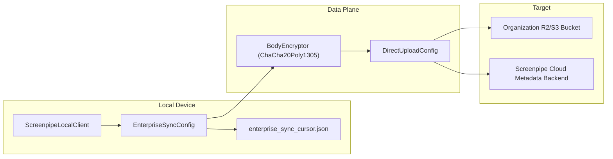

<!-- source: DeepWiki mcp.deepwiki.com · repo screenpipe/screenpipe · page 6.3 Enterprise Windows Release · fetched 2026-10-26 -->

# Enterprise Windows Release

<details>
<summary>Relevant source files</summary>

The following files were used as context for generating this wiki page:

- [.github/actions/install-windows-frontend-dependencies/action.yml](.github/actions/install-windows-frontend-dependencies/action.yml)
- [.github/actions/install-windows-frontend-dependencies/prune-dependencies.test.ts](.github/actions/install-windows-frontend-dependencies/prune-dependencies.test.ts)
- [.github/actions/install-windows-frontend-dependencies/prune-dependencies.ts](.github/actions/install-windows-frontend-dependencies/prune-dependencies.ts)
- [.github/actions/setup-persistent-windows-cache/action.yml](.github/actions/setup-persistent-windows-cache/action.yml)
- [.github/scripts/enterprise-release.cjs](.github/scripts/enterprise-release.cjs)
- [.github/workflows/test-release-workflows.yml](.github/workflows/test-release-workflows.yml)
- [apps/screenpipe-app-tauri/components/__tests__/enterprise-license-prompt.test.tsx](apps/screenpipe-app-tauri/components/__tests__/enterprise-license-prompt.test.tsx)
- [apps/screenpipe-app-tauri/components/enterprise-license-prompt.tsx](apps/screenpipe-app-tauri/components/enterprise-license-prompt.tsx)
- [apps/screenpipe-app-tauri/components/meeting-notes/meeting-summary-transition.test.tsx](apps/screenpipe-app-tauri/components/meeting-notes/meeting-summary-transition.test.tsx)
- [apps/screenpipe-app-tauri/components/meeting-notes/meeting-summary-transition.tsx](apps/screenpipe-app-tauri/components/meeting-notes/meeting-summary-transition.tsx)
- [apps/screenpipe-app-tauri/components/settings/meeting-apps-picker.tsx](apps/screenpipe-app-tauri/components/settings/meeting-apps-picker.tsx)
- [apps/screenpipe-app-tauri/e2e/specs/meeting-apps-picker.spec.ts](apps/screenpipe-app-tauri/e2e/specs/meeting-apps-picker.spec.ts)
- [apps/screenpipe-app-tauri/e2e/specs/meeting-summary-recovery.spec.ts](apps/screenpipe-app-tauri/e2e/specs/meeting-summary-recovery.spec.ts)
- [apps/screenpipe-app-tauri/e2e/specs/zz-enterprise-license-prompt.spec.ts](apps/screenpipe-app-tauri/e2e/specs/zz-enterprise-license-prompt.spec.ts)
- [apps/screenpipe-app-tauri/lib/hooks/__tests__/use-enterprise-policy.test.tsx](apps/screenpipe-app-tauri/lib/hooks/__tests__/use-enterprise-policy.test.tsx)
- [apps/screenpipe-app-tauri/lib/hooks/managed-settings.test.ts](apps/screenpipe-app-tauri/lib/hooks/managed-settings.test.ts)
- [apps/screenpipe-app-tauri/lib/hooks/managed-settings.ts](apps/screenpipe-app-tauri/lib/hooks/managed-settings.ts)
- [apps/screenpipe-app-tauri/lib/hooks/use-enterprise-policy.ts](apps/screenpipe-app-tauri/lib/hooks/use-enterprise-policy.ts)
- [apps/screenpipe-app-tauri/scripts/i18n/service.mjs](apps/screenpipe-app-tauri/scripts/i18n/service.mjs)
- [apps/screenpipe-app-tauri/scripts/i18n/service.test.ts](apps/screenpipe-app-tauri/scripts/i18n/service.test.ts)
- [apps/screenpipe-app-tauri/src-tauri/sign-ssl.ps1](apps/screenpipe-app-tauri/src-tauri/sign-ssl.ps1)
- [apps/screenpipe-app-tauri/src-tauri/src/diagnostic_logs.rs](apps/screenpipe-app-tauri/src-tauri/src/diagnostic_logs.rs)
- [apps/screenpipe-app-tauri/src-tauri/src/enterprise/backfill.rs](apps/screenpipe-app-tauri/src-tauri/src/enterprise/backfill.rs)
- [apps/screenpipe-app-tauri/src-tauri/src/enterprise/source_identity_tests.rs](apps/screenpipe-app-tauri/src-tauri/src/enterprise/source_identity_tests.rs)
- [apps/screenpipe-app-tauri/src-tauri/src/enterprise/sync.rs](apps/screenpipe-app-tauri/src-tauri/src/enterprise/sync.rs)
- [apps/screenpipe-app-tauri/src-tauri/src/enterprise/upload.rs](apps/screenpipe-app-tauri/src-tauri/src/enterprise/upload.rs)
- [apps/screenpipe-app-tauri/src-tauri/src/enterprise_sync.rs](apps/screenpipe-app-tauri/src-tauri/src/enterprise_sync.rs)
- [apps/screenpipe-app-tauri/src-tauri/src/log_files.rs](apps/screenpipe-app-tauri/src-tauri/src/log_files.rs)
- [apps/screenpipe-app-tauri/src-tauri/tests/enterprise_sync_test.rs](apps/screenpipe-app-tauri/src-tauri/tests/enterprise_sync_test.rs)
- [crates/screenpipe-db/src/db/source_identity.rs](crates/screenpipe-db/src/db/source_identity.rs)
- [crates/screenpipe-gateway/src/api.rs](crates/screenpipe-gateway/src/api.rs)
- [crates/screenpipe-gateway/src/bin/seed.rs](crates/screenpipe-gateway/src/bin/seed.rs)
- [crates/screenpipe-gateway/src/identity_tests.rs](crates/screenpipe-gateway/src/identity_tests.rs)
- [crates/screenpipe-gateway/src/ingest.rs](crates/screenpipe-gateway/src/ingest.rs)
- [crates/screenpipe-telemetry-wire/src/lib.rs](crates/screenpipe-telemetry-wire/src/lib.rs)
- [crates/screenpipe-telemetry-wire/src/manifest.rs](crates/screenpipe-telemetry-wire/src/manifest.rs)
- [infra/release-windows-runner/README.md](infra/release-windows-runner/README.md)
- [infra/release-windows-runner/bootstrap.ps1](infra/release-windows-runner/bootstrap.ps1)
- [infra/release-windows-runner/configure-runner.ps1](infra/release-windows-runner/configure-runner.ps1)
- [infra/release-windows-runner/configure-runner.sh](infra/release-windows-runner/configure-runner.sh)
- [infra/release-windows-runner/deploy.sh](infra/release-windows-runner/deploy.sh)
- [infra/release-windows-runner/main.bicep](infra/release-windows-runner/main.bicep)
- [infra/release-windows-runner/status.ps1](infra/release-windows-runner/status.ps1)
- [infra/release-windows-runner/status.sh](infra/release-windows-runner/status.sh)

</details>


This document details the enterprise Windows release pipeline for Screenpipe, targeting enterprise deployments with security, manageability, and compliance features. This specialized process generates signed installers, packages for Microsoft Intune MDM, and integrates enterprise-specific runtime features such as license key authentication, admin policy enforcement, and telemetry synchronization.

---

## Purpose & Scope

The enterprise Windows release workflow produces Screenpipe Windows installers designed explicitly for deployment in managed environments using MDM solutions like Microsoft Intune. Key distinguishing aspects relative to the consumer release include:

- **Manual-only trigger:** The release-enterprise GitHub Actions workflow runs manually, giving maintainers fine-grained control without automatic triggers on pushes or PRs [`.github/workflows/release-enterprise.yml:11-14`]().

- **Enterprise-specific build config:** Instead of the default production profile, the build employs a tailored configuration stored in `tauri.enterprise.conf.json` controlling enterprise branding and policies [`.github/workflows/release-enterprise.yml:181-185`]().

- **EV (Extended Validation) code signing:** All binaries and installers are signed with a high-trust SSL.com EV certificate, providing better OS and SmartScreen reputation for enterprise contexts [`.github/workflows/release-enterprise.yml:210-230`]().

- **Intune package creation:** After binary signing, the workflow creates `.intunewin` packages via Microsoft’s Win32 Content Prep Tool, enabling deployment and update delivery through Microsoft Intune MDM [`.github/workflows/release-enterprise.yml:244-255`]().

- **Enterprise runtime features:** The desktop app build includes robust license key authentication and admin policy enforcement mechanisms embedded in UI hooks and native Rust modules [`apps/screenpipe-app-tauri/lib/hooks/use-enterprise-policy.ts:31-49`](), [`apps/screenpipe-app-tauri/src-tauri/src/enterprise_sync.rs:1-120`]().

- **Enterprise telemetry sync:** A background telemetry sync cog periodically uploads local usage data to private R2 buckets or customer storage gateways for organizational visibility [`apps/screenpipe-app-tauri/src-tauri/src/enterprise_sync.rs:30-90`](), [`ee/desktop-rust/enterprise_sync.rs:5-50`]().
  
---

## Workflow Architecture

The manual-triggered GitHub Actions workflow orchestrates the entire enterprise release pipeline:



Key aspects:

- **Git Long Paths enabled** and a shortened target path junction (`C:\t`) address Windows path length limits during the Rust+Tauri build.

- Dependencies installed include Bun (JS runtime), Node.js, Rust toolchain, and MSVC build tools.

- ONNX Runtime binaries for Windows are downloaded separately for the AI inference features.

- The build uses the `enterprise-build` Cargo feature flag, injecting enterprise-only code.

- CodeSignTool (from SSL.com) signs exe/dll files with an EV certificate. The workflow contains retry/backoff logic due to known SSL.com endpoint quirks [`apps/screenpipe-app-tauri/src-tauri/sign-ssl.ps1:1-152`]()

- Post-signing, the Tauri updater signature is regenerated to match the new installer hash.

- The final installer exe is repackaged into a `.intunewin` archive for Intune MDM, using Microsoft’s Win32 Content Prep Tool in a PowerShell helper script.

- Artifacts upload to the Screenpipe R2 bucket with a distinct enterprise prefix for organizational management.

- An API call notifies enterprise subscribers of the new build availability.

Sources: [`.github/workflows/release-enterprise.yml:11-300`](), [`apps/screenpipe-app-tauri/src-tauri/sign-ssl.ps1:1-152`](), [`apps/screenpipe-app-tauri/scripts/pre_build.js:15-22`]()

---

## Enterprise Authentication & Policy Enforcement

Enterprise deploys rely on license key authentication and centralized admin control of settings, UI visibility, and AI model presets.

### Enterprise Policy Data Model

The React hook `useEnterprisePolicy` manages enterprise policy state such as hidden UI sections, locked local settings, managed AI presets, and scheduled managed pipes.

```typescript
interface EnterprisePolicy {
  hiddenSections: string[];
  lockedSettings: Record<string, unknown>;
  managedAiPreset: EnterpriseManagedAiPreset | null;
  aiPresetPolicy: EnterpriseAiPresetPolicy;
  appUpdatePolicy: EnterpriseAppUpdatePolicy;
  managedPipes: ManagedPipe[];
  managedSkills: ManagedTeamSkill[];
  orgName: string;
  requireAccountLogin: boolean; // Enforce employee Screenpipe login (not just license key)
  recordingAllowed: boolean;    // Whether local capture is enabled by admin
}
```
This state is refreshed periodically (every 5 minutes) to propagate admin changes without restarting the app [`apps/screenpipe-app-tauri/lib/hooks/use-enterprise-policy.ts:44-59`]().

### Data Flow: License Key and Policy Enforcement



- The user enters a license key in the UI component `EnterpriseLicensePrompt`.

- The hook `useEnterprisePolicy` fetches the organization’s policy from the remote control plane.

- The locked settings (e.g., disabling screenshots), hidden UI sections, and AI preset enforcement data are saved locally and pushed to Rust via the `set_enterprise_policy` command that enforces the runtime policy.

- This setup hides or disables UI and features based on admin controls and ensures that employees authenticate either by license key alone or via Screenpipe account (controlled by `requireAccountLogin`) [`apps/screenpipe-app-tauri/lib/hooks/use-enterprise-policy.ts:44-59`](), [`apps/screenpipe-app-tauri/lib/hooks/use-enterprise-policy.ts:194-210`](), [`apps/screenpipe-app-tauri/components/enterprise-license-prompt.tsx:1-120`]().

### Core Code Entities

| Name                        | Description                                                    | Location                                    |
|-----------------------------|----------------------------------------------------------------|---------------------------------------------|
| `useEnterprisePolicy`       | React hook managing fetching, caching, and enforcement of enterprise policy | `apps/screenpipe-app-tauri/lib/hooks/use-enterprise-policy.ts:44-150` |
| `EnterprisePolicy`           | Interface defining the enterprise policy shape                | same                                        |
| `applyManagedOverrides`     | Function applying admin-enforced overrides on local settings   | `apps/screenpipe-app-tauri/lib/hooks/managed-settings.ts:27-39`       |
| `EnterpriseAuthenticationState` | Enum of auth states (`checking`, `choice`, `authenticated`, etc.) | same                                    |
| `commands.set_enterprise_policy` | Tauri native command invoked to update Rust-side policy state | `apps/screenpipe-app-tauri/lib/utils/tauri.ts:7-20`                 |

Sources: [`apps/screenpipe-app-tauri/lib/hooks/use-enterprise-policy.ts:44-59`](), [`apps/screenpipe-app-tauri/lib/hooks/use-enterprise-policy.ts:194-210`](), [`apps/screenpipe-app-tauri/lib/hooks/managed-settings.ts:27-39`]()

---

## Enterprise Telemetry Sync

Enterprise editions include a background sync engine that streams telemetry and analytic data from the local Screenpipe app to the enterprise organization's backend. This is gated by the `enterprise-build` Cargo feature.

### Architecture and Data Flow



- The `ScreenpipeLocalClient` interfaces with the running local HTTP API to pull batches of typed telemetry data (screenshots, audio transcripts, activities, UI events) [`apps/screenpipe-app-tauri/src-tauri/src/enterprise_sync.rs:42-85`]().

- `EnterpriseSyncConfig` holds the license key, device ID (stable machine UUID), ingest endpoint URL, cursor file path for incremental sync, and mode (`HostedIngest`, `DirectReadable`, or `DirectEncrypted`) [`apps/screenpipe-app-tauri/src-tauri/src/enterprise/sync.rs:100-140`]().

- The sync engine respects backoff and network errors, paginates large payloads, and stores sync cursors to avoid redundant uploads. First-run backfills skip older data beyond 15 minutes [`apps/screenpipe-app-tauri/src-tauri/src/enterprise/sync.rs:20-60`](), [`ee/desktop-rust/enterprise_sync.rs:30-59`]()

- Telemetry uploads to either Screenpipe-hosted cloud ingest or direct customer storage (e.g., R2 or S3 bucket) using encrypted or plaintext JSONL batches for compliance with organizational data retention.

Sources: [`apps/screenpipe-app-tauri/src-tauri/src/enterprise_sync.rs:1-199`](), [`apps/screenpipe-app-tauri/src-tauri/src/enterprise/sync.rs:4-147`](), [`ee/desktop-rust/enterprise_sync.rs:20-50`]()

---

## Code Signing Process

### EV Certificate via CodeSignTool

Screenpipe uses SSL.com’s official **CodeSignTool** to sign Windows binaries with an Extended Validation (EV) certificate, improving reputation and SmartScreen bypasses for enterprise-managed apps.

Key details:

- The PowerShell script `sign-ssl.ps1` handles the signing of each binary (.exe, .dll, .msi, etc.). If a file looks like a PE payload but lacks a `.exe` extension (e.g., the uninstaller), it temporarily copies it to a `.exe` alias for signing [`apps/screenpipe-app-tauri/src-tauri/sign-ssl.ps1:1-152`]().

- The script resolves absolute file paths before changing directories, supports retry with exponential backoff to handle intermittent SSL.com API errors, and detects quota exceeded errors to fail early.

- Credentials and TOTP secrets are pulled from environment variables (`ESIGNER_USERNAME`, `ESIGNER_PASSWORD`, `ESIGNER_TOTP_SECRET`) stored securely in GitHub Actions secrets.

- The workflow installs the tool automatically into the build environment and invokes it for each binary after the Tauri build completes [`.github/workflows/release-enterprise.yml:210-230`]().

### Tauri Updater Signature Regeneration

Because signing modifies the installer binary, the workflow re-creates the Tauri updater’s signature file (`.sig`) post-signing, ensuring update integrity and smooth auto-updates [`.github/workflows/release-enterprise.yml:232-242`]().

---

## Intune Packaging (.intunewin)

To integrate with Microsoft Intune Mobile Device Management (MDM):

- The signed installer `.exe` is converted into an `.intunewin` package using the official [Microsoft Win32 Content Prep Tool](https://github.com/microsoft/Microsoft-Win32-Content-Prep-Tool).

- The packaging process is a separate PowerShell step that:

  1. Downloads the `IntuneWinAppUtil.exe` tool.

  2. Runs it against the directory containing the signed installer.

  3. Specifies the setup `.exe` (e.g., `screenpipe_${VERSION}_x64-setup.exe`).

  4. Produces a `.intunewin` artifact suitable for enterprise MDM deployment [`.github/workflows/release-enterprise.yml:244-255`]().

This packaging enables IT administrators to centrally deploy, update, and retire Screenpipe installations via Intune.

---

## Distribution & Notification

- The workflow uploads artifacts to Cloudflare R2 under paths prefixed with `enterprise/releases/{version}/x86_64-pc-windows-msvc`, isolating enterprise assets for organizational access control [`.github/workflows/release-enterprise.yml:263-281`]().

- Finally, it sends a POST request to the Screenpipe enterprise API endpoint `/api/enterprise/builds/notify` to alert clients and subscriptions of the new build version, enabling automated in-app notifications and management [`.github/workflows/release-enterprise.yml:290-300`]().

---

# Summary Tables

| Feature                  | Component / Script              | Location / File                                                  |
|--------------------------|--------------------------------|-----------------------------------------------------------------|
| Policy & License Hook    | `useEnterprisePolicy` hook      | `apps/screenpipe-app-tauri/lib/hooks/use-enterprise-policy.ts` |
| Managed Settings Helper  | `applyManagedOverrides`         | `apps/screenpipe-app-tauri/lib/hooks/managed-settings.ts`      |
| Enterprise Sync Client   | `ScreenpipeLocalClient` Rust    | `apps/screenpipe-app-tauri/src-tauri/src/enterprise_sync.rs`   |
| Enterprise Sync Config   | `EnterpriseSyncConfig` struct   | `apps/screenpipe-app-tauri/src-tauri/src/enterprise/sync.rs`    |
| Code Signing Script      | `sign-ssl.ps1`                  | `apps/screenpipe-app-tauri/src-tauri/sign-ssl.ps1`              |
| Intune Packaging Script  | PowerShell wrapper for IntuneWinAppUtil.exe | `.github/workflows/release-enterprise.yml`                    |
| Build & Release Workflow | GitHub Actions workflow yaml    | `.github/workflows/release-enterprise.yml`                      |

---

# Diagrams Bridging Natural Language Concepts to Code Entities

### Enterprise Policy System Overview

```mermaid
graph TD
    UI[EnterpriseLicensePrompt (TSX Component)]
    Hook[useEnterprisePolicy (React Hook)]
    Commands[commands.set_enterprise_policy (Tauri Native Command)]
    Settings[getStore (Local Store API)]
    RustPolicy[enterprise_policy.rs (Rust Policy State)]

    UI -->|submit license key| Hook
    Hook -->|fetch/refresh policy| Settings
    Hook -->|update policy state| Commands
    Commands -->|apply policy| RustPolicy
```

- The React UI component collects license keys.
- The hook calls async APIs and updates local storage.
- Native commands push policy data to Rust for runtime enforcement.
- Rust state gates UI visibility and capabilities.

Sources: [`apps/screenpipe-app-tauri/lib/hooks/use-enterprise-policy.ts:44-150`](), [`apps/screenpipe-app-tauri/lib/utils/tauri.ts:7-40`]()  

---

### Enterprise Telemetry Sync Components

```mermaid
graph LR
    subgraph "Local System"
        SPApp[Screenpipe App]
        LocalClient[ScreenpipeLocalClient (Rust)]
        SyncEngine[enterprise_sync.rs Background Task]

        SPApp --> |local HTTP API| LocalClient
        LocalClient --> |fetch telemetry| SyncEngine
        SyncEngine --> |upload JSONL batches| UploadClient
    end

    subgraph "Cloud Storage"
        R2Bucket[R2/S3 Bucket]
        Gateway[screenpipe-gateway (Rust HTTP API)]
    end

    SyncEngine --> UploadClient
    UploadClient --> R2Bucket
    UploadClient --> Gateway
```

- The sync engine pulls data from the local HTTP API via `ScreenpipeLocalClient`.
- It streams JSONL telemetry to cloud storage or metadata gateway, authenticated by license keys.
- The telemetry supports activity monitoring and administrative dashboards.

Sources: [`apps/screenpipe-app-tauri/src-tauri/src/enterprise_sync.rs:40-120`](), [`ee/desktop-rust/enterprise_sync.rs:30-90`]()

---

# Conclusion

The Screenpipe enterprise Windows release pipeline incorporates rigorous code signing, packaging for Intune MDM, and embedded runtime features for enterprise license enforcement and telemetry reporting. This maintains security, manageability, and compliance, enabling customers to deploy Screenpipe at scale in their corporate environments.

Sources:

- [`.github/workflows/release-enterprise.yml:5-300`]()
- [`apps/screenpipe-app-tauri/lib/hooks/use-enterprise-policy.ts:1-160`]()

- [`apps/screenpipe-app-tauri/src-tauri/src/enterprise_sync.rs:1-199`]()

- [`apps/screenpipe-app-tauri/src-tauri/src/enterprise/sync.rs:1-147`]()

- [`apps/screenpipe-app-tauri/src-tauri/sign-ssl.ps1:1-152`]()

- [`apps/screenpipe-app-tauri/scripts/pre_build.js:15-22`]()

---

