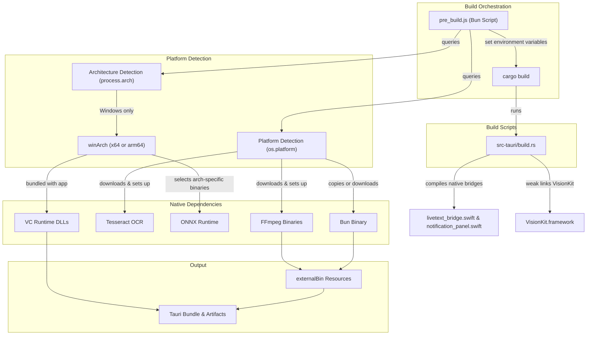
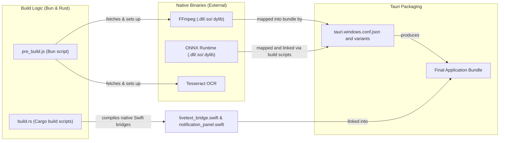

<!-- source: DeepWiki mcp.deepwiki.com · repo screenpipe/screenpipe · page 7.2 Build System · fetched 2026-10-26 -->

# Build System

Relevant source files

The following files were used as context for generating this wiki page:

- [.cargo/config.toml](.cargo/config.toml)
- [apps/screenpipe-app-tauri/.gitignore](apps/screenpipe-app-tauri/.gitignore)
- [apps/screenpipe-app-tauri/scripts/build-frontend.js](apps/screenpipe-app-tauri/scripts/build-frontend.js)
- [apps/screenpipe-app-tauri/scripts/build-frontend.test.js](apps/screenpipe-app-tauri/scripts/build-frontend.test.js)
- [apps/screenpipe-app-tauri/scripts/find_tools.js](apps/screenpipe-app-tauri/scripts/find_tools.js)
- [apps/screenpipe-app-tauri/scripts/native_dependency_cache.js](apps/screenpipe-app-tauri/scripts/native_dependency_cache.js)
- [apps/screenpipe-app-tauri/scripts/native_dependency_cache.test.js](apps/screenpipe-app-tauri/scripts/native_dependency_cache.test.js)
- [apps/screenpipe-app-tauri/scripts/pre_build.js](apps/screenpipe-app-tauri/scripts/pre_build.js)
- [apps/screenpipe-app-tauri/scripts/setup_openblas.js](apps/screenpipe-app-tauri/scripts/setup_openblas.js)
- [apps/screenpipe-app-tauri/src-tauri/build.rs](apps/screenpipe-app-tauri/src-tauri/build.rs)
- [apps/screenpipe-app-tauri/src-tauri/gen/schemas/acl-manifests.json](apps/screenpipe-app-tauri/src-tauri/gen/schemas/acl-manifests.json)
- [apps/screenpipe-app-tauri/src-tauri/gen/schemas/desktop-schema.json](apps/screenpipe-app-tauri/src-tauri/gen/schemas/desktop-schema.json)
- [apps/screenpipe-app-tauri/src-tauri/gen/schemas/macOS-schema.json](apps/screenpipe-app-tauri/src-tauri/gen/schemas/macOS-schema.json)
- [apps/screenpipe-app-tauri/src-tauri/src/e2e/commands.rs](apps/screenpipe-app-tauri/src-tauri/src/e2e/commands.rs)
- [apps/screenpipe-app-tauri/src-tauri/tauri.beta.conf.json](apps/screenpipe-app-tauri/src-tauri/tauri.beta.conf.json)
- [apps/screenpipe-app-tauri/src-tauri/tauri.conf.json](apps/screenpipe-app-tauri/src-tauri/tauri.conf.json)
- [apps/screenpipe-app-tauri/src-tauri/tauri.enterprise.conf.json](apps/screenpipe-app-tauri/src-tauri/tauri.enterprise.conf.json)
- [apps/screenpipe-app-tauri/src-tauri/tauri.linux.conf.json](apps/screenpipe-app-tauri/src-tauri/tauri.linux.conf.json)
- [apps/screenpipe-app-tauri/src-tauri/tauri.macos.conf.json](apps/screenpipe-app-tauri/src-tauri/tauri.macos.conf.json)
- [apps/screenpipe-app-tauri/src-tauri/tauri.prod.conf.json](apps/screenpipe-app-tauri/src-tauri/tauri.prod.conf.json)
- [apps/screenpipe-app-tauri/src-tauri/tauri.windows.conf.json](apps/screenpipe-app-tauri/src-tauri/tauri.windows.conf.json)

The build system for Screenpipe is responsible for managing and orchestrating the compilation and bundling of the application alongside the native platform-specific dependencies critical for its functionality. This includes the setup of FFmpeg, ONNX Runtime, Tesseract OCR, OpenBLAS, and native bridging code, ensuring compatibility for Windows, macOS, and Linux architectures.

---

## Overview

Screenpipe's build system is architected around two primary layers:

1. **Pre-build Script**: Written in JavaScript (executed with Bun runtime), this script orchestrates the download, configuration, and caching of large, native third-party binaries and tools such as FFmpeg, Bun runtime, and Tesseract OCR. It ensures that these dependencies are properly prepared before Rust compilation.

2. **Cargo Build Scripts (`build.rs`)**: These Rust scripts execute at compile time, configuring platform-specific build details. This includes compiling Swift bridges on macOS, detecting SDK availability (like VisionKit.framework), and linking native static libraries tailored for each platform and architecture.

The build system handles:

- Platform detection via Node.js/OS primitives
- Architecture-specific binaries (x64, ARM64)
- Dynamic fetching of latest or pinned versions of native dependencies (via GitHub, third-party hosts)
- Environment and linking configuration for Rust compilation
- Packaging configuration for Tauri desktop bundles (including bundling native DLLs/shared libraries)

This design offloads large dependency handling outside the Git version control, improves cross-platform consistency, and enables fine-grained native integration.

**Sources:**  
[apps/screenpipe-app-tauri/scripts/pre_build.js:1-37]()  
[apps/screenpipe-app-tauri/src-tauri/build.rs:1-4]()  

---

## Build System Architecture

**Sources:**  
[apps/screenpipe-app-tauri/scripts/pre_build.js:15-24]()  
[apps/screenpipe-app-tauri/src-tauri/build.rs:24-102]()  
[apps/screenpipe-app-tauri/src-tauri/tauri.prod.conf.json:26-28]()  

---

## Pre-build Script (`pre_build.js`)

This Bun-based script acts as the setup and cache manager for native dependencies before Rust compilation begins. It is designed to be idempotent and ensures dependencies are only prepared once per build.

### Key Responsibilities

- Determine current platform (`windows`, `macos`, `linux`) and architecture (e.g., `x64`, `arm64`).
- Define platform-specific dependency URLs and package names for:
  - **FFmpeg:** Different versions and sources by OS and architecture.
  - **Tesseract OCR:** On Linux, fetch static builds; on other platforms fallback or system installations.
  - **OpenBLAS:** Setup script imported for native matrix computations.
- Manage the Bun runtime binary for Tauri `externalBin` usage:
  - On Windows, searches numerous possible paths (including `where.exe`, common install locations, npm global prefix).
  - On Linux and macOS, downloads prebuilt binary artifacts matching the platform triple.
- Cache downloads and unpack archives to reduce rebuild overhead.
- Export environment variables to Cargo for downstream linking and discovery.

### Platform-Specific Configuration Summary

| Platform | Arch | FFmpeg Source | Tesseract Source |
|----------|------|---------------|------------------|
| Windows  | x64  | `ffmpeg-8.0.1-full_build-shared` from GyanD (7z archive) | N/A |
| Windows  | arm64| Daily autobuilds from `tordona/ffmpeg-win-arm64` (7z archive) | N/A |
| macOS    | x64  | `ffmpeg80intel.zip` from osxexperts.net | N/A |
| macOS    | arm64| `ffmpeg7arm.zip` from osxexperts.net | N/A |
| Linux    | x64  | `ffmpeg-release-amd64-static.tar.xz` from johnvansickle.com | Statically linked tesseract binary from DanielMYT/tesseract-static (no system install required) |

### Bun Binary Copying Logic

- For Windows, exhaustive paths are checked including npm global prefix and AppData.
- Rename copied Bun binary to platform-triple expected by Tauri (`bun-x86_64-unknown-linux-gnu`, `bun-aarch64-pc-windows-msvc.exe`, etc.).
- For Linux, downloads a baseline glibc compatible Bun binary to avoid host incompatibilities in AppImage.
- For macOS, separate downloads for `arm64` and `x86_64` targets prevent "Bad CPU type" runtime errors.

This careful handling ensures Bun can be invoked consistently during app runtime post-installation.

**Sources:**  
[apps/screenpipe-app-tauri/scripts/pre_build.js:1-185]()  
[apps/screenpipe-app-tauri/scripts/setup_openblas.js:1-30]()  

---

## Cargo Build Scripts (`build.rs`)

The Rust `build.rs` scripts automate compile-time configuration that cannot be resolved within the static `Cargo.toml`. Key aspects include conditional compilation, native code bridging, linking, and SDK detection.

### macOS Native Swift Bridges

- **VisionKit Detection**:  
  The function `has_visionkit_sdk()` runs `xcrun --sdk macosx --show-sdk-path` to detect if the SDK contains `VisionKit.framework`, required for Live Text OCR integration.  
  If missing, a fallback C stub library is compiled instead, which provides no-op implementations returning errors.

- **Live Text Bridge Compilation (`build_livetext_bridge`)**:  
  Compiles `swift/livetext_bridge.swift` to a static library `liblivetext_bridge.a` targeting macOS 13.0 using Swift 5 mode to avoid concurrency isolation issues.  
  The produced library is weakly linked against `VisionKit.framework` to allow graceful launch on older macOS versions.

- **Fallback Stub**:  
  If either the Swift source is missing or VisionKit is not detected, a stub C source file is compiled and linked instead. This stub safely returns errors for all Live Text API calls.

- **Native Notification Panel Bridge (`build_notification_panel`)**:  
  Similarly, compiles Swift code for native macOS notification support into a static library `libnotification_panel.a`.

### Platform Conditional Compilation

- The script handles only macOS-specific tasks; other platforms ignore this logic.
- It retrieves the correct target architecture for proper compilation arguments (arm64 vs x86_64).

**Sources:**  
[apps/screenpipe-app-tauri/src-tauri/build.rs:5-206]()  

---

## Tauri Configuration Files

Multiple `tauri.conf.json` variants manage build and bundling settings customized per release channel and platform.

| Config File | Description                                | Key Features & Differences                                      |
|-------------|--------------------------------------------|-----------------------------------------------------------------|
| `tauri.conf.json`              | Development configuration                         | Frontend URL `http://localhost:1420`, no bundled `externalBin`  |
| `tauri.prod.conf.json`         | Production app build                              | Bundles `bun` binary, signs Windows builds, sets update URLs   |
| `tauri.enterprise.conf.json`   | Enterprise release                               | Per-machine Windows install, custom NSIS images/hooks          |
| `tauri.windows.conf.json`       | Windows-specific resource mapping                 | Maps FFmpeg, ONNX Runtime, OpenBLAS, VC redistributables DLLs  |

### Bundled Native DLLs in Windows Build

The Windows Tauri config explicitly maps native dependencies into the root of the final bundle:

- `ffmpeg\bin\*.dll`
- `onnxruntime*\lib\*.dll`
- `openblas\bin\*.dll`
- `vcredist\*.dll`

This ensures they are packaged alongside the executable for runtime discovery.

**Sources:**  
[apps/screenpipe-app-tauri/src-tauri/tauri.prod.conf.json:1-137]()  
[apps/screenpipe-app-tauri/src-tauri/tauri.enterprise.conf.json:1-147]()  
[apps/screenpipe-app-tauri/src-tauri/tauri.windows.conf.json:1-32]()  
[apps/screenpipe-app-tauri/src-tauri/tauri.conf.json:1-127]()  

---

## Platform Build Flags and ONNX Runtime Setup

To optimize performance and hardware integration, platform-specific build flags are set:

| Flag                  | Purpose                                                            | Platform/Use                             |
|-----------------------|-------------------------------------------------------------------|----------------------------------------|
| `metal`               | Enables Metal GPU acceleration                                    | macOS Apple Silicon builds              |
| `parakeet-mlx`        | Apple Silicon-optimized speech transcription engine              | macOS Apple Silicon                     |
| `redact-onnx-coreml`  | CoreML Execution Provider for PII redaction                      | macOS                                  |

Regarding ONNX Runtime (ORT) setup:

- Windows x64 builds use the official Microsoft prebuilt ONNX Runtime ZIP packages downloaded in CI, linked by the `ort` crate’s `download-binaries` strategy.
- Windows ARM64 builds use specialized ONNX Runtime distributions to support Snapdragon/Copilot+ PCs.
- macOS prefers Apple VisionKit for OCR where available, falling back to Tesseract for other platforms.

Thus, the build system manages the selection and linking of the appropriate ORT binaries and execution providers based on platform and architecture.

**Sources:**  
[apps/screenpipe-app-tauri/src-tauri/build.rs:6-20]()  
[.github/workflows/e2e-test.yml:144-172]()  
[.github/workflows/release-app.yml:172-174]()  

---

## Dependency Flow Diagram

---

## Code Entity Mapping

| System Component           | Code Entity / File                | Description                                   |
|----------------------------|---------------------------------|-----------------------------------------------|
| Pre-build entry point      | `pre_build.js`                  | Main Bun script managing native dependencies.|
| OpenBLAS setup             | `setup_openblas.js`             | Sets up OpenBLAS native binaries.             |
| Swift Live Text bridge     | `build_livetext_bridge` function in `build.rs` | Compiles macOS Live Text Swift bridge.        |
| VisionKit SDK detection    | `has_visionkit_sdk` function in `build.rs`     | Detects VisionKit.framework presence.         |
| Windows code signing       | `signCommand` in `tauri.prod.conf.json`         | Powershell script invocation for signing.     |
| External binary resource   | `externalBin` array in `tauri.prod.conf.json`  | Bundled binaries like Bun runtime.             |

---

# Summary

Screenpipe’s build system is a sophisticated multi-tier process combining JavaScript dependency management with Rust compile-time configuration. It ensures cross-platform compatibility by fetching and caching native binaries optimized per OS and architecture while compiling native Swift code bridges on macOS. Careful Tauri configuration files per release channel govern packaging, signing, and resource inclusion, making the entire build and distribution process reproducible and robust.

---

**Full Sources:**

- [apps/screenpipe-app-tauri/scripts/pre_build.js:1-185]()  
- [apps/screenpipe-app-tauri/scripts/setup_openblas.js:1-30]()  
- [apps/screenpipe-app-tauri/src-tauri/build.rs:1-206]()  
- [apps/screenpipe-app-tauri/src-tauri/tauri.prod.conf.json:1-137]()  
- [apps/screenpipe-app-tauri/src-tauri/tauri.enterprise.conf.json:1-147]()  
- [apps/screenpipe-app-tauri/src-tauri/tauri.windows.conf.json:1-32]()  
- [apps/screenpipe-app-tauri/src-tauri/tauri.conf.json:1-127]()

---

