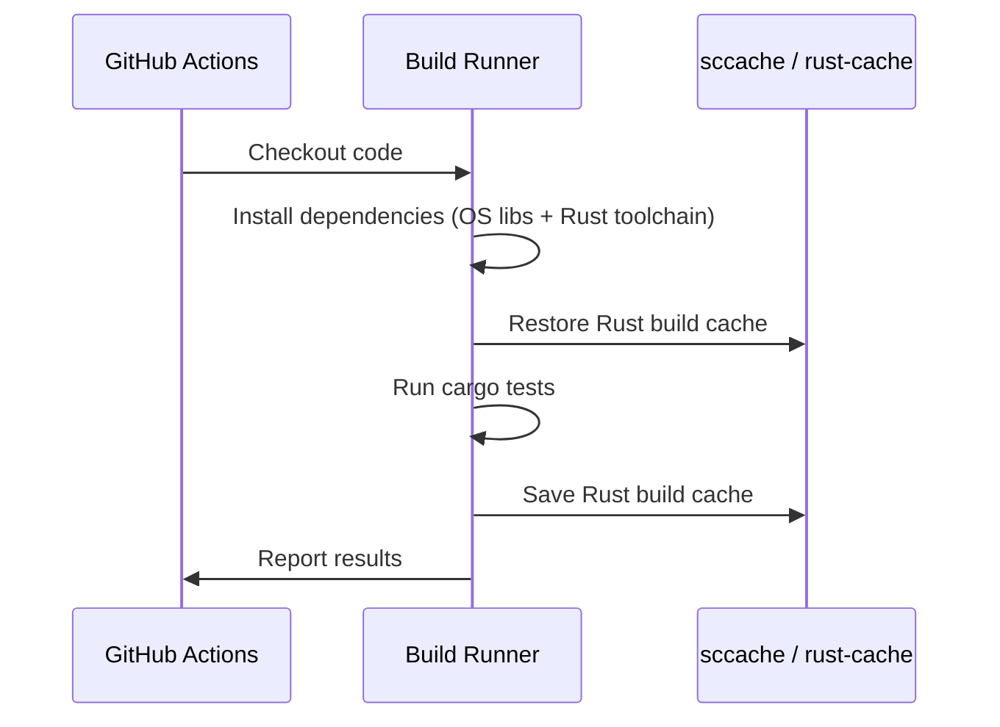
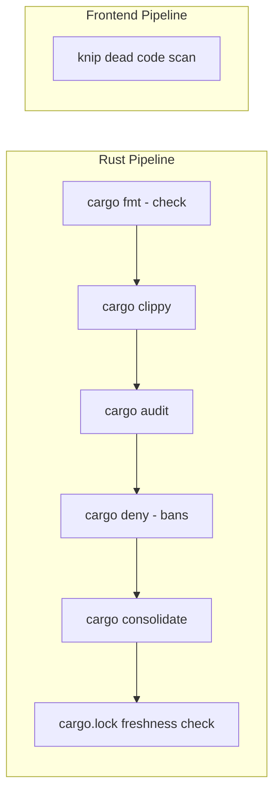
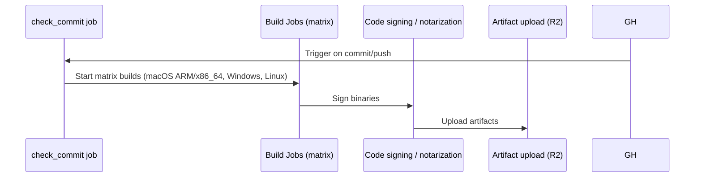
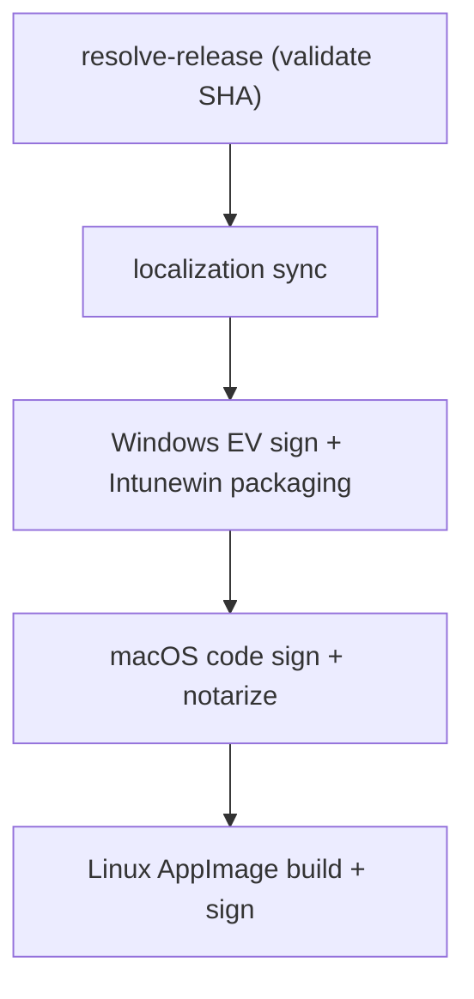

<!-- source: DeepWiki mcp.deepwiki.com · repo screenpipe/screenpipe · page 7.4 CI/CD Pipeline · fetched 2026-10-26 -->

# CI/CD Pipeline

Relevant source files

The following files were used as context for generating this wiki page:

- [.github/scripts/assert_windows_audio_rms.ps1](.github/scripts/assert_windows_audio_rms.ps1)
- [.github/scripts/release-workflows.test.ts](.github/scripts/release-workflows.test.ts)
- [.github/scripts/setup-ninja-windows.ps1](.github/scripts/setup-ninja-windows.ps1)
- [.github/workflows/benchmark.yml](.github/workflows/benchmark.yml)
- [.github/workflows/ci.yml](.github/workflows/ci.yml)
- [.github/workflows/e2e-test.yml](.github/workflows/e2e-test.yml)
- [.github/workflows/gateway-e2e.yml](.github/workflows/gateway-e2e.yml)
- [.github/workflows/release-app.yml](.github/workflows/release-app.yml)
- [.github/workflows/release-cli.yml](.github/workflows/release-cli.yml)
- [.github/workflows/release-enterprise.yml](.github/workflows/release-enterprise.yml)
- [.github/workflows/release-gateway-container.yml](.github/workflows/release-gateway-container.yml)
- [.github/workflows/style.yml](.github/workflows/style.yml)
- [.github/workflows/test-frontend.yml](.github/workflows/test-frontend.yml)
- [.github/workflows/windows-integration-test.yml](.github/workflows/windows-integration-test.yml)
- [apps/screenpipe-app-tauri/components/chat/standalone/hooks/__tests__/pi-terminal-error.test.tsx](apps/screenpipe-app-tauri/components/chat/standalone/hooks/__tests__/pi-terminal-error.test.tsx)
- [apps/screenpipe-app-tauri/components/chat/standalone/hooks/use-pi-foreground-events.ts](apps/screenpipe-app-tauri/components/chat/standalone/hooks/use-pi-foreground-events.ts)
- [apps/screenpipe-app-tauri/components/chat/standalone/message-content.answer-recovery.test.tsx](apps/screenpipe-app-tauri/components/chat/standalone/message-content.answer-recovery.test.tsx)
- [apps/screenpipe-app-tauri/knip.json](apps/screenpipe-app-tauri/knip.json)
- [apps/screenpipe-app-tauri/lib/__tests__/context-pruning.test.ts](apps/screenpipe-app-tauri/lib/__tests__/context-pruning.test.ts)
- [apps/screenpipe-app-tauri/lib/chat/__tests__/provider-errors.test.ts](apps/screenpipe-app-tauri/lib/chat/__tests__/provider-errors.test.ts)
- [apps/screenpipe-app-tauri/lib/chat/provider-errors.ts](apps/screenpipe-app-tauri/lib/chat/provider-errors.ts)
- [apps/screenpipe-app-tauri/lib/model-metadata.test.ts](apps/screenpipe-app-tauri/lib/model-metadata.test.ts)
- [apps/screenpipe-app-tauri/lib/model-metadata.ts](apps/screenpipe-app-tauri/lib/model-metadata.ts)
- [apps/screenpipe-app-tauri/scripts/eval-pi-compaction.ts](apps/screenpipe-app-tauri/scripts/eval-pi-compaction.ts)
- [apps/screenpipe-app-tauri/scripts/eval-pi-extensions.ts](apps/screenpipe-app-tauri/scripts/eval-pi-extensions.ts)
- [apps/screenpipe-app-tauri/scripts/webdriver-transport.test.ts](apps/screenpipe-app-tauri/scripts/webdriver-transport.test.ts)
- [apps/screenpipe-app-tauri/vitest.config.ts](apps/screenpipe-app-tauri/vitest.config.ts)
- [crates/screenpipe-core/assets/extensions/context-pruning.ts](crates/screenpipe-core/assets/extensions/context-pruning.ts)
- [crates/screenpipe-core/assets/pi-context-compaction.test.ts](crates/screenpipe-core/assets/pi-context-compaction.test.ts)
- [crates/screenpipe-core/assets/pi-transport-cause.patch](crates/screenpipe-core/assets/pi-transport-cause.patch)
- [crates/screenpipe-core/assets/pi-transport-cause.test.ts](crates/screenpipe-core/assets/pi-transport-cause.test.ts)
- [crates/screenpipe-core/src/agents/pi_compaction.rs](crates/screenpipe-core/src/agents/pi_compaction.rs)
- [crates/screenpipe-gateway/Dockerfile](crates/screenpipe-gateway/Dockerfile)
- [docs/evidence/cloud-connection-copy/before-after.png](docs/evidence/cloud-connection-copy/before-after.png)

This page details the implementation and structure of Screenpipe's Continuous Integration and Continuous Delivery (CI/CD) pipelines implemented with GitHub Actions. It covers the workflows in `ci.yml`, `style.yml` as well as testing suites, frontend tests, artifact generation, and secret scanning mechanisms for secure and efficient software delivery.

---

## Overview and Scope

Screenpipe employs a robust set of GitHub Actions workflows to automate testing, code quality verification, multi-platform builds, release publishing, and secret scanning. This ensures consistent high-quality software delivery for desktop apps (Tauri), CLI tools, and other components across macOS (Intel and Apple Silicon), Windows (x64 and ARM64), and Linux.

Key workflows managed include:

- `ci.yml` — Continuous integration with platform-specific Rust test suites and compilation caching.
- `style.yml` — Code quality checks including formatting, linting, dependency audits, and frontend dead-code analysis.
- `e2e-test.yml` and `windows-integration-test.yml` — End-to-end testing on Windows with audio simulation and integration tests.
- Artifact generation workflows (`release-app.yml`, `release-cli.yml`, `release-enterprise.yml`) — Multi-platform build, signing, notarization, and packaging.
- Secret scanning and audit tools integrated into the pipeline.

---

## Workflow Architecture and Data Flow

Screenpipe's CI/CD system is orchestrated through multiple GitHub Actions workflows triggered by pushes, pull requests, release tags, schedules, or manual triggers:

```mermaid
graph TB
    subgraph Triggers
        PUSH["Push to main"]
        PR["Pull Request"]
        TAG["Tag Push (v*)"]
        MANUAL["Manual Dispatch"]
        SCHEDULE["Scheduled (Cron)"]
    end

    subgraph CI Workflows
        CI["ci.yml (Rust Testing)"]
        STYLE["style.yml (Quality Checks)"]
        WIN_INT["windows-integration-test.yml (CLI Integration)"]
        E2E["e2e-test.yml (Windows E2E)"]
    end

    subgraph Release Workflows
        APPREL["release-app.yml (Desktop App Release)"]
        CLIREL["release-cli.yml (CLI Release)"]
        ENTREL["release-enterprise.yml (Enterprise Builds)"]
        MCPREL["release-mcp.yml (MCP Registry Release)"]
        SDKREL["sdk-release.yml (NAPI-RS SDK Release)"]
    end

    subgraph Performance
        BENCH["benchmark.yml (Daily OCR/STT Benchmarks)"]
    end

    PUSH --> CI
    PR --> CI
    PUSH --> STYLE
    PR --> STYLE
    PUSH --> WIN_INT
    PR --> WIN_INT
    PUSH --> E2E
    PR --> E2E
    TAG --> CLIREL
    PUSH --> APPREL
    MANUAL --> APPREL
    MANUAL --> ENTREL
    TAG --> MCPREL
    MANUAL --> SDKREL
    SCHEDULE --> BENCH
    MANUAL --> BENCH
```

This design modularizes responsibilities and optimizes resource usage by triggering specific workflows based on file changes or labels, thus avoiding unnecessary builds or tests.

Sources:  
[.github/workflows/ci.yml:7-21](), [.github/workflows/style.yml:7-26](), [.github/workflows/e2e-test.yml:10-18](), [.github/workflows/windows-integration-test.yml:7-14](), [.github/workflows/release-app.yml:6-25](), [.github/workflows/release-cli.yml:8-15](), [.github/workflows/release-enterprise.yml:5-40](), [.github/workflows/release-mcp.yml:3-8](), [.github/workflows/sdk-release.yml:10-30](), [.github/workflows/benchmark.yml:3-7]()

---

## Continuous Integration (`ci.yml`)

The `ci.yml` workflow is the core continuous integration pipeline for Rust code. It validates correctness across target platforms and configurations on every relevant push or pull request.

### Triggering Conditions

- Runs on pushes or PRs targeting `main` branch.
- Observes changes to Rust sources (`.rs`), Cargo manifests, or workflow scripts [[.github/workflows/ci.yml:7-21]]().

### Test Jobs and Steps

- **Ubuntu Tests ("test-ubuntu")**:
  - Runs on `ubuntu-latest`.
  - Installs dependencies, including native libraries like OpenBLAS with linker fixes.
  - Runs `cargo test` on the entire workspace excluding platform-specific crates like `screenpipe-rfdetr-mlx` [[.github/workflows/ci.yml:58-121]]().

- **Windows Tests ("test-windows")**:
  - Runs on Windows Server 2022 hosted runner.
  - Downloads and caches ONNX Runtime binaries needed for Windows tests.
  - Copies ONNX runtime DLLs manually next to test binaries to fix `STATUS_DLL_NOT_FOUND` errors in OCR tests.
  - Runs tests with an explicit target triple and proper environment [[.github/workflows/ci.yml:124-209]]().

### Build and Cache Optimization

- Uses a shared R2 cache via `sccache` for Rust compilation artifacts to reduce build times [[.github/workflows/ci.yml:90-104]]().
- Caching is carefully layered with `rust-cache` and fallback keys for partial cache reuse.

**CI Flow**

Sources:  
[.github/workflows/ci.yml:7-209](), [.github/scripts/install_dependencies.sh:1-11]()

---

## Code Quality and Style Checks (`style.yml`)

The `style.yml` workflow enforces code formatting, linting, dependency hygiene, and frontend dead-code checks on every push or PR.

### Key Tasks

- **Rust Formatting and Clippy**:
  - Runs `cargo fmt --check` and `cargo clippy` excluding macOS-only crates to catch style and lint violations [[.github/workflows/style.yml:77-110]]().

- **Security and Dependency Audits**:
  - Runs `cargo audit` for known vulnerabilities.
  - Uses `cargo deny` to detect banned or duplicate dependencies.
  - Checks workspace dependencies consolidation with `cargo consolidate` [[.github/workflows/style.yml:111-151]]().

- **Frontend Dead Code (knip)**:
  - Invokes `knip` on the frontend (Tauri app Typescript sources) to identify unused files, dependencies, or untracked files, helping keep frontend slim [[.github/workflows/style.yml:175-193]]().

- **Cargo.lock Freshness**:
  - Ensures all workspace lockfiles are up to date to avoid stale builds [[.github/workflows/style.yml:152-173]]().

**Code Quality Flow**

Sources:  
[.github/workflows/style.yml:77-193]()

---

## Desktop Application Release (`release-app.yml`)

The `release-app.yml` GitHub Actions workflow automates building, signing, and distributing the Tauri-based desktop application for multiple platforms.

### Triggering Conditions

- Triggered on push to `main` or manually via GitHub UI.
- Commit message prefix filtering detects releases: commits beginning with `Bump app` or `release-app` flag for release [[.github/workflows/release-app.yml:40-123]]().

### Jobs and Runner Selection

- `check_commit`: Validates the commit SHA, version alignment, and sets output flags for release and test requirements.
- Runner selection dynamically switches between self-hosted runners or GitHub-hosted runners based on flags:
  - macOS ARM builds prefer GitHub `macos-26` runners.
  - Windows builds use GitHub-hosted `windows-2022` runners.
  - Linux builds prefer `ubuntu-24.04` runners [[.github/workflows/release-app.yml:124-144]]().

### Build Matrix and Features

- Uses matrix builds targeting:
  - `aarch64-apple-darwin` with Metal, Parakeet ML extensions, RFDETR ML extensions, and Redaction CoreML feature.
  - `x86_64-apple-darwin` with Metal and Redaction CoreML features [[.github/workflows/release-app.yml:145-178]]().

- The builds include:
  - Code signing
  - Notarization on macOS
  - Uploading artifacts to Cloudflare R2 storage for distribution [[.github/workflows/release-app.yml:160-178]]().

**Release App Flow**

Sources:  
[.github/workflows/release-app.yml:34-178]()

---

## Enterprise Release (`release-enterprise.yml`)

This workflow provides a manual-triggered enterprise-grade multi-platform release with specialized signing and packaging.

### Key Features

- Uses Extended Validation (EV) code signing via SSL.com certificates for Windows binaries [[.github/workflows/release-enterprise.yml:7]]().
- Creates `.intunewin` packages for Intune MDM deployment on Windows [[.github/workflows/release-enterprise.yml:7]]().
- Supports macOS notarization and Linux AppImage signing [[.github/workflows/release-enterprise.yml:7]]().
- PowerShell scripts enable Git long paths and create directory junctions to mitigate Windows MAX_PATH issues during builds [[.github/workflows/release-enterprise.yml:165-170]]().

### Workflow Steps

- `resolve-release`: Validates the release SHA and version, ensuring it is a fully qualified commit and not a branch name [[.github/workflows/release-enterprise.yml:46-93]]().
- Localization syncing to handle translation snapshots for releases [[.github/workflows/release-enterprise.yml:95-119]]().
- Platform-specific jobs for Windows, macOS, and Linux with conditional runner selection based on `force_github_runners` input [[.github/workflows/release-enterprise.yml:120-170]]().

**Enterprise Release Job Flow**

Sources:  
[.github/workflows/release-enterprise.yml:5-170]()

---

## MCP and SDK Releases

### MCP Registry Release (`release-mcp.yml`)

- Automatically publishes the `screenpipe-mcp` package to the npm MCP Registry.
- Implements GitHub OIDC for passwordless authentication [[.github/workflows/release-mcp.yml:87-90]]().
- Bundles packages into `.mcpb` bundles to distribute via GitHub Releases [[.github/workflows/release-mcp.yml:104-136]]().

### SDK Native Bindings Release (`sdk-release.yml`)

- Cross-compiles native Rust bindings for Node.js using NAPI-RS.
- Employs a matrix build targeting Apple Silicon, Intel macOS, and Windows x64/ARM64 platforms.
- Explicitly copies platform-specific `.node` binaries into per-platform subdirectories under `npm/`, ensuring no platform-specific package is empty or stub, preventing npm publishing issues [[.github/workflows/sdk-release.yml:103-204]]().

---

## End-to-End Testing

### Windows E2E Tests (`e2e-test.yml`)

- Runs full end-to-end tests on Windows using Bun.
- Installs and configures the **Scream** virtual audio driver, including certificate creation and driver signing, to simulate audio input effectively for meeting transcription tests [[.github/workflows/e2e-test.yml:59-120]]().
- Uses sccache for caching and optimization to reduce build times on Windows runners.

### Windows CLI Integration Tests (`windows-integration-test.yml`)

- Validates the CLI recording functionality on Windows.
- Sets up dependencies and verifies audio capture capabilities using the installed Scream driver.
- Applies strict build target settings (e.g., `AWS_LC_SYS_PREBUILT_NASM=1`) [[.github/workflows/windows-integration-test.yml:60-151]]().

Sources:  
[.github/workflows/e2e-test.yml:59-120](), [.github/workflows/windows-integration-test.yml:60-151]()

---

## Performance Benchmarks (`benchmark.yml`)

- Runs scheduled daily benchmarks for OCR (Apple, Tesseract, Windows) and Speech-to-Text (STT) engines [[.github/workflows/benchmark.yml:17-144]]().
- Results are uploaded as artifacts for later analysis and regression detection.
- Analyzes performance trends for CPU and GPU acceleration across platforms.

---

## Secret Scanning and Security

While not explicitly shown in the workflow YAMLs, the CI pipeline integrates:

- Cargo audit and cargo deny for dependency vulnerability and licensing checks in `style.yml`.
- Workspace-wide cache and secret management using GitHub Actions secrets for safe credential usage in deployment and artifact upload.
- OIDC-based authentication for npm publishing in MCP release workflow to avoid storing static tokens [[.github/workflows/release-mcp.yml:87-90]]().

---

## Artifact Generation and Distribution

### Frontend Test Flows

Separate workflows (`test-frontend.yml`) run frontend unit and integration tests using Bun for speed, leveraging cached dependencies and frozen lockfiles for correctness. They ensure React/TS UI code quality and regressions before builds.

### Pre-build Script (`pre_build.js`)

- Cleans stale output directories to ensure Tauri embeds fresh UI versions before builds.
- Downloads platform-specific dependencies (`ffmpeg`, `tesseract`).
- Copies Bun runtime binaries as sidecars for Tauri apps on multiple platforms [[apps/screenpipe-app-tauri/scripts/pre_build.js:30-170]]().

---

## Mapping Natural Language Concepts to Code Entities

### CI Pipeline Components and Key Files

```mermaid
graph TB
    CI["CI Workflow - .github/workflows/ci.yml"]
    STYLE["Style Checks - .github/workflows/style.yml"]
    E2E["Windows E2E - .github/workflows/e2e-test.yml"]
    WIN_INT["CLI Integration - .github/workflows/windows-integration-test.yml"]
    RELEASE_APP["Desktop App Release - .github/workflows/release-app.yml"]
    RELEASE_CLI["CLI Release - .github/workflows/release-cli.yml"]
    RELEASE_ENTERPRISE["Enterprise Release - .github/workflows/release-enterprise.yml"]
    RELEASE_MCP["MCP Release - .github/workflows/release-mcp.yml"]
    SDK_RELEASE["SDK Release - .github/workflows/sdk-release.yml"]
    PRE_BUILD["Build Prep - apps/screenpipe-app-tauri/scripts/pre_build.js"]
    
    CI -->|triggers| TEST_UBUNTU["job: test-ubuntu"]
    CI -->|triggers| TEST_WINDOWS["job: test-windows"]
    STYLE -->|runs| FORMAT_CHECK["cargo fmt & clippy"]
    STYLE -->|runs| AUDITS["cargo audit, cargo deny"]
    STYLE -->|runs| KNIP["frontend dead code analysis"]
    E2E -->|runs| SCREAM_SETUP["Install Scream virtual audio driver"]
    RELEASE_APP -->|includes| BUILD_MATRIX["macOS Intel/ARM builds"]
    RELEASE_ENTERPRISE -->|includes| EV_SIGN["EV code signing (Windows)"]
    RELEASE_MCP -->|bundles| MCPB_BUNDLE[".mcpb archive generation"]
    SDK_RELEASE -->|copies| NAPI_BINARIES[".node files into npm/<platform>/"]
    PRE_BUILD -->|prepares| DEPENDENCIES["ffmpeg, tesseract, bun"]
```

Sources:  
[.github/workflows/ci.yml:34-209](), [.github/workflows/style.yml:77-193](), [.github/workflows/e2e-test.yml:59-120](), [.github/workflows/release-app.yml:34-178](), [.github/workflows/release-enterprise.yml:5-170](), [.github/workflows/release-mcp.yml:87-90](), [.github/workflows/sdk-release.yml:103-204](), [apps/screenpipe-app-tauri/scripts/pre_build.js:30-170]()

---

## Summary Table of Primary CI/CD Workflows

| Workflow           | Purpose                        | Platforms                 | Key Features / Highlights                            |
|--------------------|-------------------------------|---------------------------|-----------------------------------------------------|
| ci.yml             | Core Rust CI tests             | Ubuntu, Windows           | sccache + rust-cache optimization, file-path filtering |
| style.yml          | Code quality checks            | Ubuntu                    | fmt, clippy, cargo audit/deny, frontend dead code   |
| e2e-test.yml       | End-to-end tests               | Windows                   | Bun, Scream audio driver setup, full integration    |
| windows-integration-test.yml | CLI integration tests       | Windows                   | Scream driver, MSVC setup, audio capture simulation |
| release-app.yml    | Desktop app build & release    | macOS (Intel/ARM), Windows, Linux | Matrix builds, signing, notarization, multi-arch    |
| release-cli.yml    | CLI build & release            | macOS, Windows, Linux     | Multi-target builds, caching, signing               |
| release-enterprise.yml | Enterprise release            | Windows, macOS, Linux     | EV code signing, Intune packaging, long-path fixes  |
| release-mcp.yml    | MCP npm package release        | Linux                     | OIDC-authenticated publishing, MCP bundle generation |
| sdk-release.yml    | Native Rust SDK release        | macOS Intel/ARM, Windows  | NAPI-RS builds, binary packaging                     |

---

This structured CI/CD pipeline provides Screenpipe with rapid feedback loops, high confidence in multi-platform code correctness, and professional-grade artifact releases for diverse user targets.

Sources:  
All sources above as cited throughout the document.

---

