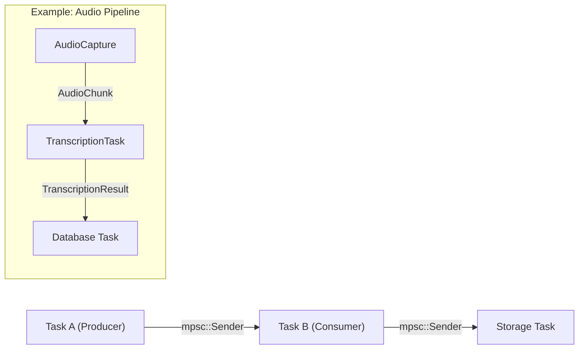
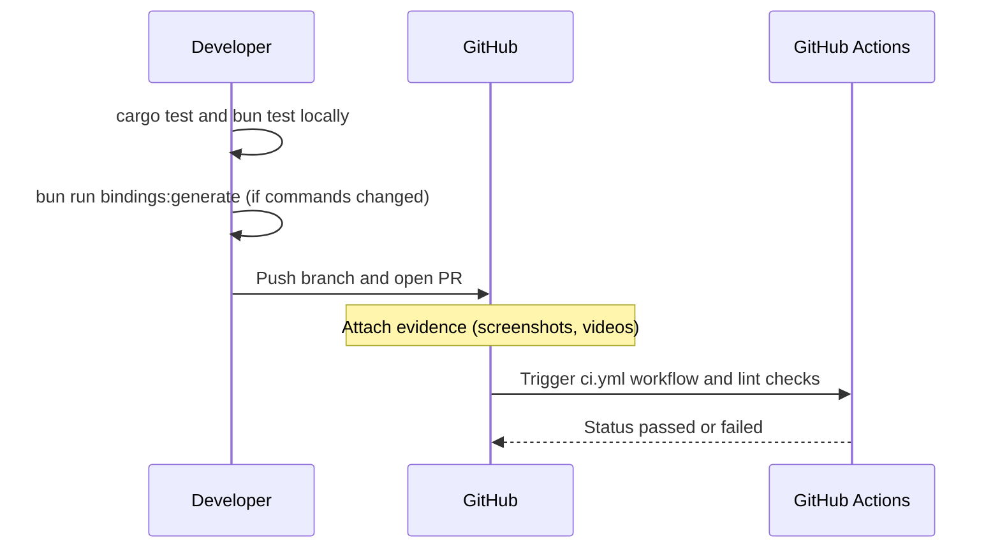
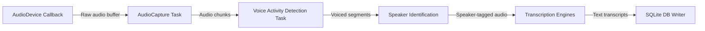

<!-- source: DeepWiki mcp.deepwiki.com · repo screenpipe/screenpipe · page 7.5 Contributing Guidelines · fetched 2026-10-26 -->

# Contributing Guidelines

<details>
<summary>Relevant source files</summary>

The following files were used as context for generating this wiki page:

- [.github/ISSUE_TEMPLATE/bug_report.md](.github/ISSUE_TEMPLATE/bug_report.md)
- [.github/ISSUE_TEMPLATE/documentation.md](.github/ISSUE_TEMPLATE/documentation.md)
- [.github/ISSUE_TEMPLATE/feature_request.md](.github/ISSUE_TEMPLATE/feature_request.md)
- [.github/ISSUE_TEMPLATE/question.md](.github/ISSUE_TEMPLATE/question.md)
- [.github/pull_request_template.md](.github/pull_request_template.md)
- [.github/scripts/upload-release-artifacts.sh](.github/scripts/upload-release-artifacts.sh)
- [.gitignore](.gitignore)
- [AGENTS.md](AGENTS.md)
- [CLAUDE.md](CLAUDE.md)
- [CONTRIBUTING.md](CONTRIBUTING.md)
- [apps/screenpipe-app-tauri/scripts/native-build-queue.test.ts](apps/screenpipe-app-tauri/scripts/native-build-queue.test.ts)
- [apps/screenpipe-app-tauri/scripts/native-build-queue.ts](apps/screenpipe-app-tauri/scripts/native-build-queue.ts)
- [docs/human-only-app-publication.md](docs/human-only-app-publication.md)
- [docs/macos-dev-builds.md](docs/macos-dev-builds.md)
- [infra/release-artifact-uploader/package.json](infra/release-artifact-uploader/package.json)
- [infra/release-artifact-uploader/src/index.js](infra/release-artifact-uploader/src/index.js)
- [infra/release-artifact-uploader/src/index.test.js](infra/release-artifact-uploader/src/index.test.js)
- [infra/release-artifact-uploader/wrangler.jsonc](infra/release-artifact-uploader/wrangler.jsonc)
- [scripts/dev/README.md](scripts/dev/README.md)
- [scripts/dev/pr-evidence](scripts/dev/pr-evidence)
- [scripts/dev/sp-dev-app](scripts/dev/sp-dev-app)
- [scripts/dev/sp-dev-cli](scripts/dev/sp-dev-cli)
- [scripts/dev/sp-update-src](scripts/dev/sp-update-src)

</details>


This page summarizes the contribution process for the Screenpipe codebase, including code style, Pull Request (PR) workflow, commit message standards, concurrency patterns, linting, evidence handling, and agent instruction files. Screenpipe is a local-first, 24/7 AI memory system designed to respect user privacy and operational stability. Contributions should adhere to these principles.

---

## Design Principles

The following guiding principles shape architectural and coding decisions across the project:

| Principle              | Implication                                           | Implementation Detail                                     |
|-----------------------|------------------------------------------------------|-----------------------------------------------------------|
| **User Fanatic**       | Prioritize user value and experience.                | Emphasize features that users actually want. [CONTRIBUTING.md:186]() |
| **Concurrency**        | Prefer message passing (channels) over locks.        | Use `tokio::sync::mpsc` channels for inter-task comms. [CONTRIBUTING.md:187]() |
| **Simplicity**         | Avoid premature optimization. Readable code preferred.| Strive for minimal, clear code. [CONTRIBUTING.md:188]()  |
| **Stability Over Features** | Prioritize system reliability over adding features. | Avoid feature creep. [CLAUDE.md:8]()                        |
| **Local-First**        | Keep data local and accessible for AI context.       | Index accessibility trees locally. [CLAUDE.md:3]()        |

### Inter-Task Communication Pattern

Screenpipe uses Tokio's MPSC (multi-producer, single-consumer) channels extensively for async communication, minimizing the use of Mutexes or locks to avoid deadlocks and bottlenecks.



Sources: [CONTRIBUTING.md:181-190](), [CLAUDE.md:3-9]()

---

## Development Workflow

### Local Development

- Use `bun` for JavaScript/TypeScript dependency management and scripts, and `cargo` for Rust builds.
- To build on **macOS**, the typical command is:

  ```bash
  cargo build --release --features metal
  ```

- For the Tauri desktop app, run from `apps/screenpipe-app-tauri`:

  ```bash
  bun install
  bun run build:tauri:dev
  ```

- The project uses cross-platform isolated build caches to reduce rebuild times and avoid conflicts across multiple worktrees.

### macOS Permission Handling

Dev builds are signed with a developer certificate to ensure permissions like TCC (Transparency, Consent, and Control) persist across rebuilds. Without the cert, permission dialogs may appear; users can continue explicitly in onboarding.

```mermaid
flowchart TD
  Start["Start Dev Session"]
  Start --> HackingChoice{"Hacking Target?"}
  HackingChoice -->|Frontend (UI/Tauri)| TauriDev["bun run dev:tauri"]
  HackingChoice -->|Engine/CLI| CargoRun["cargo run"]
  
  TauriDev --> TCCCheck["TCC Permissions Check"]
  TCCCheck -->|Has Cert| Persist["Permissions Persist Across Builds"]
  TCCCheck -->|No Cert| Onboarding["Show 'Continue Anyway' option in Onboarding"]
```

Sources: [CONTRIBUTING.md:14-133](), [CLAUDE.md:9]()

---

## Code Style & Linting

### Source File Headers

All source files must start with the standardized header below, placed after any required shebang or language directives.

```typescript
// screenpipe — AI that knows everything you've seen, said, or heard
// https://screenpipe.com
```

This applies to Rust, TS/JS, and Swift source code files. Agent prompt and instruction files (`AGENTS.md`, `CLAUDE.md`) are exempt.

### Git Commit Messages

The commit history is used to generate automated changelogs and must meet these criteria:

- Use **present tense** (e.g., "add feature" not "added feature").
- Use **imperative mood** ("move cursor" instead of "moves cursor").
- Limit the first line to **72 characters**.

### Rust `#[tauri::command]` Bindings

- Each `#[tauri::command]` function exported to the frontend must also have `#[specta::specta]`.
- If you modify these, regenerate TypeScript bindings using:

  ```bash
  bun run bindings:generate
  ```

- To verify bindings and frontend types, run:

  ```bash
  bun run bindings:check
  bun run typecheck
  ```

Sources: [CONTRIBUTING.md:168-180](), [CLAUDE.md:9](), [.claude/skills/screenpipe-tauri/SKILL.md:12-45]()

---

## Pull Request Process

1. **PR Template:** Always fill the PR template fully. Do NOT use issue numbers in the PR title.

2. **Visual Evidence:** PRs changing UI or behavior require before-and-after recordings (screenshots, videos, or terminal output). **Never** commit media files directly—use GitHub drag-drop or fork release assets.

3. **Bindings and Type Checks:** Verify frontend command bindings and run type checks if the change affects Tauri commands.

4. **Style Compliance:** Follow Rust and TypeScript style rules. Commit files with a newline at EOF.



Sources: [CONTRIBUTING.md:156-165](), [CLAUDE.md:9](), [.github/pull_request_template.md:1-44]()

---

## Testing Suite

Testing is essential before pushing code. Types of tests:

- **Rust unit/integration tests:** Use `cargo test`.
- **JS/TS tests:** Use `bun test`.
- **Tauri frontend tests:** Use `bun run bindings:check` and `bun run typecheck`.
- **Regression Checklist:** Before modifying critical subsystems like window management or audio, consult the regression checklist in `docs/TESTING.md`.

Sources: [CLAUDE.md:9](), [.claude/skills/screenpipe-tauri/SKILL.md:31-37]()

---

## Evidence Assets

Visual or terminal-recorded evidence is required for many changes, especially UI or behavior modifications. Use the helper script `scripts/dev/pr-evidence` to create before/after GIFs in headless terminals:

```bash
scripts/dev/pr-evidence --out fix.gif \
  --before-label "before (#NNNN)" --before 'cmd showing bug' \
  --after-label  "after"         --after  'cmd showing fix'
```

Always verify the recordings personally before attaching to a PR.

Sources: [scripts/dev/pr-evidence]()

---

## Concurrency Patterns

Screenpipe employs Tokio async runtime and prefers MPSC channels for concurrency, avoiding mutexes and shared mutable state where possible. This approach helps prevent data races, reduces complexity, and improves maintainability.

Key concurrency primitives used:

- `tokio::sync::mpsc` for message passing
- `tokio::spawn` for task creation
- Limited use of `Mutex` and locks, only when absolutely necessary

See the concurrency diagram under Design Principles for the audio pipeline example.

---

## Biome Linting and Static Analysis

The codebase employs the Biome linter (formerly Rome / Deno linter successor) for TypeScript and JavaScript linting. This linting enforces style and correctness across frontend and desktop app sources. Run with:

```bash
bun run lint
```

Static analysis failures are treated as CI failures.

---

## Agent Instruction Files

The contributing process includes two key dimension files that define operational and style guidelines for AI agents integrated into Screenpipe:

### `CLAUDE.md`

- Defines conventions for AI agents operating in the system, including PR and eval requirements.
- Emphasizes running evals locally before PR creation and providing explicit commands/results in PR bodies.

### `AGENTS.md`

- Centralized context file loaded into every AI agent.
- Contains important instructions on local indexing of accessibility trees, principles like "user fanatic", "stability over feature creep".
- Instructs on source file header additions and testing conventions.
- Covers agent scoping and human oversight boundaries.

Both files are part of the repo root and must be kept in sync to ensure instructions do not drift. Contributors should understand them before modifying AI-related code.

Sources: [CLAUDE.md:1-9](), [AGENTS.md:1-121]()

---

# Summary Diagram: Natural Language Concepts to Code Entities

```mermaid
flowchart TB
  classDef nlConcept fill:#f9f,stroke-width:0

  subgraph "Natural Language Space"
    UserFanatic["User Fanatic Principle"]:::nlConcept
    Concurrency["Concurrency using Channels"]:::nlConcept
    PRProcess["Pull Request Process"]
    Evidence["Evidence Attachments"]
    CommitMsg["Commit Message Style"]
    AgentInstructions["Agent Instruction Files (CLAUDE.md, AGENTS.md)"]
  end

  subgraph "Code Entity Space"
    TokioMPSC["tokio::sync::mpsc"] 
    ConcurrencyRustCode["Concurrency pattern in Rust crates"]
    PRTemplate[".github/pull_request_template.md"]
    PREvidence["scripts/dev/pr-evidence"]
    GitCommitRules["Git Commit Message Convention"]
    AGENTSfile["AGENTS.md"]
    CLAUDEfile["CLAUDE.md"]
    Linting["Biome linter / bun run lint"]
  end

  UserFanatic -->|Implement in| ConcurrencyRustCode
  Concurrency -->|Implemented via| TokioMPSC
  PRProcess --> PRTemplate
  Evidence --> PREvidence
  CommitMsg --> GitCommitRules
  AgentInstructions --> AGENTSfile
  AgentInstructions --> CLAUDEfile
  Linting -.-> PRProcess
  Linting -.-> Code Entity Space
```

---

# Detailed Concurrency Flow Example: Audio Pipeline (Rust)



- Each arrow corresponds to communication through `tokio::sync::mpsc::channel`.
- No blocking or memory allocation on high frequency callbacks.
- Background tasks consume and persist data without blocking capture.

Sources: [CONTRIBUTING.md:181-190](), [CLAUDE.md:3-9]()

---

# Summary Table of Code and Contribution Artifacts

| Purpose                    | File / Location                                  | Notes                                  |
|----------------------------|-------------------------------------------------|----------------------------------------|
| Contribution Getting Started | `CONTRIBUTING.md`                              | Setup, build, and platform-specific steps |
| PR Template & Evidence       | `.github/pull_request_template.md`, `pr-evidence` | PR instructions and evidence helper     |
| Commit Message Guidelines    | `CONTRIBUTING.md` section                     | 72 char limit, imperative mood         |
| Agent Guidance               | `AGENTS.md`, `CLAUDE.md`                        | AI agent instructions and styles       |
| Source File Headers          | Code source files                               | Standard screenpipe header required    |
| Concurrency Pattern          | Rust crates using `tokio::sync::mpsc`          | Preferred concurrency primitive        |
| Linting                     | Biome linter                                    | Enforces style on TS/JS frontend code  |
| Binding Generation           | `bun run bindings:generate`                     | For Tauri commands                     |

Sources: [CONTRIBUTING.md](), [CLAUDE.md](), [AGENTS.md](), [.github/pull_request_template.md](), [scripts/dev/pr-evidence]()

---

This page captures the core requirements and workflows for contributing effectively to Screenpipe. Developers should read the referenced files and run local tests and evidence generation prior to PR submission to ensure a smooth review and merge process.

---

