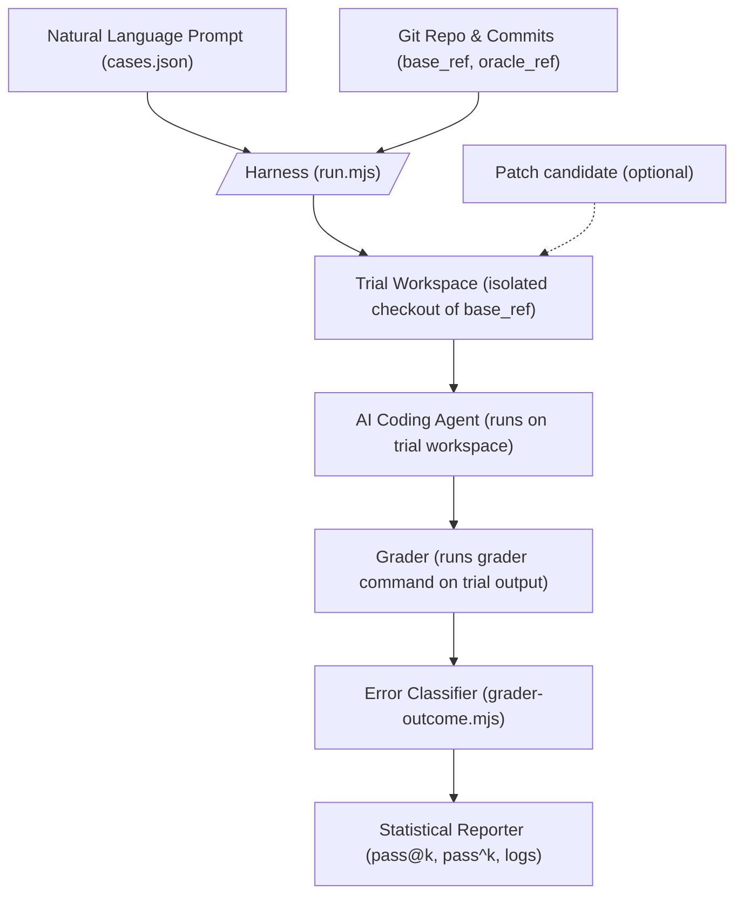
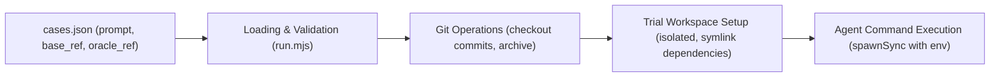
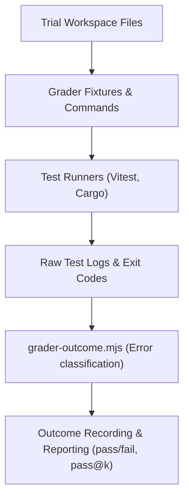

<!-- source: DeepWiki mcp.deepwiki.com · repo screenpipe/screenpipe · page 7.6 Coding-Agent Evals · fetched 2026-10-26 -->

# Coding-Agent Evals

<details>
<summary>Relevant source files</summary>

The following files were used as context for generating this wiki page:

- [evals/coding-agent/.gitignore](evals/coding-agent/.gitignore)
- [evals/coding-agent/DESIGN.md](evals/coding-agent/DESIGN.md)
- [evals/coding-agent/README.md](evals/coding-agent/README.md)
- [evals/coding-agent/binary-fixtures.test.ts](evals/coding-agent/binary-fixtures.test.ts)
- [evals/coding-agent/calibrate-audio-policy.test.js](evals/coding-agent/calibrate-audio-policy.test.js)
- [evals/coding-agent/calibrate-html-viewer.test.js](evals/coding-agent/calibrate-html-viewer.test.js)
- [evals/coding-agent/calibrate-manual-sync.test.js](evals/coding-agent/calibrate-manual-sync.test.js)
- [evals/coding-agent/calibrate-terminal-quota.test.js](evals/coding-agent/calibrate-terminal-quota.test.js)
- [evals/coding-agent/calibrate-transcription-language.test.js](evals/coding-agent/calibrate-transcription-language.test.js)
- [evals/coding-agent/cases.json](evals/coding-agent/cases.json)
- [evals/coding-agent/fingerprints.test.ts](evals/coding-agent/fingerprints.test.ts)
- [evals/coding-agent/grader-outcome.mjs](evals/coding-agent/grader-outcome.mjs)
- [evals/coding-agent/graders/app-terminal-quota.test.ts](evals/coding-agent/graders/app-terminal-quota.test.ts)
- [evals/coding-agent/graders/audio-policy-banner.fixture.tsx.txt](evals/coding-agent/graders/audio-policy-banner.fixture.tsx.txt)
- [evals/coding-agent/graders/audio-policy-onboarding.fixture.tsx.txt](evals/coding-agent/graders/audio-policy-onboarding.fixture.tsx.txt)
- [evals/coding-agent/graders/audio-policy-recovery.fixture.tsx.txt](evals/coding-agent/graders/audio-policy-recovery.fixture.tsx.txt)
- [evals/coding-agent/graders/html-viewer.fixture.ts.txt](evals/coding-agent/graders/html-viewer.fixture.ts.txt)
- [evals/coding-agent/graders/manual-sync.config.mjs](evals/coding-agent/graders/manual-sync.config.mjs)
- [evals/coding-agent/graders/manual-sync.fixture.tsx.txt](evals/coding-agent/graders/manual-sync.fixture.tsx.txt)
- [evals/coding-agent/graders/transcription-language.fixture.ts.txt](evals/coding-agent/graders/transcription-language.fixture.ts.txt)
- [evals/coding-agent/mine-history.mjs](evals/coding-agent/mine-history.mjs)
- [evals/coding-agent/mine-history.test.ts](evals/coding-agent/mine-history.test.ts)
- [evals/coding-agent/run.mjs](evals/coding-agent/run.mjs)
- [evals/coding-agent/run.test.ts](evals/coding-agent/run.test.ts)
- [evals/coding-agent/wrapped-setup.test.ts](evals/coding-agent/wrapped-setup.test.ts)

</details>


This page documents the **evals/coding-agent** regression harness in the Screenpipe codebase. It covers the manifest format (`cases.json`), the trial runner (`run.mjs`), the grader system, calibration tests, provenance fingerprints for provenance and traceability, and pass@k and pass^k success measurement. This system validates coding-agent behaviors by testing real regression cases mined from Git history, running isolated isolated trials, and reproducibly grading agent outputs for correctness and stability.

---

## 1. Purpose and Scope

The coding-agent evals harness is a core developer tool designed to:

- **Validate AI coding agent functionality** by running isolated tasks derived from real past bug fixes in the repository.
- **Detect regressions and verify fixes** by comparing behavior between a broken commit and its fixing commit.
- **Measure reliability** through repeated trials, aggregated pass@k (probability of success for k independent runs) and pass^k statistics.
- **Store rich trial provenance** including exact repository states, prompts, transcripts, candidate patches, grader outputs, and runtime fingerprints.
- **Enable calibration and validation** with numerous control tests to ensure the harness reliability and behavioral classification correctness.

Unlike unit tests, these evals run entire AI agent trials on realistic coding challenges extracted from real development regressions. They leverage a robust grader system for deterministic correctness and support detailed failure analysis.

---

## 2. Manifest: `cases.json`

The manifest file `evals/coding-agent/cases.json` describes the entire eval suite:

- Conforms to schema version 1.
- Defines a regression test suite named `screenpipe-app-coding-agent-regressions`.
- Lists 128+ real regression test cases mined from Git history.
- Each test case has:
  - `id`, `name` describing the scenario.
  - `source`: Always a `git_regression` kind with a `fix_commit`.
  - `base_ref`: The broken parent commit SHA.
  - `oracle_ref`: The fixed commit SHA, identical to `source.fix_commit`.
  - A natural language `prompt` describing the task.
  - `grader` detailing how to run correctness checks.
  - Optional `tags` for categorization.
  - Optional `grader_dependency_links` and fixtures for environment setup.
  - Optional `gate` metadata indicating status (`advisory`, `blocking`).
  - Optional `trigger_paths` for selective invalidations.

Example snippet representing a coding-agent case:
```json
{
  "id": "app-chat-concurrent-save",
  "name": "Preserve both writers during concurrent chat saves",
  "source": { "kind": "git_regression", "fix_commit": "1a74f9c6..." },
  "base_ref": "8c0affa6b...",
  "oracle_ref": "1a74f9c6...",
  "tags": ["regression", "chat", "concurrency", "data-loss"],
  "prompt": "A saved chat can lose messages when a later writer saves an older snapshot...",
  "grader": {
    "timeout_seconds": 300,
    "fixtures": [
      { "local_path": "graders/chat-save-outcomes.fixture.ts", "destination_path": "apps/screenpipe-app-tauri/lib/__tests__/eval-chat-save.test.ts" }
    ],
    "command": "cd apps/screenpipe-app-tauri && NODE_OPTIONS=--localstorage-file=.eval-localstorage node node_modules/vitest/vitest.mjs run --config vitest.config.ts lib/__tests__/eval-chat-save.test.ts --pool=forks --poolOptions.forks.singleFork=true"
  },
  "oracle_paths": ["apps/screenpipe-app-tauri/lib/chat-storage.ts","apps/screenpipe-app-tauri/lib/chat-merge.ts"],
  "grader_dependency_links": [
    { "source_path": "apps/screenpipe-app-tauri/node_modules", "destination_path": "apps/screenpipe-app-tauri/node_modules" }
  ]
}
```

The manifest includes suite-level metadata such as ownership, promotion policy, and dataset versioning to ensure governance of regression cases for the continuous development pipeline.

Sources: `evals/coding-agent/cases.json:1-150`

---

## 3. Trial Runner: `run.mjs`

The main harness runtime is implemented in `evals/coding-agent/run.mjs`. Its responsibilities include:

- **Argument parsing** for mode (`agent`, `baseline`, `oracle`, `regrade`), number of trials, case filtering, and paths for patches, manifest, and repository.
- **Loading and validating the manifest** JSON file, including schema checks and commit existence verification for each case's `base_ref` and `oracle_ref`.
- **Selecting cases to run**, based on user filters or all by default.
- **Preparing a clean isolated Git clone state** for each case trial:
  - Uses detached checkout of the `base_ref` to simulate broken code.
  - Enforces no future commits or patches invisible to the agent.
  - Symlinks dependency caches for faster build.
- **Running the AI coding agent command** (specified or default) to attempt the fix per the prompt.
- **Invoking graders asynchronously** for each run on the output folder using the case's configured grader command.
- **Collecting and aggregating outcomes**:
  - Captures judge exit codes, logs, runtime signals.
  - Applies classification for setup or infra errors vs. true behavioral failures.
  - Saves JSON results with success/failure and output transcripts.
- **Reporting statistical pass@k** and pass^k across repeated trials.
- **Provenance fingerprinting**:
  - Hashes source files for `run.mjs` and `grader-outcome.mjs` for runtime integrity.
  - Hashes the full manifest content to fingerprint dataset version.

Key functions/classes in `run.mjs`:

```js
function parseArgs(argv) { ... }              // Parses CLI arguments with validation.
function command(program, args, options) { ... } // Synchronous execution with output capture.
function mustRun(program, args, options) { ... } // Like command but throws on error.
function loadManifest() { ... }              // Loads and validates the JSON manifest file.
function selectCases(manifest, ids) { ... } // Filters test cases by a set of IDs.
function validateCase(evalCase) { ... }      // Validates required fields and commit refs.
```

Provenance fingerprinting captures implementation hashes at startup:
```js
const harnessFiles = Object.fromEntries(["run.mjs", "grader-outcome.mjs"].map(
  (path) => [path, sha256(readFileSync(join(HERE, path)))],
));
const HARNESS_PROVENANCE = {
  schema_version: 1,
  files: harnessFiles,
  fingerprint: sha256(JSON.stringify(harnessFiles)),
};
```

This design ensures trials are reproducible and isolated from environment drifts.

Sources: `evals/coding-agent/run.mjs:1-170`

---

## 4. Grader System

### 4.1. Grader Concept

Each test case includes a `grader` specification which details:

- The **command line** to run the grader (often invoking Vitest or Cargo test runners) on the trial's snapshot copy.
- A list of **fixtures**:
  - Local fixture files copied into the trial workspace.
  - Git tree source files checked out at the oracle commit to support grading.
- **Timeouts** in seconds to control maximum allowed execution duration.
- Optional dependency links to share node_modules or build artifacts.

Graders examine:

- Agent output transcriptions, patches, or commits.
- Internal tests embedded in product code validating expected behavior and no regressions.
- Log files for assurance of no infra/setup errors. 

### 4.2. Error Classification: `grader-outcome.mjs`

`evals/coding-agent/grader-outcome.mjs` implements error classification logic to differentiate:

- Setup or infrastructure errors (missing modules, build errors, collection failures).
- Execution failures (assertion errors, test failures).
- Known run conditions (e.g. process signals, command not available).

This supports ignoring trials that fail due to invalid environments instead of true regressions.

Example:
```js
export function classifyGraderError(grader) {
  if (grader.error || grader.signal || grader.status === null) return "process";
  if (grader.status === 0) return null; // Success
  if (grader.status === 126 || grader.status === 127) return "command_unavailable";
  // Additional regex detection on stderr/stdout for known error patterns
  ...
  return null; // Unknown
}
```

### 4.3. Calibration Tests & Fixtures

Multiple `.test.js` and `.test.ts` calibration files invoke specific grader scenarios validating component-specific agent behaviors (e.g. audio policy, terminal quota handling, HTML rendering). They:

- Setup environments by checking out the oracle commit snapshot.
- Patch files or inject test logic for deeper calibration.
- Assert expected passes or failures and classify errors correctly.

Examples include:

- `calibrate-audio-policy.test.js` verifies onboarding and audio permission logic through synthetic state manipulations.
- `calibrate-html-viewer.test.js` executes HTML rendering grader fixtures checking sandboxing and CSP policies.
- `app-terminal-quota.test.ts` tests chat transport handling of terminal quota failure events with React hooks and mock commands.

Sources:  
- `evals/coding-agent/graders/*.ts, *.fixture.ts.txt`  
- `evals/coding-agent/calibrate-*.test.js`  
- `evals/coding-agent/grader-outcome.mjs:1-88` 

---

## 5. Provenance Fingerprints

The harness records fingerprints of its own core runtime components to ensure integrity:

- `run.mjs` and `grader-outcome.mjs` implementation bytes are hashed with SHA-256 at startup.
- The full manifest `cases.json` content is fingerprinted for dataset consistency.
- Repository commit versions for each trial are verified exactly.

This tracking provides immutable evidence correlating eval results with precise code and data versions.

Sources: `evals/coding-agent/run.mjs:23-34`

---

## 6. Workflow Diagram of Coding-Agent Eval Trial



This diagram maps the flow from a natural language task prompt and repository commits into an isolated trial workspace on which the AI agent attempts a fix. The grader runs against the output, errors are classified, and success metrics are reported.

Sources: `evals/coding-agent/run.mjs:1-170`, `evals/coding-agent/cases.json:1-150`, `evals/coding-agent/grader-outcome.mjs:1-88`

---

## 7. Bridging Natural Language Tasks & Code Entities

### 7.1. From Natural Language Task to Trial Runner Components



Here we see how the manifest's natural language tasks drive git and workspace operations to create isolated trials invoked by the harness.

### 7.2. From Trial Output to Grading and Outcome Classification



This flow explains how grader commands execute in the trial workspace to produce logs analyzed by error classification logic. Final outcomes feed into reporting systems.

Sources:  
- `evals/coding-agent/cases.json`  
- `evals/coding-agent/run.mjs`  
- `evals/coding-agent/grader-outcome.mjs`  

---

## 8. Pass@k and Statistical Reporting

The harness supports running multiple repeated trials per case. It aggregates outcomes into probabilistic success estimates:

- **pass@k**: the probability at least one of k independent runs passes.
- **pass^k**: the probability that all k independent runs pass.

These statistics provide a robust signal on agent stability and variance beyond single-run pass/fail.

Detailed reporting artifacts include:

- Individual trial transcripts.
- Runtime fingerprints for reproducibility audit.
- Grader outputs including logs and exit statuses.
- Success/failure counts with classifications.

This supports gating deployments on reliable agent correctness.

---

## Summary

The Screenpipe **coding-agent evals** system is a sophisticated regression harness rigorously validating AI developer assistant correctness on real historic bugs. It comprises:

- A versioned **manifest** specifying tasks derived from Git regression history.
- A **trial runner** that creates isolated commit workspaces and executes agent commands.
- An extensible **grader framework** with fixtures and configurable runner invocations.
- Error **classification** for differentiating setup infra errors vs behavior regressions.
- Provenance **fingerprints** enabling traceability of harness code and data.
- Statistical **pass@k** reporting for reliable agent correctness metrics.
- Numerous **calibration tests** to ensure grader and harness fidelity.

This infrastructure underpins continuous quality of the coding agent AI integration and supports trustworthy, repeatable regression detection and behavior verification.

---

Sources:  
- `evals/coding-agent/cases.json`  
- `evals/coding-agent/run.mjs`  
- `evals/coding-agent/grader-outcome.mjs`  
- `evals/coding-agent/calibrate-audio-policy.test.js`  
- `evals/coding-agent/calibrate-html-viewer.test.js`  
- `evals/coding-agent/README.md`  
- `evals/coding-agent/DESIGN.md`

---

