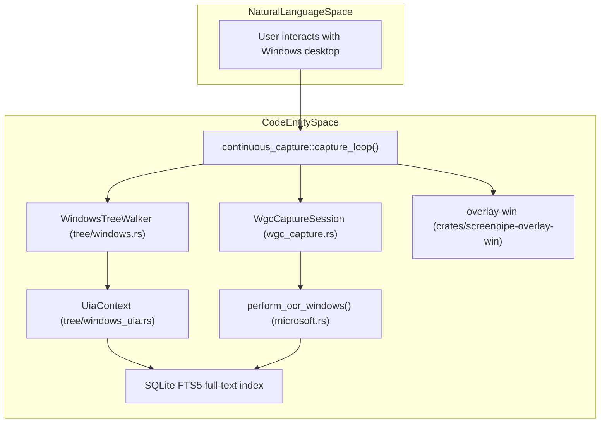
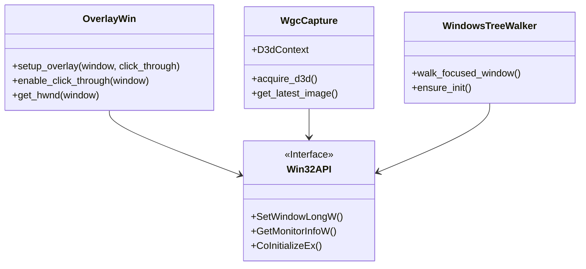

<!-- source: DeepWiki mcp.deepwiki.com · repo screenpipe/screenpipe · page 8.2 Windows · fetched 2026-10-26 -->

# Windows

Relevant source files

The following files were used as context for generating this wiki page:

- [.github/workflows/docs.yml](.github/workflows/docs.yml)
- [.github/workflows/eval-diarization.yml](.github/workflows/eval-diarization.yml)
- [.github/workflows/eval-meeting-detection.yml](.github/workflows/eval-meeting-detection.yml)
- [.github/workflows/sdk.yml](.github/workflows/sdk.yml)
- [.github/workflows/test-ai-gateway.yml](.github/workflows/test-ai-gateway.yml)
- [apps/screenpipe-app-tauri/app/shortcut-reminder/page.test.tsx](apps/screenpipe-app-tauri/app/shortcut-reminder/page.test.tsx)
- [apps/screenpipe-app-tauri/app/shortcut-reminder/page.tsx](apps/screenpipe-app-tauri/app/shortcut-reminder/page.tsx)
- [apps/screenpipe-app-tauri/e2e/README.md](apps/screenpipe-app-tauri/e2e/README.md)
- [apps/screenpipe-app-tauri/e2e/helpers/api-utils.ts](apps/screenpipe-app-tauri/e2e/helpers/api-utils.ts)
- [apps/screenpipe-app-tauri/e2e/specs/api-search-stress.spec.ts](apps/screenpipe-app-tauri/e2e/specs/api-search-stress.spec.ts)
- [apps/screenpipe-app-tauri/e2e/specs/app-lifecycle.spec.ts](apps/screenpipe-app-tauri/e2e/specs/app-lifecycle.spec.ts)
- [apps/screenpipe-app-tauri/e2e/specs/settings-sections.spec.ts](apps/screenpipe-app-tauri/e2e/specs/settings-sections.spec.ts)
- [apps/screenpipe-app-tauri/e2e/specs/windows-core-recording.spec.ts](apps/screenpipe-app-tauri/e2e/specs/windows-core-recording.spec.ts)
- [apps/screenpipe-app-tauri/e2e/specs/windows-system-integration.spec.ts](apps/screenpipe-app-tauri/e2e/specs/windows-system-integration.spec.ts)
- [apps/screenpipe-app-tauri/e2e/specs/windows-user-journey.spec.ts](apps/screenpipe-app-tauri/e2e/specs/windows-user-journey.spec.ts)
- [apps/screenpipe-app-tauri/src-tauri/src/disk_pressure_notifications.rs](apps/screenpipe-app-tauri/src-tauri/src/disk_pressure_notifications.rs)
- [apps/screenpipe-app-tauri/src-tauri/src/native_overlay_win.rs](apps/screenpipe-app-tauri/src-tauri/src/native_overlay_win.rs)
- [apps/screenpipe-app-tauri/src-tauri/src/native_shortcut_reminder.rs](apps/screenpipe-app-tauri/src-tauri/src/native_shortcut_reminder.rs)
- [apps/screenpipe-app-tauri/src-tauri/src/notifications/client.rs](apps/screenpipe-app-tauri/src-tauri/src/notifications/client.rs)
- [apps/screenpipe-app-tauri/src-tauri/src/overlay_health.rs](apps/screenpipe-app-tauri/src-tauri/src/overlay_health.rs)
- [apps/screenpipe-app-tauri/src-tauri/src/window/capture_protection.rs](apps/screenpipe-app-tauri/src-tauri/src/window/capture_protection.rs)
- [apps/screenpipe-app-tauri/src-tauri/swift/shortcut_reminder.swift](apps/screenpipe-app-tauri/src-tauri/swift/shortcut_reminder.swift)
- [apps/screenpipe-app-tauri/src-tauri/swift/shortcut_reminder_tests.swift](apps/screenpipe-app-tauri/src-tauri/swift/shortcut_reminder_tests.swift)
- [crates/screenpipe-audio-eval/Cargo.toml](crates/screenpipe-audio-eval/Cargo.toml)
- [crates/screenpipe-audio-eval/src/bin/eval_transcription.rs](crates/screenpipe-audio-eval/src/bin/eval_transcription.rs)
- [crates/screenpipe-overlay-win/src/actions.rs](crates/screenpipe-overlay-win/src/actions.rs)
- [crates/screenpipe-overlay-win/src/layout.rs](crates/screenpipe-overlay-win/src/layout.rs)
- [crates/screenpipe-overlay-win/src/preview.rs](crates/screenpipe-overlay-win/src/preview.rs)
- [crates/screenpipe-overlay-win/src/render.rs](crates/screenpipe-overlay-win/src/render.rs)
- [crates/screenpipe-overlay-win/src/state.rs](crates/screenpipe-overlay-win/src/state.rs)
- [crates/screenpipe-overlay-win/src/text.rs](crates/screenpipe-overlay-win/src/text.rs)
- [crates/screenpipe-overlay-win/src/window.rs](crates/screenpipe-overlay-win/src/window.rs)
- [crates/screenpipe-screen/examples/wgc_cpu_probe.rs](crates/screenpipe-screen/examples/wgc_cpu_probe.rs)
- [crates/screenpipe-screen/examples/wgc_session_ab.rs](crates/screenpipe-screen/examples/wgc_session_ab.rs)
- [crates/screenpipe-screen/src/monitor/windows.rs](crates/screenpipe-screen/src/monitor/windows.rs)
- [crates/screenpipe-screen/src/wgc_capture.rs](crates/screenpipe-screen/src/wgc_capture.rs)

This page documents the Windows-specific implementation details of Screenpipe, covering the ONNX Runtime setup, VC redistributables, path length workarounds, ARM64 support, the `overlay-win` crate for window overlays, Windows Graphics Capture (WGC) screen capture, and UI Automation (UIA) accessibility. It explains key implementations, data flow, important classes and functions, and provides diagrams to bridge conceptual understanding with code entities.

---

## ONNX Runtime Setup

Screenpipe leverages ONNX Runtime (ORT) on Windows for AI inferencing tasks such as redaction and object recognition. The setup includes integration steps to ensure consistent, performant execution within the Rust ecosystem.

- The project downloads ONNX Runtime native binaries automatically during builds, managed by [`apps/screenpipe-app-tauri/e2e/README.md:120-140`]() and build scripts.
- The Windows debug app binaries include `onnxruntime*.dll` files staged alongside the executable for runtime linking and load [apps/screenpipe-app-tauri/e2e/specs/windows-system-integration.spec.ts:214-225]().
- VS redistributables (MSVC C++ runtime) are prerequisites for ONNX Runtime and the native overlays, verified and installed as part of the Windows deployment pipeline.
- Path length workarounds are necessary when building dependencies since Windows traditionally limits path lengths to 260 characters. The repo recommends enabling `core.longpaths true` in Git and minimizing deep nested build paths to accommodate this [apps/screenpipe-app-tauri/e2e/README.md:120-160]().

### ARM64 Support

Screenpipe supports both x86_64 and ARM64 Windows architectures. The Cargo workspace and dependencies are configured accordingly to compile for native ARM64 targets, making usage seamless on modern devices like Surface Pro X [crates/screenpipe-screen/Cargo.toml:88-112]().

---

## Screen Capture on Windows

### Windows Graphics Capture (WGC)

Screenpipe uses a high-efficiency direct integration with Windows.Graphics.Capture (WGC) for persistent screen capture, mitigating CPU overhead found in standard wrappers.

#### Key Details

- The core capture logic resides in `crates/screenpipe-screen/src/wgc_capture.rs`. The design creates a persistent WGC session managing a `Direct3D11CaptureFramePool` and `GraphicsCaptureSession` [crates/screenpipe-screen/src/wgc_capture.rs:5-33]().
- To optimize CPU usage, the `FrameArrived` event handler *does not* perform expensive CPU-side readbacks for every frame. Instead, it drains frames and performs a GPU-side `CopyResource` to a "latest" texture only when there are active frame requests [crates/screenpipe-screen/src/wgc_capture.rs:16-19]().
- The captured D3D11 device is shared across all capture sessions and checked for removal reasons to trigger recreation on GPU resets or driver updates, with fallback to WARP (software device) for compatibility in VMs or remote sessions [crates/screenpipe-screen/src/wgc_capture.rs:80-120]().
- Display mode changes are detected and cause the capture frame pool to be recreated in place, avoiding flicker or stale borders [crates/screenpipe-screen/src/wgc_capture.rs:25-30]().

### High-FPS Recording

- The Windows high-fps recording pipeline currently logs a warning that it is not yet supported and falls back to the default capture at the standard rate [crates/screenpipe-engine/src/hd_recorder.rs:96-111]().

---

## UI Automation Accessibility (UIA)

Screenpipe uses the Windows UI Automation (UIA) API to extract the accessibility tree (elements like buttons, text fields, etc.) from the focused window. This matches the accessibility approach taken on macOS (`AX` tree).

### WindowsTreeWalker

The `WindowsTreeWalker` struct manages the UIA lifecycle:

- It initializes COM on the thread with `COINIT_APARTMENTTHREADED` for UIA to function, handling reinitialization if needed [crates/screenpipe-a11y/src/tree/windows.rs:120-130]().
- Implements careful COM uninitialization only if it initialized the apartment on the current thread [crates/screenpipe-a11y/src/tree/windows.rs:170-185]().
- Skips transient shell windows that are ephemeral and steal foreground focus briefly on certain Windows 11 versions (e.g., `MSCTFIME UI`, `Shell_TrayWnd`) to avoid spurious frames [crates/screenpipe-a11y/src/tree/windows.rs:195-210]().
- Captures relevant control types (`Text`, `Edit`, `Document`, `Button`) while ignoring decorative controls such as scrollbars or tooltips [crates/screenpipe-a11y/src/tree/windows.rs:50-80]().

The accessibility data includes per-line geometry obtained from text fragments using UIA's `TextRange.GetBoundingRectangles`, enabling fine-grained text highlighting in the search UI [crates/screenpipe-a11y/src/tree/mod.rs:55-60]().

---

## Windows Overlay System (`overlay-win` crate)

Screenpipe provides a Windows-native overlay for interaction and status display, analogous to macOS's `NSPanel` overlays.

### Implementation Highlights

- The overlay is a single popup window created with styles `WS_EX_LAYERED` and `WS_EX_NOACTIVATE`, allowing transparency and preventing the window from taking keyboard focus [crates/screenpipe-overlay-win/src/window.rs:5-25]().
- It uses a Direct2D render target (ID2D1DCRenderTarget) for content rendering, updated at around 12Hz to balance responsiveness and efficiency [crates/screenpipe-overlay-win/src/render.rs:1–100 (implied)]().
- The window is marked with `WS_EX_TOOLWINDOW` to exclude it from the taskbar and Alt+Tab order [crates/screenpipe-overlay-win/src/window.rs:8-50]().
- Click-through behavior is toggled by adding or removing the `WS_EX_TRANSPARENT` extended style via `SetWindowLongPtrW` [apps/screenpipe-app-tauri/src-tauri/src/windows_overlay.rs:28-40]().

### Monitor Awareness and DPI

- The overlay uses Windows APIs like `MonitorFromWindow` and `GetMonitorInfoW` to stay properly positioned per monitor, supporting multi-monitor setups with different DPI scaling factors [apps/screenpipe-app-tauri/src-tauri/src/windows_overlay.rs:100-120]().

### Shortcut Reminder Overlay Integration

- While macOS uses a native SwiftUI overlay for shortcut reminders, Windows uses the native `overlay-win` window with the same user-facing contract [apps/screenpipe-app-tauri/src-tauri/src/native_shortcut_reminder.rs:5-180]().

---

## Windows Graphics Capture and Accessibility Data Flow Diagram

---

## Windows System Entity Mapping

---

## Additional Windows Features

### DRM Content & Capture Protection

- Screenpipe suspends capture during playback of DRM-protected content or known remote desktop clients.
- This is managed by maintaining a `DRM_CONTENT_PAUSED` flag, triggering the vision capture manager to release or reacquire capture handles as needed [crates/screenpipe-engine/src/drm_detector.rs:30-100]().

### WebView2 Environment Configuration

- The embedded front-end WebView2 environment is configured to use a custom `UserDataFolder` path to persist settings locally on disk [apps/screenpipe-app-tauri/src-tauri/src/windows_webview_env.rs:1-10]().

### Incognito Detection

- The system detects incognito/private mode browsing by matching window titles and processes against known browser signatures and private window indicators [crates/screenpipe-a11y/src/incognito/windows.rs:1-40]().

---

## Summary

Windows support in Screenpipe spans from native Windows Graphics Capture with GPU-optimized frame acquisition, COM-based UI Automation tree extraction with precise role and geometry filtering, to native overlay windows with efficient Direct2D rendering. The system integrates platform-specific environment setups like ONNX Runtime links and VC redistributables, handles common Windows quirks such as path length limitations, and supports modern ARM64 architectures. The overlay window enables click-through functionality, while UI Automation data flows into SQLite full-text indices for later AI-powered querying. Comprehensive E2E test suites cover these Windows subsystems.

---

### Sources

- `crates/screenpipe-screen/src/wgc_capture.rs:1-162`  
- `crates/screenpipe-a11y/src/tree/windows.rs:20-210`  
- `crates/screenpipe-a11y/src/tree/mod.rs:45-60`  
- `crates/screenpipe-engine/src/drm_detector.rs:1-110`  
- `crates/screenpipe-screen/Cargo.toml:85-115`  
- `crates/screenpipe-overlay-win/src/window.rs:1-160`  
- `apps/screenpipe-app-tauri/src-tauri/src/windows_overlay.rs:20-125`  
- `apps/screenpipe-app-tauri/src-tauri/src/native_shortcut_reminder.rs:1-180`  
- `apps/screenpipe-app-tauri/e2e/README.md:120-160`  
- `apps/screenpipe-app-tauri/e2e/specs/windows-system-integration.spec.ts:170-230`  
- `apps/screenpipe-app-tauri/src-tauri/src/windows_webview_env.rs:1-10`  
- `crates/screenpipe-a11y/src/incognito/windows.rs:1-40`

---

