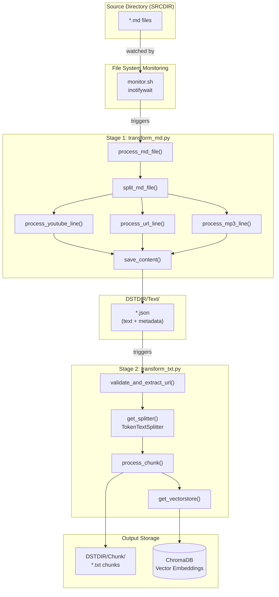
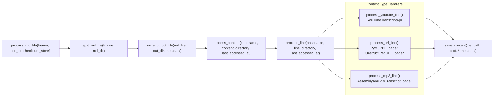
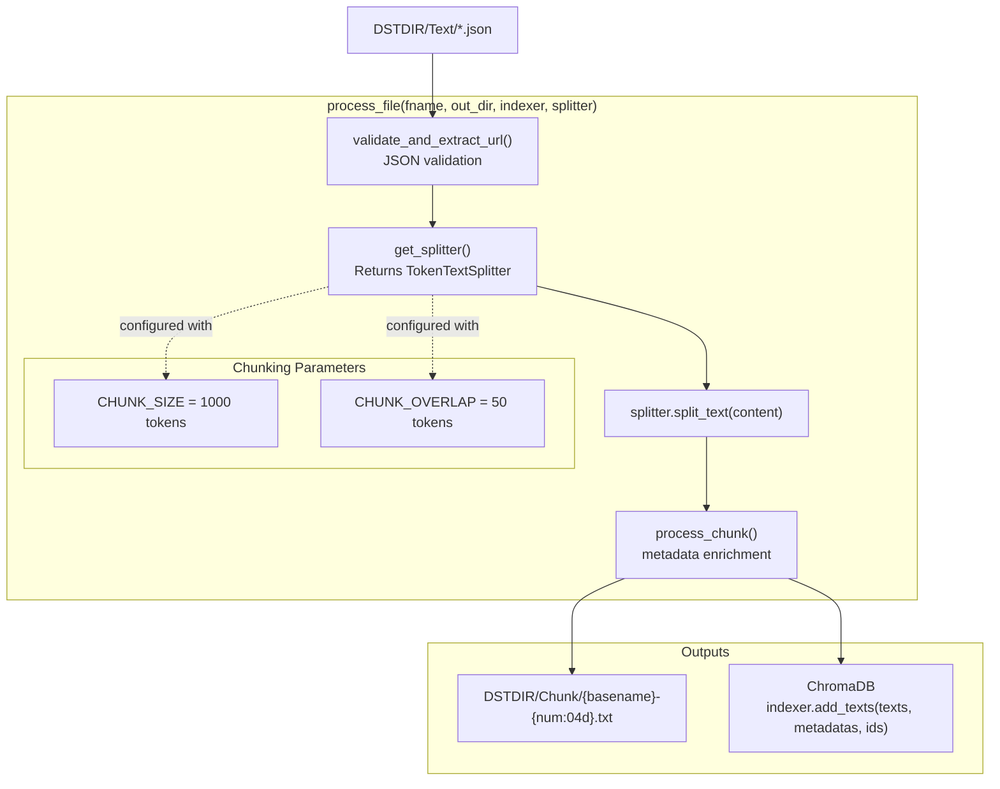
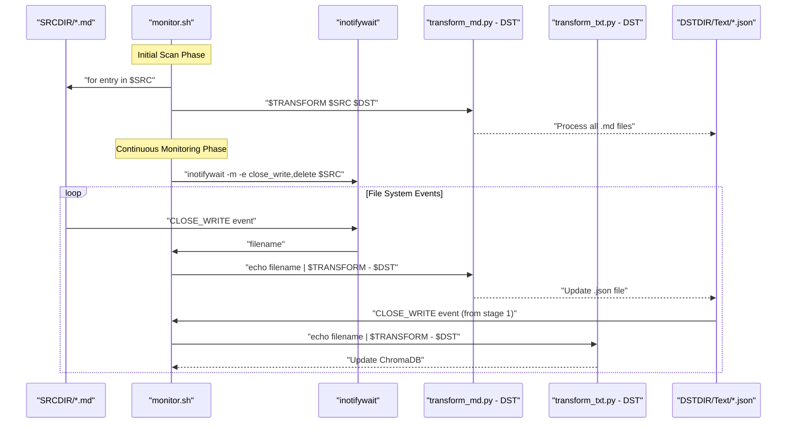
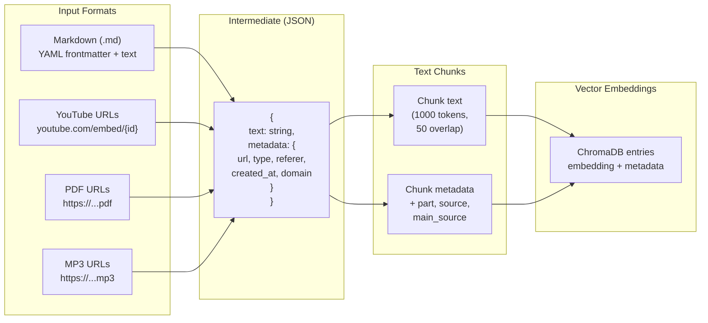

<!-- source: DeepWiki mcp.deepwiki.com · repo flepied/second-brain-agent · page 2 Data Processing Pipeline · fetched 2026-10-26 -->

# Data Processing Pipeline

<details>
<summary>Relevant source files</summary>

The following files were used as context for generating this wiki page:

- [README.md](README.md)
- [transform_md.py](transform_md.py)
- [transform_txt.py](transform_txt.py)

</details>


The data processing pipeline transforms diverse document formats into vector embeddings stored in ChromaDB. This two-stage pipeline consists of content extraction ([transform_md.py]()), text chunking with vectorization ([transform_txt.py]()), orchestrated by a file system monitoring service ([monitor.sh]()). 

This page provides an architectural overview of the pipeline. For detailed implementation specifics, see:
- **Markdown and Content Extraction** ([#2.1]()) - Deep dive into [transform_md.py]()
- **Text Chunking and Vectorization** ([#2.2]()) - Deep dive into [transform_txt.py]()
- **File System Monitoring** ([#2.3]()) - Deep dive into [monitor.sh]()

For information about the storage layer and ChromaDB configuration, see **Vector Database Setup** ([#5.1]()). For details about the Agent system that queries this processed data, see **Agent and Intelligence Layer** ([#3]()).

## Architecture Overview

The pipeline implements a two-stage transformation process that converts markdown files and embedded content (YouTube videos, PDFs, web pages, audio) into searchable vector embeddings. The system uses `inotifywait` for real-time file monitoring, triggering incremental processing when source files change.

**Pipeline Architecture: File Flow and Processing Stages**



Sources: [transform_md.py:531-566](), [transform_txt.py:101-131](), [monitor.sh]()

## Pipeline Stages

The pipeline operates in two sequential stages, each implemented as a systemd service that can run continuously or be triggered manually:

| Stage | Script | Systemd Service | Input | Output | Primary Functions |
|-------|--------|----------------|-------|--------|-------------------|
| **Content Extraction** | `transform_md.py` | `sba-md.service` | `SRCDIR/*.md` | `DSTDIR/Text/*.json` | `process_md_file()`, `save_content()` |
| **Chunking & Vectorization** | `transform_txt.py` | `sba-txt.service` | `DSTDIR/Text/*.json` | `DSTDIR/Chunk/*.txt`, ChromaDB | `process_file()`, `get_vectorstore()` |

### Stage 1: Content Extraction (transform_md.py)

The first stage extracts text content from markdown files and embedded multimedia resources. The `process_md_file()` function serves as the entry point, delegating to specialized extraction functions based on content type.

**Content Extraction: Function Call Flow**



Sources: [transform_md.py:531-566](), [transform_md.py:185-213](), [transform_md.py:215-280](), [transform_md.py:282-330]()

**Key Features:**
- **History File Splitting**: Splits journal/history files by date using `split_md_file()` and regex patterns `DATE2_REGEXP`, `DATE3_REGEXP` ([transform_md.py:429-460]())
- **Content Deduplication**: Uses `ChecksumStore` to skip unchanged files ([transform_md.py:558]())
- **Fallback Mechanisms**: YouTube extraction falls back to Whisper if transcript API fails ([transform_md.py:150-182]())
- **Metadata Extraction**: Parses YAML frontmatter with `get_metadata()` ([transform_md.py:354-387]())

For detailed implementation, see **Markdown and Content Extraction** ([#2.1]()).

### Stage 2: Text Chunking and Vectorization (transform_txt.py)

The second stage processes JSON files into fixed-size text chunks and generates vector embeddings. The `TokenTextSplitter` from LangChain creates chunks with configurable size and overlap.

**Chunking Configuration and Data Flow**



Sources: [transform_txt.py:18-21](), [transform_txt.py:24-29](), [transform_txt.py:101-131]()

**Key Features:**
- **Token-Based Chunking**: 1000 token chunks with 50 token overlap to preserve context across boundaries
- **Metadata Preservation**: Each chunk retains original metadata plus `part`, `source`, `main_source` fields ([transform_txt.py:36-43]())
- **Timestamp Synchronization**: Chunk files maintain source file modification times ([transform_txt.py:52-54]())
- **Cleanup on Deletion**: `remove_related_files()` deletes chunks when source files are removed ([transform_txt.py:85-98]())

For detailed implementation, see **Text Chunking and Vectorization** ([#2.2]()).

## File System Monitoring and Orchestration

The `monitor.sh` script orchestrates the pipeline by watching the source directory for changes and triggering the appropriate transformation scripts. It uses `inotifywait` from the `inotify-tools` package to detect file system events in real-time.

**File System Monitoring: Event Detection and Script Invocation**



Sources: [monitor.sh]()

The monitoring script can be invoked directly or deployed as a systemd user service. When run as `sba-md.service` and `sba-txt.service`, it provides continuous background processing. See **File System Monitoring** ([#2.3]()) for implementation details and **System Services** ([#5.2]()) for deployment configuration.

## Data Flow and Transformations

The pipeline transforms raw markdown files into searchable vector embeddings through a series of data format conversions:

**Data Format Transformation Pipeline**



Sources: [transform_md.py:72-90](), [transform_txt.py:58-82](), [transform_txt.py:32-55]()

### Metadata Standardization

The pipeline extracts and standardizes metadata across all document types to ensure consistent querying:

| Metadata Field | Source | Description | Format |
|----------------|--------|-------------|--------|
| `url` | YAML frontmatter or computed | Source URL or file path | String |
| `type` | Content type or default | Document category | `notes`, `youtube`, `pdf`, `audio`, `web`, `history` |
| `referer` | Parent document | Embedding source document | Filename without extension |
| `created_at` | YAML `date` or file mtime | Document creation timestamp | Unix timestamp (float) |
| `last_accessed_at` | File mtime | Last modification timestamp | Unix timestamp (float) |
| `domain` | Computed from filename | Logical grouping | String (see `extract_domain()`) |

Sources: [transform_md.py:354-387](), [transform_md.py:414-426](), [transform_txt.py:78-81]()

The `domain` field is computed by `extract_domain()` which removes numbers and strings like `At`, `Journal`, `Project`, `Notes`, and `History` from the filename. For example, `WorkoutHistory202412.md` yields domain `Workout`. This domain metadata enables filtered retrieval for activity reports (see **Intent Classification and Extraction** [#3.2]()).

## Output Format and Storage Structure

The pipeline generates a hierarchical directory structure under `DSTDIR` with processed content organized by type:

```
DSTDIR/
├── Text/           # Extracted content as JSON
│   ├── {basename}.json
│   ├── {video_id}.json
│   └── {url_hash}.json
├── Chunk/          # Text chunks for vectorization
│   ├── {basename}-0001.txt
│   ├── {basename}-0002.txt
│   └── ...
├── Markdown/       # Split markdown files
│   └── history files
├── Orig/           # Original downloaded files
│   ├── audio files
│   └── PDF files
└── Db/            # ChromaDB vector storage
```

### JSON Document Format

Each processed document is stored as JSON with the following structure:

```json
{
  "text": "extracted content",
  "metadata": {
    "url": "source URL or file path",
    "type": "notes|youtube|pdf|audio|web",
    "referer": "parent document name",
    "last_accessed_at": 1234567890.0,
    "created_at": 1234567890.0,
    "domain": "extracted domain"
  }
}
```

Sources: [transform_md.py:39-41](), [transform_md.py:44-62](), [transform_txt.py:36-49]()

## Error Handling and Resilience

The pipeline includes comprehensive error handling to ensure robust operation:

- **Content Deduplication**: Files are only reprocessed when content changes using checksum comparison
- **Encoding Support**: Handles both UTF-8 and Latin-1 encodings
- **Missing File Cleanup**: Removes vector database entries when source files are deleted
- **API Failure Recovery**: Falls back to alternative extraction methods (e.g., Whisper for YouTube when transcripts are unavailable)

Sources: [transform_md.py:428-464](), [transform_md.py:416-423](), [transform_txt.py:79-93](), [transform_md.py:87-117]()

---

