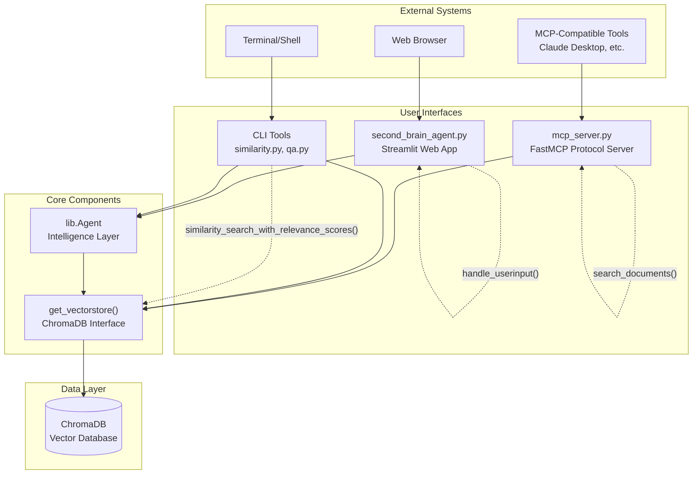
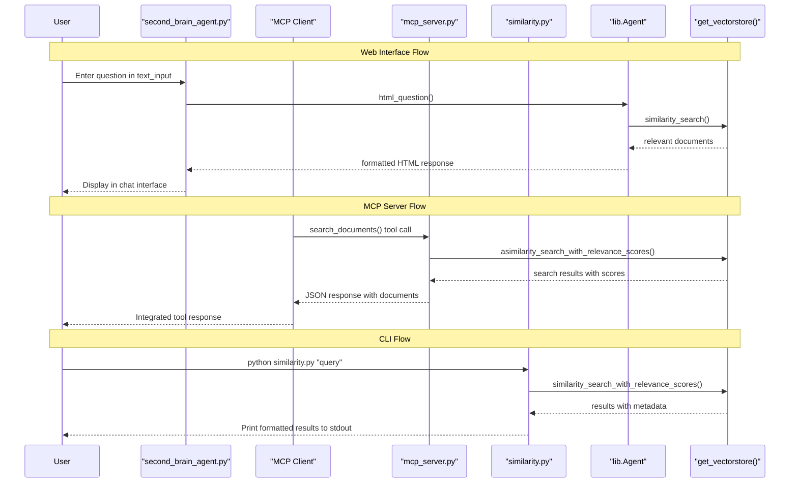

<!-- source: DeepWiki mcp.deepwiki.com · repo flepied/second-brain-agent · page 4 User Interfaces · fetched 2026-10-26 -->

# User Interfaces

Relevant source files

The following files were used as context for generating this wiki page:

- [README.md](README.md)
- [mcp-server.sh](mcp-server.sh)
- [mcp_server.py](mcp_server.py)
- [second_brain_agent.py](second_brain_agent.py)

## Purpose and Scope

This document provides an overview of the various user interfaces available in the Second Brain Agent system for querying and interacting with the personal knowledge database. The system provides three primary interface types: a web-based chat interface, a programmatic MCP server, and command-line utilities.

For details on the core Agent system that powers these interfaces, see [Core Agent System](#3.1). For information about the underlying vector database storage, see [Vector Database Setup](#5.1).

## Interface Architecture Overview

The Second Brain Agent system exposes its knowledge base through multiple complementary interfaces, each designed for different use cases and user preferences. All interfaces ultimately interact with the same ChromaDB vector database and leverage the core `Agent` class for intelligent responses.

### Interface Types

| Interface Type | Primary Use Case | Implementation | Target Users |
|---|---|---|---|
| **Web Interface** | Interactive conversations and exploratory queries | Streamlit application | End users seeking conversational interaction |
| **MCP Server** | Programmatic integration with other tools | FastMCP protocol server | Developers and automated systems |
| **CLI Tools** | Quick searches and scripting | Python command-line utilities | Power users and system administrators |

## System Interface Architecture

**Sources**: [second_brain_agent.py:1-73](), [mcp_server.py:1-244](), [similarity.py:1-41]()

## User Interaction Flow

**Sources**: [second_brain_agent.py:22-30](), [mcp_server.py:88-89](), [similarity.py:29]()

## Interface Capabilities Matrix

Each interface provides different capabilities suited to its intended use case:

| Capability | Web Interface | MCP Server | CLI Tools |
|---|---|---|---|
| **Natural Language Q&A** | ✅ Full conversational AI via `Agent.html_question()` | ❌ Raw document search only | ⚠️ Limited via `qa.py` |  
| **Similarity Search** | ✅ Integrated in responses | ✅ Primary function via `search_documents()` | ✅ Primary function |
| **Metadata Filtering** | ❌ Not exposed | ✅ Complex filters via `filter_metadata` | ✅ Simple key=value filters |
| **Document Statistics** | ❌ Not available | ✅ Via `get_document_count()` and `get_domains()` | ❌ Not available |
| **Real-time Interaction** | ✅ Interactive chat session | ✅ Tool-based integration | ❌ Single command execution |
| **Batch Processing** | ❌ One question at a time | ✅ Programmatic bulk queries | ✅ Scriptable commands |

## Interface Implementation Details

### Session Management
- **Web Interface**: Uses Streamlit's `st.session_state` to maintain `Agent` instance across requests [second_brain_agent.py:48-49]()
- **MCP Server**: Stateless tool-based architecture with per-request `get_vectorstore()` calls [mcp_server.py:80]()
- **CLI Tools**: Stateless single-execution commands with fresh database connections [similarity.py:25]()

### Input Processing
- **Web Interface**: Processes user input through `handle_userinput()` with email cleaning via `clean_email()` [second_brain_agent.py:17-30]()
- **MCP Server**: Validates and processes structured tool parameters including complex metadata filters [mcp_server.py:84-85]()
- **CLI Tools**: Parses command-line arguments with `split_filter()` for metadata filtering [similarity.py:14-21]()

### Output Formatting
- **Web Interface**: Renders HTML responses using `bot_template` and `user_template` from `htmlTemplates` [second_brain_agent.py:27-29]()
- **MCP Server**: Returns structured JSON with documents, metadata, and similarity scores [mcp_server.py:93-108]()
- **CLI Tools**: Outputs plain text with source paths, similarity scores, and metadata [similarity.py:31]()

**Sources**: [second_brain_agent.py:1-73](), [mcp_server.py:1-244](), [similarity.py:1-41](), [mcp-server.sh:1-16]()

---

