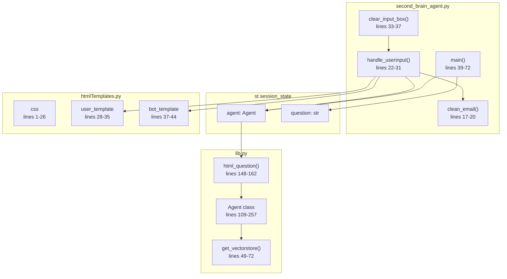
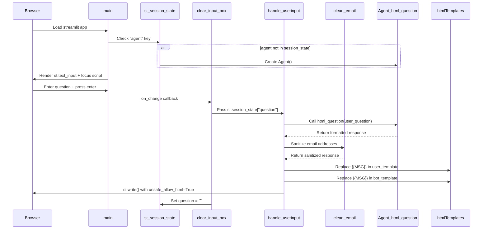
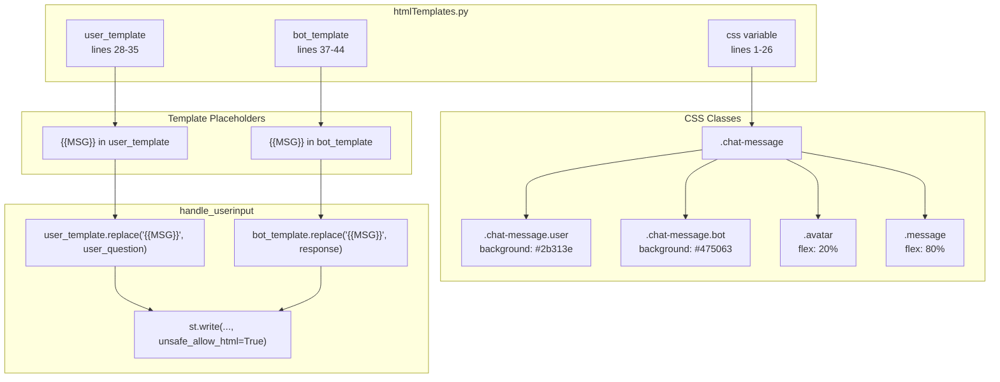

<!-- source: DeepWiki mcp.deepwiki.com · repo flepied/second-brain-agent · page 4.1 Web Interface · fetched 2026-10-26 -->

# Web Interface

<details>
<summary>Relevant source files</summary>

The following files were used as context for generating this wiki page:

- [lib.py](lib.py)
- [second_brain_agent.py](second_brain_agent.py)

</details>


The Web Interface provides an interactive chat-based user interface for querying the Second Brain Agent system through a web browser. Built with Streamlit, it enables users to have conversational interactions with their knowledge base through a clean, responsive web application.

This document covers the Streamlit-based web interface implementation. For programmatic access to the knowledge base, see [MCP Protocol Server](#4.2). For command-line query tools, see [Command Line Tools](#4.3).

## Architecture Overview

The web interface is implemented as a single-page Streamlit application that orchestrates several key components to provide a conversational AI experience.

### Core Components Architecture



**Components Interaction Flow**
The Streamlit application in `second_brain_agent.py` maintains session state for the `Agent` instance and user input. The `handle_userinput` function calls `Agent.html_question()` for RAG-based responses, then formats output using HTML templates from `htmlTemplates.py`.

Sources: [second_brain_agent.py:39-72](), [second_brain_agent.py:22-31](), [lib.py:109-162](), [htmlTemplates.py:1-44]()

### User Interaction Flow



**Request-Response Cycle**
User input triggers `clear_input_box()` which calls `handle_userinput()`. This function invokes `Agent.html_question()` from `lib.py`, sanitizes the response with `clean_email()`, formats it using `user_template` and `bot_template`, and displays the conversation using `st.write()` with HTML rendering enabled.

Sources: [second_brain_agent.py:33-37](), [second_brain_agent.py:22-31](), [second_brain_agent.py:17-20](), [lib.py:148-162]()

## Core Implementation

### Main Application Function

The `main()` function at [second_brain_agent.py:39-72]() initializes the Streamlit application:

| Step | Code | Purpose |
|------|------|---------|
| 1. Load environment | `load_dotenv()` | Load API keys and configuration from `.env` |
| 2. Configure page | `st.set_page_config()` | Set page title and brain icon |
| 3. Apply CSS | `st.write(css, unsafe_allow_html=True)` | Inject chat message styling |
| 4. Initialize Agent | `if "agent" not in st.session_state: st.session_state.agent = Agent()` | Create singleton Agent instance with OpenAI LLM and ChromaDB vectorstore |
| 5. Create input | `st.text_input(key="question", on_change=clear_input_box)` | Text input with callback trigger |
| 6. Focus script | `st.components.v1.html()` | JavaScript to auto-focus input field |

The application uses Streamlit's session state to maintain a persistent `Agent` instance (defined in `lib.py`) across user interactions. The `Agent` is initialized once per session with connections to the OpenAI LLM [lib.py:115]() and ChromaDB vectorstore [lib.py:114]().

Sources: [second_brain_agent.py:39-68](), [lib.py:112-119]()

### Question Processing Pipeline

The question handling follows a three-stage pipeline:

| Stage | Function | Lines | Purpose |
|-------|----------|-------|---------|
| 1. Input Trigger | `clear_input_box()` | [second_brain_agent.py:33-37]() | Invoked by `on_change` callback, calls `handle_userinput()` and clears input |
| 2. AI Processing | `handle_userinput()` | [second_brain_agent.py:22-31]() | Calls `Agent.html_question()`, sanitizes response, formats with templates |
| 3. Email Sanitization | `clean_email()` | [second_brain_agent.py:17-20]() | Converts `<email@domain>` to `&lt;email@domain&gt;` to prevent XSS |

**Agent Integration**

The `handle_userinput()` function calls `st.session_state.agent.html_question(user_question)` which triggers the full RAG pipeline:

1. **Intent Classification**: [lib.py:170]() calls `extract_intent()` to classify as regular question or activity report
2. **Query Routing**: [lib.py:171-175]() routes to `_regular_question()` or `_activity_report()` 
3. **Response Generation**: [lib.py:148-162]() formats answer with HTML-linked sources using `local_link()` helper
4. **Source Extraction**: [lib.py:245-248]() converts chunk sources to original URLs via ChromaDB metadata

The `html_question()` method differs from `question()` by wrapping sources in HTML `<a>` tags for clickable links in the web interface.

Sources: [second_brain_agent.py:22-31](), [second_brain_agent.py:33-37](), [lib.py:148-162](), [lib.py:168-175]()

## HTML Templating System

The web interface uses a custom HTML templating system defined in `htmlTemplates.py` to create a chat-like conversation display.

### Template Structure



**Template Architecture**
The `css` variable defines styling, while `user_template` and `bot_template` provide HTML structures. The `handle_userinput()` function performs string replacement on `{{MSG}}` placeholders and renders with `unsafe_allow_html=True` to enable HTML links in bot responses.

Sources: [htmlTemplates.py:1-44](), [second_brain_agent.py:26-30]()

### Chat Message Styling

The CSS at [htmlTemplates.py:1-26]() defines distinct visual styles:

| Component | CSS Class | Styling Details |
|-----------|-----------|-----------------|
| User Message | `.chat-message.user` | Background: `#2b313e`, padding: `1.5rem`, border-radius: `0.5rem` |
| Bot Message | `.chat-message.bot` | Background: `#475063`, padding: `1.5rem`, border-radius: `0.5rem` |
| Avatar Container | `.avatar` | Flex: `20%`, contains `` tag |
| Message Content | `.message` | Flex: `80%`, padding: `0 1.5rem`, color: `#fff` |

**Template Placeholder Substitution**

Templates use simple string replacement via Python's `.replace()` method:
- `user_template` [htmlTemplates.py:28-35](): Contains user avatar and `{{MSG}}` placeholder
- `bot_template` [htmlTemplates.py:37-44](): Contains bot avatar and `{{MSG}}` placeholder
- Substitution occurs in [second_brain_agent.py:27-28](): `user_template.replace("{{MSG}}", user_question)` and `bot_template.replace("{{MSG}}", response)`

The bot template preserves HTML formatting in responses, enabling clickable source links generated by `Agent.html_question()`.

Sources: [htmlTemplates.py:1-44](), [second_brain_agent.py:26-30]()

## Browser Integration and Security

### Auto-Focus JavaScript

The application at [second_brain_agent.py:57-68]() injects JavaScript using `st.components.v1.html()` to automatically focus the input field:

```javascript
var input = window.parent.document.querySelectorAll("input[type=text]");
for (var i = 0; i < input.length; ++i) {
    input[i].focus();
}
```

The script targets `window.parent.document` because Streamlit runs components in iframes. The `querySelectorAll` loop handles multiple text inputs that may exist in the Streamlit interface. This provides immediate typing capability without manual clicking.

Sources: [second_brain_agent.py:57-68]()

### Email Sanitization

The `clean_email()` function at [second_brain_agent.py:17-20]() prevents XSS attacks when rendering HTML responses:

```python
def clean_email(response):
    return re.sub(r"<(.*@.*)>", r"&lt;\1&gt;", response)
```

**Sanitization Flow**:
1. Pattern `r"<(.*@.*)>"` matches email addresses in angle brackets
2. Replacement `r"&lt;\1&gt;"` converts `<` to `&lt;` and `>` to `&gt;`
3. Applied in [second_brain_agent.py:24]() before `st.write(..., unsafe_allow_html=True)`

This is critical because `unsafe_allow_html=True` enables HTML rendering for source links. Without sanitization, LLM-generated content containing `<script>` tags or malicious HTML could execute in the user's browser.

Sources: [second_brain_agent.py:17-20](), [second_brain_agent.py:24]()

## Configuration and Environment

The web interface loads configuration through environment variables using `load_dotenv()`. The underlying `Agent` class requires:

- **OpenAI API Key**: For language model interactions
- **Vector Database**: ChromaDB connection for document retrieval
- **Source/Destination Directories**: For file processing pipeline

The Streamlit application runs as a standard Python script and can be launched using:

```bash
streamlit run second_brain_agent.py
```

Sources: [second_brain_agent.py:41](), [second_brain_agent.py:71-73]()

---

