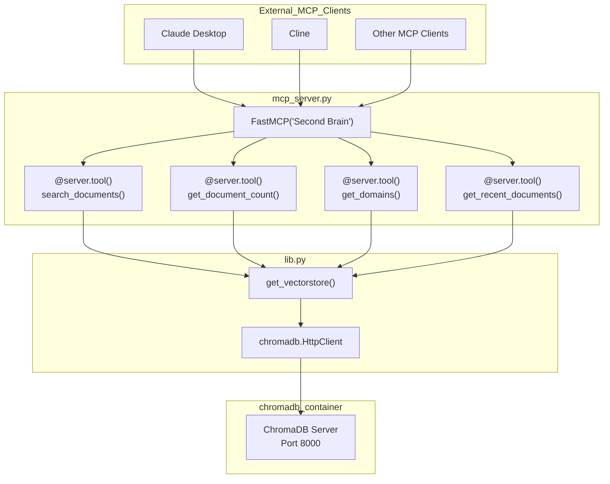
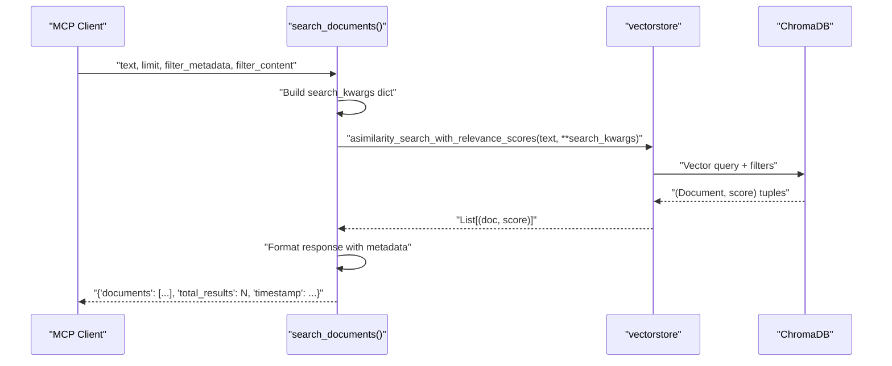
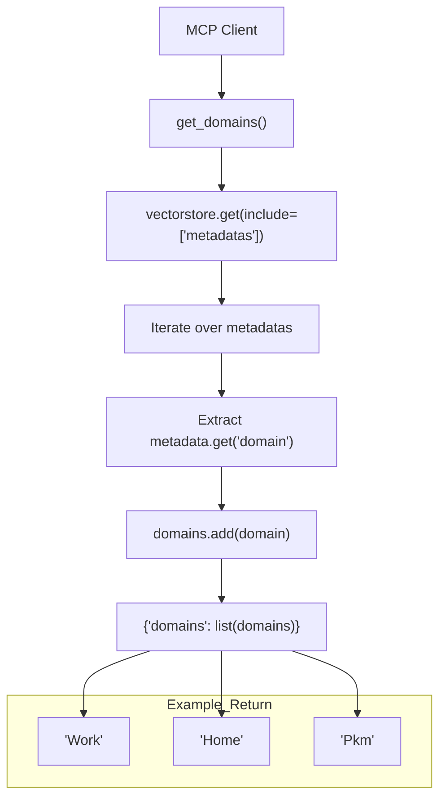
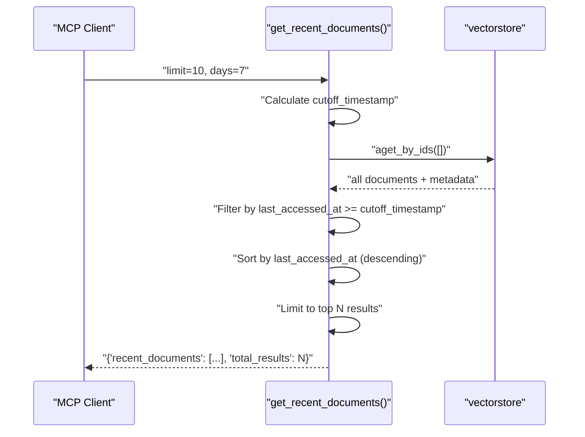
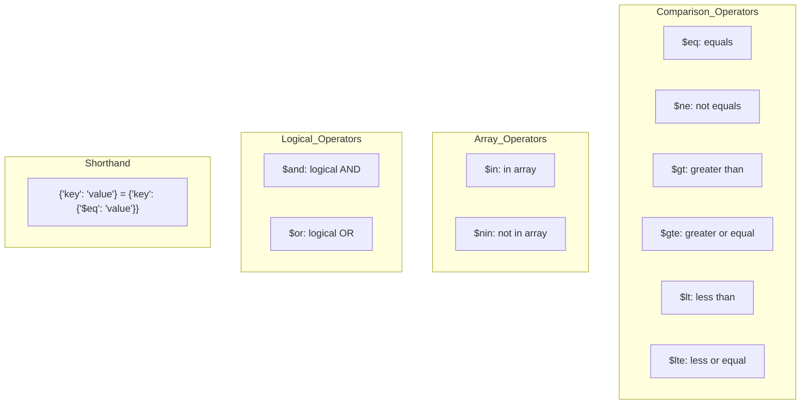
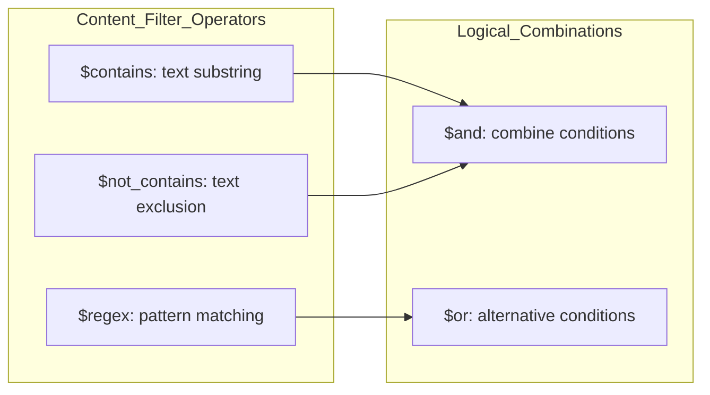
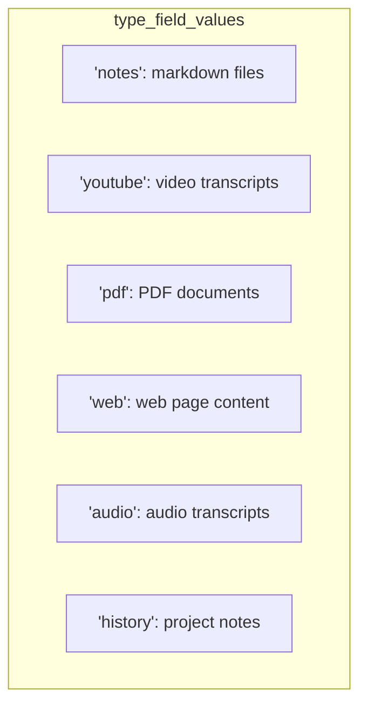
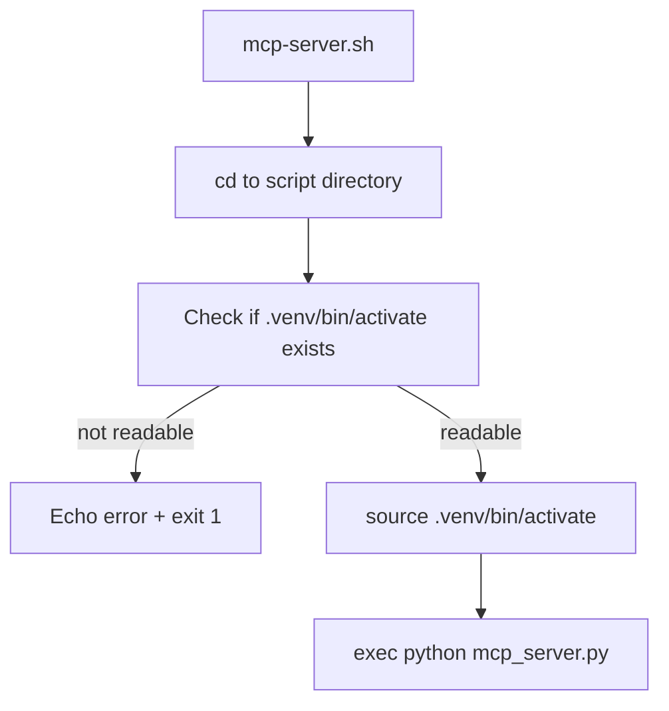

<!-- source: DeepWiki mcp.deepwiki.com · repo flepied/second-brain-agent · page 4.2 MCP Protocol Server · fetched 2026-10-26 -->

# MCP Protocol Server

<details>
<summary>Relevant source files</summary>

The following files were used as context for generating this wiki page:

- [lib.py](lib.py)
- [mcp-server.sh](mcp-server.sh)
- [mcp_server.py](mcp_server.py)
- [test_mcp_server.py](test_mcp_server.py)

</details>


The MCP Protocol Server provides programmatic access to the Second Brain Agent's document database through the Model Context Protocol (MCP). This server exposes the vector database functionality as standardized tools that can be consumed by MCP-compatible clients, enabling external applications and agents to search, query, and retrieve documents from the personal knowledge base.

For information about the core Agent system that provides intelligent query processing, see [Core Agent System](#3.1). For details about the web-based user interface, see [Web Interface](#4.1).

## Architecture Overview

The MCP server (`mcp_server.py`) provides programmatic access to the ChromaDB vector database through the Model Context Protocol. It implements the FastMCP framework to expose four specialized tools: `search_documents`, `get_document_count`, `get_domains`, and `get_recent_documents`. Unlike the Agent system, the MCP server provides direct vector database access without LLM processing overhead.



**MCP Server Architecture with Code Entities**

The server initializes as `FastMCP(name="Second Brain", instructions="...")` at [mcp_server.py:25-29](). Each tool is decorated with `@server.tool()` and implements async operations for concurrent client access. The `get_vectorstore()` function from `lib.py` provides the connection to ChromaDB with automatic retry logic (up to 12 retries with 5-second intervals).

Sources: [mcp_server.py:1-29](), [lib.py:49-72]()

## MCP Tools Implementation

The server exposes four tools through the MCP protocol. Each tool is implemented as an async function decorated with `@server.tool()`.

### search_documents Tool

The `search_documents` tool implements semantic similarity search with metadata and content filtering:



**Document Search Flow**

| Parameter | Type | Default | Description |
|-----------|------|---------|-------------|
| `text` | str | "" | Search query for semantic similarity (empty for metadata-only search) |
| `limit` | int | 10 | Maximum number of results |
| `filter_metadata` | Optional[Dict[str, Any]] | None | ChromaDB metadata filters (supports `$and`, `$or`, `$eq`, `$ne`, `$gt`, `$gte`, `$lt`, `$lte`, `$in`, `$nin`) |
| `filter_content` | Optional[Dict[str, Any]] | None | Document content filters (supports `$contains`, `$not_contains`, `$regex`) |

The tool builds `search_kwargs` at [mcp_server.py:373-377]() and invokes `vectorstore.asimilarity_search_with_relevance_scores()` at [mcp_server.py:380-382](). Results are formatted as dictionaries containing `content`, `metadata`, and `similarity_score` at [mcp_server.py:385-393]().

**Return Format:**
```python
{
    "documents": [
        {
            "content": "document text...",
            "metadata": {
                "created_at": 1685469900.0,
                "source": "~/.second-brain/Chunk/DciNotes20240406-0001.txt",
                "last_accessed_at": 1712397600.0,
                "part": 1,
                "referer": "DciNotes",
                "url": "file:///home/user/Wiki/DciNotes",
                "type": "history",
                "main_source": "~/.second-brain/Text/DciNotes20240406.json",
                "domain": "Work"
            },
            "similarity_score": 0.85
        }
    ],
    "total_results": 1,
    "timestamp": "2024-01-01T12:00:00Z"
}
```

Sources: [mcp_server.py:32-407]()

### get_document_count Tool

The `get_document_count` tool returns the total number of documents matching filter criteria:


**Document Count Flow**

| Parameter | Type | Default | Description |
|-----------|------|---------|-------------|
| `filter_metadata` | Optional[Dict[str, Any]] | None | ChromaDB metadata filters (same syntax as `search_documents`) |

Implementation at [mcp_server.py:409-583]() calls `vectorstore.get(where=filter_metadata, include=[])` to retrieve document IDs without content, then returns `len(res)` as the count. The `include=[]` parameter optimizes performance by excluding document content and embeddings.

Sources: [mcp_server.py:409-583]()

### get_domains Tool

The `get_domains` tool extracts unique domain values from all documents:



**Domain Discovery Process**

Implementation at [mcp_server.py:585-613]() uses `asyncio.to_thread()` to execute the synchronous `vectorstore.get()` operation at [mcp_server.py:596-599](). It iterates over all document metadata at [mcp_server.py:602-606]() to build a set of unique domain values, which is returned as a list.

**Return Format:**
```python
{
    "domains": ["Work", "Home", "Pkm", "Personal"]
}
```

Sources: [mcp_server.py:585-613]()

### get_recent_documents Tool

The `get_recent_documents` tool retrieves recently accessed documents:



**Recent Documents Flow**

| Parameter | Type | Default | Description |
|-----------|------|---------|-------------|
| `limit` | int | 10 | Maximum results to return |
| `days` | int | 7 | Days to look back for recent access |

Implementation at [mcp_server.py:615-670]():
1. Calculates `cutoff_timestamp = (datetime.now() - timedelta(days=days)).timestamp()` at [mcp_server.py:632-633]()
2. Retrieves all documents using `vectorstore.aget_by_ids([])` at [mcp_server.py:636]()
3. Filters documents where `last_accessed_at >= cutoff_timestamp` at [mcp_server.py:639-652]()
4. Sorts by `last_accessed` in descending order at [mcp_server.py:655]()
5. Limits results at [mcp_server.py:656]()

**Return Format:**
```python
{
    "recent_documents": [
        {
            "content": "document text...",
            "metadata": {...},
            "last_accessed": 1712397600.0
        }
    ],
    "total_results": 5,
    "days_back": 7,
    "timestamp": "2024-01-01T12:00:00Z"
}
```

Sources: [mcp_server.py:615-670]()

## Filtering Capabilities

The MCP server supports two types of filtering: metadata filtering and content filtering.

### Metadata Filtering

Metadata filters use ChromaDB's query syntax with the following operators:



**ChromaDB Metadata Filter Operators**

| Operator | Supported Types | Example |
|----------|----------------|---------|
| `$eq`, `$ne` | String, numeric | `{"type": {"$eq": "notes"}}` |
| `$gt`, `$gte`, `$lt`, `$lte` | Numeric only | `{"created_at": {"$gte": 1685469600.0}}` |
| `$in`, `$nin` | Arrays | `{"referer": {"$in": ["DciNotes", "WorkNotes"]}}` |
| `$and`, `$or` | Nested conditions | `{"$and": [{"type": "notes"}, {"domain": "work"}]}` |

**Important Limitations:**
- `$regex`, `$exists`, `$contains` operators are NOT supported for metadata filtering
- Multiple conditions require explicit `$and` operator
- Invalid: `{"type": "youtube", "domain": "work"}` 
- Valid: `{"$and": [{"type": {"$eq": "youtube"}}, {"domain": {"$eq": "work"}}]}`

Sources: [mcp_server.py:176-197]()

### Content Filtering

Content filters operate on document text using `where_document` parameter:



**Content Filter Operators**

Examples:
```python
# Find documents containing "github"
{"$contains": "github"}

# Find documents not containing "test"
{"$not_contains": "test"}

# Find documents matching regex
{"$regex": "(?i)python.*script"}

# Complex content filtering
{"$and": [{"$contains": "python"}, {"$not_contains": "test"}]}
```

Content filtering is specified via the `filter_content` parameter at [mcp_server.py:204-240]() and applied using `search_kwargs["where_document"] = filter_content` at [mcp_server.py:376-377]().

Sources: [mcp_server.py:204-240](), [mcp_server.py:376-377]()

## Document Metadata Schema

Documents returned by the MCP server include standardized metadata fields:

| Field | Type | Description | Example |
|-------|------|-------------|---------|
| `created_at` | float | Document creation timestamp | `1685469900.0` |
| `last_accessed_at` | float | Source markdown file modification time | `1712397600.0` |
| `source` | str | Path to chunk file | `~/.second-brain/Chunk/DciNotes20240406-0001.txt` |
| `main_source` | str | Path to JSON file before chunking | `~/.second-brain/Text/DciNotes20240406.json` |
| `referer` | str | Basename of source markdown file | `DciNotes` |
| `url` | str | Original document location | `file:///home/user/Wiki/DciNotes` or `https://youtube.com/watch?v=...` |
| `part` | int | Chunk number within document | `1`, `2`, `3`, etc. |
| `type` | str | Document classification | `notes`, `youtube`, `pdf`, `web`, `audio`, `history` |
| `domain` | str | Organizational category | `Work`, `Personal`, `Pkm` |

**Document Type Classification:**



**Document Types**

The `type` field is set during content extraction in `transform_md.py` and preserved through the chunking pipeline in `transform_txt.py`. The `domain` field comes from markdown headers or defaults based on file location.

Sources: [mcp_server.py:287-318]()

## Configuration and Deployment

### Environment Configuration

The MCP server loads configuration from environment variables:

```python
# mcp_server.py lines 17-22
load_dotenv()
SRCDIR = os.getenv("SRCDIR", ".")
DSTDIR = os.getenv("DSTDIR", ".")
SBA_ORG_DOC = os.getenv("SBA_ORG_DOC", "SecondBrainOrganization.md")
```

| Environment Variable | Purpose | Default | Used For |
|---------------------|---------|---------|----------|
| `SRCDIR` | Source directory for documents | `"."` | Organization document lookup |
| `DSTDIR` | Destination directory | `"."` | Future use |
| `SBA_ORG_DOC` | Organization document filename | `"SecondBrainOrganization.md"` | Domain descriptions |

The server initializes FastMCP at [mcp_server.py:25-29]():
```python
server = FastMCP(
    name="Second Brain",
    instructions="""This server provides tools for interacting with personal notes...""",
)
```

Sources: [mcp_server.py:17-29]()

### Deployment Script

The `mcp-server.sh` script provides the entry point for MCP clients:



**Deployment Script Flow**

Script implementation at [mcp-server.sh:1-16]():
1. Changes to script directory with `cd $(cd "$(dirname "$0")" && pwd)` at [mcp-server.sh:3]()
2. Validates Poetry virtual environment exists at [mcp-server.sh:6-9]()
3. Activates virtual environment at [mcp-server.sh:11]()
4. Executes server with `exec python mcp_server.py "$@"` at [mcp-server.sh:13]()

The script passes command-line arguments to the Python process and uses `exec` to replace the shell process with the Python process.

Sources: [mcp-server.sh:1-16]()

### Server Execution

When run directly, the server prints debugging information and starts the FastMCP server:

```python
# mcp_server.py lines 672-683
if __name__ == "__main__":
    print("Starting MCP server...", file=sys.stderr)
    print(f"Current working directory: {os.getcwd()}", file=sys.stderr)
    print(f"Environment variables: SRCDIR={os.getenv('SRCDIR', 'NOT SET')}, "
          f"DSTDIR={os.getenv('DSTDIR', 'NOT SET')}", file=sys.stderr)
    server.run()
```

The `server.run()` call at [mcp_server.py:683]() starts the FastMCP server, which listens for MCP protocol messages on stdio.

Sources: [mcp_server.py:672-684]()

## Integration with Vector Database

The MCP server integrates directly with the ChromaDB vector database through the `get_vectorstore()` function from the `lib` module. This integration provides:

- **Async Operations**: All database queries use async methods (`asimilarity_search_with_relevance_scores`, `aget_by_ids`)
- **Error Handling**: Comprehensive exception handling with structured error responses
- **Performance**: Direct vector database access without Agent system overhead
- **Consistency**: Uses the same vector database instance as other system components

The server maintains connection pooling and resource management through the shared vectorstore interface, ensuring efficient resource utilization across multiple concurrent MCP client connections.

Sources: [mcp_server.py:15](), [mcp_server.py:80-90](), [mcp_server.py:154-159]()

---

