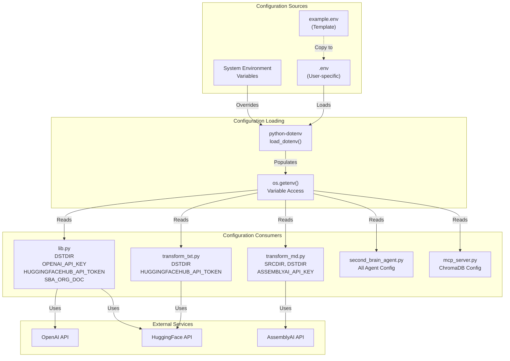
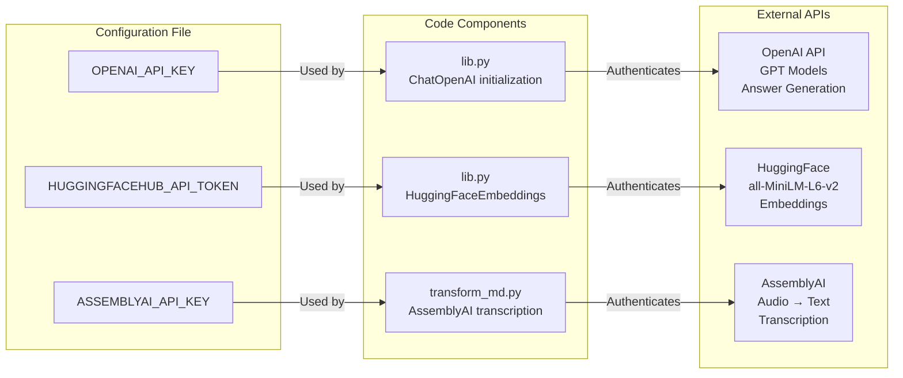
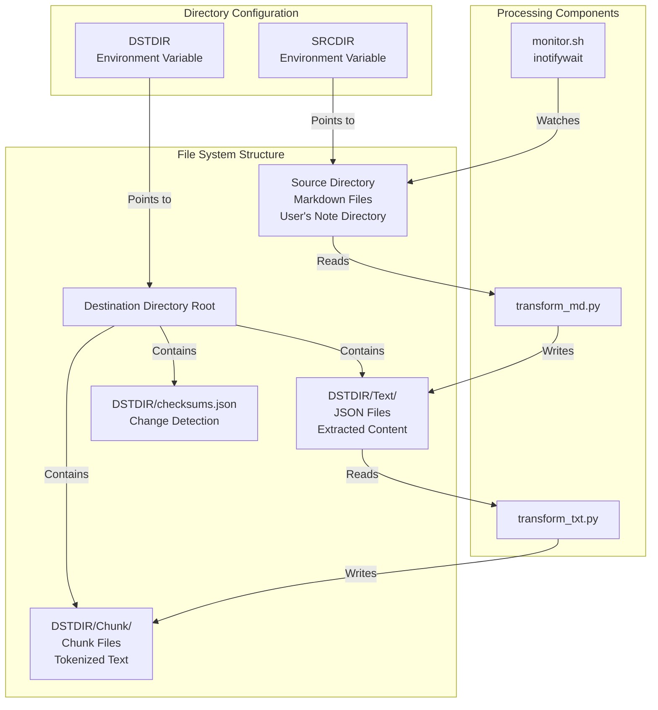
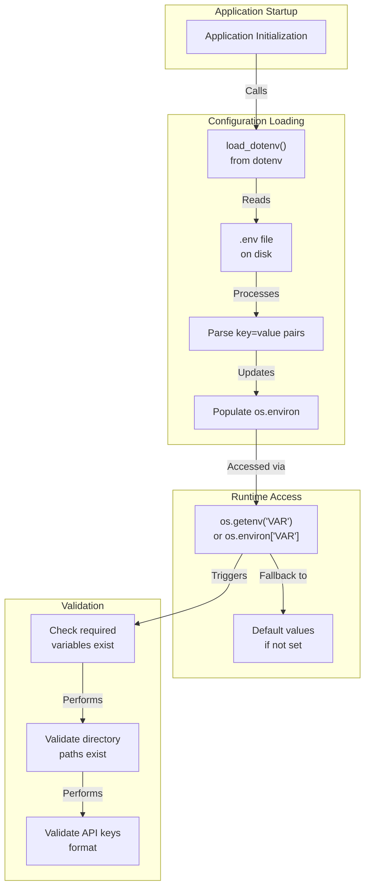
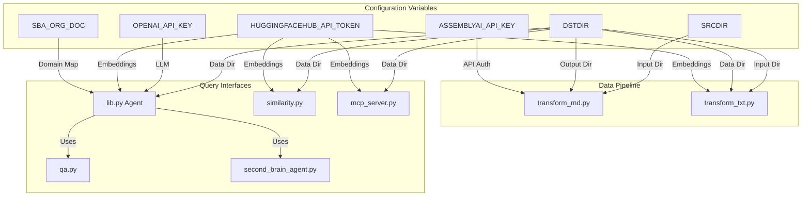

<!-- source: DeepWiki mcp.deepwiki.com · repo flepied/second-brain-agent · page 5.3 Configuration Management · fetched 2026-10-26 -->

# Configuration Management

<details>
<summary>Relevant source files</summary>

The following files were used as context for generating this wiki page:

- [README.md](README.md)
- [example.env](example.env)
- [test_lib.py](test_lib.py)

</details>


## Purpose and Scope

This document explains the configuration system for the Second Brain AI Agent, including environment variable structure, API key requirements, and directory path configuration. The configuration system uses a `.env` file to manage all runtime settings, enabling the separation of code from deployment-specific parameters.

For information about the ChromaDB deployment configuration, see [Vector Database Setup](#5.1). For systemd service configuration, see [System Services](#5.2).

## Overview

The Second Brain Agent uses environment variables loaded from a `.env` file to configure API credentials, processing directories, and system behavior. The configuration system relies on `python-dotenv` to load these variables at runtime, making them accessible to all components of the system.



**Sources:** [README.md:135-139](), [example.env:1-7]()

## Environment File Structure

The configuration file follows a simple key-value format with one environment variable per line. The system provides an `example.env` template that users copy to create their own `.env` file.

### Template File

The `example.env` file serves as a template showing all available configuration options:

| Variable | Purpose | Required |
|----------|---------|----------|
| `SRCDIR` | Source directory for markdown files | Yes |
| `DSTDIR` | Destination directory for processed data | Yes |
| `HUGGINGFACEHUB_API_TOKEN` | HuggingFace API credentials for embeddings | Yes |
| `OPENAI_API_KEY` | OpenAI API credentials for LLM | Yes |
| `ASSEMBLYAI_API_KEY` | AssemblyAI API credentials for audio transcription | Yes |
| `SBA_ORG_DOC` | Organization document for domain classification | No (default: SecondBrainOrganization.md) |

**Sources:** [example.env:1-7]()

### Setup Process

Users must copy the template and populate it with their specific values:

```bash
cp example.env .env
# Edit .env with actual values
```

The `.env` file is excluded from version control via `.gitignore` to prevent credential leakage.

**Sources:** [README.md:135-139]()

## API Key Configuration

The system integrates with three external AI/ML services, each requiring authentication via API keys.



### OpenAI API Key

**Variable:** `OPENAI_API_KEY`

Used by the Agent class for language model operations. This key authenticates requests to OpenAI's GPT models for question answering, summarization, and intent classification.

**Obtaining the key:**
- Create an account at https://platform.openai.com
- Navigate to API keys section
- Generate a new secret key
- Copy the key to the `.env` file

**Sources:** [example.env:4](), [README.md:17]()

### HuggingFace API Token

**Variable:** `HUGGINGFACEHUB_API_TOKEN`

Used for generating vector embeddings via the Sentence Transformers library. The system uses the `all-MiniLM-L6-v2` model for text embeddings.

**Obtaining the token:**
- Create an account at https://huggingface.co
- Navigate to Settings → Access Tokens
- Generate a new token
- Copy the token to the `.env` file

**Sources:** [example.env:3]()

### AssemblyAI API Key

**Variable:** `ASSEMBLYAI_API_KEY`

Used for transcribing audio files (MP3s and other formats) during the content extraction phase.

**Obtaining the key:**
- Create an account at https://www.assemblyai.com
- Navigate to the dashboard
- Copy your API key
- Add it to the `.env` file

**Sources:** [example.env:5]()

## Directory Path Configuration

The system requires two directory paths that define where it reads source files and writes processed data.



### SRCDIR - Source Directory

**Variable:** `SRCDIR`

**Purpose:** Specifies the directory containing user's markdown notes and documents.

**Characteristics:**
- Must be a readable directory path
- Typically points to note-taking application directory (e.g., Obsidian vault)
- Monitored continuously by `monitor.sh` via `inotifywait`
- Contains markdown files with embedded links to PDFs, YouTube videos, web pages, and audio files

**Example values:**
```bash
SRCDIR=/home/user/Documents/Obsidian
SRCDIR=/home/user/SecondBrain
```

**Sources:** [example.env:1](), [README.md:40]()

### DSTDIR - Destination Directory

**Variable:** `DSTDIR`

**Purpose:** Root directory where the agent stores all processed data and intermediate files.

**Subdirectory structure:**
- `Text/` - JSON files with extracted content and metadata
- `Chunk/` - Text chunk files ready for embedding
- `checksums.json` - MD5 checksums for change detection

**Characteristics:**
- Must be a writable directory path
- Persists across system restarts
- Should have sufficient disk space for processed content
- Used by both processing stages (`transform_md.py` and `transform_txt.py`)

**Example values:**
```bash
DSTDIR=/home/user/.local/share/second-brain-agent
DSTDIR=/var/lib/sba-data
```

**Sources:** [example.env:2]()

## Optional Configuration

### SBA_ORG_DOC - Organization Document

**Variable:** `SBA_ORG_DOC`

**Purpose:** Specifies the document that describes domain mappings and organizational structure for document classification.

**Default value:** `SecondBrainOrganization.md`

**Usage:** The Agent uses this document to understand how to classify and filter documents by domain. This is particularly useful for activity report queries that need to filter by subject area.

**Domain classification:** The system derives domain metadata by removing numeric suffixes and specific keywords (`At`, `Journal`, `Project`, `Notes`, `History`) from filenames. For example, `WorkoutHistory202412.md` becomes domain `Workout`.

**Sources:** [example.env:6](), [README.md:72-73]()

## Configuration Loading Mechanism

The system loads configuration using the `python-dotenv` library, which reads the `.env` file and populates `os.environ` with the values.



### Loading Pattern

The typical pattern in Python modules:

```python
from dotenv import load_dotenv
import os

# Load environment variables from .env file
load_dotenv()

# Access configuration
src_dir = os.getenv('SRCDIR')
dst_dir = os.getenv('DSTDIR')
openai_key = os.getenv('OPENAI_API_KEY')
```

### Environment Variable Precedence

The configuration follows standard environment variable precedence:
1. System environment variables (highest priority)
2. `.env` file values
3. Default values in code (if provided)

This allows system administrators to override configuration without modifying the `.env` file.

**Sources:** [README.md:135-157]()

## Integration with System Components

Different components of the system use different subsets of the configuration:

| Component | Configuration Used |
|-----------|-------------------|
| `transform_md.py` | `SRCDIR`, `DSTDIR`, `ASSEMBLYAI_API_KEY` |
| `transform_txt.py` | `DSTDIR`, `HUGGINGFACEHUB_API_TOKEN` |
| `lib.py` (Agent) | `DSTDIR`, `OPENAI_API_KEY`, `HUGGINGFACEHUB_API_TOKEN`, `SBA_ORG_DOC` |
| `second_brain_agent.py` | All configuration via Agent |
| `similarity.py` | `DSTDIR`, `HUGGINGFACEHUB_API_TOKEN` |
| `qa.py` | All configuration via Agent |
| `mcp_server.py` | `DSTDIR`, `HUGGINGFACEHUB_API_TOKEN` |



**Sources:** Based on system architecture from diagrams

## Configuration Validation

The system performs implicit validation when components attempt to use configuration values:

### Missing Required Variables

If a required environment variable is not set, the component will typically fail with a clear error. For example, if `OPENAI_API_KEY` is missing, the OpenAI client initialization will raise an authentication error.

### Invalid Directory Paths

If `SRCDIR` or `DSTDIR` point to non-existent or inaccessible directories, file operations will fail with `FileNotFoundError` or permission errors.

### Invalid API Keys

Invalid API keys are detected when making the first API call to the respective service, resulting in HTTP 401 or 403 errors.

### Best Practices

1. **Verify configuration after setup:**
   ```bash
   # Check that directories exist
   ls -ld $SRCDIR
   ls -ld $DSTDIR
   ```

2. **Test API keys before full deployment:**
   - Run small test queries to verify each API key works
   - Check API quota and rate limits

3. **Use absolute paths:**
   - Always specify absolute paths for `SRCDIR` and `DSTDIR`
   - Relative paths may cause issues with systemd services

4. **Secure the `.env` file:**
   - Set appropriate file permissions: `chmod 600 .env`
   - Never commit `.env` to version control
   - Use different `.env` files for different environments

**Sources:** [README.md:135-157]()

## Example Configuration

Below is a complete example configuration with placeholder values:

```bash
# Source directory (where your markdown notes are stored)
SRCDIR=/home/user/Documents/Obsidian

# Destination directory (where processed data will be stored)
DSTDIR=/home/user/.local/share/second-brain-agent

# HuggingFace API token (for embeddings)
HUGGINGFACEHUB_API_TOKEN=hf_xxxxxxxxxxxxxxxxxxxxxxxxxxxxx

# OpenAI API key (for LLM)
OPENAI_API_KEY=sk-xxxxxxxxxxxxxxxxxxxxxxxxxxxxx

# AssemblyAI API key (for audio transcription)
ASSEMBLYAI_API_KEY=xxxxxxxxxxxxxxxxxxxxxxxxxxxxxxxx

# Organization document (optional, defaults to SecondBrainOrganization.md)
SBA_ORG_DOC=SecondBrainOrganization.md
```

**Sources:** [example.env:1-7]()

---

