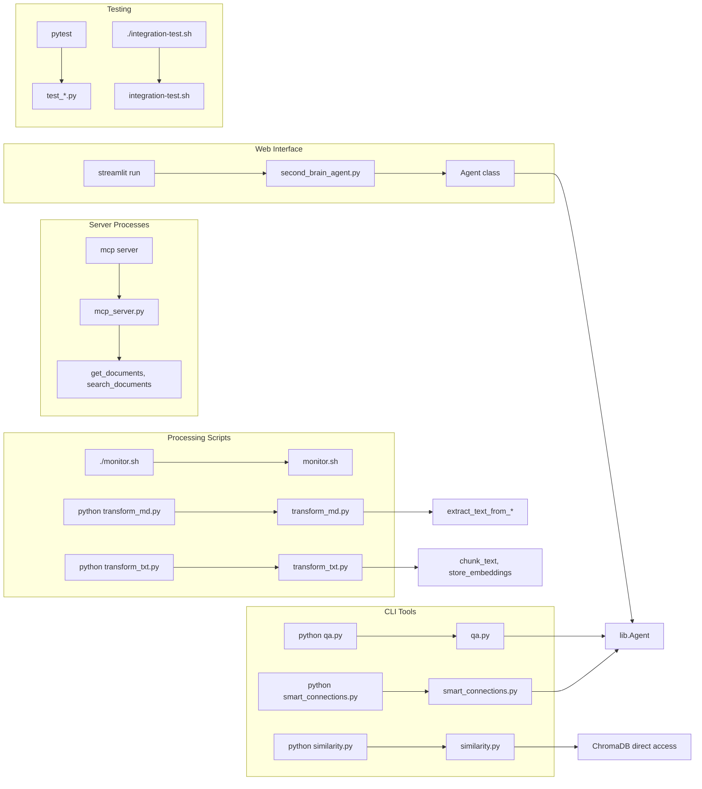
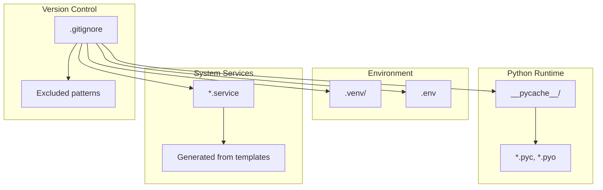

<!-- source: DeepWiki mcp.deepwiki.com · repo flepied/second-brain-agent · page 7 Appendix · fetched 2026-10-26 -->

# Appendix

Relevant source files

The following files were used as context for generating this wiki page:

- [.gitignore](.gitignore)

This appendix provides additional reference information for the Second Brain Agent system, including licensing details, project structure overview, and miscellaneous files that support the main functionality. For information about core system components, see the main documentation sections [1](#1) through [6](#6).

## Licensing

The Second Brain Agent is distributed under the GNU General Public License version 3 (GPL-3.0). This is a copyleft license that ensures the software remains free and open source.

### License Summary

| Aspect | Details |
|--------|---------|
| License Type | GNU General Public License v3.0 |
| Permissions | Commercial use, modification, distribution, private use |
| Conditions | Source code must be disclosed, license and copyright notice must be included, state changes must be documented |
| Limitations | No warranty, no liability |

The full license text is available in the project root and establishes the legal framework for using, modifying, and distributing the software.

**Sources:** [LICENSE:1-675]()

## Project Structure Overview

The following diagram illustrates the high-level organization of files and directories in the Second Brain Agent codebase:

### Project File Organization

```mermaid
graph TB
    ROOT["/"]
    
    subgraph "Core Python Modules"
        LIB["lib.py"]
        EXTRACTORS["extractors.py"] 
        TMD["transform_md.py"]
        TTXT["transform_txt.py"]
        SBA["second_brain_agent.py"]
        MCP["mcp_server.py"]
    end
    
    subgraph "CLI Utilities"
        SIM["similarity.py"]
        QA["qa.py"]
        SC["smart_connections.py"]
    end
    
    subgraph "Infrastructure Scripts"
        MONITOR["monitor.sh"]
        INTEGRATION["integration-test.sh"]
        COMPOSE["compose.yaml"]
    end
    
    subgraph "Configuration Files"
        PYPROJECT["pyproject.toml"]
        GITIGNORE[".gitignore"]
        ENVFILE[".env"]
        LICENSE_FILE["LICENSE"]
    end
    
    subgraph "Service Definitions"
        SERVICES["*.service files"]
    end
    
    ROOT --> LIB
    ROOT --> EXTRACTORS
    ROOT --> TMD
    ROOT --> TTXT
    ROOT --> SBA
    ROOT --> MCP
    ROOT --> SIM
    ROOT --> QA
    ROOT --> SC
    ROOT --> MONITOR
    ROOT --> INTEGRATION
    ROOT --> COMPOSE
    ROOT --> PYPROJECT
    ROOT --> GITIGNORE
    ROOT --> ENVFILE
    ROOT --> LICENSE_FILE
    ROOT --> SERVICES
```

**Sources:** [.gitignore:1-5](), [LICENSE:1-675]()

## Configuration and Metadata Files

### Git Configuration

The project uses Git for version control with a standard `.gitignore` configuration that excludes:

| Pattern | Purpose |
|---------|---------|
| `__pycache__` | Python bytecode cache directories |
| `.venv` | Virtual environment directory |
| `.env` | Environment variables file containing secrets |
| `*.service` | Generated systemd service files |

### Dependency Management

The project uses Poetry for Python dependency management, with configuration specified in `pyproject.toml`. This includes:

- Project metadata and version information
- Python dependencies for core functionality
- Development dependencies for testing and code quality
- Build system configuration

**Sources:** [.gitignore:1-5]()

## System Entry Points and Utilities

The following diagram maps the various entry points and utilities to their specific code implementations:

### Code Entry Points Mapping

**Sources:** [.gitignore:4]()

## File Patterns and Exclusions

The project maintains clean version control through strategic file exclusions:

### Generated and Temporary Files

This ensures that sensitive configuration data, generated files, and environment-specific artifacts are not committed to version control.

**Sources:** [.gitignore:1-5]()

## Legal and Compliance Information

### GPL-3.0 License Compliance

The GNU General Public License v3.0 requires specific compliance measures:

| Requirement | Implementation |
|-------------|----------------|
| Source Code Availability | All source code is publicly available in the GitHub repository |
| License Notice | Full license text included in [LICENSE:1-675]() |
| Copyright Notice | Copyright notices preserved in all source files |
| Modification Documentation | Git history provides complete modification tracking |
| Distribution Terms | All redistributions must include license and source code |

### Third-Party Dependencies

The system integrates with various external services and libraries, each with their own licensing terms:

- OpenAI API (commercial terms)
- Hugging Face models (various open source licenses)
- AssemblyAI (commercial terms)
- ChromaDB (Apache 2.0 license)
- Python ecosystem packages (various open source licenses)

Users must ensure compliance with all applicable licenses when deploying the system.

**Sources:** [LICENSE:1-675]()