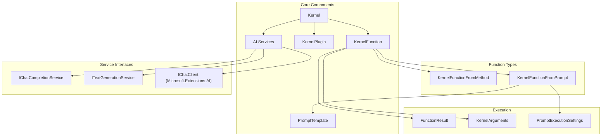
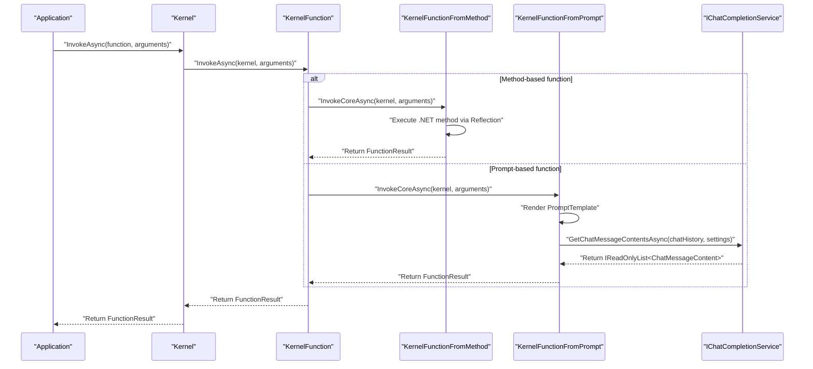
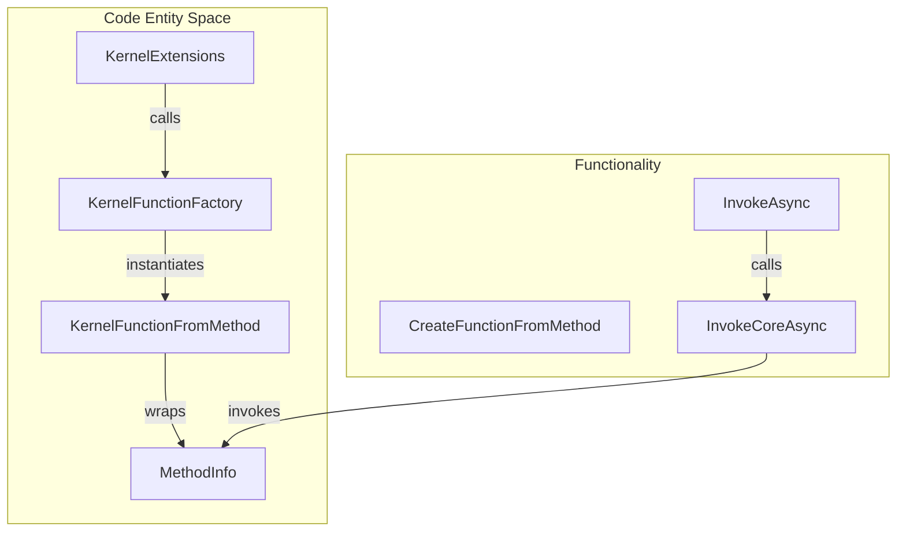

<!-- source: DeepWiki mcp.deepwiki.com · repo microsoft/semantic-kernel · page 2.1 .NET Implementation · fetched 2026-10-26 -->

# .NET Implementation

<details>
<summary>Relevant source files</summary>

The following files were used as context for generating this wiki page:

- [docs/decisions/0004-error-handling.md](docs/decisions/0004-error-handling.md)
- [docs/decisions/0006-open-api-dynamic-payload-and-namespaces.md](docs/decisions/0006-open-api-dynamic-payload-and-namespaces.md)
- [docs/decisions/0007-prompt-extract-template-engine.md](docs/decisions/0007-prompt-extract-template-engine.md)
- [docs/decisions/0008-support-generic-llm-request-settings.md](docs/decisions/0008-support-generic-llm-request-settings.md)
- [docs/decisions/0009-support-multiple-named-args-in-template-function-calls.md](docs/decisions/0009-support-multiple-named-args-in-template-function-calls.md)
- [docs/decisions/0010-dotnet-project-structure.md](docs/decisions/0010-dotnet-project-structure.md)
- [docs/decisions/0011-function-and-kernel-result-types.md](docs/decisions/0011-function-and-kernel-result-types.md)
- [docs/decisions/0012-kernel-service-registration.md](docs/decisions/0012-kernel-service-registration.md)
- [docs/decisions/0013-memory-as-plugin.md](docs/decisions/0013-memory-as-plugin.md)
- [docs/decisions/0014-chat-completion-roles-in-prompt.md](docs/decisions/0014-chat-completion-roles-in-prompt.md)
- [docs/decisions/0015-completion-service-selection.md](docs/decisions/0015-completion-service-selection.md)
- [docs/decisions/0016-custom-prompt-template-formats.md](docs/decisions/0016-custom-prompt-template-formats.md)
- [docs/decisions/0017-openai-function-calling.md](docs/decisions/0017-openai-function-calling.md)
- [docs/decisions/0038-completion-service-selection.md](docs/decisions/0038-completion-service-selection.md)
- [dotnet/samples/Concepts/ChatCompletion/HybridCompletion_Fallback.cs](dotnet/samples/Concepts/ChatCompletion/HybridCompletion_Fallback.cs)
- [dotnet/samples/Concepts/ChatCompletion/OpenAI_StructuredOutputs.cs](dotnet/samples/Concepts/ChatCompletion/OpenAI_StructuredOutputs.cs)
- [dotnet/samples/Concepts/Resources/Plugins/MoviePlugins/MoviePluginPrompt/TopMovies/config.json](dotnet/samples/Concepts/Resources/Plugins/MoviePlugins/MoviePluginPrompt/TopMovies/config.json)
- [dotnet/samples/Concepts/Resources/Plugins/MoviePlugins/MoviePluginPrompt/TopMovies/skprompt.txt](dotnet/samples/Concepts/Resources/Plugins/MoviePlugins/MoviePluginPrompt/TopMovies/skprompt.txt)
- [dotnet/samples/Concepts/Resources/Plugins/MoviePlugins/MoviePluginYaml/TopMovies.yaml](dotnet/samples/Concepts/Resources/Plugins/MoviePlugins/MoviePluginYaml/TopMovies.yaml)
- [dotnet/samples/Demos/OpenAIRealtime/OpenAIRealtime.csproj](dotnet/samples/Demos/OpenAIRealtime/OpenAIRealtime.csproj)
- [dotnet/samples/Demos/OpenAIRealtime/Program.cs](dotnet/samples/Demos/OpenAIRealtime/Program.cs)
- [dotnet/samples/GettingStartedWithProcesses/GettingStartedWithProcesses.csproj](dotnet/samples/GettingStartedWithProcesses/GettingStartedWithProcesses.csproj)
- [dotnet/samples/GettingStartedWithProcesses/Step04/SchemaGenerator.cs](dotnet/samples/GettingStartedWithProcesses/Step04/SchemaGenerator.cs)
- [dotnet/samples/GettingStartedWithProcesses/Step04/Steps/ManagerAgentStep.cs](dotnet/samples/GettingStartedWithProcesses/Step04/Steps/ManagerAgentStep.cs)
- [dotnet/samples/GettingStartedWithProcesses/Utilities/MermaidRenderer.cs](dotnet/samples/GettingStartedWithProcesses/Utilities/MermaidRenderer.cs)
- [dotnet/samples/LearnResources/LearnResources.csproj](dotnet/samples/LearnResources/LearnResources.csproj)
- [dotnet/src/Connectors/Connectors.AzureOpenAI.UnitTests/Connectors.AzureOpenAI.UnitTests.csproj](dotnet/src/Connectors/Connectors.AzureOpenAI.UnitTests/Connectors.AzureOpenAI.UnitTests.csproj)
- [dotnet/src/Connectors/Connectors.AzureOpenAI/Connectors.AzureOpenAI.csproj](dotnet/src/Connectors/Connectors.AzureOpenAI/Connectors.AzureOpenAI.csproj)
- [dotnet/src/Connectors/Connectors.Google.UnitTests/Extensions/KernelFunctionMetadataExtensionsTests.cs](dotnet/src/Connectors/Connectors.Google.UnitTests/Extensions/KernelFunctionMetadataExtensionsTests.cs)
- [dotnet/src/Connectors/Connectors.OpenAI.UnitTests/Connectors.OpenAI.UnitTests.csproj](dotnet/src/Connectors/Connectors.OpenAI.UnitTests/Connectors.OpenAI.UnitTests.csproj)
- [dotnet/src/Connectors/Connectors.OpenAI.UnitTests/Core/AutoFunctionInvocationFilterTests.cs](dotnet/src/Connectors/Connectors.OpenAI.UnitTests/Core/AutoFunctionInvocationFilterTests.cs)
- [dotnet/src/Connectors/Connectors.OpenAI.UnitTests/Core/OpenAIJsonSchemaTransformerTests.cs](dotnet/src/Connectors/Connectors.OpenAI.UnitTests/Core/OpenAIJsonSchemaTransformerTests.cs)
- [dotnet/src/Connectors/Connectors.OpenAI.UnitTests/Extensions/KernelFunctionMetadataExtensionsTests.cs](dotnet/src/Connectors/Connectors.OpenAI.UnitTests/Extensions/KernelFunctionMetadataExtensionsTests.cs)
- [dotnet/src/Connectors/Connectors.OpenAI.UnitTests/Helpers/OpenAIChatResponseFormatBuilderTests.cs](dotnet/src/Connectors/Connectors.OpenAI.UnitTests/Helpers/OpenAIChatResponseFormatBuilderTests.cs)
- [dotnet/src/Connectors/Connectors.OpenAI/Connectors.OpenAI.csproj](dotnet/src/Connectors/Connectors.OpenAI/Connectors.OpenAI.csproj)
- [dotnet/src/Connectors/Connectors.OpenAI/Helpers/OpenAIChatResponseFormatBuilder.cs](dotnet/src/Connectors/Connectors.OpenAI/Helpers/OpenAIChatResponseFormatBuilder.cs)
- [dotnet/src/Experimental/Process.Core/Tools/ProcessVisualizationExtensions.cs](dotnet/src/Experimental/Process.Core/Tools/ProcessVisualizationExtensions.cs)
- [dotnet/src/InternalUtilities/planning/PlannerInstrumentation.cs](dotnet/src/InternalUtilities/planning/PlannerInstrumentation.cs)
- [dotnet/src/InternalUtilities/src/Schema/KernelJsonSchemaBuilder.cs](dotnet/src/InternalUtilities/src/Schema/KernelJsonSchemaBuilder.cs)
- [dotnet/src/SemanticKernel.Abstractions/AI/ChatClient/ChatClientExtensions.cs](dotnet/src/SemanticKernel.Abstractions/AI/ChatClient/ChatClientExtensions.cs)
- [dotnet/src/SemanticKernel.Abstractions/AI/ChatClient/KernelFunctionInvokingChatClientBuilderExtensions.cs](dotnet/src/SemanticKernel.Abstractions/AI/ChatClient/KernelFunctionInvokingChatClientBuilderExtensions.cs)
- [dotnet/src/SemanticKernel.Abstractions/AI/ChatCompletion/AIFunctionExtensions.cs](dotnet/src/SemanticKernel.Abstractions/AI/ChatCompletion/AIFunctionExtensions.cs)
- [dotnet/src/SemanticKernel.Abstractions/AI/ChatCompletion/AIFunctionKernelFunction.cs](dotnet/src/SemanticKernel.Abstractions/AI/ChatCompletion/AIFunctionKernelFunction.cs)
- [dotnet/src/SemanticKernel.Abstractions/AI/ChatCompletion/ChatClientChatCompletionService.cs](dotnet/src/SemanticKernel.Abstractions/AI/ChatCompletion/ChatClientChatCompletionService.cs)
- [dotnet/src/SemanticKernel.Abstractions/AI/ChatCompletion/ChatCompletionServiceChatClient.cs](dotnet/src/SemanticKernel.Abstractions/AI/ChatCompletion/ChatCompletionServiceChatClient.cs)
- [dotnet/src/SemanticKernel.Abstractions/AI/ChatCompletion/ChatCompletionServiceExtensions.cs](dotnet/src/SemanticKernel.Abstractions/AI/ChatCompletion/ChatCompletionServiceExtensions.cs)
- [dotnet/src/SemanticKernel.Abstractions/AI/Embeddings/EmbeddingGenerationServiceExtensions.cs](dotnet/src/SemanticKernel.Abstractions/AI/Embeddings/EmbeddingGenerationServiceExtensions.cs)
- [dotnet/src/SemanticKernel.Abstractions/AI/PromptNode.cs](dotnet/src/SemanticKernel.Abstractions/AI/PromptNode.cs)
- [dotnet/src/SemanticKernel.Abstractions/AbstractionsJsonContext.cs](dotnet/src/SemanticKernel.Abstractions/AbstractionsJsonContext.cs)
- [dotnet/src/SemanticKernel.Abstractions/Events/CancelKernelEventArgs.cs](dotnet/src/SemanticKernel.Abstractions/Events/CancelKernelEventArgs.cs)
- [dotnet/src/SemanticKernel.Abstractions/Events/FunctionInvokedEventArgs.cs](dotnet/src/SemanticKernel.Abstractions/Events/FunctionInvokedEventArgs.cs)
- [dotnet/src/SemanticKernel.Abstractions/Events/FunctionInvokingEventArgs.cs](dotnet/src/SemanticKernel.Abstractions/Events/FunctionInvokingEventArgs.cs)
- [dotnet/src/SemanticKernel.Abstractions/Events/KernelEventArgs.cs](dotnet/src/SemanticKernel.Abstractions/Events/KernelEventArgs.cs)
- [dotnet/src/SemanticKernel.Abstractions/Events/PromptRenderedEventArgs.cs](dotnet/src/SemanticKernel.Abstractions/Events/PromptRenderedEventArgs.cs)
- [dotnet/src/SemanticKernel.Abstractions/Events/PromptRenderingEventArgs.cs](dotnet/src/SemanticKernel.Abstractions/Events/PromptRenderingEventArgs.cs)
- [dotnet/src/SemanticKernel.Abstractions/Filters/AutoFunctionInvocation/AutoFunctionInvocationContext.cs](dotnet/src/SemanticKernel.Abstractions/Filters/AutoFunctionInvocation/AutoFunctionInvocationContext.cs)
- [dotnet/src/SemanticKernel.Abstractions/Filters/AutoFunctionInvocation/IAutoFunctionInvocationFilter.cs](dotnet/src/SemanticKernel.Abstractions/Filters/AutoFunctionInvocation/IAutoFunctionInvocationFilter.cs)
- [dotnet/src/SemanticKernel.Abstractions/Filters/Function/FunctionInvocationContext.cs](dotnet/src/SemanticKernel.Abstractions/Filters/Function/FunctionInvocationContext.cs)
- [dotnet/src/SemanticKernel.Abstractions/Filters/Prompt/PromptRenderContext.cs](dotnet/src/SemanticKernel.Abstractions/Filters/Prompt/PromptRenderContext.cs)
- [dotnet/src/SemanticKernel.Abstractions/Functions/FunctionResult.cs](dotnet/src/SemanticKernel.Abstractions/Functions/FunctionResult.cs)
- [dotnet/src/SemanticKernel.Abstractions/Functions/KernelFunction.cs](dotnet/src/SemanticKernel.Abstractions/Functions/KernelFunction.cs)
- [dotnet/src/SemanticKernel.Abstractions/Functions/KernelFunctionExtensions.cs](dotnet/src/SemanticKernel.Abstractions/Functions/KernelFunctionExtensions.cs)
- [dotnet/src/SemanticKernel.Abstractions/Functions/KernelFunctionLogMessages.cs](dotnet/src/SemanticKernel.Abstractions/Functions/KernelFunctionLogMessages.cs)
- [dotnet/src/SemanticKernel.Abstractions/Functions/KernelPlugin.cs](dotnet/src/SemanticKernel.Abstractions/Functions/KernelPlugin.cs)
- [dotnet/src/SemanticKernel.Abstractions/Functions/KernelPluginExtensions.cs](dotnet/src/SemanticKernel.Abstractions/Functions/KernelPluginExtensions.cs)
- [dotnet/src/SemanticKernel.Abstractions/Kernel.cs](dotnet/src/SemanticKernel.Abstractions/Kernel.cs)
- [dotnet/src/SemanticKernel.Abstractions/SemanticKernel.Abstractions.csproj](dotnet/src/SemanticKernel.Abstractions/SemanticKernel.Abstractions.csproj)
- [dotnet/src/SemanticKernel.Core/Contents/StreamingMethodContent.cs](dotnet/src/SemanticKernel.Core/Contents/StreamingMethodContent.cs)
- [dotnet/src/SemanticKernel.Core/Functions/KernelFunctionFromMethod.cs](dotnet/src/SemanticKernel.Core/Functions/KernelFunctionFromMethod.cs)
- [dotnet/src/SemanticKernel.Core/Functions/KernelFunctionFromPrompt.cs](dotnet/src/SemanticKernel.Core/Functions/KernelFunctionFromPrompt.cs)
- [dotnet/src/SemanticKernel.Core/KernelExtensions.cs](dotnet/src/SemanticKernel.Core/KernelExtensions.cs)
- [dotnet/src/SemanticKernel.Core/SemanticKernel.Core.csproj](dotnet/src/SemanticKernel.Core/SemanticKernel.Core.csproj)
- [dotnet/src/SemanticKernel.UnitTests/AI/ChatCompletion/AIFunctionKernelFunctionTests.cs](dotnet/src/SemanticKernel.UnitTests/AI/ChatCompletion/AIFunctionKernelFunctionTests.cs)
- [dotnet/src/SemanticKernel.UnitTests/AI/ServiceConversionExtensionsTests.cs](dotnet/src/SemanticKernel.UnitTests/AI/ServiceConversionExtensionsTests.cs)
- [dotnet/src/SemanticKernel.UnitTests/Filters/FunctionInvocationFilterTests.cs](dotnet/src/SemanticKernel.UnitTests/Filters/FunctionInvocationFilterTests.cs)
- [dotnet/src/SemanticKernel.UnitTests/Filters/PromptRenderFilterTests.cs](dotnet/src/SemanticKernel.UnitTests/Filters/PromptRenderFilterTests.cs)
- [dotnet/src/SemanticKernel.UnitTests/Functions/AIFunctionExtensionsTests.cs](dotnet/src/SemanticKernel.UnitTests/Functions/AIFunctionExtensionsTests.cs)
- [dotnet/src/SemanticKernel.UnitTests/Functions/FunctionFromMethodTests.cs](dotnet/src/SemanticKernel.UnitTests/Functions/FunctionFromMethodTests.cs)
- [dotnet/src/SemanticKernel.UnitTests/Functions/FunctionResultTests.cs](dotnet/src/SemanticKernel.UnitTests/Functions/FunctionResultTests.cs)
- [dotnet/src/SemanticKernel.UnitTests/Functions/KernelBuilderTests.cs](dotnet/src/SemanticKernel.UnitTests/Functions/KernelBuilderTests.cs)
- [dotnet/src/SemanticKernel.UnitTests/Functions/KernelFunctionLogMessagesTests.cs](dotnet/src/SemanticKernel.UnitTests/Functions/KernelFunctionLogMessagesTests.cs)
- [dotnet/src/SemanticKernel.UnitTests/Functions/KernelPluginCollectionTests.cs](dotnet/src/SemanticKernel.UnitTests/Functions/KernelPluginCollectionTests.cs)
- [dotnet/src/SemanticKernel.UnitTests/Functions/KernelPluginTests.cs](dotnet/src/SemanticKernel.UnitTests/Functions/KernelPluginTests.cs)
- [dotnet/src/SemanticKernel.UnitTests/KernelTests.cs](dotnet/src/SemanticKernel.UnitTests/KernelTests.cs)

</details>


This page provides a detailed overview of the .NET Semantic Kernel implementation, covering its core architecture, key classes, and execution model. It details the `SemanticKernel.Abstractions` and `SemanticKernel.Core` projects, the `IKernelBuilder` pattern, dependency injection integration, and `Microsoft.Extensions.AI` interoperability.

## Core Architecture

The .NET implementation of Semantic Kernel is built around a modular architecture with clear separation of concerns. At its center is the `Kernel` class, which orchestrates the interaction between plugins, functions, and AI services.

### Key Components and Relationships



Sources: [dotnet/src/SemanticKernel.Abstractions/Kernel.cs:26-27](), [dotnet/src/SemanticKernel.Abstractions/Functions/KernelFunction.cs:30-31](), [dotnet/src/SemanticKernel.Core/Functions/KernelFunctionFromPrompt.cs:27-28](), [dotnet/src/SemanticKernel.Core/Functions/KernelFunctionFromMethod.cs:30-31]()

### Core Classes and Execution Model

The .NET implementation centers around several key classes that work together to provide the Semantic Kernel functionality:

#### Kernel Class

The `Kernel` class serves as the central orchestrator for the entire system. It provides access to registered plugins, functions, and a service provider for dependency injection.

```csharp
public sealed class Kernel
{
    public KernelPluginCollection Plugins { get; }
    public IServiceProvider Services { get; }
    public CultureInfo Culture { get; set; }
    public ILoggerFactory LoggerFactory { get; }
    public IDictionary<string, object?> Data { get; }
    
    // Function invocation methods
    public Task<FunctionResult> InvokeAsync(KernelFunction function, KernelArguments? arguments = null, CancellationToken cancellationToken = default);
    public Task<T?> InvokeAsync<T>(KernelFunction function, KernelArguments? arguments = null, CancellationToken cancellationToken = default);
}
```

Sources: [dotnet/src/SemanticKernel.Abstractions/Kernel.cs:26-167](), [dotnet/src/SemanticKernel.Abstractions/Kernel.cs:124-128]()

#### KernelFunction Class

The `KernelFunction` abstract class represents a function that can be invoked. It inherits from `FullyQualifiedAIFunction`, providing interoperability with `Microsoft.Extensions.AI`.

```csharp
public abstract class KernelFunction : FullyQualifiedAIFunction
{
    public new virtual string Name => this.Metadata.Name;
    public virtual string? PluginName => this.Metadata.PluginName;
    public override string Description => this.Metadata.Description;
    public IReadOnlyDictionary<string, PromptExecutionSettings>? ExecutionSettings { get; }
    
    // Invocation methods
    public Task<FunctionResult> InvokeAsync(Kernel kernel, KernelArguments? arguments = null, CancellationToken cancellationToken = default);
}
```

Sources: [dotnet/src/SemanticKernel.Abstractions/Functions/KernelFunction.cs:30-108]()

#### Function Execution Flow

The following diagram maps the Natural Language Space (Prompts) to the Code Entity Space (Classes and Methods) within the .NET implementation.



Sources: [dotnet/src/SemanticKernel.Abstractions/Kernel.cs:26-119](), [dotnet/src/SemanticKernel.Abstractions/Functions/KernelFunction.cs:30-108](), [dotnet/src/SemanticKernel.Core/Functions/KernelFunctionFromPrompt.cs:27-28](), [dotnet/src/SemanticKernel.Core/Functions/KernelFunctionFromMethod.cs:30-31]()

## Function Types and Implementation

The .NET implementation provides two primary types of functions: method-based functions and prompt-based functions.

### Method-Based Functions

`KernelFunctionFromMethod` wraps .NET methods as kernel functions. It uses reflection to map `KernelArguments` to method parameters.



Sources: [dotnet/src/SemanticKernel.Core/Functions/KernelFunctionFromMethod.cs:30-69](), [dotnet/src/SemanticKernel.Core/KernelExtensions.cs:35-47](), [dotnet/src/SemanticKernel.Core/KernelExtensions.cs:89-102]()

### Prompt-Based Functions

`KernelFunctionFromPrompt` creates a function from a prompt template. It handles template rendering and interacts with AI services like `IChatCompletionService`.

Sources: [dotnet/src/SemanticKernel.Core/Functions/KernelFunctionFromPrompt.cs:43-87](), [dotnet/src/SemanticKernel.Core/Functions/KernelFunctionFromPrompt.cs:102-148]()

## Microsoft.Extensions.AI Interoperability

Semantic Kernel .NET implementation provides deep integration with `Microsoft.Extensions.AI` (MEAI) abstractions.

### Service Bridging

The framework allows wrapping `IChatClient` (MEAI) as `IChatCompletionService` (SK) and vice versa.

| SK Type | MEAI Type | Adapter Class |
| :--- | :--- | :--- |
| `IChatCompletionService` | `IChatClient` | `ChatClientChatCompletionService` |
| `KernelFunction` | `AIFunction` | `AIFunctionKernelFunction` |

Sources: [dotnet/src/SemanticKernel.Abstractions/AI/ChatCompletion/ChatClientChatCompletionService.cs:16-22](), [dotnet/src/SemanticKernel.Abstractions/AI/ChatCompletion/AIFunctionKernelFunction.cs:17-30]()

### Content Conversion

The `FunctionResult.GetValue<T>()` method includes logic to automatically convert between SK `ChatMessageContent` and MEAI `ChatMessage` or `ChatResponse`.

Sources: [dotnet/src/SemanticKernel.Abstractions/Functions/FunctionResult.cs:107-122](), [dotnet/src/SemanticKernel.Abstractions/Functions/FunctionResult.cs:144-163]()

## Dependency Injection and Builder Pattern

The `IKernelBuilder` provides a fluent API for constructing `Kernel` instances and registering services.

```csharp
// Example using IKernelBuilder
IKernelBuilder builder = Kernel.CreateBuilder();
builder.Services.AddLogging(c => c.AddConsole());
builder.AddOpenAIChatCompletion("model-id", "api-key");
Kernel kernel = builder.Build();
```

Sources: [dotnet/src/SemanticKernel.Abstractions/Kernel.cs:85-85](), [dotnet/src/SemanticKernel.Abstractions/Kernel.cs:56-81]()

## Telemetry and Instrumentation

Function execution is instrumented with `ActivitySource` and `Meter` for distributed tracing and metrics.

- **Metrics**: `semantic_kernel.function.invocation.duration` (Histogram)
- **Activities**: `Microsoft.SemanticKernel` ActivitySource

Sources: [dotnet/src/SemanticKernel.Abstractions/Functions/KernelFunction.cs:41-44](), [dotnet/src/SemanticKernel.Abstractions/Functions/KernelFunction.cs:59-62](), [dotnet/src/InternalUtilities/planning/PlannerInstrumentation.cs:18-21]()

---

