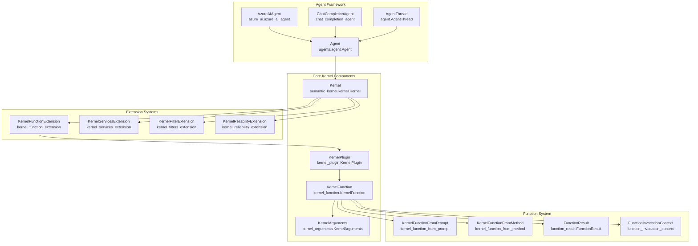
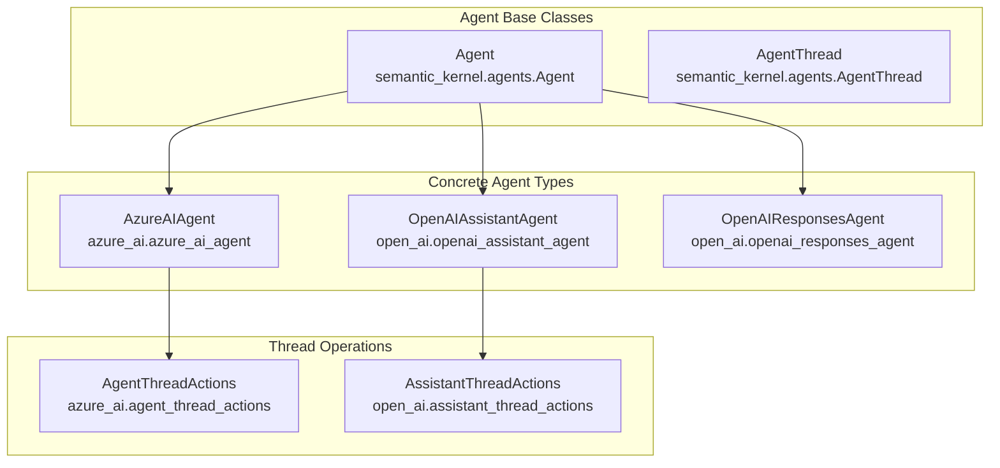

<!-- source: DeepWiki mcp.deepwiki.com · repo microsoft/semantic-kernel · page 2.2 Python Implementation · fetched 2026-10-26 -->

# Python Implementation

<details>
<summary>Relevant source files</summary>

The following files were used as context for generating this wiki page:

- [docs/decisions/0037-audio-naming.md](docs/decisions/0037-audio-naming.md)
- [python/.env.example](python/.env.example)
- [python/pyproject.toml](python/pyproject.toml)
- [python/samples/__init__.py](python/samples/__init__.py)
- [python/samples/concepts/README.md](python/samples/concepts/README.md)
- [python/samples/concepts/agents/azure_ai_agent/azure_ai_agent_azure_ai_search.py](python/samples/concepts/agents/azure_ai_agent/azure_ai_agent_azure_ai_search.py)
- [python/samples/concepts/agents/azure_ai_agent/azure_ai_agent_file_manipulation.py](python/samples/concepts/agents/azure_ai_agent/azure_ai_agent_file_manipulation.py)
- [python/samples/concepts/agents/azure_ai_agent/azure_ai_agent_streaming.py](python/samples/concepts/agents/azure_ai_agent/azure_ai_agent_streaming.py)
- [python/samples/concepts/mcp/README.md](python/samples/concepts/mcp/README.md)
- [python/samples/concepts/mcp/agent_with_mcp_plugin.py](python/samples/concepts/mcp/agent_with_mcp_plugin.py)
- [python/samples/concepts/mcp/agent_with_mcp_sampling.py](python/samples/concepts/mcp/agent_with_mcp_sampling.py)
- [python/samples/concepts/mcp/azure_ai_agent_with_mcp_plugin.py](python/samples/concepts/mcp/azure_ai_agent_with_mcp_plugin.py)
- [python/samples/concepts/mcp/mcp_as_plugin.py](python/samples/concepts/mcp/mcp_as_plugin.py)
- [python/samples/concepts/realtime/README.md](python/samples/concepts/realtime/README.md)
- [python/samples/concepts/realtime/realtime_agent_with_function_calling_webrtc.py](python/samples/concepts/realtime/realtime_agent_with_function_calling_webrtc.py)
- [python/samples/concepts/realtime/realtime_agent_with_function_calling_websocket.py](python/samples/concepts/realtime/realtime_agent_with_function_calling_websocket.py)
- [python/samples/concepts/realtime/simple_realtime_chat_webrtc.py](python/samples/concepts/realtime/simple_realtime_chat_webrtc.py)
- [python/samples/concepts/realtime/simple_realtime_chat_websocket.py](python/samples/concepts/realtime/simple_realtime_chat_websocket.py)
- [python/samples/concepts/realtime/utils.py](python/samples/concepts/realtime/utils.py)
- [python/samples/getting_started/.env.example](python/samples/getting_started/.env.example)
- [python/samples/getting_started/third_party/.env.example](python/samples/getting_started/third_party/.env.example)
- [python/samples/getting_started_with_agents/azure_ai_agent/README.md](python/samples/getting_started_with_agents/azure_ai_agent/README.md)
- [python/samples/getting_started_with_agents/openai_assistant/README.md](python/samples/getting_started_with_agents/openai_assistant/README.md)
- [python/samples/learn_resources/.env.example](python/samples/learn_resources/.env.example)
- [python/samples/learn_resources/README.md](python/samples/learn_resources/README.md)
- [python/samples/learn_resources/ai_services.py](python/samples/learn_resources/ai_services.py)
- [python/samples/learn_resources/configuring_prompts.py](python/samples/learn_resources/configuring_prompts.py)
- [python/samples/learn_resources/creating_functions.py](python/samples/learn_resources/creating_functions.py)
- [python/samples/learn_resources/evaluate_with_prompt_flow.py](python/samples/learn_resources/evaluate_with_prompt_flow.py)
- [python/samples/learn_resources/functions_within_prompts.py](python/samples/learn_resources/functions_within_prompts.py)
- [python/samples/learn_resources/plugin.py](python/samples/learn_resources/plugin.py)
- [python/samples/learn_resources/plugins/MathPlugin/Math.py](python/samples/learn_resources/plugins/MathPlugin/Math.py)
- [python/samples/learn_resources/serializing_prompts.py](python/samples/learn_resources/serializing_prompts.py)
- [python/samples/learn_resources/templates.py](python/samples/learn_resources/templates.py)
- [python/samples/learn_resources/using_the_kernel.py](python/samples/learn_resources/using_the_kernel.py)
- [python/samples/learn_resources/your_first_prompt.py](python/samples/learn_resources/your_first_prompt.py)
- [python/semantic_kernel/__init__.py](python/semantic_kernel/__init__.py)
- [python/semantic_kernel/agents/azure_ai/agent_content_generation.py](python/semantic_kernel/agents/azure_ai/agent_content_generation.py)
- [python/semantic_kernel/agents/azure_ai/agent_thread_actions.py](python/semantic_kernel/agents/azure_ai/agent_thread_actions.py)
- [python/semantic_kernel/agents/azure_ai/azure_ai_agent.py](python/semantic_kernel/agents/azure_ai/azure_ai_agent.py)
- [python/semantic_kernel/agents/open_ai/assistant_thread_actions.py](python/semantic_kernel/agents/open_ai/assistant_thread_actions.py)
- [python/semantic_kernel/agents/open_ai/openai_assistant_agent.py](python/semantic_kernel/agents/open_ai/openai_assistant_agent.py)
- [python/semantic_kernel/agents/open_ai/openai_responses_agent.py](python/semantic_kernel/agents/open_ai/openai_responses_agent.py)
- [python/semantic_kernel/connectors/ai/function_calling_utils.py](python/semantic_kernel/connectors/ai/function_calling_utils.py)
- [python/semantic_kernel/connectors/ai/hugging_face/hf_prompt_execution_settings.py](python/semantic_kernel/connectors/ai/hugging_face/hf_prompt_execution_settings.py)
- [python/semantic_kernel/connectors/ai/hugging_face/services/__init__.py](python/semantic_kernel/connectors/ai/hugging_face/services/__init__.py)
- [python/semantic_kernel/connectors/ai/open_ai/prompt_execution_settings/open_ai_realtime_execution_settings.py](python/semantic_kernel/connectors/ai/open_ai/prompt_execution_settings/open_ai_realtime_execution_settings.py)
- [python/semantic_kernel/connectors/ai/open_ai/services/_open_ai_realtime.py](python/semantic_kernel/connectors/ai/open_ai/services/_open_ai_realtime.py)
- [python/semantic_kernel/connectors/ai/open_ai/services/azure_realtime.py](python/semantic_kernel/connectors/ai/open_ai/services/azure_realtime.py)
- [python/semantic_kernel/connectors/ai/open_ai/settings/open_ai_settings.py](python/semantic_kernel/connectors/ai/open_ai/settings/open_ai_settings.py)
- [python/semantic_kernel/connectors/ai/prompt_execution_settings.py](python/semantic_kernel/connectors/ai/prompt_execution_settings.py)
- [python/semantic_kernel/connectors/mcp.py](python/semantic_kernel/connectors/mcp.py)
- [python/semantic_kernel/const.py](python/semantic_kernel/const.py)
- [python/semantic_kernel/exceptions/function_exceptions.py](python/semantic_kernel/exceptions/function_exceptions.py)
- [python/semantic_kernel/exceptions/kernel_exceptions.py](python/semantic_kernel/exceptions/kernel_exceptions.py)
- [python/semantic_kernel/functions/kernel_function.py](python/semantic_kernel/functions/kernel_function.py)
- [python/semantic_kernel/functions/kernel_function_decorator.py](python/semantic_kernel/functions/kernel_function_decorator.py)
- [python/semantic_kernel/functions/kernel_function_extension.py](python/semantic_kernel/functions/kernel_function_extension.py)
- [python/semantic_kernel/functions/kernel_function_from_method.py](python/semantic_kernel/functions/kernel_function_from_method.py)
- [python/semantic_kernel/functions/kernel_function_from_prompt.py](python/semantic_kernel/functions/kernel_function_from_prompt.py)
- [python/semantic_kernel/functions/kernel_parameter_metadata.py](python/semantic_kernel/functions/kernel_parameter_metadata.py)
- [python/semantic_kernel/functions/kernel_plugin.py](python/semantic_kernel/functions/kernel_plugin.py)
- [python/semantic_kernel/kernel.py](python/semantic_kernel/kernel.py)
- [python/semantic_kernel/schema/kernel_json_schema_builder.py](python/semantic_kernel/schema/kernel_json_schema_builder.py)
- [python/semantic_kernel/services/ai_service_selector.py](python/semantic_kernel/services/ai_service_selector.py)
- [python/semantic_kernel/text/text_chunker.py](python/semantic_kernel/text/text_chunker.py)
- [python/tests/samples/test_concepts.py](python/tests/samples/test_concepts.py)
- [python/tests/unit/agents/azure_ai_agent/test_agent_content_generation.py](python/tests/unit/agents/azure_ai_agent/test_agent_content_generation.py)
- [python/tests/unit/agents/azure_ai_agent/test_agent_thread_actions.py](python/tests/unit/agents/azure_ai_agent/test_agent_thread_actions.py)
- [python/tests/unit/agents/azure_ai_agent/test_azure_ai_agent.py](python/tests/unit/agents/azure_ai_agent/test_azure_ai_agent.py)
- [python/tests/unit/agents/openai_assistant/test_assistant_thread_actions.py](python/tests/unit/agents/openai_assistant/test_assistant_thread_actions.py)
- [python/tests/unit/agents/openai_assistant/test_openai_assistant_agent.py](python/tests/unit/agents/openai_assistant/test_openai_assistant_agent.py)
- [python/tests/unit/connectors/ai/open_ai/services/test_openai_realtime.py](python/tests/unit/connectors/ai/open_ai/services/test_openai_realtime.py)
- [python/tests/unit/connectors/mcp/test_mcp.py](python/tests/unit/connectors/mcp/test_mcp.py)
- [python/tests/unit/data/conftest.py](python/tests/unit/data/conftest.py)
- [python/tests/unit/data/test_vector_search_base.py](python/tests/unit/data/test_vector_search_base.py)
- [python/tests/unit/data/test_vector_store_record_collection.py](python/tests/unit/data/test_vector_store_record_collection.py)
- [python/tests/unit/functions/test_kernel_function_decorators.py](python/tests/unit/functions/test_kernel_function_decorators.py)
- [python/tests/unit/functions/test_kernel_function_from_method.py](python/tests/unit/functions/test_kernel_function_from_method.py)
- [python/tests/unit/functions/test_kernel_function_from_prompt.py](python/tests/unit/functions/test_kernel_function_from_prompt.py)
- [python/tests/unit/functions/test_kernel_parameter_metadata.py](python/tests/unit/functions/test_kernel_parameter_metadata.py)
- [python/tests/unit/functions/test_kernel_plugins.py](python/tests/unit/functions/test_kernel_plugins.py)
- [python/tests/unit/kernel/test_kernel.py](python/tests/unit/kernel/test_kernel.py)
- [python/tests/unit/schema/test_schema_builder.py](python/tests/unit/schema/test_schema_builder.py)
- [python/tests/unit/services/test_service_utils.py](python/tests/unit/services/test_service_utils.py)
- [python/tests/unit/text/test_text_chunker.py](python/tests/unit/text/test_text_chunker.py)
- [python/uv.lock](python/uv.lock)

</details>


This document covers the Python implementation of Semantic Kernel, focusing on the core architecture, orchestration patterns, and key components that make up the Python SDK. The Python implementation provides a comprehensive framework for AI orchestration, function execution, plugin management, and agent-based workflows.

For information about the .NET implementation, see [.NET Implementation](#2.1). For cross-language architecture concepts, see [Architecture](#2).

## Core Architecture Overview

The Python implementation is built around several key architectural components that work together to provide AI orchestration capabilities. The central `Kernel` class serves as the orchestration hub, managing plugins, services, and execution contexts.

### Python Kernel Architecture



**Sources:** [python/semantic_kernel/kernel.py:62-75](), [python/semantic_kernel/functions/kernel_function.py:75-104](), [python/semantic_kernel/functions/kernel_plugin.py:36-79](), [python/semantic_kernel/agents/azure_ai/azure_ai_agent.py:29-41]()

## Kernel Orchestration

The `Kernel` class is the central orchestration component that manages AI services, plugins, and execution contexts. It inherits from multiple extension classes to provide comprehensive functionality.

### Kernel Class Structure

The `Kernel` class uses a mixin pattern to combine multiple extension capabilities:

```mermaid
graph TB
    subgraph "Kernel Inheritance Hierarchy"
        Kernel["Kernel"]
        KernelFilterExtension["KernelFilterExtension<br/>filters management"]
        KernelFunctionExtension["KernelFunctionExtension<br/>plugin & function management"]
        KernelServicesExtension["KernelServicesExtension<br/>AI service management"]
        KernelReliabilityExtension["KernelReliabilityExtension<br/>retry mechanisms"]
    end

    subgraph "Core Invocation Methods"
        invoke["invoke()<br/>Execute single function"]
        invoke_stream["invoke_stream()<br/>Stream function results"]
        invoke_prompt["invoke_prompt()<br/>Execute from prompt"]
    end

    subgraph "Management Operations"
        add_plugin["add_plugin()<br/>Register plugins"]
        add_service["add_service()<br/>Register AI services"]
        get_function["get_function()<br/>Retrieve functions"]
    end

    Kernel --|> KernelFilterExtension
    Kernel --|> KernelFunctionExtension
    Kernel --|> KernelServicesExtension
    Kernel --|> KernelReliabilityExtension
    
    Kernel --> invoke
    Kernel --> invoke_stream
    Kernel --> invoke_prompt
    
    Kernel --> add_plugin
    Kernel --> add_service
    Kernel --> get_function
```

The kernel provides both synchronous and streaming invocation patterns. Key invocation methods include:

- `invoke()` - Executes a function and returns a `FunctionResult`. [python/semantic_kernel/kernel.py:165-214]()
- `invoke_stream()` - Provides streaming execution with `AsyncGenerator` results. [python/semantic_kernel/kernel.py:104-163]()

**Sources:** [python/semantic_kernel/kernel.py:62-163](), [python/semantic_kernel/functions/kernel_function_extension.py:1-50](), [python/semantic_kernel/services/kernel_services_extension.py:1-50]()

## Dependency Structure and Models

The Python implementation relies heavily on `Pydantic` for data validation and model management, ensuring strict typing and schema enforcement across the SDK.

### Dependency Configuration

The project uses `pyproject.toml` for dependency management, specifying a minimum Python version of `3.10`. [python/pyproject.toml:8-8]()

| Category | Key Dependencies |
| :--- | :--- |
| **Core** | `pydantic`, `aiohttp`, `typing-extensions` |
| **AI Services** | `openai`, `azure-ai-projects`, `azure-ai-agents` |
| **Templating** | `jinja2`, `pybars4` |
| **Optional** | `anthropic`, `google-genai`, `mistralai`, `ollama`, `transformers` |

**Sources:** [python/pyproject.toml:25-60](), [python/pyproject.toml:63-157]()

## Functions and Plugins

The Python implementation provides a flexible function and plugin system that supports both prompt-based and method-based functions.

### Function Creation Patterns

Functions can be created through multiple pathways:

1. **Prompt-based functions** using `KernelFunctionFromPrompt`. [python/semantic_kernel/functions/kernel_function_from_prompt.py:55-138]()
2. **Method-based functions** using the `@kernel_function` decorator. [python/semantic_kernel/functions/kernel_function_decorator.py:1-50]()
3. **Plugin loading** from objects or classes using `KernelPlugin.from_object`. [python/semantic_kernel/functions/kernel_plugin.py:105-135]()

The `KernelPlugin` class acts as a container for functions, supporting registration and lookup by name. [python/semantic_kernel/functions/kernel_plugin.py:36-79]()

**Sources:** [python/semantic_kernel/functions/kernel_function.py:75-202](), [python/semantic_kernel/functions/kernel_plugin.py:36-210]()

## Agent Framework

The Python implementation includes a comprehensive agent framework supporting multiple agent types and orchestration patterns.

### Agent Class Hierarchy



### Agent Execution Patterns

Agents support both streaming and non-streaming execution patterns. The `AgentThreadActions` and `AssistantThreadActions` classes provide core operations for thread management, including function calling and message processing.

- `AzureAIAgent.invoke()` triggers the `AgentThreadActions.invoke` logic. [python/semantic_kernel/agents/azure_ai/agent_thread_actions.py:107-165]()
- `OpenAIAssistantAgent.invoke()` triggers the `AssistantThreadActions.invoke` logic. [python/semantic_kernel/agents/open_ai/assistant_thread_actions.py:137-161]()

**Sources:** [python/semantic_kernel/agents/azure_ai/azure_ai_agent.py:29-58](), [python/semantic_kernel/agents/azure_ai/agent_thread_actions.py:98-165](), [python/semantic_kernel/agents/open_ai/assistant_thread_actions.py:71-161]()

## AI Service Integration

The Python implementation provides extensive AI service integration through a layered connector architecture.

### Service Selection

The `AIServiceSelector` is responsible for choosing the appropriate AI service based on the kernel's registered services and the requested execution settings. [python/semantic_kernel/services/ai_service_selector.py:1-50]()

Primary connectors include:
- **OpenAI/Azure OpenAI**: `OpenAIChatCompletion`, `AzureChatCompletion`. [python/semantic_kernel/connectors/ai/open_ai/services/open_ai_chat_completion.py:1-50]()
- **Realtime API**: `OpenAIRealtime`, `AzureRealtime`. [python/semantic_kernel/connectors/ai/open_ai/services/_open_ai_realtime.py:1-50]()
- **MCP**: Integration via `mcp` library for Model Context Protocol servers. [python/semantic_kernel/connectors/mcp.py:1-50]()

**Sources:** [python/semantic_kernel/kernel.py:77-85](), [python/semantic_kernel/connectors/mcp.py:76-154](), [python/semantic_kernel/connectors/ai/open_ai/services/azure_realtime.py:1-50]()

## Filtering and Extensibility

The Python implementation includes a filtering system for customizing execution behavior at multiple levels via `KernelFilterExtension`. [python/semantic_kernel/filters/kernel_filters_extension.py:1-50]()

### Filter Types
- **Function Invocation Filters**: Applied during function execution.
- **Prompt Rendering Filters**: Applied during prompt rendering.
- **Auto Function Invocation Filters**: Applied during the auto-invocation loop for tool calling.

**Sources:** [python/semantic_kernel/kernel.py:68-75](), [python/semantic_kernel/filters/filter_types.py:1-30]()

---

