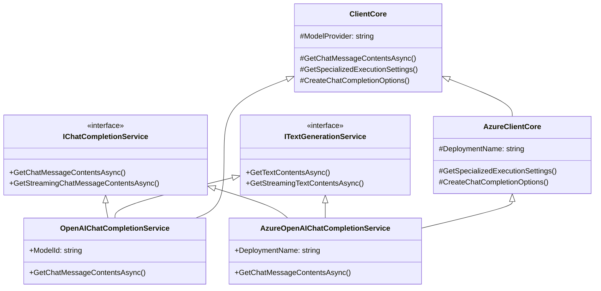
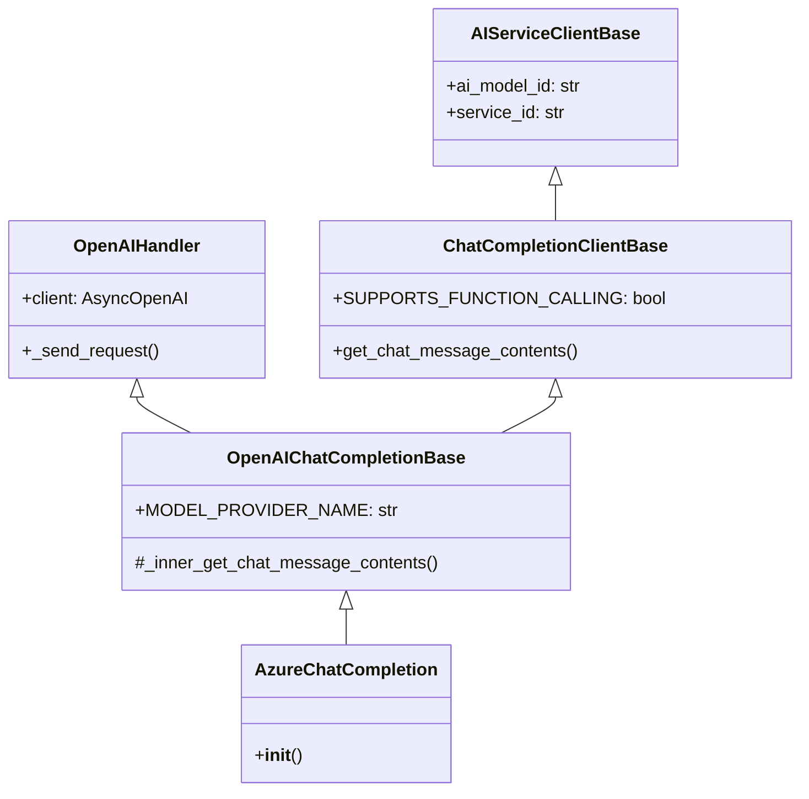
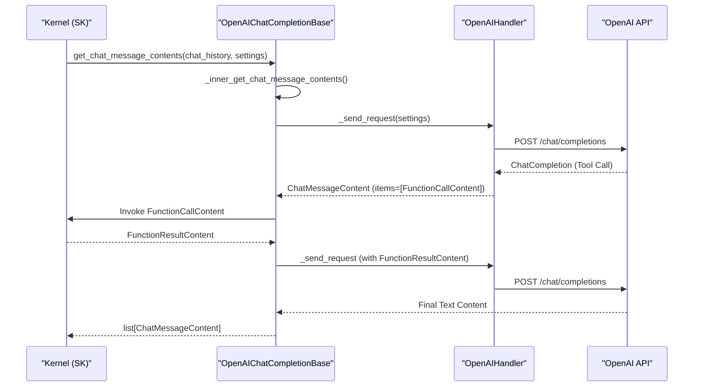

<!-- source: DeepWiki mcp.deepwiki.com · repo microsoft/semantic-kernel · page 4.1 OpenAI and Azure OpenAI Connectors · fetched 2026-10-26 -->

# OpenAI and Azure OpenAI Connectors

<details>
<summary>Relevant source files</summary>

The following files were used as context for generating this wiki page:

- [docs/decisions/0065-realtime-api-clients.md](docs/decisions/0065-realtime-api-clients.md)
- [dotnet/docs/OPENAI-CONNECTOR-MIGRATION.md](dotnet/docs/OPENAI-CONNECTOR-MIGRATION.md)
- [dotnet/samples/Concepts/ChatCompletion/AzureOpenAIWithData_ChatCompletion.cs](dotnet/samples/Concepts/ChatCompletion/AzureOpenAIWithData_ChatCompletion.cs)
- [dotnet/samples/Concepts/ChatCompletion/AzureOpenAI_ChatCompletion.cs](dotnet/samples/Concepts/ChatCompletion/AzureOpenAI_ChatCompletion.cs)
- [dotnet/samples/Concepts/ChatCompletion/AzureOpenAI_ChatCompletionStreaming.cs](dotnet/samples/Concepts/ChatCompletion/AzureOpenAI_ChatCompletionStreaming.cs)
- [dotnet/samples/Concepts/ChatCompletion/AzureOpenAI_ChatCompletionWithReasoning.cs](dotnet/samples/Concepts/ChatCompletion/AzureOpenAI_ChatCompletionWithReasoning.cs)
- [dotnet/samples/Concepts/ChatCompletion/AzureOpenAI_CustomClient.cs](dotnet/samples/Concepts/ChatCompletion/AzureOpenAI_CustomClient.cs)
- [dotnet/samples/Concepts/ChatCompletion/ChatHistoryInFunctions.cs](dotnet/samples/Concepts/ChatCompletion/ChatHistoryInFunctions.cs)
- [dotnet/samples/Concepts/ChatCompletion/HuggingFace_ChatCompletion.cs](dotnet/samples/Concepts/ChatCompletion/HuggingFace_ChatCompletion.cs)
- [dotnet/samples/Concepts/ChatCompletion/HuggingFace_ChatCompletionStreaming.cs](dotnet/samples/Concepts/ChatCompletion/HuggingFace_ChatCompletionStreaming.cs)
- [dotnet/samples/Concepts/ChatCompletion/LMStudio_ChatCompletion.cs](dotnet/samples/Concepts/ChatCompletion/LMStudio_ChatCompletion.cs)
- [dotnet/samples/Concepts/ChatCompletion/LMStudio_ChatCompletionStreaming.cs](dotnet/samples/Concepts/ChatCompletion/LMStudio_ChatCompletionStreaming.cs)
- [dotnet/samples/Concepts/ChatCompletion/OpenAI_ChatCompletion.cs](dotnet/samples/Concepts/ChatCompletion/OpenAI_ChatCompletion.cs)
- [dotnet/samples/Concepts/ChatCompletion/OpenAI_ChatCompletionExtraBody.cs](dotnet/samples/Concepts/ChatCompletion/OpenAI_ChatCompletionExtraBody.cs)
- [dotnet/samples/Concepts/ChatCompletion/OpenAI_ChatCompletionStreaming.cs](dotnet/samples/Concepts/ChatCompletion/OpenAI_ChatCompletionStreaming.cs)
- [dotnet/samples/Concepts/ChatCompletion/OpenAI_CustomClient.cs](dotnet/samples/Concepts/ChatCompletion/OpenAI_CustomClient.cs)
- [dotnet/samples/Concepts/Filtering/AzureOpenAI_DeploymentSwitch.cs](dotnet/samples/Concepts/Filtering/AzureOpenAI_DeploymentSwitch.cs)
- [dotnet/src/Connectors/Connectors.AzureOpenAI.UnitTests/Core/AzureClientCoreTests.cs](dotnet/src/Connectors/Connectors.AzureOpenAI.UnitTests/Core/AzureClientCoreTests.cs)
- [dotnet/src/Connectors/Connectors.AzureOpenAI.UnitTests/Core/ClientCoreTests.cs](dotnet/src/Connectors/Connectors.AzureOpenAI.UnitTests/Core/ClientCoreTests.cs)
- [dotnet/src/Connectors/Connectors.AzureOpenAI.UnitTests/Extensions/AzureOpenAIKernelBuilderExtensionsTests.cs](dotnet/src/Connectors/Connectors.AzureOpenAI.UnitTests/Extensions/AzureOpenAIKernelBuilderExtensionsTests.cs)
- [dotnet/src/Connectors/Connectors.AzureOpenAI.UnitTests/Extensions/AzureOpenAIServiceCollectionExtensionsTests.cs](dotnet/src/Connectors/Connectors.AzureOpenAI.UnitTests/Extensions/AzureOpenAIServiceCollectionExtensionsTests.cs)
- [dotnet/src/Connectors/Connectors.AzureOpenAI.UnitTests/Services/AzureOpenAIAudioToTextServiceTests.cs](dotnet/src/Connectors/Connectors.AzureOpenAI.UnitTests/Services/AzureOpenAIAudioToTextServiceTests.cs)
- [dotnet/src/Connectors/Connectors.AzureOpenAI.UnitTests/Services/AzureOpenAIChatCompletionExtraBodyTests.cs](dotnet/src/Connectors/Connectors.AzureOpenAI.UnitTests/Services/AzureOpenAIChatCompletionExtraBodyTests.cs)
- [dotnet/src/Connectors/Connectors.AzureOpenAI.UnitTests/Services/AzureOpenAIChatCompletionServiceTests.cs](dotnet/src/Connectors/Connectors.AzureOpenAI.UnitTests/Services/AzureOpenAIChatCompletionServiceTests.cs)
- [dotnet/src/Connectors/Connectors.AzureOpenAI.UnitTests/Services/AzureOpenAITextEmbeddingGenerationServiceTests.cs](dotnet/src/Connectors/Connectors.AzureOpenAI.UnitTests/Services/AzureOpenAITextEmbeddingGenerationServiceTests.cs)
- [dotnet/src/Connectors/Connectors.AzureOpenAI.UnitTests/Services/AzureOpenAITextToAudioServiceTests.cs](dotnet/src/Connectors/Connectors.AzureOpenAI.UnitTests/Services/AzureOpenAITextToAudioServiceTests.cs)
- [dotnet/src/Connectors/Connectors.AzureOpenAI.UnitTests/Services/AzureOpenAITextToImageServiceTests.cs](dotnet/src/Connectors/Connectors.AzureOpenAI.UnitTests/Services/AzureOpenAITextToImageServiceTests.cs)
- [dotnet/src/Connectors/Connectors.AzureOpenAI.UnitTests/Settings/AzureOpenAIPromptExecutionSettingsTests.cs](dotnet/src/Connectors/Connectors.AzureOpenAI.UnitTests/Settings/AzureOpenAIPromptExecutionSettingsTests.cs)
- [dotnet/src/Connectors/Connectors.AzureOpenAI/Core/AzureClientCore.ChatCompletion.cs](dotnet/src/Connectors/Connectors.AzureOpenAI/Core/AzureClientCore.ChatCompletion.cs)
- [dotnet/src/Connectors/Connectors.AzureOpenAI/Core/AzureClientCore.cs](dotnet/src/Connectors/Connectors.AzureOpenAI/Core/AzureClientCore.cs)
- [dotnet/src/Connectors/Connectors.AzureOpenAI/Extensions/AzureOpenAIKernelBuilderExtensions.cs](dotnet/src/Connectors/Connectors.AzureOpenAI/Extensions/AzureOpenAIKernelBuilderExtensions.cs)
- [dotnet/src/Connectors/Connectors.AzureOpenAI/Extensions/AzureOpenAIServiceCollectionExtensions.cs](dotnet/src/Connectors/Connectors.AzureOpenAI/Extensions/AzureOpenAIServiceCollectionExtensions.cs)
- [dotnet/src/Connectors/Connectors.AzureOpenAI/Services/AzureOpenAITextToAudioService.cs](dotnet/src/Connectors/Connectors.AzureOpenAI/Services/AzureOpenAITextToAudioService.cs)
- [dotnet/src/Connectors/Connectors.AzureOpenAI/Services/AzureOpenAITextToImageService.cs](dotnet/src/Connectors/Connectors.AzureOpenAI/Services/AzureOpenAITextToImageService.cs)
- [dotnet/src/Connectors/Connectors.AzureOpenAI/Settings/AzureOpenAIPromptExecutionSettings.cs](dotnet/src/Connectors/Connectors.AzureOpenAI/Settings/AzureOpenAIPromptExecutionSettings.cs)
- [dotnet/src/Connectors/Connectors.OpenAI.UnitTests/Core/ClientCoreTests.cs](dotnet/src/Connectors/Connectors.OpenAI.UnitTests/Core/ClientCoreTests.cs)
- [dotnet/src/Connectors/Connectors.OpenAI.UnitTests/Services/OpenAIAudioToTextServiceTests.cs](dotnet/src/Connectors/Connectors.OpenAI.UnitTests/Services/OpenAIAudioToTextServiceTests.cs)
- [dotnet/src/Connectors/Connectors.OpenAI.UnitTests/Services/OpenAIChatCompletionExtraBodyTests.cs](dotnet/src/Connectors/Connectors.OpenAI.UnitTests/Services/OpenAIChatCompletionExtraBodyTests.cs)
- [dotnet/src/Connectors/Connectors.OpenAI.UnitTests/Services/OpenAIChatCompletionServiceTests.cs](dotnet/src/Connectors/Connectors.OpenAI.UnitTests/Services/OpenAIChatCompletionServiceTests.cs)
- [dotnet/src/Connectors/Connectors.OpenAI.UnitTests/Settings/OpenAIPromptExecutionSettingsTests.cs](dotnet/src/Connectors/Connectors.OpenAI.UnitTests/Settings/OpenAIPromptExecutionSettingsTests.cs)
- [dotnet/src/Connectors/Connectors.OpenAI.UnitTests/TestData/chat_completion_streaming_test_response.txt](dotnet/src/Connectors/Connectors.OpenAI.UnitTests/TestData/chat_completion_streaming_test_response.txt)
- [dotnet/src/Connectors/Connectors.OpenAI/Core/ClientCore.AudioToText.cs](dotnet/src/Connectors/Connectors.OpenAI/Core/ClientCore.AudioToText.cs)
- [dotnet/src/Connectors/Connectors.OpenAI/Core/ClientCore.ChatCompletion.cs](dotnet/src/Connectors/Connectors.OpenAI/Core/ClientCore.ChatCompletion.cs)
- [dotnet/src/Connectors/Connectors.OpenAI/Core/ClientCore.TextToAudio.cs](dotnet/src/Connectors/Connectors.OpenAI/Core/ClientCore.TextToAudio.cs)
- [dotnet/src/Connectors/Connectors.OpenAI/Services/OpenAIChatCompletionService.cs](dotnet/src/Connectors/Connectors.OpenAI/Services/OpenAIChatCompletionService.cs)
- [dotnet/src/Connectors/Connectors.OpenAI/Settings/OpenAIAudioToTextExecutionSettings.cs](dotnet/src/Connectors/Connectors.OpenAI/Settings/OpenAIAudioToTextExecutionSettings.cs)
- [dotnet/src/Connectors/Connectors.OpenAI/Settings/OpenAIPromptExecutionSettings.cs](dotnet/src/Connectors/Connectors.OpenAI/Settings/OpenAIPromptExecutionSettings.cs)
- [dotnet/src/Connectors/Connectors.OpenAI/Settings/OpenAITextToAudioExecutionSettings.cs](dotnet/src/Connectors/Connectors.OpenAI/Settings/OpenAITextToAudioExecutionSettings.cs)
- [dotnet/src/IntegrationTests/Connectors/AzureOpenAI/AzureOpenAIChatCompletionStreamingTests.cs](dotnet/src/IntegrationTests/Connectors/AzureOpenAI/AzureOpenAIChatCompletionStreamingTests.cs)
- [dotnet/src/SemanticKernel.Abstractions/AI/PromptExecutionSettingsExtensions.cs](dotnet/src/SemanticKernel.Abstractions/AI/PromptExecutionSettingsExtensions.cs)
- [python/semantic_kernel/connectors/ai/chat_completion_client_base.py](python/semantic_kernel/connectors/ai/chat_completion_client_base.py)
- [python/semantic_kernel/connectors/ai/embeddings/embedding_generator_base.py](python/semantic_kernel/connectors/ai/embeddings/embedding_generator_base.py)
- [python/semantic_kernel/connectors/ai/hugging_face/services/hf_text_completion.py](python/semantic_kernel/connectors/ai/hugging_face/services/hf_text_completion.py)
- [python/semantic_kernel/connectors/ai/hugging_face/services/hf_text_embedding.py](python/semantic_kernel/connectors/ai/hugging_face/services/hf_text_embedding.py)
- [python/semantic_kernel/connectors/ai/ollama/services/ollama_chat_completion.py](python/semantic_kernel/connectors/ai/ollama/services/ollama_chat_completion.py)
- [python/semantic_kernel/connectors/ai/ollama/services/ollama_text_completion.py](python/semantic_kernel/connectors/ai/ollama/services/ollama_text_completion.py)
- [python/semantic_kernel/connectors/ai/ollama/services/ollama_text_embedding.py](python/semantic_kernel/connectors/ai/ollama/services/ollama_text_embedding.py)
- [python/semantic_kernel/connectors/ai/open_ai/prompt_execution_settings/azure_chat_prompt_execution_settings.py](python/semantic_kernel/connectors/ai/open_ai/prompt_execution_settings/azure_chat_prompt_execution_settings.py)
- [python/semantic_kernel/connectors/ai/open_ai/prompt_execution_settings/open_ai_prompt_execution_settings.py](python/semantic_kernel/connectors/ai/open_ai/prompt_execution_settings/open_ai_prompt_execution_settings.py)
- [python/semantic_kernel/connectors/ai/open_ai/services/azure_chat_completion.py](python/semantic_kernel/connectors/ai/open_ai/services/azure_chat_completion.py)
- [python/semantic_kernel/connectors/ai/open_ai/services/azure_config_base.py](python/semantic_kernel/connectors/ai/open_ai/services/azure_config_base.py)
- [python/semantic_kernel/connectors/ai/open_ai/services/azure_text_completion.py](python/semantic_kernel/connectors/ai/open_ai/services/azure_text_completion.py)
- [python/semantic_kernel/connectors/ai/open_ai/services/azure_text_embedding.py](python/semantic_kernel/connectors/ai/open_ai/services/azure_text_embedding.py)
- [python/semantic_kernel/connectors/ai/open_ai/services/open_ai_chat_completion.py](python/semantic_kernel/connectors/ai/open_ai/services/open_ai_chat_completion.py)
- [python/semantic_kernel/connectors/ai/open_ai/services/open_ai_chat_completion_base.py](python/semantic_kernel/connectors/ai/open_ai/services/open_ai_chat_completion_base.py)
- [python/semantic_kernel/connectors/ai/open_ai/services/open_ai_config_base.py](python/semantic_kernel/connectors/ai/open_ai/services/open_ai_config_base.py)
- [python/semantic_kernel/connectors/ai/open_ai/services/open_ai_handler.py](python/semantic_kernel/connectors/ai/open_ai/services/open_ai_handler.py)
- [python/semantic_kernel/connectors/ai/open_ai/services/open_ai_text_completion.py](python/semantic_kernel/connectors/ai/open_ai/services/open_ai_text_completion.py)
- [python/semantic_kernel/connectors/ai/open_ai/services/open_ai_text_embedding.py](python/semantic_kernel/connectors/ai/open_ai/services/open_ai_text_embedding.py)
- [python/semantic_kernel/connectors/ai/open_ai/services/open_ai_text_embedding_base.py](python/semantic_kernel/connectors/ai/open_ai/services/open_ai_text_embedding_base.py)
- [python/semantic_kernel/connectors/ai/text_completion_client_base.py](python/semantic_kernel/connectors/ai/text_completion_client_base.py)
- [python/tests/integration/completions/test_azure_oai_chat_service_extensions.py](python/tests/integration/completions/test_azure_oai_chat_service_extensions.py)
- [python/tests/unit/connectors/ai/open_ai/services/test_azure_chat_completion.py](python/tests/unit/connectors/ai/open_ai/services/test_azure_chat_completion.py)
- [python/tests/unit/connectors/ai/open_ai/services/test_openai_chat_completion_base.py](python/tests/unit/connectors/ai/open_ai/services/test_openai_chat_completion_base.py)
- [python/tests/unit/connectors/ai/test_function_choice_behavior.py](python/tests/unit/connectors/ai/test_function_choice_behavior.py)

</details>


This document provides a technical overview of the OpenAI and Azure OpenAI connectors in the Semantic Kernel framework. These connectors enable integration with OpenAI and Azure OpenAI services for chat completion, text completion, embedding generation, and other AI capabilities.

For information about other AI service connectors, see [Other AI Service Connectors](4.3). For details on how AI services are selected and configured, see [Service Selection and Configuration](4.2).

## Purpose and Architecture

The OpenAI and Azure OpenAI connectors provide a standardized interface for interacting with OpenAI and Azure OpenAI services. They implement the core service interfaces defined in Semantic Kernel, such as `IChatCompletionService`, `ITextGenerationService`, and `ITextEmbeddingService`, allowing seamless integration with the kernel.

### OpenAI and Azure OpenAI Connector Architecture

```mermaid
graph TD
    subgraph "Semantic Kernel Core"
        [Kernel]
        [AIServices]
        [ServiceInterfaces]
    end

    subgraph "OpenAI Connectors"
        [ClientCore]
        [OpenAIChatCompletionService]
        [OpenAITextCompletionService]
        [OpenAITextEmbeddingService]
    end

    subgraph "Azure OpenAI Connectors"
        [AzureClientCore]
        [AzureOpenAIChatCompletionService]
        [AzureOpenAITextCompletionService]
        [AzureOpenAITextEmbeddingService]
    end

    [Kernel] --> [AIServices]
    [AIServices] --> [ServiceInterfaces]
    [ServiceInterfaces] --> [OpenAIChatCompletionService]
    [ServiceInterfaces] --> [OpenAITextCompletionService]
    [ServiceInterfaces] --> [OpenAITextEmbeddingService]
    [ServiceInterfaces] --> [AzureOpenAIChatCompletionService]
    [ServiceInterfaces] --> [AzureOpenAITextCompletionService]
    [ServiceInterfaces] --> [AzureOpenAITextEmbeddingService]
    
    [ClientCore] --> [OpenAIChatCompletionService]
    [ClientCore] --> [OpenAITextCompletionService]
    [ClientCore] --> [OpenAITextEmbeddingService]
    
    [AzureClientCore] --> [AzureOpenAIChatCompletionService]
    [AzureClientCore] --> [AzureOpenAITextCompletionService]
    [AzureClientCore] --> [AzureOpenAITextEmbeddingService]
```

Sources:
- [dotnet/src/Connectors/Connectors.OpenAI/Core/ClientCore.ChatCompletion.cs:30-31]()
- [python/semantic_kernel/connectors/ai/open_ai/services/open_ai_chat_completion_base.py:54-55]()
- [dotnet/src/Connectors/Connectors.AzureOpenAI/Core/AzureClientCore.cs:21-22]()
- [python/semantic_kernel/connectors/ai/open_ai/services/azure_chat_completion.py:40-41]()

## Connector Implementation

Both OpenAI and Azure OpenAI connectors follow a similar architecture with base classes that handle common functionality and derived classes for specific services.

### .NET Connector Class Hierarchy



Sources:
- [dotnet/src/Connectors/Connectors.OpenAI/Core/ClientCore.ChatCompletion.cs:30-138]()
- [dotnet/src/Connectors/Connectors.AzureOpenAI/Core/AzureClientCore.cs:21-22]()
- [dotnet/src/Connectors/Connectors.AzureOpenAI/Core/AzureClientCore.ChatCompletion.cs:21-32]()

## .NET Implementation

### ClientCore and AzureClientCore

In .NET, `ClientCore` is the internal base for common OpenAI functionality [dotnet/src/Connectors/Connectors.OpenAI/Core/ClientCore.ChatCompletion.cs:30](). It handles metrics via `Meter` [dotnet/src/Connectors/Connectors.OpenAI/Core/ClientCore.ChatCompletion.cs:69]() and manages a safety limit for recursive function calls via `MaxInflightAutoInvokes = 128` [dotnet/src/Connectors/Connectors.OpenAI/Core/ClientCore.ChatCompletion.cs:58]().

`AzureClientCore` inherits from `ClientCore` to add Azure-specific logic, such as adding data sources [dotnet/src/Connectors/Connectors.AzureOpenAI/Core/AzureClientCore.ChatCompletion.cs:98-103]() and handling `UserSecurityContext` [dotnet/src/Connectors/Connectors.AzureOpenAI/Core/AzureClientCore.ChatCompletion.cs:75-80]().

### Service Classes

Key services include:
- `OpenAIChatCompletionService`: Uses the OpenAI SDK to provide chat completion [dotnet/src/Connectors/Connectors.OpenAI.UnitTests/Services/OpenAIChatCompletionServiceTests.cs:35]().
- `AzureOpenAIChatCompletionService`: Extends functionality for Azure deployments, supporting API versions and token credentials [dotnet/src/Connectors/Connectors.AzureOpenAI.UnitTests/Services/AzureOpenAIChatCompletionServiceTests.cs:32-70]().

Sources:
- [dotnet/src/Connectors/Connectors.OpenAI/Core/ClientCore.ChatCompletion.cs:30-97]()
- [dotnet/src/Connectors/Connectors.AzureOpenAI/Core/AzureClientCore.ChatCompletion.cs:21-137]()
- [dotnet/src/Connectors/Connectors.AzureOpenAI.UnitTests/Services/AzureOpenAIChatCompletionServiceTests.cs:51-108]()

## Python Implementation

### OpenAIHandler and Client Bases

The Python implementation uses `OpenAIHandler` to abstract the underlying `AsyncOpenAI` client [python/semantic_kernel/connectors/ai/open_ai/services/open_ai_handler.py:47-50](). It manages request routing for different model types like `CHAT`, `EMBEDDING`, and `TEXT_TO_IMAGE` [python/semantic_kernel/connectors/ai/open_ai/services/open_ai_handler.py:58-74]().

`OpenAIChatCompletionBase` provides the core logic for `_inner_get_chat_message_contents` [python/semantic_kernel/connectors/ai/open_ai/services/open_ai_chat_completion_base.py:75]() and handles streaming via `AsyncGenerator` [python/semantic_kernel/connectors/ai/open_ai/services/open_ai_chat_completion_base.py:95-100]().

### Python Connector Class Hierarchy



Sources:
- [python/semantic_kernel/connectors/ai/chat_completion_client_base.py:35-40]()
- [python/semantic_kernel/connectors/ai/open_ai/services/open_ai_handler.py:47-55]()
- [python/semantic_kernel/connectors/ai/open_ai/services/open_ai_chat_completion_base.py:54-58]()
- [python/semantic_kernel/connectors/ai/open_ai/services/azure_chat_completion.py:40-43]()

## Execution Settings

Execution settings allow fine-tuning of the AI request. `OpenAIPromptExecutionSettings` maps Semantic Kernel properties to OpenAI API parameters like `temperature`, `top_p`, and `max_tokens` [dotnet/src/Connectors/Connectors.OpenAI/Settings/OpenAIPromptExecutionSettings.cs:49-130]().

### Key Settings and Features
- **ExtraBody Escape Hatch**: Both .NET and Python support `extra_body` to pass non-standard parameters directly to the API [dotnet/src/Connectors/Connectors.OpenAI/Settings/OpenAIPromptExecutionSettings.cs:338]() [python/semantic_kernel/connectors/ai/open_ai/prompt_execution_settings/open_ai_prompt_execution_settings.py:104]().
- **Structured Outputs**: Enabled via `ResponseFormat`. In Python, setting `response_format` to a `BaseModel` or `dict` with `json_schema` triggers `structured_json_response` [python/semantic_kernel/connectors/ai/open_ai/prompt_execution_settings/open_ai_prompt_execution_settings.py:117-147]().
- **Reasoning Models**: Support for `reasoning_effort` (low, medium, high) for models like o1/o3 [dotnet/src/Connectors/Connectors.OpenAI/Settings/OpenAIPromptExecutionSettings.cs:34]() [python/semantic_kernel/connectors/ai/open_ai/prompt_execution_settings/open_ai_prompt_execution_settings.py:98-103]().

Sources:
- [dotnet/src/Connectors/Connectors.OpenAI/Settings/OpenAIPromptExecutionSettings.cs:20-340]()
- [python/semantic_kernel/connectors/ai/open_ai/prompt_execution_settings/open_ai_prompt_execution_settings.py:14-104]()
- [dotnet/src/Connectors/Connectors.AzureOpenAI/Settings/AzureOpenAIPromptExecutionSettings.cs:13-25]()

## Chat Completion Flow

The auto-invocation loop in `ChatCompletionClientBase` allows the connector to handle multiple rounds of tool calls automatically.



Sources:
- [python/semantic_kernel/connectors/ai/chat_completion_client_base.py:85-154]()
- [python/semantic_kernel/connectors/ai/open_ai/services/open_ai_chat_completion_base.py:75-91]()
- [python/semantic_kernel/connectors/ai/open_ai/services/open_ai_handler.py:76-92]()

## Azure OpenAI with Data (On Your Data)

Azure OpenAI connectors support `AzureChatDataSource` (e.g., `AzureSearchChatDataSource`) to integrate retrieval-augmented generation directly at the connector level [dotnet/src/Connectors/Connectors.AzureOpenAI/Core/AzureClientCore.ChatCompletion.cs:98-103]().

In .NET, these are added to `ChatCompletionOptions` via `options.AddDataSource(azureSettings.AzureChatDataSource)` [dotnet/src/Connectors/Connectors.AzureOpenAI/Core/AzureClientCore.ChatCompletion.cs:101]().

Sources:
- [dotnet/src/Connectors/Connectors.AzureOpenAI/Core/AzureClientCore.ChatCompletion.cs:98-103]()
- [dotnet/src/Connectors/Connectors.AzureOpenAI.UnitTests/Services/AzureOpenAIChatCompletionServiceTests.cs:156-161]()
- [dotnet/samples/Concepts/ChatCompletion/AzureOpenAIWithData_ChatCompletion.cs:52-69]()

## Migration and Compatibility

The connectors have transitioned from `functions` and `function_call` to the modern `tools` and `tool_choice` parameters. The Python implementation explicitly validates and warns against the use of deprecated function parameters [python/semantic_kernel/connectors/ai/open_ai/prompt_execution_settings/open_ai_prompt_execution_settings.py:106-114]().

Sources:
- [python/semantic_kernel/connectors/ai/open_ai/prompt_execution_settings/open_ai_prompt_execution_settings.py:106-114]()
- [dotnet/src/Connectors/Connectors.OpenAI/Core/ClientCore.ChatCompletion.cs:61-64]()

---

