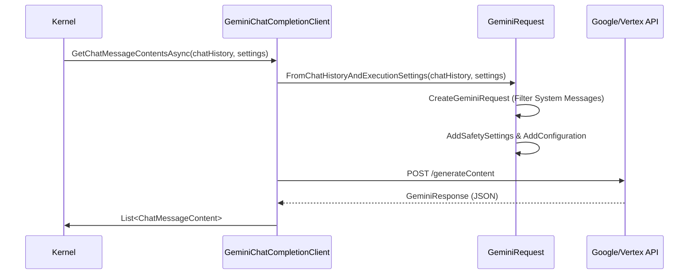

<!-- source: DeepWiki mcp.deepwiki.com · repo microsoft/semantic-kernel · page 4.3 Other AI Service Connectors · fetched 2026-10-26 -->

# Other AI Service Connectors

Relevant source files

The following files were used as context for generating this wiki page:

- [docs/decisions/0054-processes.md](docs/decisions/0054-processes.md)
- [docs/decisions/diagrams/process/process_diagram_basic.png](docs/decisions/diagrams/process/process_diagram_basic.png)
- [dotnet/samples/Concepts/ChatCompletion/Google_GeminiChatCompletionWithFile.cs](dotnet/samples/Concepts/ChatCompletion/Google_GeminiChatCompletionWithFile.cs)
- [dotnet/samples/Concepts/ChatCompletion/Google_GeminiChatCompletionWithThinking.cs](dotnet/samples/Concepts/ChatCompletion/Google_GeminiChatCompletionWithThinking.cs)
- [dotnet/samples/Concepts/ChatCompletion/MistralAI_ChatCompletion.cs](dotnet/samples/Concepts/ChatCompletion/MistralAI_ChatCompletion.cs)
- [dotnet/samples/Concepts/FunctionCalling/NexusRaven_FunctionCalling.cs](dotnet/samples/Concepts/FunctionCalling/NexusRaven_FunctionCalling.cs)
- [dotnet/samples/Concepts/Plugins/CreatePromptPluginFromDirectory.cs](dotnet/samples/Concepts/Plugins/CreatePromptPluginFromDirectory.cs)
- [dotnet/samples/Demos/AmazonBedrockModels/AmazonBedrockAIModels.csproj](dotnet/samples/Demos/AmazonBedrockModels/AmazonBedrockAIModels.csproj)
- [dotnet/samples/Demos/AmazonBedrockModels/Program.cs](dotnet/samples/Demos/AmazonBedrockModels/Program.cs)
- [dotnet/samples/Demos/OnnxSimpleChatWithCuda/OnnxSimpleChatWithCuda.csproj](dotnet/samples/Demos/OnnxSimpleChatWithCuda/OnnxSimpleChatWithCuda.csproj)
- [dotnet/samples/Demos/OnnxSimpleChatWithCuda/Program.cs](dotnet/samples/Demos/OnnxSimpleChatWithCuda/Program.cs)
- [dotnet/samples/Demos/OnnxSimpleChatWithCuda/README.md](dotnet/samples/Demos/OnnxSimpleChatWithCuda/README.md)
- [dotnet/src/Connectors/Connectors.Amazon.UnitTests/Services/BedrockChatCompletionServiceTests.cs](dotnet/src/Connectors/Connectors.Amazon.UnitTests/Services/BedrockChatCompletionServiceTests.cs)
- [dotnet/src/Connectors/Connectors.Amazon.UnitTests/Services/BedrockTextGenerationServiceTests.cs](dotnet/src/Connectors/Connectors.Amazon.UnitTests/Services/BedrockTextGenerationServiceTests.cs)
- [dotnet/src/Connectors/Connectors.Amazon/Bedrock/Core/Clients/BedrockChatCompletionClient.cs](dotnet/src/Connectors/Connectors.Amazon/Bedrock/Core/Clients/BedrockChatCompletionClient.cs)
- [dotnet/src/Connectors/Connectors.Amazon/Bedrock/Core/Clients/BedrockTextGenerationClient.cs](dotnet/src/Connectors/Connectors.Amazon/Bedrock/Core/Clients/BedrockTextGenerationClient.cs)
- [dotnet/src/Connectors/Connectors.Amazon/Bedrock/Core/IBedrockTextGenerationService.cs](dotnet/src/Connectors/Connectors.Amazon/Bedrock/Core/IBedrockTextGenerationService.cs)
- [dotnet/src/Connectors/Connectors.Amazon/Bedrock/Core/Models/AI21Labs/AI21JambaService.cs](dotnet/src/Connectors/Connectors.Amazon/Bedrock/Core/Models/AI21Labs/AI21JambaService.cs)
- [dotnet/src/Connectors/Connectors.Amazon/Bedrock/Core/Models/AI21Labs/AI21JurassicService.cs](dotnet/src/Connectors/Connectors.Amazon/Bedrock/Core/Models/AI21Labs/AI21JurassicService.cs)
- [dotnet/src/Connectors/Connectors.Amazon/Bedrock/Core/Models/Amazon/AmazonService.cs](dotnet/src/Connectors/Connectors.Amazon/Bedrock/Core/Models/Amazon/AmazonService.cs)
- [dotnet/src/Connectors/Connectors.Amazon/Bedrock/Core/Models/Anthropic/AnthropicService.cs](dotnet/src/Connectors/Connectors.Amazon/Bedrock/Core/Models/Anthropic/AnthropicService.cs)
- [dotnet/src/Connectors/Connectors.Amazon/Bedrock/Settings/AmazonCommandExecutionSettings.cs](dotnet/src/Connectors/Connectors.Amazon/Bedrock/Settings/AmazonCommandExecutionSettings.cs)
- [dotnet/src/Connectors/Connectors.Amazon/Bedrock/Settings/AmazonCommandRExecutionSettings.cs](dotnet/src/Connectors/Connectors.Amazon/Bedrock/Settings/AmazonCommandRExecutionSettings.cs)
- [dotnet/src/Connectors/Connectors.AzureOpenAI.UnitTests/Settings/OpenAIPromptExecutionSettingsTests.cs](dotnet/src/Connectors/Connectors.AzureOpenAI.UnitTests/Settings/OpenAIPromptExecutionSettingsTests.cs)
- [dotnet/src/Connectors/Connectors.Google.UnitTests/Core/Gemini/Clients/GeminiChatGenerationTests.cs](dotnet/src/Connectors/Connectors.Google.UnitTests/Core/Gemini/Clients/GeminiChatGenerationTests.cs)
- [dotnet/src/Connectors/Connectors.Google.UnitTests/Core/Gemini/Clients/GeminiChatStreamingTests.cs](dotnet/src/Connectors/Connectors.Google.UnitTests/Core/Gemini/Clients/GeminiChatStreamingTests.cs)
- [dotnet/src/Connectors/Connectors.Google.UnitTests/Core/Gemini/Clients/GeminiCountingTokensTests.cs](dotnet/src/Connectors/Connectors.Google.UnitTests/Core/Gemini/Clients/GeminiCountingTokensTests.cs)
- [dotnet/src/Connectors/Connectors.Google.UnitTests/Core/Gemini/GeminiRequestTests.cs](dotnet/src/Connectors/Connectors.Google.UnitTests/Core/Gemini/GeminiRequestTests.cs)
- [dotnet/src/Connectors/Connectors.Google.UnitTests/Core/VertexAI/VertexAIClientEmbeddingsGenerationTests.cs](dotnet/src/Connectors/Connectors.Google.UnitTests/Core/VertexAI/VertexAIClientEmbeddingsGenerationTests.cs)
- [dotnet/src/Connectors/Connectors.Google.UnitTests/GeminiPromptExecutionSettingsTests.cs](dotnet/src/Connectors/Connectors.Google.UnitTests/GeminiPromptExecutionSettingsTests.cs)
- [dotnet/src/Connectors/Connectors.Google.UnitTests/Services/GoogleAIGeminiChatCompletionServiceTests.cs](dotnet/src/Connectors/Connectors.Google.UnitTests/Services/GoogleAIGeminiChatCompletionServiceTests.cs)
- [dotnet/src/Connectors/Connectors.Google.UnitTests/Services/VertexAIGeminiChatCompletionServiceTests.cs](dotnet/src/Connectors/Connectors.Google.UnitTests/Services/VertexAIGeminiChatCompletionServiceTests.cs)
- [dotnet/src/Connectors/Connectors.Google/Core/ClientBase.cs](dotnet/src/Connectors/Connectors.Google/Core/ClientBase.cs)
- [dotnet/src/Connectors/Connectors.Google/Core/Gemini/Clients/GeminiChatCompletionClient.cs](dotnet/src/Connectors/Connectors.Google/Core/Gemini/Clients/GeminiChatCompletionClient.cs)
- [dotnet/src/Connectors/Connectors.Google/Core/Gemini/Clients/GeminiTokenCounterClient.cs](dotnet/src/Connectors/Connectors.Google/Core/Gemini/Clients/GeminiTokenCounterClient.cs)
- [dotnet/src/Connectors/Connectors.Google/Core/Gemini/Models/GeminiRequest.cs](dotnet/src/Connectors/Connectors.Google/Core/Gemini/Models/GeminiRequest.cs)
- [dotnet/src/Connectors/Connectors.Google/Core/VertexAI/VertexAIEmbeddingClient.cs](dotnet/src/Connectors/Connectors.Google/Core/VertexAI/VertexAIEmbeddingClient.cs)
- [dotnet/src/Connectors/Connectors.Google/Extensions/VertexAIMemoryBuilderExtensions.cs](dotnet/src/Connectors/Connectors.Google/Extensions/VertexAIMemoryBuilderExtensions.cs)
- [dotnet/src/Connectors/Connectors.Google/GeminiPromptExecutionSettings.cs](dotnet/src/Connectors/Connectors.Google/GeminiPromptExecutionSettings.cs)
- [dotnet/src/Connectors/Connectors.Google/GeminiThinkingConfig.cs](dotnet/src/Connectors/Connectors.Google/GeminiThinkingConfig.cs)
- [dotnet/src/Connectors/Connectors.HuggingFace.UnitTests/HuggingFacePromptExecutionSettingsTests.cs](dotnet/src/Connectors/Connectors.HuggingFace.UnitTests/HuggingFacePromptExecutionSettingsTests.cs)
- [dotnet/src/Connectors/Connectors.HuggingFace.UnitTests/Services/HuggingFaceChatCompletionTests.cs](dotnet/src/Connectors/Connectors.HuggingFace.UnitTests/Services/HuggingFaceChatCompletionTests.cs)
- [dotnet/src/Connectors/Connectors.HuggingFace.UnitTests/Services/HuggingFaceEmbeddingGenerationTests.cs](dotnet/src/Connectors/Connectors.HuggingFace.UnitTests/Services/HuggingFaceEmbeddingGenerationTests.cs)
- [dotnet/src/Connectors/Connectors.HuggingFace.UnitTests/Services/HuggingFaceStreamingChatCompletionTests.cs](dotnet/src/Connectors/Connectors.HuggingFace.UnitTests/Services/HuggingFaceStreamingChatCompletionTests.cs)
- [dotnet/src/Connectors/Connectors.HuggingFace.UnitTests/Services/HuggingFaceStreamingTextGenerationTests.cs](dotnet/src/Connectors/Connectors.HuggingFace.UnitTests/Services/HuggingFaceStreamingTextGenerationTests.cs)
- [dotnet/src/Connectors/Connectors.HuggingFace.UnitTests/Services/HuggingFaceTextGenerationTests.cs](dotnet/src/Connectors/Connectors.HuggingFace.UnitTests/Services/HuggingFaceTextGenerationTests.cs)
- [dotnet/src/Connectors/Connectors.HuggingFace.UnitTests/TestData/chatcompletion_test_response.json](dotnet/src/Connectors/Connectors.HuggingFace.UnitTests/TestData/chatcompletion_test_response.json)
- [dotnet/src/Connectors/Connectors.HuggingFace.UnitTests/TestData/chatcompletion_test_stream_response.txt](dotnet/src/Connectors/Connectors.HuggingFace.UnitTests/TestData/chatcompletion_test_stream_response.txt)
- [dotnet/src/Connectors/Connectors.HuggingFace.UnitTests/TestData/embeddings_test_response_feature_extraction.json](dotnet/src/Connectors/Connectors.HuggingFace.UnitTests/TestData/embeddings_test_response_feature_extraction.json)
- [dotnet/src/Connectors/Connectors.HuggingFace.UnitTests/TextGeneration/TextGenerationStreamResponseTests.cs](dotnet/src/Connectors/Connectors.HuggingFace.UnitTests/TextGeneration/TextGenerationStreamResponseTests.cs)
- [dotnet/src/Connectors/Connectors.HuggingFace/Core/HuggingFaceClient.cs](dotnet/src/Connectors/Connectors.HuggingFace/Core/HuggingFaceClient.cs)
- [dotnet/src/Connectors/Connectors.HuggingFace/Core/HuggingFaceMessageApiClient.cs](dotnet/src/Connectors/Connectors.HuggingFace/Core/HuggingFaceMessageApiClient.cs)
- [dotnet/src/Connectors/Connectors.HuggingFace/Core/Models/ChatCompletionRequest.cs](dotnet/src/Connectors/Connectors.HuggingFace/Core/Models/ChatCompletionRequest.cs)
- [dotnet/src/Connectors/Connectors.HuggingFace/Core/Models/TextEmbeddingResponse.cs](dotnet/src/Connectors/Connectors.HuggingFace/Core/Models/TextEmbeddingResponse.cs)
- [dotnet/src/Connectors/Connectors.HuggingFace/Core/Models/TextGenerationRequest.cs](dotnet/src/Connectors/Connectors.HuggingFace/Core/Models/TextGenerationRequest.cs)
- [dotnet/src/Connectors/Connectors.HuggingFace/HuggingFaceKernelBuilderExtensions.cs](dotnet/src/Connectors/Connectors.HuggingFace/HuggingFaceKernelBuilderExtensions.cs)
- [dotnet/src/Connectors/Connectors.HuggingFace/HuggingFacePromptExecutionSettings.cs](dotnet/src/Connectors/Connectors.HuggingFace/HuggingFacePromptExecutionSettings.cs)
- [dotnet/src/Connectors/Connectors.HuggingFace/HuggingFaceServiceCollectionExtensions.cs](dotnet/src/Connectors/Connectors.HuggingFace/HuggingFaceServiceCollectionExtensions.cs)
- [dotnet/src/Connectors/Connectors.HuggingFace/Services/HuggingFaceChatCompletionService.cs](dotnet/src/Connectors/Connectors.HuggingFace/Services/HuggingFaceChatCompletionService.cs)
- [dotnet/src/Connectors/Connectors.HuggingFace/Services/HuggingFaceImageToTextService.cs](dotnet/src/Connectors/Connectors.HuggingFace/Services/HuggingFaceImageToTextService.cs)
- [dotnet/src/Connectors/Connectors.HuggingFace/Services/HuggingFaceTextEmbeddingGenerationService.cs](dotnet/src/Connectors/Connectors.HuggingFace/Services/HuggingFaceTextEmbeddingGenerationService.cs)
- [dotnet/src/Connectors/Connectors.HuggingFace/Services/HuggingFaceTextGenerationService.cs](dotnet/src/Connectors/Connectors.HuggingFace/Services/HuggingFaceTextGenerationService.cs)
- [dotnet/src/Connectors/Connectors.MistralAI.UnitTests/Client/MistralClientTests.cs](dotnet/src/Connectors/Connectors.MistralAI.UnitTests/Client/MistralClientTests.cs)
- [dotnet/src/Connectors/Connectors.MistralAI.UnitTests/MistralAIPromptExecutionSettingsTests.cs](dotnet/src/Connectors/Connectors.MistralAI.UnitTests/MistralAIPromptExecutionSettingsTests.cs)
- [dotnet/src/Connectors/Connectors.MistralAI.UnitTests/MistralTestBase.cs](dotnet/src/Connectors/Connectors.MistralAI.UnitTests/MistralTestBase.cs)
- [dotnet/src/Connectors/Connectors.MistralAI.UnitTests/Services/MistralAIChatCompletionServiceTests.cs](dotnet/src/Connectors/Connectors.MistralAI.UnitTests/Services/MistralAIChatCompletionServiceTests.cs)
- [dotnet/src/Connectors/Connectors.MistralAI.UnitTests/TestData/chat_completions_function_call_response.json](dotnet/src/Connectors/Connectors.MistralAI.UnitTests/TestData/chat_completions_function_call_response.json)
- [dotnet/src/Connectors/Connectors.MistralAI.UnitTests/TestData/chat_completions_response_with_document.json](dotnet/src/Connectors/Connectors.MistralAI.UnitTests/TestData/chat_completions_response_with_document.json)
- [dotnet/src/Connectors/Connectors.MistralAI.UnitTests/TestData/chat_completions_streaming_function_call_response.txt](dotnet/src/Connectors/Connectors.MistralAI.UnitTests/TestData/chat_completions_streaming_function_call_response.txt)
- [dotnet/src/Connectors/Connectors.MistralAI/Client/ChatCompletionRequest.cs](dotnet/src/Connectors/Connectors.MistralAI/Client/ChatCompletionRequest.cs)
- [dotnet/src/Connectors/Connectors.MistralAI/Client/ContentChunk.cs](dotnet/src/Connectors/Connectors.MistralAI/Client/ContentChunk.cs)
- [dotnet/src/Connectors/Connectors.MistralAI/Client/ContentChunkType.cs](dotnet/src/Connectors/Connectors.MistralAI/Client/ContentChunkType.cs)
- [dotnet/src/Connectors/Connectors.MistralAI/Client/DocumentUrlChunk.cs](dotnet/src/Connectors/Connectors.MistralAI/Client/DocumentUrlChunk.cs)
- [dotnet/src/Connectors/Connectors.MistralAI/Client/ImageUrlChunk.cs](dotnet/src/Connectors/Connectors.MistralAI/Client/ImageUrlChunk.cs)
- [dotnet/src/Connectors/Connectors.MistralAI/Client/MistralChatChoice.cs](dotnet/src/Connectors/Connectors.MistralAI/Client/MistralChatChoice.cs)
- [dotnet/src/Connectors/Connectors.MistralAI/Client/MistralChatCompletionChoice.cs](dotnet/src/Connectors/Connectors.MistralAI/Client/MistralChatCompletionChoice.cs)
- [dotnet/src/Connectors/Connectors.MistralAI/Client/MistralChatCompletionChunk.cs](dotnet/src/Connectors/Connectors.MistralAI/Client/MistralChatCompletionChunk.cs)
- [dotnet/src/Connectors/Connectors.MistralAI/Client/MistralChatMessage.cs](dotnet/src/Connectors/Connectors.MistralAI/Client/MistralChatMessage.cs)
- [dotnet/src/Connectors/Connectors.MistralAI/Client/MistralClient.cs](dotnet/src/Connectors/Connectors.MistralAI/Client/MistralClient.cs)
- [dotnet/src/Connectors/Connectors.MistralAI/Client/MistralFunction.cs](dotnet/src/Connectors/Connectors.MistralAI/Client/MistralFunction.cs)
- [dotnet/src/Connectors/Connectors.MistralAI/Client/MistralParameters.cs](dotnet/src/Connectors/Connectors.MistralAI/Client/MistralParameters.cs)
- [dotnet/src/Connectors/Connectors.MistralAI/Client/MistralTool.cs](dotnet/src/Connectors/Connectors.MistralAI/Client/MistralTool.cs)
- [dotnet/src/Connectors/Connectors.MistralAI/Client/MistralToolCall.cs](dotnet/src/Connectors/Connectors.MistralAI/Client/MistralToolCall.cs)
- [dotnet/src/Connectors/Connectors.MistralAI/MistralAIPromptExecutionSettings.cs](dotnet/src/Connectors/Connectors.MistralAI/MistralAIPromptExecutionSettings.cs)
- [dotnet/src/Connectors/Connectors.Ollama.UnitTests/Extensions/OllamaKernelBuilderExtensionsTests.cs](dotnet/src/Connectors/Connectors.Ollama.UnitTests/Extensions/OllamaKernelBuilderExtensionsTests.cs)
- [dotnet/src/Connectors/Connectors.Ollama.UnitTests/Extensions/OllamaServiceCollectionExtensionsTests.cs](dotnet/src/Connectors/Connectors.Ollama.UnitTests/Extensions/OllamaServiceCollectionExtensionsTests.cs)
- [dotnet/src/Connectors/Connectors.Ollama.UnitTests/Services/OllamaTextGenerationTests.cs](dotnet/src/Connectors/Connectors.Ollama.UnitTests/Services/OllamaTextGenerationTests.cs)
- [dotnet/src/Connectors/Connectors.Ollama.UnitTests/Settings/OllamaPromptExecutionSettingsTests.cs](dotnet/src/Connectors/Connectors.Ollama.UnitTests/Settings/OllamaPromptExecutionSettingsTests.cs)
- [dotnet/src/Connectors/Connectors.Ollama/Extensions/OllamaKernelBuilderExtensions.cs](dotnet/src/Connectors/Connectors.Ollama/Extensions/OllamaKernelBuilderExtensions.cs)
- [dotnet/src/Connectors/Connectors.Ollama/Extensions/OllamaServiceCollectionExtensions.cs](dotnet/src/Connectors/Connectors.Ollama/Extensions/OllamaServiceCollectionExtensions.cs)
- [dotnet/src/Connectors/Connectors.Ollama/Services/OllamaTextGenerationService.cs](dotnet/src/Connectors/Connectors.Ollama/Services/OllamaTextGenerationService.cs)
- [dotnet/src/Connectors/Connectors.Ollama/Settings/OllamaPromptExecutionSettings.cs](dotnet/src/Connectors/Connectors.Ollama/Settings/OllamaPromptExecutionSettings.cs)
- [dotnet/src/Connectors/Connectors.Onnx.UnitTests/Connectors.Onnx.UnitTests.csproj](dotnet/src/Connectors/Connectors.Onnx.UnitTests/Connectors.Onnx.UnitTests.csproj)
- [dotnet/src/Connectors/Connectors.Onnx.UnitTests/OnnxChatClientExtensionsTests.cs](dotnet/src/Connectors/Connectors.Onnx.UnitTests/OnnxChatClientExtensionsTests.cs)
- [dotnet/src/Connectors/Connectors.Onnx.UnitTests/OnnxExtensionsTests.cs](dotnet/src/Connectors/Connectors.Onnx.UnitTests/OnnxExtensionsTests.cs)
- [dotnet/src/Connectors/Connectors.Onnx.UnitTests/OnnxRuntimeGenAIChatCompletionServiceProvidersTests.cs](dotnet/src/Connectors/Connectors.Onnx.UnitTests/OnnxRuntimeGenAIChatCompletionServiceProvidersTests.cs)
- [dotnet/src/Connectors/Connectors.Onnx/BertOnnxOptions.cs](dotnet/src/Connectors/Connectors.Onnx/BertOnnxOptions.cs)
- [dotnet/src/Connectors/Connectors.Onnx/BertOnnxTextEmbeddingGenerationService.cs](dotnet/src/Connectors/Connectors.Onnx/BertOnnxTextEmbeddingGenerationService.cs)
- [dotnet/src/Connectors/Connectors.Onnx/Connectors.Onnx.csproj](dotnet/src/Connectors/Connectors.Onnx/Connectors.Onnx.csproj)
- [dotnet/src/Connectors/Connectors.Onnx/OnnxKernelBuilderExtensions.ChatClient.cs](dotnet/src/Connectors/Connectors.Onnx/OnnxKernelBuilderExtensions.ChatClient.cs)
- [dotnet/src/Connectors/Connectors.Onnx/OnnxKernelBuilderExtensions.cs](dotnet/src/Connectors/Connectors.Onnx/OnnxKernelBuilderExtensions.cs)
- [dotnet/src/Connectors/Connectors.Onnx/OnnxRuntimeGenAIChatCompletionService.cs](dotnet/src/Connectors/Connectors.Onnx/OnnxRuntimeGenAIChatCompletionService.cs)
- [dotnet/src/Connectors/Connectors.Onnx/OnnxRuntimeGenAIPromptExecutionSettings.cs](dotnet/src/Connectors/Connectors.Onnx/OnnxRuntimeGenAIPromptExecutionSettings.cs)
- [dotnet/src/Connectors/Connectors.Onnx/OnnxServiceCollectionExtensions.DependencyInjection.cs](dotnet/src/Connectors/Connectors.Onnx/OnnxServiceCollectionExtensions.DependencyInjection.cs)
- [dotnet/src/Connectors/Connectors.Onnx/OnnxServiceCollectionExtensions.cs](dotnet/src/Connectors/Connectors.Onnx/OnnxServiceCollectionExtensions.cs)
- [dotnet/src/IntegrationTests/Connectors/Amazon/Bedrock/BedrockChatCompletionTests.cs](dotnet/src/IntegrationTests/Connectors/Amazon/Bedrock/BedrockChatCompletionTests.cs)
- [dotnet/src/IntegrationTests/Connectors/Google/EmbeddingGenerationTests.cs](dotnet/src/IntegrationTests/Connectors/Google/EmbeddingGenerationTests.cs)
- [dotnet/src/IntegrationTests/Connectors/Google/Gemini/GeminiChatCompletionTests.cs](dotnet/src/IntegrationTests/Connectors/Google/Gemini/GeminiChatCompletionTests.cs)
- [dotnet/src/IntegrationTests/Connectors/Google/TestsBase.cs](dotnet/src/IntegrationTests/Connectors/Google/TestsBase.cs)
- [dotnet/src/IntegrationTests/Connectors/HuggingFace/ChatCompletion/HuggingFaceChatCompletionTests.cs](dotnet/src/IntegrationTests/Connectors/HuggingFace/ChatCompletion/HuggingFaceChatCompletionTests.cs)
- [dotnet/src/IntegrationTests/Connectors/HuggingFace/EmbeddingGeneration/EmbeddingGenerationTests.cs](dotnet/src/IntegrationTests/Connectors/HuggingFace/EmbeddingGeneration/EmbeddingGenerationTests.cs)
- [dotnet/src/IntegrationTests/Connectors/HuggingFace/HuggingFaceTestsBase.cs](dotnet/src/IntegrationTests/Connectors/HuggingFace/HuggingFaceTestsBase.cs)
- [dotnet/src/IntegrationTests/Connectors/HuggingFace/TextGeneration/HuggingFaceTextGenerationTests.cs](dotnet/src/IntegrationTests/Connectors/HuggingFace/TextGeneration/HuggingFaceTextGenerationTests.cs)
- [dotnet/src/IntegrationTests/Connectors/MistralAI/ChatCompletion/MistralAIChatCompletionTests.cs](dotnet/src/IntegrationTests/Connectors/MistralAI/ChatCompletion/MistralAIChatCompletionTests.cs)
- [dotnet/src/IntegrationTests/Connectors/Onnx/OnnxRuntimeGenAIChatClientTests.cs](dotnet/src/IntegrationTests/Connectors/Onnx/OnnxRuntimeGenAIChatClientTests.cs)
- [dotnet/src/IntegrationTests/CrossLanguage/KernelRequestTracer.cs](dotnet/src/IntegrationTests/CrossLanguage/KernelRequestTracer.cs)
- [dotnet/src/IntegrationTests/TestSettings/BedrockAgentConfiguration.cs](dotnet/src/IntegrationTests/TestSettings/BedrockAgentConfiguration.cs)
- [dotnet/src/InternalUtilities/src/Text/ExceptionJsonConverter.cs](dotnet/src/InternalUtilities/src/Text/ExceptionJsonConverter.cs)
- [dotnet/src/SemanticKernel.UnitTests/Utilities/ExceptionConverterTests.cs](dotnet/src/SemanticKernel.UnitTests/Utilities/ExceptionConverterTests.cs)
- [dotnet/src/SemanticKernel.UnitTests/Utilities/StreamJsonParserTests.cs](dotnet/src/SemanticKernel.UnitTests/Utilities/StreamJsonParserTests.cs)
- [prompt_template_samples/FunPlugin/Joke/config.json](prompt_template_samples/FunPlugin/Joke/config.json)
- [python/samples/concepts/agents/bedrock_agent/README.md](python/samples/concepts/agents/bedrock_agent/README.md)
- [python/samples/concepts/reasoning/simple_reasoning_azure_ai_inference.py](python/samples/concepts/reasoning/simple_reasoning_azure_ai_inference.py)
- [python/samples/concepts/setup/ALL_SETTINGS.md](python/samples/concepts/setup/ALL_SETTINGS.md)
- [python/semantic_kernel/connectors/ai/README.md](python/semantic_kernel/connectors/ai/README.md)
- [python/semantic_kernel/connectors/ai/anthropic/prompt_execution_settings/anthropic_prompt_execution_settings.py](python/semantic_kernel/connectors/ai/anthropic/prompt_execution_settings/anthropic_prompt_execution_settings.py)
- [python/semantic_kernel/connectors/ai/anthropic/services/anthropic_chat_completion.py](python/semantic_kernel/connectors/ai/anthropic/services/anthropic_chat_completion.py)
- [python/semantic_kernel/connectors/ai/anthropic/services/utils.py](python/semantic_kernel/connectors/ai/anthropic/services/utils.py)
- [python/semantic_kernel/connectors/ai/azure_ai_inference/__init__.py](python/semantic_kernel/connectors/ai/azure_ai_inference/__init__.py)
- [python/semantic_kernel/connectors/ai/azure_ai_inference/azure_ai_inference_prompt_execution_settings.py](python/semantic_kernel/connectors/ai/azure_ai_inference/azure_ai_inference_prompt_execution_settings.py)
- [python/semantic_kernel/connectors/ai/azure_ai_inference/azure_ai_inference_settings.py](python/semantic_kernel/connectors/ai/azure_ai_inference/azure_ai_inference_settings.py)
- [python/semantic_kernel/connectors/ai/azure_ai_inference/services/azure_ai_inference_base.py](python/semantic_kernel/connectors/ai/azure_ai_inference/services/azure_ai_inference_base.py)
- [python/semantic_kernel/connectors/ai/azure_ai_inference/services/azure_ai_inference_chat_completion.py](python/semantic_kernel/connectors/ai/azure_ai_inference/services/azure_ai_inference_chat_completion.py)
- [python/semantic_kernel/connectors/ai/azure_ai_inference/services/azure_ai_inference_text_embedding.py](python/semantic_kernel/connectors/ai/azure_ai_inference/services/azure_ai_inference_text_embedding.py)
- [python/semantic_kernel/connectors/ai/azure_ai_inference/services/azure_ai_inference_tracing.py](python/semantic_kernel/connectors/ai/azure_ai_inference/services/azure_ai_inference_tracing.py)
- [python/semantic_kernel/connectors/ai/azure_ai_inference/services/utils.py](python/semantic_kernel/connectors/ai/azure_ai_inference/services/utils.py)
- [python/semantic_kernel/connectors/ai/bedrock/README.md](python/semantic_kernel/connectors/ai/bedrock/README.md)
- [python/semantic_kernel/connectors/ai/bedrock/bedrock_prompt_execution_settings.py](python/semantic_kernel/connectors/ai/bedrock/bedrock_prompt_execution_settings.py)
- [python/semantic_kernel/connectors/ai/bedrock/bedrock_settings.py](python/semantic_kernel/connectors/ai/bedrock/bedrock_settings.py)
- [python/semantic_kernel/connectors/ai/bedrock/services/bedrock_base.py](python/semantic_kernel/connectors/ai/bedrock/services/bedrock_base.py)
- [python/semantic_kernel/connectors/ai/bedrock/services/bedrock_chat_completion.py](python/semantic_kernel/connectors/ai/bedrock/services/bedrock_chat_completion.py)
- [python/semantic_kernel/connectors/ai/bedrock/services/bedrock_text_completion.py](python/semantic_kernel/connectors/ai/bedrock/services/bedrock_text_completion.py)
- [python/semantic_kernel/connectors/ai/bedrock/services/bedrock_text_embedding.py](python/semantic_kernel/connectors/ai/bedrock/services/bedrock_text_embedding.py)
- [python/semantic_kernel/connectors/ai/bedrock/services/model_provider/bedrock_model_provider.py](python/semantic_kernel/connectors/ai/bedrock/services/model_provider/bedrock_model_provider.py)
- [python/semantic_kernel/connectors/ai/bedrock/services/model_provider/utils.py](python/semantic_kernel/connectors/ai/bedrock/services/model_provider/utils.py)
- [python/semantic_kernel/connectors/ai/google/google_ai/google_ai_prompt_execution_settings.py](python/semantic_kernel/connectors/ai/google/google_ai/google_ai_prompt_execution_settings.py)
- [python/semantic_kernel/connectors/ai/google/google_ai/services/google_ai_chat_completion.py](python/semantic_kernel/connectors/ai/google/google_ai/services/google_ai_chat_completion.py)
- [python/semantic_kernel/connectors/ai/google/google_ai/services/google_ai_text_completion.py](python/semantic_kernel/connectors/ai/google/google_ai/services/google_ai_text_completion.py)
- [python/semantic_kernel/connectors/ai/google/google_ai/services/google_ai_text_embedding.py](python/semantic_kernel/connectors/ai/google/google_ai/services/google_ai_text_embedding.py)
- [python/semantic_kernel/connectors/ai/google/google_ai/services/utils.py](python/semantic_kernel/connectors/ai/google/google_ai/services/utils.py)
- [python/semantic_kernel/connectors/ai/google/shared_utils.py](python/semantic_kernel/connectors/ai/google/shared_utils.py)
- [python/semantic_kernel/connectors/ai/google/vertex_ai/services/utils.py](python/semantic_kernel/connectors/ai/google/vertex_ai/services/utils.py)
- [python/semantic_kernel/connectors/ai/google/vertex_ai/services/vertex_ai_chat_completion.py](python/semantic_kernel/connectors/ai/google/vertex_ai/services/vertex_ai_chat_completion.py)
- [python/semantic_kernel/connectors/ai/google/vertex_ai/services/vertex_ai_text_completion.py](python/semantic_kernel/connectors/ai/google/vertex_ai/services/vertex_ai_text_completion.py)
- [python/semantic_kernel/connectors/ai/google/vertex_ai/services/vertex_ai_text_embedding.py](python/semantic_kernel/connectors/ai/google/vertex_ai/services/vertex_ai_text_embedding.py)
- [python/semantic_kernel/connectors/ai/google/vertex_ai/vertex_ai_prompt_execution_settings.py](python/semantic_kernel/connectors/ai/google/vertex_ai/vertex_ai_prompt_execution_settings.py)
- [python/semantic_kernel/connectors/ai/nvidia/README.md](python/semantic_kernel/connectors/ai/nvidia/README.md)
- [python/semantic_kernel/connectors/ai/nvidia/__init__.py](python/semantic_kernel/connectors/ai/nvidia/__init__.py)
- [python/semantic_kernel/connectors/ai/nvidia/prompt_execution_settings/__init__.py](python/semantic_kernel/connectors/ai/nvidia/prompt_execution_settings/__init__.py)
- [python/semantic_kernel/connectors/ai/nvidia/prompt_execution_settings/nvidia_prompt_execution_settings.py](python/semantic_kernel/connectors/ai/nvidia/prompt_execution_settings/nvidia_prompt_execution_settings.py)
- [python/semantic_kernel/connectors/ai/nvidia/services/__init__.py](python/semantic_kernel/connectors/ai/nvidia/services/__init__.py)
- [python/semantic_kernel/connectors/ai/nvidia/services/nvidia_chat_completion.py](python/semantic_kernel/connectors/ai/nvidia/services/nvidia_chat_completion.py)
- [python/semantic_kernel/connectors/ai/nvidia/services/nvidia_handler.py](python/semantic_kernel/connectors/ai/nvidia/services/nvidia_handler.py)
- [python/semantic_kernel/connectors/ai/nvidia/services/nvidia_model_types.py](python/semantic_kernel/connectors/ai/nvidia/services/nvidia_model_types.py)
- [python/semantic_kernel/connectors/ai/nvidia/services/nvidia_text_embedding.py](python/semantic_kernel/connectors/ai/nvidia/services/nvidia_text_embedding.py)
- [python/semantic_kernel/connectors/ai/nvidia/settings/__init__.py](python/semantic_kernel/connectors/ai/nvidia/settings/__init__.py)
- [python/semantic_kernel/connectors/ai/nvidia/settings/nvidia_settings.py](python/semantic_kernel/connectors/ai/nvidia/settings/nvidia_settings.py)
- [python/semantic_kernel/connectors/ai/ollama/ollama_prompt_execution_settings.py](python/semantic_kernel/connectors/ai/ollama/ollama_prompt_execution_settings.py)
- [python/semantic_kernel/connectors/ai/ollama/services/utils.py](python/semantic_kernel/connectors/ai/ollama/services/utils.py)
- [python/semantic_kernel/contents/binary_content.py](python/semantic_kernel/contents/binary_content.py)
- [python/tests/integration/completions/chat_completion_test_base.py](python/tests/integration/completions/chat_completion_test_base.py)
- [python/tests/integration/completions/test_chat_completion_with_function_calling.py](python/tests/integration/completions/test_chat_completion_with_function_calling.py)
- [python/tests/integration/completions/test_chat_completion_with_image_input_text_output.py](python/tests/integration/completions/test_chat_completion_with_image_input_text_output.py)
- [python/tests/integration/completions/test_chat_completions.py](python/tests/integration/completions/test_chat_completions.py)
- [python/tests/integration/completions/test_text_completion.py](python/tests/integration/completions/test_text_completion.py)
- [python/tests/integration/embeddings/test_embedding_service_base.py](python/tests/integration/embeddings/test_embedding_service_base.py)
- [python/tests/unit/connectors/ai/anthropic/conftest.py](python/tests/unit/connectors/ai/anthropic/conftest.py)
- [python/tests/unit/connectors/ai/anthropic/services/test_anthropic_chat_completion.py](python/tests/unit/connectors/ai/anthropic/services/test_anthropic_chat_completion.py)
- [python/tests/unit/connectors/ai/anthropic/test_anthropic_request_settings.py](python/tests/unit/connectors/ai/anthropic/test_anthropic_request_settings.py)
- [python/tests/unit/connectors/ai/azure_ai_inference/conftest.py](python/tests/unit/connectors/ai/azure_ai_inference/conftest.py)
- [python/tests/unit/connectors/ai/azure_ai_inference/services/test_azure_ai_inference_chat_completion.py](python/tests/unit/connectors/ai/azure_ai_inference/services/test_azure_ai_inference_chat_completion.py)
- [python/tests/unit/connectors/ai/azure_ai_inference/services/test_azure_ai_inference_text_embedding.py](python/tests/unit/connectors/ai/azure_ai_inference/services/test_azure_ai_inference_text_embedding.py)
- [python/tests/unit/connectors/ai/azure_ai_inference/services/test_azure_ai_inference_utils.py](python/tests/unit/connectors/ai/azure_ai_inference/services/test_azure_ai_inference_utils.py)
- [python/tests/unit/connectors/ai/bedrock/conftest.py](python/tests/unit/connectors/ai/bedrock/conftest.py)
- [python/tests/unit/connectors/ai/bedrock/services/test_bedrock_chat_completion.py](python/tests/unit/connectors/ai/bedrock/services/test_bedrock_chat_completion.py)
- [python/tests/unit/connectors/ai/bedrock/services/test_bedrock_model_provider_utils.py](python/tests/unit/connectors/ai/bedrock/services/test_bedrock_model_provider_utils.py)
- [python/tests/unit/connectors/ai/bedrock/services/test_bedrock_text_completion.py](python/tests/unit/connectors/ai/bedrock/services/test_bedrock_text_completion.py)
- [python/tests/unit/connectors/ai/bedrock/services/test_bedrock_text_embedding_generation.py](python/tests/unit/connectors/ai/bedrock/services/test_bedrock_text_embedding_generation.py)
- [python/tests/unit/connectors/ai/google/conftest.py](python/tests/unit/connectors/ai/google/conftest.py)
- [python/tests/unit/connectors/ai/google/google_ai/conftest.py](python/tests/unit/connectors/ai/google/google_ai/conftest.py)
- [python/tests/unit/connectors/ai/google/google_ai/services/test_google_ai_chat_completion.py](python/tests/unit/connectors/ai/google/google_ai/services/test_google_ai_chat_completion.py)
- [python/tests/unit/connectors/ai/google/google_ai/services/test_google_ai_text_completion.py](python/tests/unit/connectors/ai/google/google_ai/services/test_google_ai_text_completion.py)
- [python/tests/unit/connectors/ai/google/google_ai/services/test_google_ai_text_embedding.py](python/tests/unit/connectors/ai/google/google_ai/services/test_google_ai_text_embedding.py)
- [python/tests/unit/connectors/ai/google/google_ai/services/test_google_ai_utils.py](python/tests/unit/connectors/ai/google/google_ai/services/test_google_ai_utils.py)
- [python/tests/unit/connectors/ai/google/test_shared_utils.py](python/tests/unit/connectors/ai/google/test_shared_utils.py)
- [python/tests/unit/connectors/ai/google/vertex_ai/conftest.py](python/tests/unit/connectors/ai/google/vertex_ai/conftest.py)
- [python/tests/unit/connectors/ai/google/vertex_ai/services/test_vertex_ai_chat_completion.py](python/tests/unit/connectors/ai/google/vertex_ai/services/test_vertex_ai_chat_completion.py)
- [python/tests/unit/connectors/ai/google/vertex_ai/services/test_vertex_ai_utils.py](python/tests/unit/connectors/ai/google/vertex_ai/services/test_vertex_ai_utils.py)
- [python/tests/unit/connectors/ai/mistral_ai/services/test_mistralai_chat_completion.py](python/tests/unit/connectors/ai/mistral_ai/services/test_mistralai_chat_completion.py)
- [python/tests/unit/connectors/ai/nvidia/prompt_execution_settings/test_nvidia_prompt_execution_settings.py](python/tests/unit/connectors/ai/nvidia/prompt_execution_settings/test_nvidia_prompt_execution_settings.py)
- [python/tests/unit/connectors/ai/ollama/services/test_ollama_text_completion.py](python/tests/unit/connectors/ai/ollama/services/test_ollama_text_completion.py)
- [python/tests/unit/connectors/ai/open_ai/services/test_azure_text_completion.py](python/tests/unit/connectors/ai/open_ai/services/test_azure_text_completion.py)
- [python/tests/unit/contents/test_binary_content.py](python/tests/unit/contents/test_binary_content.py)

This document covers AI service connectors in Semantic Kernel that integrate with providers other than OpenAI and Azure OpenAI. These connectors enable developers to use alternative AI services while maintaining consistent APIs and patterns across the framework.

For information about OpenAI and Azure OpenAI connectors, see [OpenAI and Azure OpenAI Connectors](4.1). For service selection and configuration patterns, see [Service Selection and Configuration](4.2).

## Architecture Overview

Other AI service connectors follow the same architectural patterns as the primary OpenAI connectors, implementing standard service interfaces while providing provider-specific functionality.

### Core Service Abstractions
Connectors implement core abstractions defined in the `Microsoft.SemanticKernel.Abstractions` (for .NET) and `semantic_kernel.connectors.ai` (for Python) namespaces.

```mermaid
graph TB
    subgraph "Service Abstractions"
        ICHAT["IChatCompletionService"]
        ITEXT["ITextGenerationService"] 
        IEMBED["IEmbeddingGenerationService"]
    end
    
    subgraph "Google Connectors"
        GEMINI["GeminiChatCompletionClient"]
        VEMBED["VertexAIEmbeddingClient"]
    end
    
    subgraph "HuggingFace Connectors"
        HFCHAT["HuggingFaceMessageApiClient"]
        HFTEXT["HuggingFaceClient"]
    end
    
    subgraph "MistralAI Connectors"
        MISTRAL["MistralClient"]
    end
    
    subgraph "Other Providers"
        OLLAMA["OllamaChatCompletion"]
        ONNX["OnnxRuntimeGenAIChatCompletionService"]
        ANTHROPIC["AnthropicChatCompletion"]
        BEDROCK["BedrockChatCompletionClient"]
    end
    
    %% Implementation relationships
    GEMINI --> ICHAT
    VEMBED --> IEMBED
    HFCHAT --> ICHAT
    HFTEXT --> ITEXT
    MISTRAL --> ICHAT
    OLLAMA --> ICHAT
    ONNX --> ICHAT
    ANTHROPIC --> ICHAT
    BEDROCK --> ICHAT
```

Sources: [dotnet/src/Connectors/Connectors.Google/Core/Gemini/Clients/GeminiChatCompletionClient.cs:25-25](), [dotnet/src/Connectors/Connectors.MistralAI/Client/MistralClient.cs:28-29](), [python/semantic_kernel/connectors/ai/azure_ai_inference/services/azure_ai_inference_chat_completion.py:59-60](), [dotnet/src/Connectors/Connectors.Onnx/OnnxRuntimeGenAIChatCompletionService.cs:18-18]()

## Supported Providers

### Google AI and Vertex AI
The Google connectors provide access to Gemini models through both Google AI Platform and Vertex AI endpoints. They support chat completion, embeddings, and specialized features like the Gemini "Thinking" mode.

**Key Implementation Details:**
- **Request Construction:** `GeminiRequest` handles the transformation of `ChatHistory` into Gemini-specific parts, including system instructions and multimodal content [dotnet/src/Connectors/Connectors.Google/Core/Gemini/Models/GeminiRequest.cs:127-145]().
- **Thinking Config:** Supports `GeminiThinkingConfig` for models that allow reasoning effort control [dotnet/src/Connectors/Connectors.Google/GeminiPromptExecutionSettings.cs:34-34]().
- **Safety Settings:** Integrated `GeminiSafetySetting` to control content filtering thresholds [dotnet/src/Connectors/Connectors.Google/GeminiPromptExecutionSettings.cs:136-144]().

### MistralAI
MistralAI connectors provide access to Mistral's language models, supporting chat completion and an auto-invocation loop for tool calling [dotnet/src/Connectors/Connectors.MistralAI/Client/MistralClient.cs:49-56]().

### Azure AI Inference
The Azure AI Inference connector provides a unified client for various models hosted on Azure (including models from Meta, Mistral, and Cohere). It implements `ChatCompletionClientBase` and utilizes the `ChatCompletionsClient` from the Azure SDK [python/semantic_kernel/connectors/ai/azure_ai_inference/services/azure_ai_inference_chat_completion.py:59-75]().

### Ollama, ONNX, and NVIDIA
- **Ollama:** Enables local model execution with specific settings for temperature and top_p [dotnet/src/Connectors/Connectors.Ollama/Settings/OllamaPromptExecutionSettings.cs:11-20]().
- **ONNX:** Integrates with the ONNX Runtime GenAI for high-performance local inference [dotnet/src/Connectors/Connectors.Onnx/OnnxRuntimeGenAIChatCompletionService.cs:18-18]().

Sources: [dotnet/src/Connectors/Connectors.Google/GeminiPromptExecutionSettings.cs:19-35](), [dotnet/src/Connectors/Connectors.MistralAI/Client/MistralClient.cs:58-113](), [python/semantic_kernel/connectors/ai/azure_ai_inference/services/azure_ai_inference_chat_completion.py:134-156]()

## Implementation Patterns

### Gemini Data Flow
The following diagram illustrates how a request flows from the Kernel through the Gemini Connector to the Google API.

Sources: [dotnet/src/Connectors/Connectors.Google/Core/Gemini/Clients/GeminiChatCompletionClient.cs:154-170](), [dotnet/src/Connectors/Connectors.Google/Core/Gemini/Models/GeminiRequest.cs:95-104](), [dotnet/src/Connectors/Connectors.Google/Core/Gemini/Models/GeminiRequest.cs:127-145]()

### Execution Settings and Tool Calling
Most connectors extend `PromptExecutionSettings` to provide provider-specific parameters. For example, `GeminiPromptExecutionSettings` includes `TopK`, `SafetySettings`, and `CandidateCount` [dotnet/src/Connectors/Connectors.Google/GeminiPromptExecutionSettings.cs:73-113]().

**Tool Calling Implementation:**
- **Mistral:** Uses an internal loop to handle `ToolCallBehavior`. It adds the tool result to history and re-requests the model until completion or max attempts [dotnet/src/Connectors/Connectors.MistralAI/Client/MistralClient.cs:108-151]().
- **Gemini:** Maps Semantic Kernel functions to `GeminiFunctionDeclaration` within the `GeminiRequest` [dotnet/src/Connectors/Connectors.Google/Core/Gemini/Models/GeminiRequest.cs:60-70]().

## Provider-Specific Features

### Gemini ThinkingConfig
For reasoning-capable models, the `GeminiThinkingConfig` allows developers to specify a `IncludeThoughts` flag and a `ThinkingBudget` [dotnet/src/Connectors/Connectors.Google/GeminiPromptExecutionSettings.cs:238-251](). This is reflected in the metadata as `ThoughtsTokenCount` [dotnet/src/Connectors/Connectors.Google.UnitTests/Core/Gemini/Clients/GeminiChatGenerationTests.cs:169-169]().

### Multimodal Support
Connectors like Gemini and Azure AI Inference support multimodal inputs (images and text).
- **Python:** `ChatMessageContent` items can include `ImageContent` via URI or file path [python/tests/integration/completions/test_chat_completion_with_image_input_text_output.py:42-50]().
- **.NET:** `GeminiRequest` converts `ChatMessageContent` into `GeminiPart` objects which can contain `inlineData` for images [dotnet/src/Connectors/Connectors.Google/Core/Gemini/Models/GeminiRequest.cs:196-205]().

### Structured Outputs
The Azure AI Inference connector handles structured outputs by converting a `ResponseFormat` (like a Pydantic model or JSON schema) into a `JsonSchemaFormat` expected by the underlying service [python/semantic_kernel/connectors/ai/azure_ai_inference/services/azure_ai_inference_chat_completion.py:149-156]().

| Feature | Gemini | MistralAI | Azure AI Inference | Ollama |
| :--- | :---: | :---: | :---: | :---: |
| Chat Completion | Yes | Yes | Yes | Yes |
| Streaming | Yes | Yes | Yes | Yes |
| Tool Calling | Yes | Yes | Yes | Yes |
| Vision | Yes | No | Yes | Yes |
| Embeddings | Yes | Yes | Yes | Yes |

Sources: [dotnet/src/Connectors/Connectors.Google/GeminiPromptExecutionSettings.cs:34-34](), [python/semantic_kernel/connectors/ai/azure_ai_inference/services/azure_ai_inference_chat_completion.py:149-156](), [python/tests/integration/completions/test_chat_completion_with_image_input_text_output.py:134-145](), [dotnet/src/Connectors/Connectors.MistralAI/Client/MistralClient.cs:58-61]()

---

