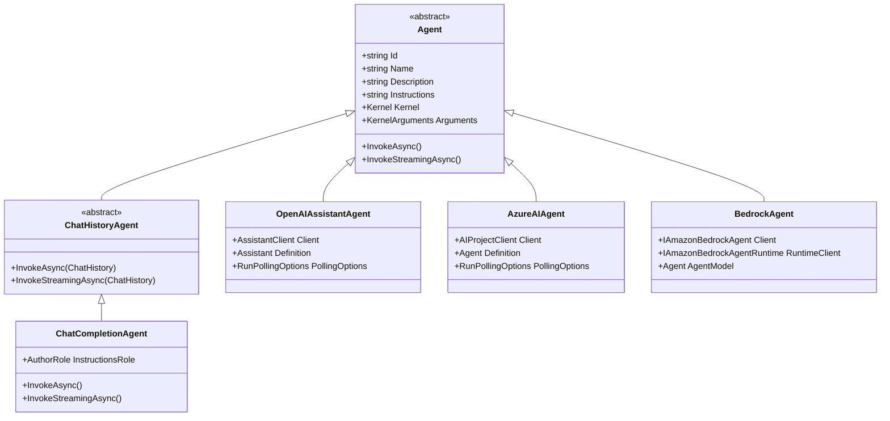
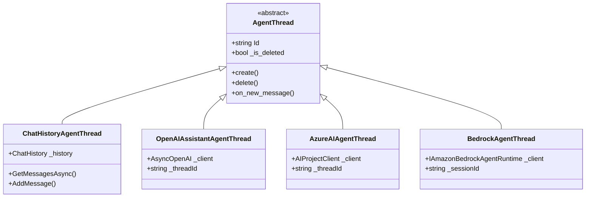
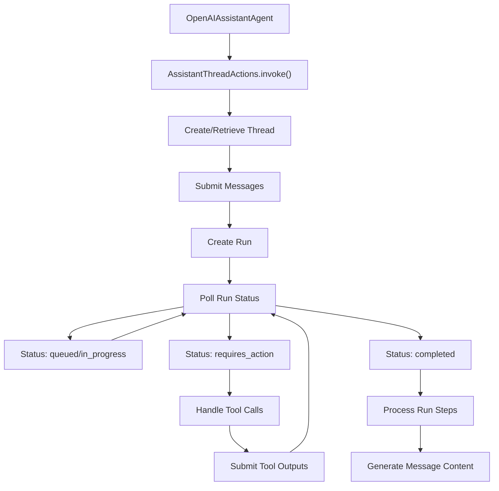
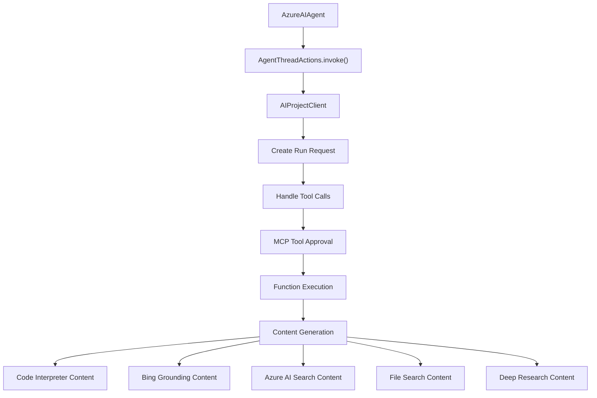
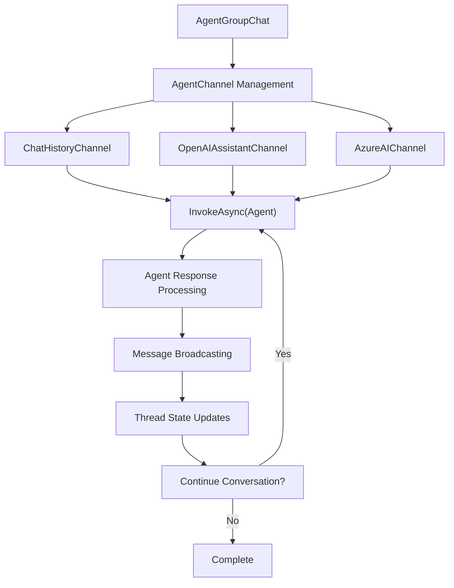
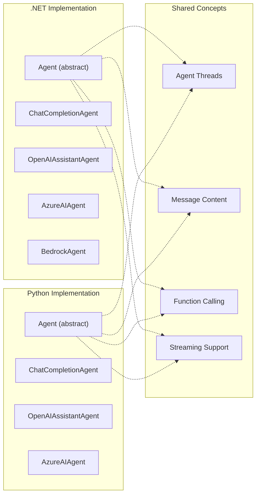
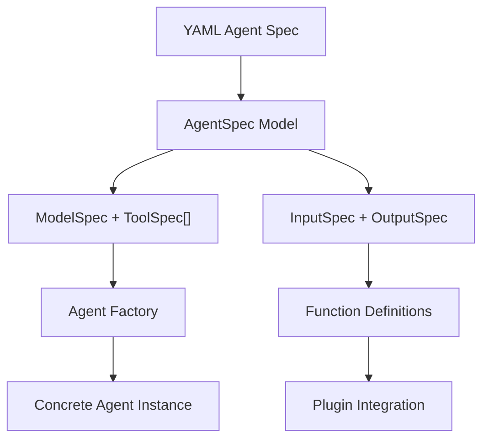

<!-- source: DeepWiki mcp.deepwiki.com · repo microsoft/semantic-kernel · page 5 Agent Framework · fetched 2026-10-26 -->

# Agent Framework

Relevant source files

The following files were used as context for generating this wiki page:

- [.github/_typos.toml](.github/_typos.toml)
- [docs/decisions/0071-multi-agent-orchestration.md](docs/decisions/0071-multi-agent-orchestration.md)
- [dotnet/Directory.Packages.props](dotnet/Directory.Packages.props)
- [dotnet/docs/EXPERIMENTS.md](dotnet/docs/EXPERIMENTS.md)
- [dotnet/samples/Concepts/Concepts.csproj](dotnet/samples/Concepts/Concepts.csproj)
- [dotnet/samples/Concepts/FunctionCalling/FunctionCalling_SharedState.cs](dotnet/samples/Concepts/FunctionCalling/FunctionCalling_SharedState.cs)
- [dotnet/samples/Concepts/README.md](dotnet/samples/Concepts/README.md)
- [dotnet/samples/Concepts/Resources/travel-destination-overview.txt](dotnet/samples/Concepts/Resources/travel-destination-overview.txt)
- [dotnet/samples/GettingStartedWithAgents/GettingStartedWithAgents.csproj](dotnet/samples/GettingStartedWithAgents/GettingStartedWithAgents.csproj)
- [dotnet/samples/GettingStartedWithAgents/README.md](dotnet/samples/GettingStartedWithAgents/README.md)
- [dotnet/src/Agents/UnitTests/Agents.UnitTests.csproj](dotnet/src/Agents/UnitTests/Agents.UnitTests.csproj)
- [dotnet/src/IntegrationTests/IntegrationTests.csproj](dotnet/src/IntegrationTests/IntegrationTests.csproj)
- [dotnet/src/InternalUtilities/samples/InternalUtilities/TestConfiguration.cs](dotnet/src/InternalUtilities/samples/InternalUtilities/TestConfiguration.cs)
- [dotnet/src/Plugins/Plugins.AI.UnitTests/Plugins.AI.UnitTests.csproj](dotnet/src/Plugins/Plugins.AI.UnitTests/Plugins.AI.UnitTests.csproj)
- [dotnet/src/Plugins/Plugins.AI/Plugins.AI.csproj](dotnet/src/Plugins/Plugins.AI/Plugins.AI.csproj)
- [dotnet/src/SemanticKernel.UnitTests/SemanticKernel.UnitTests.csproj](dotnet/src/SemanticKernel.UnitTests/SemanticKernel.UnitTests.csproj)
- [python/pyproject.toml](python/pyproject.toml)
- [python/samples/concepts/README.md](python/samples/concepts/README.md)
- [python/samples/concepts/agents/azure_ai_agent/azure_ai_agent_azure_ai_search.py](python/samples/concepts/agents/azure_ai_agent/azure_ai_agent_azure_ai_search.py)
- [python/samples/concepts/agents/azure_ai_agent/azure_ai_agent_file_manipulation.py](python/samples/concepts/agents/azure_ai_agent/azure_ai_agent_file_manipulation.py)
- [python/samples/concepts/agents/azure_ai_agent/azure_ai_agent_streaming.py](python/samples/concepts/agents/azure_ai_agent/azure_ai_agent_streaming.py)
- [python/samples/getting_started_with_agents/azure_ai_agent/README.md](python/samples/getting_started_with_agents/azure_ai_agent/README.md)
- [python/samples/getting_started_with_agents/openai_assistant/README.md](python/samples/getting_started_with_agents/openai_assistant/README.md)
- [python/semantic_kernel/agents/azure_ai/agent_content_generation.py](python/semantic_kernel/agents/azure_ai/agent_content_generation.py)
- [python/semantic_kernel/agents/azure_ai/agent_thread_actions.py](python/semantic_kernel/agents/azure_ai/agent_thread_actions.py)
- [python/semantic_kernel/agents/azure_ai/azure_ai_agent.py](python/semantic_kernel/agents/azure_ai/azure_ai_agent.py)
- [python/semantic_kernel/agents/open_ai/assistant_thread_actions.py](python/semantic_kernel/agents/open_ai/assistant_thread_actions.py)
- [python/semantic_kernel/agents/open_ai/openai_assistant_agent.py](python/semantic_kernel/agents/open_ai/openai_assistant_agent.py)
- [python/semantic_kernel/agents/open_ai/openai_responses_agent.py](python/semantic_kernel/agents/open_ai/openai_responses_agent.py)
- [python/tests/samples/test_concepts.py](python/tests/samples/test_concepts.py)
- [python/tests/unit/agents/azure_ai_agent/test_agent_content_generation.py](python/tests/unit/agents/azure_ai_agent/test_agent_content_generation.py)
- [python/tests/unit/agents/azure_ai_agent/test_agent_thread_actions.py](python/tests/unit/agents/azure_ai_agent/test_agent_thread_actions.py)
- [python/tests/unit/agents/azure_ai_agent/test_azure_ai_agent.py](python/tests/unit/agents/azure_ai_agent/test_azure_ai_agent.py)
- [python/tests/unit/agents/openai_assistant/test_assistant_thread_actions.py](python/tests/unit/agents/openai_assistant/test_assistant_thread_actions.py)
- [python/tests/unit/agents/openai_assistant/test_openai_assistant_agent.py](python/tests/unit/agents/openai_assistant/test_openai_assistant_agent.py)
- [python/tests/unit/data/conftest.py](python/tests/unit/data/conftest.py)
- [python/tests/unit/data/test_vector_search_base.py](python/tests/unit/data/test_vector_search_base.py)
- [python/tests/unit/data/test_vector_store_record_collection.py](python/tests/unit/data/test_vector_store_record_collection.py)
- [python/uv.lock](python/uv.lock)

The Agent Framework provides a multi-language orchestration system for creating, managing, and coordinating AI agents across different service providers. This framework enables complex conversational AI scenarios with support for single-agent interactions, multi-agent collaborations, and persistent conversation threads.

For information about the underlying AI service integration that agents use, see [AI Service Integration](#4). For details about function calling and plugin systems that extend agent capabilities, see [Functions and Plugins](#3.2).

## Core Architecture

The Agent Framework is built around a hierarchical class structure that provides abstractions for different types of AI agents while maintaining consistent interfaces across implementations.

### Base Agent Abstractions

The framework provides a consistent `Agent` base class that defines common properties and methods across all agent implementations. Each agent type specializes for specific AI service providers while maintaining compatibility with the broader framework. For details, see [Agent Architecture and Base Classes](#5.1).

Sources: [dotnet/src/Agents/Abstractions/Agent.cs:24-400](), [dotnet/src/Agents/Core/ChatHistoryAgent.cs:17-123](), [dotnet/src/Agents/Core/ChatCompletionAgent.cs:26-454](), [dotnet/src/Agents/OpenAI/OpenAIAssistantAgent.cs:21-371](), [dotnet/src/Agents/AzureAI/AzureAIAgent.cs:20-350](), [dotnet/src/Agents/Bedrock/BedrockAgent.cs:22-450]()

### Agent Thread Management

Agent threads manage conversation state and message history. Each agent implementation provides its own thread type that handles the specifics of maintaining conversation context with the underlying AI service.

Sources: [python/semantic_kernel/agents/agent.py:110-190](), [python/semantic_kernel/agents/open_ai/openai_assistant_agent.py:1-500](), [python/semantic_kernel/agents/azure_ai/azure_ai_agent.py:1-400]()

## Agent Implementations

### ChatCompletionAgent

The `ChatCompletionAgent` provides a general-purpose agent implementation that works with any `IChatCompletionService`. It supports flexible instruction templating and function calling. It supports configurable instruction roles, with `AuthorRole.System` as default and `AuthorRole.Developer` for reasoning models. For details, see [.NET Agent Implementations](#5.2).

Sources: [dotnet/src/Agents/Core/ChatCompletionAgent.cs:26-454](), [dotnet/src/Agents/Core/ChatCompletionAgent.cs:261-301]()

### OpenAI Assistant Agent

The `OpenAIAssistantAgent` integrates with OpenAI's Assistants API, providing access to advanced capabilities like file search, code interpreter, and function calling.

The agent handles various tool types including code interpreter, file search, and custom functions. For details, see [Python Agent Implementations](#5.3).

Sources: [python/semantic_kernel/agents/open_ai/openai_assistant_agent.py:1-500](), [python/semantic_kernel/agents/open_ai/assistant_thread_actions.py:71-161]()

### Azure AI Agent

The `AzureAIAgent` leverages Azure AI's agent capabilities, providing enterprise-grade features with Azure integration.

Azure AI Agents support advanced tools like Bing grounding, Azure AI Search integration, and MCP (Model Context Protocol) tool calling via `RequiredMcpToolCall`. For details, see [Python Agent Implementations](#5.3).

Sources: [python/semantic_kernel/agents/azure_ai/azure_ai_agent.py:1-400](), [python/semantic_kernel/agents/azure_ai/agent_thread_actions.py:98-131](), [python/semantic_kernel/agents/azure_ai/agent_content_generation.py:113-154]()

### Bedrock Agent

The `BedrockAgent` integrates with Amazon Bedrock's agent runtime, supporting AWS-native AI capabilities. Bedrock agents provide unique capabilities like knowledge base integration and action group support. For details, see [.NET Agent Implementations](#5.2).

Sources: [dotnet/src/Agents/Bedrock/BedrockAgent.cs:22-650]()

## Multi-Agent Orchestration

The framework supports coordinating multiple agents in group conversations through the `AgentGroupChat` system. Patterns include `GroupChatOrchestration`, `SequentialOrchestration`, and the `Magentic-One` pattern. For details, see [Multi-Agent Orchestration](#5.4).

Sources: [dotnet/src/Agents/Core/ChatHistoryChannel.cs:20-150](), [dotnet/src/Agents/OpenAI/OpenAIAssistantChannel.cs:19-79](), [dotnet/src/Agents/AzureAI/AzureAIChannel.cs:17-70]()

## Cross-Language Implementation

The Agent Framework is implemented in both .NET and Python with consistent APIs and patterns.

Both implementations support unified content models like `ChatMessageContent` and `StreamingChatMessageContent`, as well as automatic function invocation patterns.

Sources: [dotnet/src/Agents/Abstractions/Agent.cs:24-400](), [python/semantic_kernel/agents/agent.py:1-1200](), [python/samples/concepts/README.md:5-109]()

## Agent Declarative Specifications

The framework supports declarative agent creation through YAML specifications, enabling configuration-driven agent setup using the `DeclarativeSpecMixin`.

Agent specifications include model configuration, tool definitions, and template settings for creating agents from configuration files.

Sources: [python/semantic_kernel/agents/agent.py:44-103]()

---

