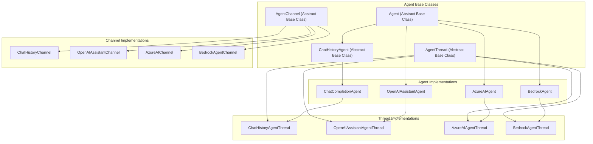
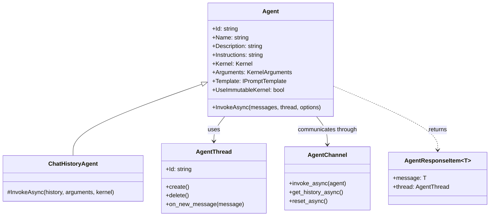
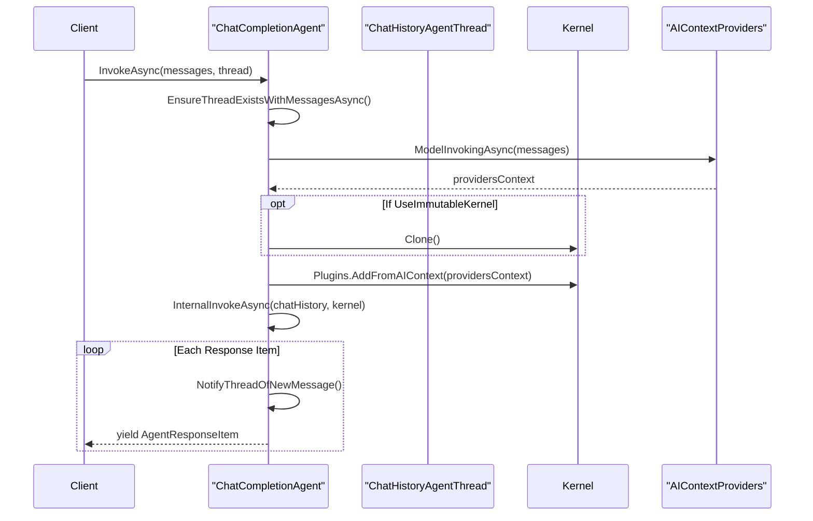
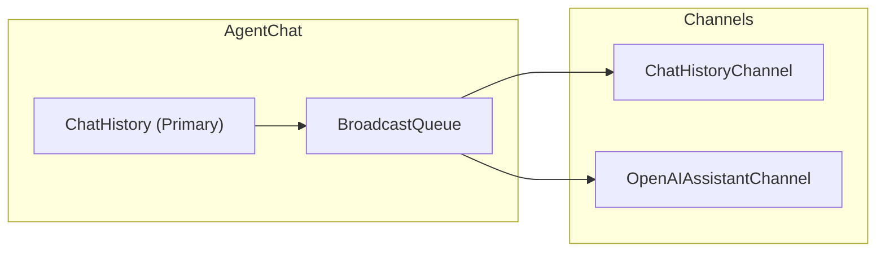

<!-- source: DeepWiki mcp.deepwiki.com · repo microsoft/semantic-kernel · page 5.1 Agent Architecture and Base Classes · fetched 2026-10-26 -->

# Agent Architecture and Base Classes

Relevant source files

The following files were used as context for generating this wiki page:

- [dotnet/samples/Concepts/Agents/AzureAIAgent_FileManipulation.cs](dotnet/samples/Concepts/Agents/AzureAIAgent_FileManipulation.cs)
- [dotnet/samples/Concepts/Agents/ChatCompletion_HistoryReducer.cs](dotnet/samples/Concepts/Agents/ChatCompletion_HistoryReducer.cs)
- [dotnet/samples/Concepts/Agents/ChatCompletion_ServiceSelection.cs](dotnet/samples/Concepts/Agents/ChatCompletion_ServiceSelection.cs)
- [dotnet/samples/Concepts/Agents/ComplexChat_NestedShopper.cs](dotnet/samples/Concepts/Agents/ComplexChat_NestedShopper.cs)
- [dotnet/samples/Concepts/Agents/MixedChat_Agents.cs](dotnet/samples/Concepts/Agents/MixedChat_Agents.cs)
- [dotnet/samples/Concepts/Agents/OpenAIAssistant_ChartMaker.cs](dotnet/samples/Concepts/Agents/OpenAIAssistant_ChartMaker.cs)
- [dotnet/samples/Concepts/Agents/OpenAIAssistant_FileManipulation.cs](dotnet/samples/Concepts/Agents/OpenAIAssistant_FileManipulation.cs)
- [dotnet/samples/Concepts/Agents/OpenAIAssistant_FunctionFilters.cs](dotnet/samples/Concepts/Agents/OpenAIAssistant_FunctionFilters.cs)
- [dotnet/samples/Concepts/ChatCompletion/ChatHistoryReducers/ChatCompletionServiceExtensions.cs](dotnet/samples/Concepts/ChatCompletion/ChatHistoryReducers/ChatCompletionServiceExtensions.cs)
- [dotnet/samples/Concepts/ChatCompletion/ChatHistoryReducers/ChatCompletionServiceWithReducer.cs](dotnet/samples/Concepts/ChatCompletion/ChatHistoryReducers/ChatCompletionServiceWithReducer.cs)
- [dotnet/samples/Concepts/ChatCompletion/ChatHistoryReducers/ChatHistoryExtensions.cs](dotnet/samples/Concepts/ChatCompletion/ChatHistoryReducers/ChatHistoryExtensions.cs)
- [dotnet/samples/Concepts/ChatCompletion/ChatHistoryReducers/ChatHistoryMaxTokensReducer.cs](dotnet/samples/Concepts/ChatCompletion/ChatHistoryReducers/ChatHistoryMaxTokensReducer.cs)
- [dotnet/samples/Concepts/ChatCompletion/ChatHistoryReducers/ChatHistoryReducerTests.cs](dotnet/samples/Concepts/ChatCompletion/ChatHistoryReducers/ChatHistoryReducerTests.cs)
- [dotnet/samples/Concepts/ChatCompletion/MultipleProviders_ChatHistoryReducer.cs](dotnet/samples/Concepts/ChatCompletion/MultipleProviders_ChatHistoryReducer.cs)
- [dotnet/samples/GettingStartedWithAgents/Step04_KernelFunctionStrategies.cs](dotnet/samples/GettingStartedWithAgents/Step04_KernelFunctionStrategies.cs)
- [dotnet/samples/GettingStartedWithAgents/Step07_Telemetry.cs](dotnet/samples/GettingStartedWithAgents/Step07_Telemetry.cs)
- [dotnet/src/Agents/Abstractions/Agent.cs](dotnet/src/Agents/Abstractions/Agent.cs)
- [dotnet/src/Agents/Abstractions/AgentChannel.cs](dotnet/src/Agents/Abstractions/AgentChannel.cs)
- [dotnet/src/Agents/Abstractions/AgentChat.cs](dotnet/src/Agents/Abstractions/AgentChat.cs)
- [dotnet/src/Agents/Abstractions/Agents.Abstractions.csproj](dotnet/src/Agents/Abstractions/Agents.Abstractions.csproj)
- [dotnet/src/Agents/Abstractions/AggregatorAgent.cs](dotnet/src/Agents/Abstractions/AggregatorAgent.cs)
- [dotnet/src/Agents/Abstractions/AggregatorChannel.cs](dotnet/src/Agents/Abstractions/AggregatorChannel.cs)
- [dotnet/src/Agents/Abstractions/Internal/BroadcastQueue.cs](dotnet/src/Agents/Abstractions/Internal/BroadcastQueue.cs)
- [dotnet/src/Agents/Abstractions/Logging/AgentChatLogMessages.cs](dotnet/src/Agents/Abstractions/Logging/AgentChatLogMessages.cs)
- [dotnet/src/Agents/AzureAI/AzureAIAgent.cs](dotnet/src/Agents/AzureAI/AzureAIAgent.cs)
- [dotnet/src/Agents/AzureAI/AzureAIChannel.cs](dotnet/src/Agents/AzureAI/AzureAIChannel.cs)
- [dotnet/src/Agents/Bedrock/BedrockAgent.cs](dotnet/src/Agents/Bedrock/BedrockAgent.cs)
- [dotnet/src/Agents/Core/AgentGroupChat.cs](dotnet/src/Agents/Core/AgentGroupChat.cs)
- [dotnet/src/Agents/Core/Agents.Core.csproj](dotnet/src/Agents/Core/Agents.Core.csproj)
- [dotnet/src/Agents/Core/Chat/AgentGroupChatSettings.cs](dotnet/src/Agents/Core/Chat/AgentGroupChatSettings.cs)
- [dotnet/src/Agents/Core/Chat/AggregatorTerminationStrategy.cs](dotnet/src/Agents/Core/Chat/AggregatorTerminationStrategy.cs)
- [dotnet/src/Agents/Core/Chat/KernelFunctionSelectionStrategy.cs](dotnet/src/Agents/Core/Chat/KernelFunctionSelectionStrategy.cs)
- [dotnet/src/Agents/Core/Chat/KernelFunctionTerminationStrategy.cs](dotnet/src/Agents/Core/Chat/KernelFunctionTerminationStrategy.cs)
- [dotnet/src/Agents/Core/Chat/RegExTerminationStrategy.cs](dotnet/src/Agents/Core/Chat/RegExTerminationStrategy.cs)
- [dotnet/src/Agents/Core/Chat/SelectionStrategy.cs](dotnet/src/Agents/Core/Chat/SelectionStrategy.cs)
- [dotnet/src/Agents/Core/Chat/SequentialSelectionStrategy.cs](dotnet/src/Agents/Core/Chat/SequentialSelectionStrategy.cs)
- [dotnet/src/Agents/Core/Chat/TerminationStrategy.cs](dotnet/src/Agents/Core/Chat/TerminationStrategy.cs)
- [dotnet/src/Agents/Core/ChatCompletionAgent.cs](dotnet/src/Agents/Core/ChatCompletionAgent.cs)
- [dotnet/src/Agents/Core/ChatHistoryChannel.cs](dotnet/src/Agents/Core/ChatHistoryChannel.cs)
- [dotnet/src/Agents/Core/Internal/ChatMessageForPrompt.cs](dotnet/src/Agents/Core/Internal/ChatMessageForPrompt.cs)
- [dotnet/src/Agents/Core/Logging/AgentGroupChatLogMessages.cs](dotnet/src/Agents/Core/Logging/AgentGroupChatLogMessages.cs)
- [dotnet/src/Agents/Core/Logging/ChatCompletionAgentLogMessages.cs](dotnet/src/Agents/Core/Logging/ChatCompletionAgentLogMessages.cs)
- [dotnet/src/Agents/Core/Logging/SequentialSelectionStrategyLogMessages.cs](dotnet/src/Agents/Core/Logging/SequentialSelectionStrategyLogMessages.cs)
- [dotnet/src/Agents/Core/Logging/TerminationStrategyLogMessages.cs](dotnet/src/Agents/Core/Logging/TerminationStrategyLogMessages.cs)
- [dotnet/src/Agents/OpenAI/Agents.OpenAI.csproj](dotnet/src/Agents/OpenAI/Agents.OpenAI.csproj)
- [dotnet/src/Agents/OpenAI/Extensions/KernelFunctionExtensions.cs](dotnet/src/Agents/OpenAI/Extensions/KernelFunctionExtensions.cs)
- [dotnet/src/Agents/OpenAI/OpenAIAssistantAgent.cs](dotnet/src/Agents/OpenAI/OpenAIAssistantAgent.cs)
- [dotnet/src/Agents/OpenAI/OpenAIAssistantChannel.cs](dotnet/src/Agents/OpenAI/OpenAIAssistantChannel.cs)
- [dotnet/src/Agents/OpenAI/OpenAIAssistantDefinition.cs](dotnet/src/Agents/OpenAI/OpenAIAssistantDefinition.cs)
- [dotnet/src/Agents/UnitTests/AgentChannelTests.cs](dotnet/src/Agents/UnitTests/AgentChannelTests.cs)
- [dotnet/src/Agents/UnitTests/AgentChatTests.cs](dotnet/src/Agents/UnitTests/AgentChatTests.cs)
- [dotnet/src/Agents/UnitTests/AggregatorAgentTests.cs](dotnet/src/Agents/UnitTests/AggregatorAgentTests.cs)
- [dotnet/src/Agents/UnitTests/Core/AgentGroupChatTests.cs](dotnet/src/Agents/UnitTests/Core/AgentGroupChatTests.cs)
- [dotnet/src/Agents/UnitTests/Core/Chat/KernelFunctionSelectionStrategyTests.cs](dotnet/src/Agents/UnitTests/Core/Chat/KernelFunctionSelectionStrategyTests.cs)
- [dotnet/src/Agents/UnitTests/Core/Chat/RegExTerminationStrategyTests.cs](dotnet/src/Agents/UnitTests/Core/Chat/RegExTerminationStrategyTests.cs)
- [dotnet/src/Agents/UnitTests/Core/Chat/SequentialSelectionStrategyTests.cs](dotnet/src/Agents/UnitTests/Core/Chat/SequentialSelectionStrategyTests.cs)
- [dotnet/src/Agents/UnitTests/Core/ChatCompletionAgentTests.cs](dotnet/src/Agents/UnitTests/Core/ChatCompletionAgentTests.cs)
- [dotnet/src/Agents/UnitTests/Core/ChatHistoryChannelTests.cs](dotnet/src/Agents/UnitTests/Core/ChatHistoryChannelTests.cs)
- [dotnet/src/Agents/UnitTests/Core/Internal/ChatMessageForPromptTests.cs](dotnet/src/Agents/UnitTests/Core/Internal/ChatMessageForPromptTests.cs)
- [dotnet/src/Agents/UnitTests/Internal/BroadcastQueueTests.cs](dotnet/src/Agents/UnitTests/Internal/BroadcastQueueTests.cs)
- [dotnet/src/Agents/UnitTests/MockAgent.cs](dotnet/src/Agents/UnitTests/MockAgent.cs)
- [dotnet/src/Agents/UnitTests/OpenAI/Extensions/AssistantClientExtensionsTests.cs](dotnet/src/Agents/UnitTests/OpenAI/Extensions/AssistantClientExtensionsTests.cs)
- [dotnet/src/Agents/UnitTests/OpenAI/Extensions/KernelFunctionExtensionsTests.cs](dotnet/src/Agents/UnitTests/OpenAI/Extensions/KernelFunctionExtensionsTests.cs)
- [dotnet/src/Agents/UnitTests/OpenAI/OpenAIAssistantAgentTests.cs](dotnet/src/Agents/UnitTests/OpenAI/OpenAIAssistantAgentTests.cs)
- [dotnet/src/Agents/UnitTests/OpenAI/OpenAIAssistantAgentThreadTests.cs](dotnet/src/Agents/UnitTests/OpenAI/OpenAIAssistantAgentThreadTests.cs)
- [dotnet/src/IntegrationTests/Agents/AggregatorAgentTests.cs](dotnet/src/IntegrationTests/Agents/AggregatorAgentTests.cs)
- [python/samples/concepts/agents/bedrock_agent/bedrock_agent_retrieval.py](python/samples/concepts/agents/bedrock_agent/bedrock_agent_retrieval.py)
- [python/samples/concepts/agents/bedrock_agent/bedrock_agent_simple_chat.py](python/samples/concepts/agents/bedrock_agent/bedrock_agent_simple_chat.py)
- [python/samples/concepts/agents/bedrock_agent/bedrock_agent_simple_chat_streaming.py](python/samples/concepts/agents/bedrock_agent/bedrock_agent_simple_chat_streaming.py)
- [python/samples/concepts/agents/bedrock_agent/bedrock_agent_with_code_interpreter.py](python/samples/concepts/agents/bedrock_agent/bedrock_agent_with_code_interpreter.py)
- [python/samples/concepts/agents/bedrock_agent/bedrock_agent_with_code_interpreter_streaming.py](python/samples/concepts/agents/bedrock_agent/bedrock_agent_with_code_interpreter_streaming.py)
- [python/samples/concepts/agents/bedrock_agent/bedrock_agent_with_kernel_function.py](python/samples/concepts/agents/bedrock_agent/bedrock_agent_with_kernel_function.py)
- [python/samples/concepts/agents/bedrock_agent/bedrock_agent_with_kernel_function_simple.py](python/samples/concepts/agents/bedrock_agent/bedrock_agent_with_kernel_function_simple.py)
- [python/samples/concepts/agents/bedrock_agent/bedrock_agent_with_kernel_function_streaming.py](python/samples/concepts/agents/bedrock_agent/bedrock_agent_with_kernel_function_streaming.py)
- [python/samples/concepts/agents/bedrock_agent/bedrock_mixed_chat_agents.py](python/samples/concepts/agents/bedrock_agent/bedrock_mixed_chat_agents.py)
- [python/samples/concepts/agents/bedrock_agent/bedrock_mixed_chat_agents_streaming.py](python/samples/concepts/agents/bedrock_agent/bedrock_mixed_chat_agents_streaming.py)
- [python/semantic_kernel/agents/agent.py](python/semantic_kernel/agents/agent.py)
- [python/semantic_kernel/agents/autogen/autogen_conversable_agent.py](python/semantic_kernel/agents/autogen/autogen_conversable_agent.py)
- [python/semantic_kernel/agents/bedrock/bedrock_agent.py](python/semantic_kernel/agents/bedrock/bedrock_agent.py)
- [python/semantic_kernel/agents/bedrock/bedrock_agent_base.py](python/semantic_kernel/agents/bedrock/bedrock_agent_base.py)
- [python/semantic_kernel/agents/channels/agent_channel.py](python/semantic_kernel/agents/channels/agent_channel.py)
- [python/semantic_kernel/agents/channels/chat_history_channel.py](python/semantic_kernel/agents/channels/chat_history_channel.py)
- [python/semantic_kernel/agents/channels/open_ai_assistant_channel.py](python/semantic_kernel/agents/channels/open_ai_assistant_channel.py)
- [python/semantic_kernel/agents/chat_completion/chat_completion_agent.py](python/semantic_kernel/agents/chat_completion/chat_completion_agent.py)
- [python/semantic_kernel/agents/group_chat/agent_chat.py](python/semantic_kernel/agents/group_chat/agent_chat.py)
- [python/semantic_kernel/agents/group_chat/agent_group_chat.py](python/semantic_kernel/agents/group_chat/agent_group_chat.py)
- [python/semantic_kernel/agents/open_ai/assistant_content_generation.py](python/semantic_kernel/agents/open_ai/assistant_content_generation.py)
- [python/semantic_kernel/agents/open_ai/function_action_result.py](python/semantic_kernel/agents/open_ai/function_action_result.py)
- [python/semantic_kernel/agents/strategies/termination/default_termination_strategy.py](python/semantic_kernel/agents/strategies/termination/default_termination_strategy.py)
- [python/semantic_kernel/contents/streaming_file_reference_content.py](python/semantic_kernel/contents/streaming_file_reference_content.py)
- [python/tests/unit/agents/autogen_conversable_agent/test_autogen_conversable_agent.py](python/tests/unit/agents/autogen_conversable_agent/test_autogen_conversable_agent.py)
- [python/tests/unit/agents/bedrock_agent/test_bedrock_agent.py](python/tests/unit/agents/bedrock_agent/test_bedrock_agent.py)
- [python/tests/unit/agents/bedrock_agent/test_bedrock_agent_channel.py](python/tests/unit/agents/bedrock_agent/test_bedrock_agent_channel.py)
- [python/tests/unit/agents/chat_completion/conftest.py](python/tests/unit/agents/chat_completion/conftest.py)
- [python/tests/unit/agents/chat_completion/test_chat_completion_agent.py](python/tests/unit/agents/chat_completion/test_chat_completion_agent.py)
- [python/tests/unit/agents/test_agent.py](python/tests/unit/agents/test_agent.py)

This page documents the core architecture of the agent system in Semantic Kernel, focusing on the base classes and abstractions that form the foundation for all agent implementations. It covers the fundamental components that enable agent functionality across different platforms (.NET and Python) and various agent types.

For specific agent implementations like OpenAI Assistant Agent, Azure AI Agent, or Bedrock Agent, see [.NET Agent Implementations](5.2). For information about multi-agent orchestration, see [Multi-Agent Orchestration](5.4).

## Overview of Agent Architecture

The agent system in Semantic Kernel provides a flexible framework for building AI agents that can interact with users, perform tasks, and leverage various AI services. The architecture is designed to be extensible, allowing for different types of agents with varying capabilities while sharing common patterns and interfaces.

### Agent System Architecture

Sources:
- [dotnet/src/Agents/Abstractions/Agent.cs:24-84]()
- [dotnet/src/Agents/Core/ChatCompletionAgent.cs:26-145]()
- [dotnet/src/Agents/OpenAI/OpenAIAssistantAgent.cs:21-107]()
- [dotnet/src/Agents/AzureAI/AzureAIAgent.cs:20-113]()
- [dotnet/src/Agents/Bedrock/BedrockAgent.cs:22-108]()
- [python/semantic_kernel/agents/agent.py:111-185]()

## Core Components

The agent architecture consists of three primary components:

1. **Agent**: The main class that defines the agent's behavior, capabilities, and interaction patterns.
2. **AgentThread**: Represents a conversation thread or session with an agent, managing state and message contribution.
3. **AgentChannel**: Handles the communication protocol between the agent and its underlying AI service.

### Core Component Relationships

Sources:
- [dotnet/src/Agents/Abstractions/Agent.cs:24-151]()
- [python/semantic_kernel/agents/agent.py:111-216]()
- [dotnet/src/Agents/Abstractions/AgentChat.cs:26-134]()

## Agent Base Class

The `Agent` base class defines the core functionality and properties that all agent implementations share. It provides the foundation for creating specialized agents that can leverage different AI services.

### Key Properties

| Property | Type | Description |
|----------|------|-------------|
| `Id` | `string` | Unique identifier for the agent (defaults to a random GUID) [dotnet/src/Agents/Abstractions/Agent.cs:37](). |
| `Name` | `string` | Display name of the agent [dotnet/src/Agents/Abstractions/Agent.cs:42](). |
| `Description` | `string` | Description of the agent's purpose [dotnet/src/Agents/Abstractions/Agent.cs:29](). |
| `Instructions` | `string` | System instructions that define the agent's behavior [dotnet/src/Agents/Abstractions/Agent.cs:60](). |
| `Kernel` | `Kernel` | Kernel instance containing services, plugins, and filters [dotnet/src/Agents/Abstractions/Agent.cs:68](). |
| `Arguments` | `KernelArguments` | Arguments for parameters and execution settings [dotnet/src/Agents/Abstractions/Agent.cs:55](). |
| `UseImmutableKernel` | `bool` | Forces agent to clone kernel during invocation to support specific context providers [dotnet/src/Agents/Abstractions/Agent.cs:79](). |

### Core Methods

The `Agent` class provides several overloads of `InvokeAsync` to handle different input scenarios, such as single strings, `ChatMessageContent`, or collections of messages [dotnet/src/Agents/Abstractions/Agent.cs:96-151]().

Sources:
- [dotnet/src/Agents/Abstractions/Agent.cs:24-151]()
- [python/semantic_kernel/agents/agent.py:230-345]()

## AgentThread

The `AgentThread` abstract base class represents a conversation thread. In Python, this is defined as an `ABC` with mandatory `_create`, `_delete`, and `_on_new_message` methods [python/semantic_kernel/agents/agent.py:111-185]().

### Thread Implementations

| Implementation | Description |
|----------------|-------------|
| `ChatHistoryAgentThread` | Manages a local `ChatHistory` object [python/semantic_kernel/agents/chat_completion/chat_completion_agent.py:51-114](). |
| `OpenAIAssistantAgentThread` | Interfaces with OpenAI's server-side thread management [dotnet/src/Agents/OpenAI/OpenAIAssistantAgent.cs:128-132](). |
| `BedrockAgentThread` | Manages an AWS Bedrock session via `bedrock_runtime_client` [python/semantic_kernel/agents/bedrock/bedrock_agent.py:55-110](). |

Sources:
- [python/semantic_kernel/agents/agent.py:111-185]()
- [python/semantic_kernel/agents/chat_completion/chat_completion_agent.py:51-114]()
- [python/semantic_kernel/agents/bedrock/bedrock_agent.py:55-110]()

## AgentChannel

The `AgentChannel` class defines the communication protocol between an agent and its underlying AI service. It is often internal or protected to encapsulate service-specific logic.

- **`ChatHistoryChannel`**: Used by `ChatCompletionAgent` to synchronize local chat history [python/semantic_kernel/agents/chat_completion/chat_completion_agent.py:123]().
- **`OpenAIAssistantChannel`**: Wraps the `AssistantClient` and a `threadId` to manage OpenAI Assistant interactions [dotnet/src/Agents/OpenAI/OpenAIAssistantChannel.cs:19-23]().
- **`BedrockAgentChannel`**: Specialized for the Bedrock Agent service [python/semantic_kernel/agents/bedrock/bedrock_agent.py:119]().

Sources:
- [dotnet/src/Agents/OpenAI/OpenAIAssistantChannel.cs:19-79]()
- [python/semantic_kernel/agents/chat_completion/chat_completion_agent.py:123-124]()

## Agent Invocation Flow

The following diagram illustrates the typical flow of an agent invocation, specifically for a `ChatCompletionAgent` using the .NET implementation.

### ChatCompletionAgent Invocation Sequence

Sources:
- [dotnet/src/Agents/Core/ChatCompletionAgent.cs:62-145]()
- [python/semantic_kernel/agents/chat_completion/chat_completion_agent.py:214-250]()

## Declarative Agent Definitions (DeclarativeSpecMixin)

In Python, the `DeclarativeSpecMixin` allows agents to be defined using a YAML-based specification. This includes defining the model, tools, and input/output schemas [python/semantic_kernel/agents/agent.py:89-105]().

### Agent Specification Structure

| Component | Class | Description |
|-----------|-------|-------------|
| `AgentSpec` | `AgentSpec` | Root specification including instructions and tools [python/semantic_kernel/agents/agent.py:89](). |
| `ModelSpec` | `ModelSpec` | Defines the model ID, API type, and connection [python/semantic_kernel/agents/agent.py:70](). |
| `ToolSpec` | `ToolSpec` | Defines external tools or plugins [python/semantic_kernel/agents/agent.py:79](). |
| `InputSpec` | `InputSpec` | Defines required input parameters [python/semantic_kernel/agents/agent.py:47](). |

Sources:
- [python/semantic_kernel/agents/agent.py:44-105]()
- [python/semantic_kernel/agents/chat_completion/chat_completion_agent.py:117]()

## AgentChat and GroupChat

`AgentChat` provides a point of interaction for one or more agents. It maintains a primary `History` and handles broadcasting messages to various `AgentChannel` instances [dotnet/src/Agents/Abstractions/AgentChat.cs:26-59]().

### Chat History Synchronization

When a message is added to an `AgentChat` via `AddChatMessage`, it is broadcast to all active channels to ensure they remain synchronized [dotnet/src/Agents/Abstractions/AgentChat.cs:149-163]().

Sources:
- [dotnet/src/Agents/Abstractions/AgentChat.cs:26-163]()

## Content Generation and Mapping

Specialized utilities map service-specific responses (like OpenAI Assistant events) into Semantic Kernel's content model.

- **`create_chat_message`**: Converts `ChatMessageContent` into OpenAI-compatible message structures [python/semantic_kernel/agents/open_ai/assistant_content_generation.py:50-83]().
- **`generate_message_content`**: Transforms OpenAI `Message` objects back into `ChatMessageContent`, including annotations and file references [python/semantic_kernel/agents/open_ai/assistant_content_generation.py:131-163]().

Sources:
- [python/semantic_kernel/agents/open_ai/assistant_content_generation.py:50-163]()
- [dotnet/src/Agents/AzureAI/AzureAIAgent.cs:26-42]()

---

