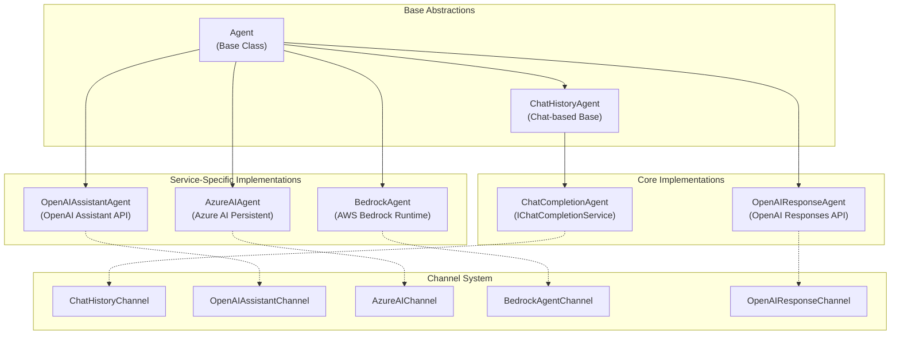
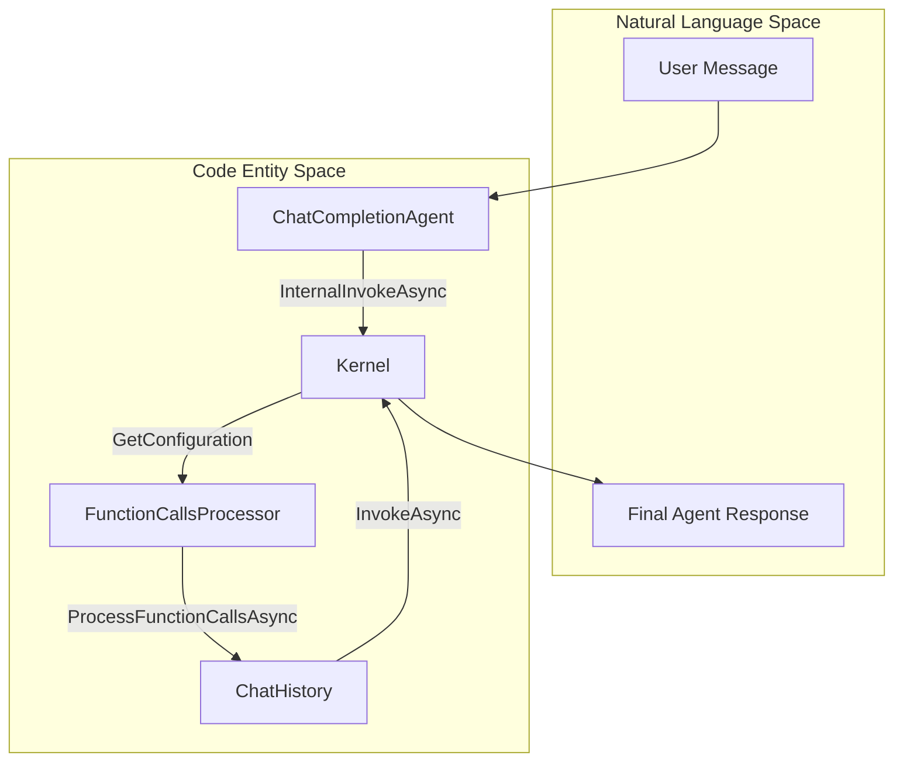

<!-- source: DeepWiki mcp.deepwiki.com · repo microsoft/semantic-kernel · page 5.2 .NET Agent Implementations · fetched 2026-10-26 -->

# .NET Agent Implementations

Relevant source files

The following files were used as context for generating this wiki page:

- [dotnet/samples/Concepts/Agents/AzureAIAgent_Streaming.cs](dotnet/samples/Concepts/Agents/AzureAIAgent_Streaming.cs)
- [dotnet/samples/Concepts/Agents/ChatCompletion_FunctionTermination.cs](dotnet/samples/Concepts/Agents/ChatCompletion_FunctionTermination.cs)
- [dotnet/samples/Concepts/Agents/ChatCompletion_ServiceSelection.cs](dotnet/samples/Concepts/Agents/ChatCompletion_ServiceSelection.cs)
- [dotnet/samples/Concepts/Agents/ChatCompletion_Streaming.cs](dotnet/samples/Concepts/Agents/ChatCompletion_Streaming.cs)
- [dotnet/samples/Concepts/Agents/OpenAIAssistant_Streaming.cs](dotnet/samples/Concepts/Agents/OpenAIAssistant_Streaming.cs)
- [dotnet/samples/GettingStartedWithAgents/AzureAIAgent/Step08_AzureAIAgent_Declarative.cs](dotnet/samples/GettingStartedWithAgents/AzureAIAgent/Step08_AzureAIAgent_Declarative.cs)
- [dotnet/samples/GettingStartedWithAgents/AzureAIAgent/Step09_AzureAIAgent_BingGrounding.cs](dotnet/samples/GettingStartedWithAgents/AzureAIAgent/Step09_AzureAIAgent_BingGrounding.cs)
- [dotnet/samples/GettingStartedWithAgents/BedrockAgent/Step01_BedrockAgent.cs](dotnet/samples/GettingStartedWithAgents/BedrockAgent/Step01_BedrockAgent.cs)
- [dotnet/samples/GettingStartedWithAgents/BedrockAgent/Step02_BedrockAgent_CodeInterpreter.cs](dotnet/samples/GettingStartedWithAgents/BedrockAgent/Step02_BedrockAgent_CodeInterpreter.cs)
- [dotnet/samples/GettingStartedWithAgents/BedrockAgent/Step03_BedrockAgent_Functions.cs](dotnet/samples/GettingStartedWithAgents/BedrockAgent/Step03_BedrockAgent_Functions.cs)
- [dotnet/samples/GettingStartedWithAgents/BedrockAgent/Step04_BedrockAgent_Trace.cs](dotnet/samples/GettingStartedWithAgents/BedrockAgent/Step04_BedrockAgent_Trace.cs)
- [dotnet/samples/GettingStartedWithAgents/BedrockAgent/Step05_BedrockAgent_FileSearch.cs](dotnet/samples/GettingStartedWithAgents/BedrockAgent/Step05_BedrockAgent_FileSearch.cs)
- [dotnet/samples/GettingStartedWithAgents/BedrockAgent/Step06_BedrockAgent_AgentChat.cs](dotnet/samples/GettingStartedWithAgents/BedrockAgent/Step06_BedrockAgent_AgentChat.cs)
- [dotnet/samples/GettingStartedWithAgents/BedrockAgent/Step07_BedrockAgent_Declarative.cs](dotnet/samples/GettingStartedWithAgents/BedrockAgent/Step07_BedrockAgent_Declarative.cs)
- [dotnet/samples/GettingStartedWithAgents/OpenAIAssistant/Step07_Assistant_Declarative.cs](dotnet/samples/GettingStartedWithAgents/OpenAIAssistant/Step07_Assistant_Declarative.cs)
- [dotnet/samples/GettingStartedWithAgents/OpenAIResponse/Step02_OpenAIResponseAgent_ConversationState.cs](dotnet/samples/GettingStartedWithAgents/OpenAIResponse/Step02_OpenAIResponseAgent_ConversationState.cs)
- [dotnet/samples/GettingStartedWithAgents/OpenAIResponse/Step03_OpenAIResponseAgent_ReasoningModel.cs](dotnet/samples/GettingStartedWithAgents/OpenAIResponse/Step03_OpenAIResponseAgent_ReasoningModel.cs)
- [dotnet/samples/GettingStartedWithAgents/OpenAIResponse/Step04_OpenAIResponseAgent_Tools.cs](dotnet/samples/GettingStartedWithAgents/OpenAIResponse/Step04_OpenAIResponseAgent_Tools.cs)
- [dotnet/samples/GettingStartedWithAgents/Step07_Telemetry.cs](dotnet/samples/GettingStartedWithAgents/Step07_Telemetry.cs)
- [dotnet/samples/GettingStartedWithAgents/Step09_Declarative.cs](dotnet/samples/GettingStartedWithAgents/Step09_Declarative.cs)
- [dotnet/src/Agents/Abstractions/Agent.cs](dotnet/src/Agents/Abstractions/Agent.cs)
- [dotnet/src/Agents/Abstractions/AgentInvokeOptions.cs](dotnet/src/Agents/Abstractions/AgentInvokeOptions.cs)
- [dotnet/src/Agents/AzureAI/AzureAIAgent.ClientFactory.cs](dotnet/src/Agents/AzureAI/AzureAIAgent.ClientFactory.cs)
- [dotnet/src/Agents/AzureAI/AzureAIAgent.cs](dotnet/src/Agents/AzureAI/AzureAIAgent.cs)
- [dotnet/src/Agents/AzureAI/AzureAIChannel.cs](dotnet/src/Agents/AzureAI/AzureAIChannel.cs)
- [dotnet/src/Agents/AzureAI/Definition/AzureAIAgentFactory.cs](dotnet/src/Agents/AzureAI/Definition/AzureAIAgentFactory.cs)
- [dotnet/src/Agents/AzureAI/Extensions/AgentDefinitionExtensions.cs](dotnet/src/Agents/AzureAI/Extensions/AgentDefinitionExtensions.cs)
- [dotnet/src/Agents/AzureAI/Extensions/AgentToolDefinitionExtensions.cs](dotnet/src/Agents/AzureAI/Extensions/AgentToolDefinitionExtensions.cs)
- [dotnet/src/Agents/AzureAI/Extensions/KernelFunctionExtensions.cs](dotnet/src/Agents/AzureAI/Extensions/KernelFunctionExtensions.cs)
- [dotnet/src/Agents/AzureAI/Internal/AgentMessageFactory.cs](dotnet/src/Agents/AzureAI/Internal/AgentMessageFactory.cs)
- [dotnet/src/Agents/AzureAI/Internal/AgentThreadActions.cs](dotnet/src/Agents/AzureAI/Internal/AgentThreadActions.cs)
- [dotnet/src/Agents/Bedrock/BedrockAgent.cs](dotnet/src/Agents/Bedrock/BedrockAgent.cs)
- [dotnet/src/Agents/Bedrock/BedrockAgentChannel.cs](dotnet/src/Agents/Bedrock/BedrockAgentChannel.cs)
- [dotnet/src/Agents/Bedrock/BedrockAgentInvokeOptions.cs](dotnet/src/Agents/Bedrock/BedrockAgentInvokeOptions.cs)
- [dotnet/src/Agents/Bedrock/BedrockAgentThread.cs](dotnet/src/Agents/Bedrock/BedrockAgentThread.cs)
- [dotnet/src/Agents/Bedrock/Definition/BedrockAgentFactory.cs](dotnet/src/Agents/Bedrock/Definition/BedrockAgentFactory.cs)
- [dotnet/src/Agents/Bedrock/Extensions/BedrockAgentExtensions.cs](dotnet/src/Agents/Bedrock/Extensions/BedrockAgentExtensions.cs)
- [dotnet/src/Agents/Bedrock/Extensions/BedrockAgentInvokeExtensions.cs](dotnet/src/Agents/Bedrock/Extensions/BedrockAgentInvokeExtensions.cs)
- [dotnet/src/Agents/Bedrock/Extensions/BedrockFunctionSchemaExtensions.cs](dotnet/src/Agents/Bedrock/Extensions/BedrockFunctionSchemaExtensions.cs)
- [dotnet/src/Agents/Core/ChatCompletionAgent.cs](dotnet/src/Agents/Core/ChatCompletionAgent.cs)
- [dotnet/src/Agents/Core/ChatHistoryChannel.cs](dotnet/src/Agents/Core/ChatHistoryChannel.cs)
- [dotnet/src/Agents/OpenAI/Definition/OpenAIAssistantAgentFactory.cs](dotnet/src/Agents/OpenAI/Definition/OpenAIAssistantAgentFactory.cs)
- [dotnet/src/Agents/OpenAI/Extensions/KernelFunctionExtensions.cs](dotnet/src/Agents/OpenAI/Extensions/KernelFunctionExtensions.cs)
- [dotnet/src/Agents/OpenAI/Extensions/OpenAIResponseExtensions.cs](dotnet/src/Agents/OpenAI/Extensions/OpenAIResponseExtensions.cs)
- [dotnet/src/Agents/OpenAI/Internal/AssistantMessageFactory.cs](dotnet/src/Agents/OpenAI/Internal/AssistantMessageFactory.cs)
- [dotnet/src/Agents/OpenAI/Internal/AssistantRunOptionsFactory.cs](dotnet/src/Agents/OpenAI/Internal/AssistantRunOptionsFactory.cs)
- [dotnet/src/Agents/OpenAI/Internal/AssistantThreadActions.cs](dotnet/src/Agents/OpenAI/Internal/AssistantThreadActions.cs)
- [dotnet/src/Agents/OpenAI/Internal/ResponseCreationOptionsFactory.cs](dotnet/src/Agents/OpenAI/Internal/ResponseCreationOptionsFactory.cs)
- [dotnet/src/Agents/OpenAI/Internal/ResponseThreadActions.cs](dotnet/src/Agents/OpenAI/Internal/ResponseThreadActions.cs)
- [dotnet/src/Agents/OpenAI/OpenAIAssistantAgent.ClientFactory.cs](dotnet/src/Agents/OpenAI/OpenAIAssistantAgent.ClientFactory.cs)
- [dotnet/src/Agents/OpenAI/OpenAIAssistantAgent.cs](dotnet/src/Agents/OpenAI/OpenAIAssistantAgent.cs)
- [dotnet/src/Agents/OpenAI/OpenAIAssistantChannel.cs](dotnet/src/Agents/OpenAI/OpenAIAssistantChannel.cs)
- [dotnet/src/Agents/OpenAI/OpenAIAssistantDefinition.cs](dotnet/src/Agents/OpenAI/OpenAIAssistantDefinition.cs)
- [dotnet/src/Agents/OpenAI/OpenAIAssistantExecutionOptions.cs](dotnet/src/Agents/OpenAI/OpenAIAssistantExecutionOptions.cs)
- [dotnet/src/Agents/OpenAI/OpenAIAssistantInvocationOptions.cs](dotnet/src/Agents/OpenAI/OpenAIAssistantInvocationOptions.cs)
- [dotnet/src/Agents/OpenAI/OpenAIResponseAgent.cs](dotnet/src/Agents/OpenAI/OpenAIResponseAgent.cs)
- [dotnet/src/Agents/OpenAI/OpenAIResponseAgentInvokeOptions.cs](dotnet/src/Agents/OpenAI/OpenAIResponseAgentInvokeOptions.cs)
- [dotnet/src/Agents/OpenAI/OpenAIResponseAgentThread.cs](dotnet/src/Agents/OpenAI/OpenAIResponseAgentThread.cs)
- [dotnet/src/Agents/OpenAI/OpenAIThreadCreationOptions.cs](dotnet/src/Agents/OpenAI/OpenAIThreadCreationOptions.cs)
- [dotnet/src/Agents/UnitTests/AzureAI/Definition/AzureAIAgentFactoryTests.cs](dotnet/src/Agents/UnitTests/AzureAI/Definition/AzureAIAgentFactoryTests.cs)
- [dotnet/src/Agents/UnitTests/Bedrock/BedrockAgentChannelTests.cs](dotnet/src/Agents/UnitTests/Bedrock/BedrockAgentChannelTests.cs)
- [dotnet/src/Agents/UnitTests/Bedrock/BedrockAgentTests.cs](dotnet/src/Agents/UnitTests/Bedrock/BedrockAgentTests.cs)
- [dotnet/src/Agents/UnitTests/Bedrock/Extensions.cs/BedrockAgentExtensionsTests.cs](dotnet/src/Agents/UnitTests/Bedrock/Extensions.cs/BedrockAgentExtensionsTests.cs)
- [dotnet/src/Agents/UnitTests/Bedrock/Extensions.cs/BedrockFunctionSchemaExtensionsTests.cs](dotnet/src/Agents/UnitTests/Bedrock/Extensions.cs/BedrockFunctionSchemaExtensionsTests.cs)
- [dotnet/src/Agents/UnitTests/Core/ChatCompletionAgentTests.cs](dotnet/src/Agents/UnitTests/Core/ChatCompletionAgentTests.cs)
- [dotnet/src/Agents/UnitTests/Core/ChatHistoryChannelTests.cs](dotnet/src/Agents/UnitTests/Core/ChatHistoryChannelTests.cs)
- [dotnet/src/Agents/UnitTests/Extensions/ResponseItemExtensionsTests.cs](dotnet/src/Agents/UnitTests/Extensions/ResponseItemExtensionsTests.cs)
- [dotnet/src/Agents/UnitTests/MockAgent.cs](dotnet/src/Agents/UnitTests/MockAgent.cs)
- [dotnet/src/Agents/UnitTests/OpenAI/Definition/OpenAIAssistantAgentFactoryTests.cs](dotnet/src/Agents/UnitTests/OpenAI/Definition/OpenAIAssistantAgentFactoryTests.cs)
- [dotnet/src/Agents/UnitTests/OpenAI/Extensions/AssistantClientExtensionsTests.cs](dotnet/src/Agents/UnitTests/OpenAI/Extensions/AssistantClientExtensionsTests.cs)
- [dotnet/src/Agents/UnitTests/OpenAI/Extensions/KernelFunctionExtensionsTests.cs](dotnet/src/Agents/UnitTests/OpenAI/Extensions/KernelFunctionExtensionsTests.cs)
- [dotnet/src/Agents/UnitTests/OpenAI/Extensions/OpenAIResponseExtensionsTests.cs](dotnet/src/Agents/UnitTests/OpenAI/Extensions/OpenAIResponseExtensionsTests.cs)
- [dotnet/src/Agents/UnitTests/OpenAI/Internal/AssistantMessageFactoryTests.cs](dotnet/src/Agents/UnitTests/OpenAI/Internal/AssistantMessageFactoryTests.cs)
- [dotnet/src/Agents/UnitTests/OpenAI/Internal/AssistantRunOptionsFactoryTests.cs](dotnet/src/Agents/UnitTests/OpenAI/Internal/AssistantRunOptionsFactoryTests.cs)
- [dotnet/src/Agents/UnitTests/OpenAI/Internal/ResponseCreationOptionsFactoryTests.cs](dotnet/src/Agents/UnitTests/OpenAI/Internal/ResponseCreationOptionsFactoryTests.cs)
- [dotnet/src/Agents/UnitTests/OpenAI/Internal/ResponseThreadActionsTests.cs](dotnet/src/Agents/UnitTests/OpenAI/Internal/ResponseThreadActionsTests.cs)
- [dotnet/src/Agents/UnitTests/OpenAI/OpenAIAssistantAgentTests.cs](dotnet/src/Agents/UnitTests/OpenAI/OpenAIAssistantAgentTests.cs)
- [dotnet/src/Agents/UnitTests/OpenAI/OpenAIAssistantAgentThreadTests.cs](dotnet/src/Agents/UnitTests/OpenAI/OpenAIAssistantAgentThreadTests.cs)
- [dotnet/src/Agents/UnitTests/OpenAI/OpenAIAssistantDefinitionTests.cs](dotnet/src/Agents/UnitTests/OpenAI/OpenAIAssistantDefinitionTests.cs)
- [dotnet/src/Agents/UnitTests/OpenAI/OpenAIAssistantInvocationOptionsTests.cs](dotnet/src/Agents/UnitTests/OpenAI/OpenAIAssistantInvocationOptionsTests.cs)
- [dotnet/src/Agents/UnitTests/OpenAI/OpenAIAssistantResponseContent.cs](dotnet/src/Agents/UnitTests/OpenAI/OpenAIAssistantResponseContent.cs)
- [dotnet/src/Agents/UnitTests/OpenAI/OpenAIResponseAgentTests.cs](dotnet/src/Agents/UnitTests/OpenAI/OpenAIResponseAgentTests.cs)
- [dotnet/src/Agents/UnitTests/Yaml/AgentYamlTests.cs](dotnet/src/Agents/UnitTests/Yaml/AgentYamlTests.cs)
- [dotnet/src/Agents/UnitTests/Yaml/AzureAIKernelAgentYamlTests.cs](dotnet/src/Agents/UnitTests/Yaml/AzureAIKernelAgentYamlTests.cs)
- [dotnet/src/Connectors/Connectors.Google/Core/Gemini/Models/GeminiPart.cs](dotnet/src/Connectors/Connectors.Google/Core/Gemini/Models/GeminiPart.cs)
- [dotnet/src/IntegrationTests/Agents/BedrockAgentTests.cs](dotnet/src/IntegrationTests/Agents/BedrockAgentTests.cs)
- [dotnet/src/IntegrationTests/Agents/ChatCompletionAgentTests.cs](dotnet/src/IntegrationTests/Agents/ChatCompletionAgentTests.cs)
- [dotnet/src/IntegrationTests/Agents/CommonInterfaceConformance/AgentThreadConformance/BedrockAgentThreadTests.cs](dotnet/src/IntegrationTests/Agents/CommonInterfaceConformance/AgentThreadConformance/BedrockAgentThreadTests.cs)
- [dotnet/src/IntegrationTests/Agents/CommonInterfaceConformance/InvokeConformance/BedrockAgentInvokeTests.cs](dotnet/src/IntegrationTests/Agents/CommonInterfaceConformance/InvokeConformance/BedrockAgentInvokeTests.cs)
- [dotnet/src/IntegrationTests/Agents/CommonInterfaceConformance/InvokeConformance/ChatCompletionAgentInvokeTests.cs](dotnet/src/IntegrationTests/Agents/CommonInterfaceConformance/InvokeConformance/ChatCompletionAgentInvokeTests.cs)
- [dotnet/src/IntegrationTests/Agents/CommonInterfaceConformance/InvokeConformance/InvokeTests.cs](dotnet/src/IntegrationTests/Agents/CommonInterfaceConformance/InvokeConformance/InvokeTests.cs)
- [dotnet/src/IntegrationTests/Agents/CommonInterfaceConformance/InvokeStreamingConformance/InvokeStreamingTests.cs](dotnet/src/IntegrationTests/Agents/CommonInterfaceConformance/InvokeStreamingConformance/InvokeStreamingTests.cs)
- [dotnet/src/IntegrationTests/Agents/CommonInterfaceConformance/OpenAIResponseAgentFixture.cs](dotnet/src/IntegrationTests/Agents/CommonInterfaceConformance/OpenAIResponseAgentFixture.cs)
- [dotnet/src/IntegrationTests/Agents/MixedAgentTests.cs](dotnet/src/IntegrationTests/Agents/MixedAgentTests.cs)
- [dotnet/src/IntegrationTests/Agents/OpenAIAssistantAgentTests.cs](dotnet/src/IntegrationTests/Agents/OpenAIAssistantAgentTests.cs)
- [dotnet/src/InternalUtilities/connectors/AI/FunctionCalling/FunctionCallsProcessor.cs](dotnet/src/InternalUtilities/connectors/AI/FunctionCalling/FunctionCallsProcessor.cs)
- [dotnet/src/InternalUtilities/samples/AgentUtilities/BaseAgentsTest.cs](dotnet/src/InternalUtilities/samples/AgentUtilities/BaseAgentsTest.cs)
- [dotnet/src/InternalUtilities/samples/AgentUtilities/BaseAssistantTest.cs](dotnet/src/InternalUtilities/samples/AgentUtilities/BaseAssistantTest.cs)
- [dotnet/src/InternalUtilities/samples/AgentUtilities/BaseAzureTest.cs](dotnet/src/InternalUtilities/samples/AgentUtilities/BaseAzureTest.cs)
- [dotnet/src/InternalUtilities/samples/AgentUtilities/BaseBedrockAgentTest.cs](dotnet/src/InternalUtilities/samples/AgentUtilities/BaseBedrockAgentTest.cs)
- [dotnet/src/InternalUtilities/samples/AgentUtilities/BaseResponsesAgentTest.cs](dotnet/src/InternalUtilities/samples/AgentUtilities/BaseResponsesAgentTest.cs)
- [dotnet/src/InternalUtilities/src/Http/HttpHeaderConstant.cs](dotnet/src/InternalUtilities/src/Http/HttpHeaderConstant.cs)
- [dotnet/src/SemanticKernel.UnitTests/Utilities/AIConnectors/FunctionCallsProcessorTests.cs](dotnet/src/SemanticKernel.UnitTests/Utilities/AIConnectors/FunctionCallsProcessorTests.cs)

This document covers the concrete agent implementations available in the .NET Semantic Kernel framework. These implementations provide different approaches to AI agent orchestration, from direct chat completion services to specialized assistant APIs.

For general agent architecture and base classes, see [Agent Architecture and Base Classes](#5.1). For multi-agent orchestration patterns, see [Multi-Agent Orchestration](#5.4).

## Agent Implementation Architecture

The .NET agent framework provides multiple concrete implementations of the base `Agent` abstraction, each targeting different AI services and interaction patterns.

### Agent Hierarchy and Channels

Sources: [dotnet/src/Agents/Abstractions/Agent.cs:24-156](), [dotnet/src/Agents/Core/ChatCompletionAgent.cs:26-48](), [dotnet/src/Agents/OpenAI/OpenAIAssistantAgent.cs:21-71](), [dotnet/src/Agents/AzureAI/AzureAIAgent.cs:20-92](), [dotnet/src/Agents/Bedrock/BedrockAgent.cs:22-65](), [dotnet/src/Agents/OpenAI/OpenAIResponseAgent.cs:17-45]()

## ChatCompletionAgent Implementation

`ChatCompletionAgent` is the primary general-purpose agent implementation that works with any `IChatCompletionService`. It provides direct integration with chat completion services and supports both streaming and non-streaming responses.

### Core Features

The `ChatCompletionAgent` class [dotnet/src/Agents/Core/ChatCompletionAgent.cs:26]() provides:

- **Service Flexibility**: Works with any registered `IChatCompletionService`.
- **Template Support**: Accepts `PromptTemplateConfig` for parameterized instructions [dotnet/src/Agents/Core/ChatCompletionAgent.cs:39-48]().
- **Instruction Roles**: Configurable `InstructionsRole` property for different model requirements (e.g., "developer" for O-series models) [dotnet/src/Agents/Core/ChatCompletionAgent.cs:59]().
- **Context Injection**: Supports `AIContextProviders` to dynamically inject functions or data into the invocation context [dotnet/src/Agents/Core/ChatCompletionAgent.cs:84-93]().

### Function Invocation Loop

The agent leverages the `FunctionCallsProcessor` to handle tool calls when `AutoInvoke` is enabled in `FunctionChoiceBehavior`.

Sources: [dotnet/src/Agents/Core/ChatCompletionAgent.cs:101-145](), [dotnet/src/InternalUtilities/connectors/AI/FunctionCalling/FunctionCallsProcessor.cs:25-120](), [dotnet/src/SemanticKernel.UnitTests/Utilities/AIConnectors/FunctionCallsProcessorTests.cs:21-173]()

## OpenAI Assistant Implementations

The framework provides two distinct OpenAI-based agent models: the **Assistant API** (persistent) and the **Responses API** (real-time/structured).

### OpenAIAssistantAgent (Assistant API)

`OpenAIAssistantAgent` provides integration with the OpenAI Assistant API, offering persistent conversations and built-in tool capabilities (Code Interpreter, File Search).

- **Persistent Threads**: Uses `OpenAIAssistantAgentThread` which wraps the server-side `AssistantThread` [dotnet/src/Agents/OpenAI/OpenAIAssistantAgent.cs:128-132]().
- **Internal Actions**: Leverages `AssistantThreadActions` to manage message creation, run polling, and history retrieval [dotnet/src/Agents/OpenAI/Internal/AssistantThreadActions.cs:24-123]().
- **Run Polling**: Uses `RunPollingOptions` to control the frequency and behavior of status checks during run execution [dotnet/src/Agents/OpenAI/OpenAIAssistantAgent.cs:86]().

### OpenAIResponseAgent (Responses API)

The `OpenAIResponseAgent` targets the OpenAI Responses API, designed for scenarios requiring specific output controls and reasoning model support.

- **Response Options**: Uses `ResponseCreationOptionsFactory` to generate `CreateResponseOptions` including model, instructions, and tool choices [dotnet/src/Agents/OpenAI/Internal/ResponseCreationOptionsFactory.cs:12-73]().
- **Previous Response Linking**: Supports linking responses via `PreviousResponseId` for conversation continuity [dotnet/src/Agents/OpenAI/Internal/ResponseCreationOptionsFactory.cs:55-58]().

Sources: [dotnet/src/Agents/OpenAI/OpenAIAssistantAgent.cs:21-91](), [dotnet/src/Agents/OpenAI/Internal/AssistantThreadActions.cs:41-61](), [dotnet/src/Agents/OpenAI/OpenAIResponseAgent.cs:17-45](), [dotnet/src/Agents/OpenAI/Internal/ResponseCreationOptionsFactory.cs:14-43]()

## AzureAIAgent Implementation

`AzureAIAgent` integrates with Azure AI Agent service, providing enterprise-grade agent capabilities with Azure's persistent agent infrastructure.

- **Tool Definitions**: Supports standard tools like `code_interpreter` and `file_search` [dotnet/src/Agents/AzureAI/AzureAIAgent.cs:26-37]().
- **Persistent Client**: Uses `PersistentAgentsClient` to manage agent definitions and conversation threads [dotnet/src/Agents/AzureAI/AzureAIAgent.cs:58-69]().
- **Polling**: Configurable `RunPollingOptions` for monitoring Azure AI Agent runs [dotnet/src/Agents/AzureAI/AzureAIAgent.cs:52]().

Sources: [dotnet/src/Agents/AzureAI/AzureAIAgent.cs:20-86](), [dotnet/src/Agents/AzureAI/Internal/AgentThreadActions.cs:21-100]()

## BedrockAgent Implementation

`BedrockAgent` provides integration with AWS Bedrock Agent Runtime, enabling execution with AWS-managed infrastructure.

- **Session State**: Explicitly manages `SessionState` for every invocation, including conversation history and override instructions [dotnet/src/Agents/Bedrock/BedrockAgent.cs:131-134]().
- **Prompt Attributes**: Passes additional instructions via `PromptSessionAttributes` [dotnet/src/Agents/Bedrock/BedrockAgent.cs:133]().
- **Runtime Client**: Uses `IAmazonBedrockAgentRuntime` for real-time interaction [dotnet/src/Agents/Bedrock/BedrockAgent.cs:34]().

Sources: [dotnet/src/Agents/Bedrock/BedrockAgent.cs:22-65](), [dotnet/src/Agents/Bedrock/BedrockAgent.cs:104-162]()

## Declarative Agent Definitions

Agents can be defined declaratively using YAML or `PromptTemplateConfig`. This allows for separation of agent behavior (instructions, tools) from code.

- **YAML Support**: `AzureAIKernelAgentYamlTests` demonstrates loading agent configurations from YAML definitions [dotnet/src/Agents/UnitTests/Yaml/AzureAIKernelAgentYamlTests.cs:15-50]().
- **Configuration Mapping**: `PromptTemplateConfig` maps `Name`, `Description`, and `Template` (instructions) directly to agent properties [dotnet/src/Agents/Core/ChatCompletionAgent.cs:39-48]().

Sources: [dotnet/src/Agents/Core/ChatCompletionAgent.cs:40-48](), [dotnet/samples/GettingStartedWithAgents/AzureAIAgent/Step08_AzureAIAgent_Declarative.cs:10-50]()

## Summary Table of Agent Capabilities

| Feature | ChatCompletionAgent | OpenAIAssistantAgent | AzureAIAgent | BedrockAgent |
| :--- | :--- | :--- | :--- | :--- |
| **Persistence** | In-memory / Custom | OpenAI Server-side | Azure Server-side | AWS Session-based |
| **Built-in Tools** | Plugin-based | Code Interpreter, Search | Code Interpreter, Search | AWS Action Groups |
| **Streaming** | Supported | Supported | Supported | Supported |
| **Threading** | `ChatHistoryAgentThread` | `OpenAIAssistantAgentThread` | `AzureAIAgentThread` | `BedrockAgentThread` |
| **Polling** | N/A | `RunPollingOptions` | `RunPollingOptions` | N/A |

Sources: [dotnet/src/Agents/Core/ChatCompletionAgent.cs:26-145](), [dotnet/src/Agents/OpenAI/OpenAIAssistantAgent.cs:21-124](), [dotnet/src/Agents/AzureAI/AzureAIAgent.cs:20-130](), [dotnet/src/Agents/Bedrock/BedrockAgent.cs:22-108]()

---

