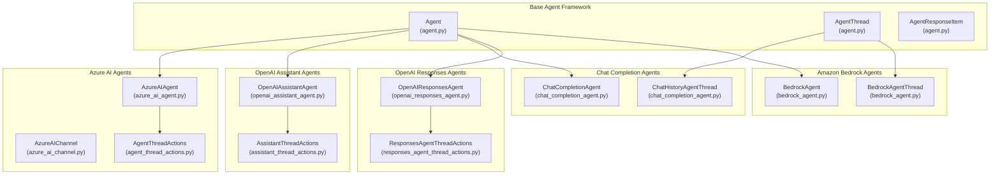
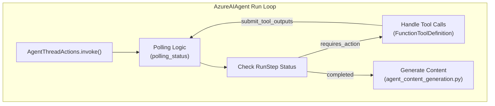
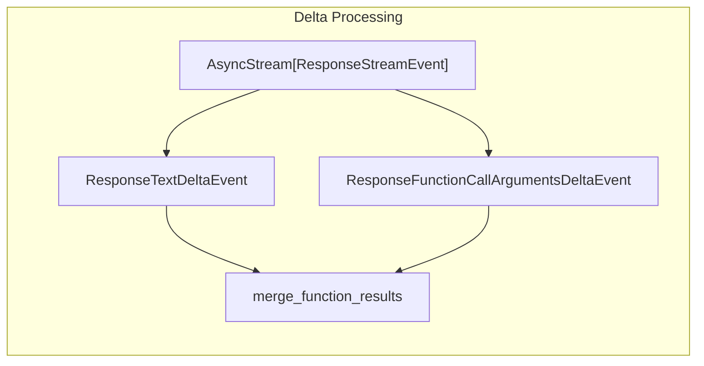

<!-- source: DeepWiki mcp.deepwiki.com · repo microsoft/semantic-kernel · page 5.3 Python Agent Implementations · fetched 2026-10-26 -->

# Python Agent Implementations

Relevant source files

The following files were used as context for generating this wiki page:

- [python/.vscode/launch.json](python/.vscode/launch.json)
- [python/pyproject.toml](python/pyproject.toml)
- [python/samples/concepts/README.md](python/samples/concepts/README.md)
- [python/samples/concepts/agents/azure_ai_agent/azure_ai_agent_azure_ai_search.py](python/samples/concepts/agents/azure_ai_agent/azure_ai_agent_azure_ai_search.py)
- [python/samples/concepts/agents/azure_ai_agent/azure_ai_agent_file_manipulation.py](python/samples/concepts/agents/azure_ai_agent/azure_ai_agent_file_manipulation.py)
- [python/samples/concepts/agents/azure_ai_agent/azure_ai_agent_streaming.py](python/samples/concepts/agents/azure_ai_agent/azure_ai_agent_streaming.py)
- [python/samples/concepts/agents/bedrock_agent/bedrock_agent_retrieval.py](python/samples/concepts/agents/bedrock_agent/bedrock_agent_retrieval.py)
- [python/samples/concepts/agents/bedrock_agent/bedrock_agent_simple_chat.py](python/samples/concepts/agents/bedrock_agent/bedrock_agent_simple_chat.py)
- [python/samples/concepts/agents/bedrock_agent/bedrock_agent_simple_chat_streaming.py](python/samples/concepts/agents/bedrock_agent/bedrock_agent_simple_chat_streaming.py)
- [python/samples/concepts/agents/bedrock_agent/bedrock_agent_with_code_interpreter.py](python/samples/concepts/agents/bedrock_agent/bedrock_agent_with_code_interpreter.py)
- [python/samples/concepts/agents/bedrock_agent/bedrock_agent_with_code_interpreter_streaming.py](python/samples/concepts/agents/bedrock_agent/bedrock_agent_with_code_interpreter_streaming.py)
- [python/samples/concepts/agents/bedrock_agent/bedrock_agent_with_kernel_function.py](python/samples/concepts/agents/bedrock_agent/bedrock_agent_with_kernel_function.py)
- [python/samples/concepts/agents/bedrock_agent/bedrock_agent_with_kernel_function_simple.py](python/samples/concepts/agents/bedrock_agent/bedrock_agent_with_kernel_function_simple.py)
- [python/samples/concepts/agents/bedrock_agent/bedrock_agent_with_kernel_function_streaming.py](python/samples/concepts/agents/bedrock_agent/bedrock_agent_with_kernel_function_streaming.py)
- [python/samples/concepts/agents/bedrock_agent/bedrock_mixed_chat_agents.py](python/samples/concepts/agents/bedrock_agent/bedrock_mixed_chat_agents.py)
- [python/samples/concepts/agents/bedrock_agent/bedrock_mixed_chat_agents_streaming.py](python/samples/concepts/agents/bedrock_agent/bedrock_mixed_chat_agents_streaming.py)
- [python/samples/concepts/agents/chat_completion_agent/chat_completion_agent_message_callback.py](python/samples/concepts/agents/chat_completion_agent/chat_completion_agent_message_callback.py)
- [python/samples/concepts/agents/chat_completion_agent/chat_completion_agent_message_callback_streaming.py](python/samples/concepts/agents/chat_completion_agent/chat_completion_agent_message_callback_streaming.py)
- [python/samples/getting_started_with_agents/README.md](python/samples/getting_started_with_agents/README.md)
- [python/samples/getting_started_with_agents/azure_ai_agent/README.md](python/samples/getting_started_with_agents/azure_ai_agent/README.md)
- [python/samples/getting_started_with_agents/copilot_studio/README.md](python/samples/getting_started_with_agents/copilot_studio/README.md)
- [python/samples/getting_started_with_agents/copilot_studio/step1_copilot_studio_agent_simple.py](python/samples/getting_started_with_agents/copilot_studio/step1_copilot_studio_agent_simple.py)
- [python/samples/getting_started_with_agents/copilot_studio/step2_copilot_studio_agent_thread_management.py](python/samples/getting_started_with_agents/copilot_studio/step2_copilot_studio_agent_thread_management.py)
- [python/samples/getting_started_with_agents/copilot_studio/step3_copilot_studio_agent_prompt_template.py](python/samples/getting_started_with_agents/copilot_studio/step3_copilot_studio_agent_prompt_template.py)
- [python/samples/getting_started_with_agents/copilot_studio/step4_copilot_studio_agent_web_search.py](python/samples/getting_started_with_agents/copilot_studio/step4_copilot_studio_agent_web_search.py)
- [python/samples/getting_started_with_agents/multi_agent_orchestration/step3_group_chat.py](python/samples/getting_started_with_agents/multi_agent_orchestration/step3_group_chat.py)
- [python/samples/getting_started_with_agents/multi_agent_orchestration/step3a_group_chat_human_in_the_loop.py](python/samples/getting_started_with_agents/multi_agent_orchestration/step3a_group_chat_human_in_the_loop.py)
- [python/samples/getting_started_with_agents/multi_agent_orchestration/step3b_group_chat_with_chat_completion_manager.py](python/samples/getting_started_with_agents/multi_agent_orchestration/step3b_group_chat_with_chat_completion_manager.py)
- [python/samples/getting_started_with_agents/multi_agent_orchestration/step4a_handoff_structured_inputs.py](python/samples/getting_started_with_agents/multi_agent_orchestration/step4a_handoff_structured_inputs.py)
- [python/samples/getting_started_with_agents/openai_assistant/README.md](python/samples/getting_started_with_agents/openai_assistant/README.md)
- [python/semantic_kernel/agents/__init__.py](python/semantic_kernel/agents/__init__.py)
- [python/semantic_kernel/agents/__init__.pyi](python/semantic_kernel/agents/__init__.pyi)
- [python/semantic_kernel/agents/agent.py](python/semantic_kernel/agents/agent.py)
- [python/semantic_kernel/agents/autogen/autogen_conversable_agent.py](python/semantic_kernel/agents/autogen/autogen_conversable_agent.py)
- [python/semantic_kernel/agents/azure_ai/agent_content_generation.py](python/semantic_kernel/agents/azure_ai/agent_content_generation.py)
- [python/semantic_kernel/agents/azure_ai/agent_thread_actions.py](python/semantic_kernel/agents/azure_ai/agent_thread_actions.py)
- [python/semantic_kernel/agents/azure_ai/azure_ai_agent.py](python/semantic_kernel/agents/azure_ai/azure_ai_agent.py)
- [python/semantic_kernel/agents/bedrock/bedrock_agent.py](python/semantic_kernel/agents/bedrock/bedrock_agent.py)
- [python/semantic_kernel/agents/bedrock/bedrock_agent_base.py](python/semantic_kernel/agents/bedrock/bedrock_agent_base.py)
- [python/semantic_kernel/agents/chat_completion/chat_completion_agent.py](python/semantic_kernel/agents/chat_completion/chat_completion_agent.py)
- [python/semantic_kernel/agents/copilot_studio/__init__.py](python/semantic_kernel/agents/copilot_studio/__init__.py)
- [python/semantic_kernel/agents/copilot_studio/copilot_studio_agent.py](python/semantic_kernel/agents/copilot_studio/copilot_studio_agent.py)
- [python/semantic_kernel/agents/copilot_studio/copilot_studio_agent_settings.py](python/semantic_kernel/agents/copilot_studio/copilot_studio_agent_settings.py)
- [python/semantic_kernel/agents/open_ai/assistant_thread_actions.py](python/semantic_kernel/agents/open_ai/assistant_thread_actions.py)
- [python/semantic_kernel/agents/open_ai/openai_assistant_agent.py](python/semantic_kernel/agents/open_ai/openai_assistant_agent.py)
- [python/semantic_kernel/agents/open_ai/openai_responses_agent.py](python/semantic_kernel/agents/open_ai/openai_responses_agent.py)
- [python/semantic_kernel/agents/open_ai/responses_agent_thread_actions.py](python/semantic_kernel/agents/open_ai/responses_agent_thread_actions.py)
- [python/semantic_kernel/agents/orchestration/tools.py](python/semantic_kernel/agents/orchestration/tools.py)
- [python/semantic_kernel/connectors/oracle.py](python/semantic_kernel/connectors/oracle.py)
- [python/semantic_kernel/data/vector.py](python/semantic_kernel/data/vector.py)
- [python/tests/integration/agents/azureai_agent/test_azureai_agent_integration.py](python/tests/integration/agents/azureai_agent/test_azureai_agent_integration.py)
- [python/tests/integration/agents/chat_completion_agent/test_chat_completion_agent_integration.py](python/tests/integration/agents/chat_completion_agent/test_chat_completion_agent_integration.py)
- [python/tests/integration/agents/openai_assistant_agent/test_openai_assistant_agent_integration.py](python/tests/integration/agents/openai_assistant_agent/test_openai_assistant_agent_integration.py)
- [python/tests/integration/agents/openai_responses_agent/test_openai_responses_agent_integration.py](python/tests/integration/agents/openai_responses_agent/test_openai_responses_agent_integration.py)
- [python/tests/samples/test_concepts.py](python/tests/samples/test_concepts.py)
- [python/tests/unit/agents/autogen_conversable_agent/test_autogen_conversable_agent.py](python/tests/unit/agents/autogen_conversable_agent/test_autogen_conversable_agent.py)
- [python/tests/unit/agents/azure_ai_agent/test_agent_content_generation.py](python/tests/unit/agents/azure_ai_agent/test_agent_content_generation.py)
- [python/tests/unit/agents/azure_ai_agent/test_agent_thread_actions.py](python/tests/unit/agents/azure_ai_agent/test_agent_thread_actions.py)
- [python/tests/unit/agents/azure_ai_agent/test_azure_ai_agent.py](python/tests/unit/agents/azure_ai_agent/test_azure_ai_agent.py)
- [python/tests/unit/agents/bedrock_agent/test_bedrock_agent.py](python/tests/unit/agents/bedrock_agent/test_bedrock_agent.py)
- [python/tests/unit/agents/bedrock_agent/test_bedrock_agent_channel.py](python/tests/unit/agents/bedrock_agent/test_bedrock_agent_channel.py)
- [python/tests/unit/agents/chat_completion/conftest.py](python/tests/unit/agents/chat_completion/conftest.py)
- [python/tests/unit/agents/chat_completion/test_chat_completion_agent.py](python/tests/unit/agents/chat_completion/test_chat_completion_agent.py)
- [python/tests/unit/agents/copilot_studio/test_copilot_studio_agent.py](python/tests/unit/agents/copilot_studio/test_copilot_studio_agent.py)
- [python/tests/unit/agents/openai_assistant/test_assistant_thread_actions.py](python/tests/unit/agents/openai_assistant/test_assistant_thread_actions.py)
- [python/tests/unit/agents/openai_assistant/test_openai_assistant_agent.py](python/tests/unit/agents/openai_assistant/test_openai_assistant_agent.py)
- [python/tests/unit/agents/openai_responses/test_openai_responses_thread_actions.py](python/tests/unit/agents/openai_responses/test_openai_responses_thread_actions.py)
- [python/tests/unit/agents/test_agent.py](python/tests/unit/agents/test_agent.py)
- [python/tests/unit/connectors/memory/test_oracle.py](python/tests/unit/connectors/memory/test_oracle.py)
- [python/tests/unit/data/conftest.py](python/tests/unit/data/conftest.py)
- [python/tests/unit/data/test_vector_search_base.py](python/tests/unit/data/test_vector_search_base.py)
- [python/tests/unit/data/test_vector_store_record_collection.py](python/tests/unit/data/test_vector_store_record_collection.py)
- [python/uv.lock](python/uv.lock)

This document covers the concrete agent implementations available in the Python Semantic Kernel, including Azure AI Agents, OpenAI Assistant Agents, OpenAI Responses Agents, Bedrock Agents, and Chat Completion Agents. These implementations provide different approaches to conversational AI interactions, each optimized for specific use cases and AI service integrations.

For information about the base agent architecture and abstractions, see [Agent Architecture and Base Classes](#5.1). For multi-agent orchestration patterns, see [Multi-Agent Orchestration](#5.4). For .NET agent implementations, see [.NET Agent Implementations](#5.2).

## Agent Implementation Architecture

The Python agent implementations follow a common pattern built on the base `Agent` class [python/semantic_kernel/agents/agent.py:117](), with each implementation providing specific integrations with different AI services and capabilities.

### Code Entity Space: Agent Class Hierarchy

The following diagram maps the high-level agent concepts to the specific classes and files in the Python codebase.

Sources: [python/semantic_kernel/agents/agent.py:111-200](), [python/semantic_kernel/agents/azure_ai/azure_ai_agent.py:29-40](), [python/semantic_kernel/agents/open_ai/openai_assistant_agent.py:1-100](), [python/semantic_kernel/agents/chat_completion/chat_completion_agent.py:51-117](), [python/semantic_kernel/agents/bedrock/bedrock_agent.py:113-120]()

## Azure AI Agent Implementation

The `AzureAIAgent` provides integration with the Azure AI Agent service, offering advanced capabilities like code interpretation, file search, and web grounding.

### Core Architecture and Run Loop

The `AzureAIAgent` uses `AgentThreadActions` [python/semantic_kernel/agents/azure_ai/agent_thread_actions.py:98]() to manage the run loop. This includes polling the Azure AI service for status updates [python/semantic_kernel/agents/azure_ai/agent_thread_actions.py:101]() and handling tool outputs.

### Key Features
- **Declarative Spec**: Supports defining agents and tools (Azure AI Search, Bing Grounding, Code Interpreter) via YAML or dictionaries [python/semantic_kernel/agents/azure_ai/azure_ai_agent.py:87-170]().
- **Tool Mapping**: Maps Semantic Kernel `KernelFunction` metadata to Azure AI `FunctionToolDefinition` [python/semantic_kernel/agents/azure_ai/agent_thread_actions.py:70]().
- **Content Generation**: Specialized functions in `agent_content_generation.py` convert Azure AI models like `ThreadMessage` into SK `ChatMessageContent` [python/semantic_kernel/agents/azure_ai/agent_content_generation.py:113-154]().

Sources: [python/semantic_kernel/agents/azure_ai/azure_ai_agent.py:87-175](), [python/semantic_kernel/agents/azure_ai/agent_thread_actions.py:101-131](), [python/semantic_kernel/agents/azure_ai/agent_content_generation.py:1-100]()

## OpenAI Assistant Agent Implementation

The `OpenAIAssistantAgent` [python/semantic_kernel/agents/open_ai/openai_assistant_agent.py:1-100]() integrates with the OpenAI Assistants API. It utilizes `AssistantThreadActions` to perform operations on OpenAI threads.

### Invocation and Tool Mapping
- **Invoke**: The `invoke` method manages the creation of runs and handles the transition between states like `in_progress` and `requires_action` [python/semantic_kernel/agents/open_ai/assistant_thread_actions.py:137-161]().
- **Tool Mapping**: Automatically maps `CodeInterpreterTool` and `FileSearchTool` from the OpenAI SDK to agent capabilities [python/semantic_kernel/agents/open_ai/assistant_thread_actions.py:10-11]().

Sources: [python/semantic_kernel/agents/open_ai/assistant_thread_actions.py:10-161]()

## OpenAI Responses Agent Implementation

The `OpenAIResponsesAgent` [python/semantic_kernel/agents/open_ai/openai_responses_agent.py:1-50]() is a specialized implementation focusing on the OpenAI Responses API.

### Streaming and Delta Processing
The `ResponsesAgentThreadActions` class handles the complex streaming events from OpenAI, such as `ResponseTextDeltaEvent` and `ResponseFunctionCallArgumentsDeltaEvent` [python/semantic_kernel/agents/open_ai/responses_agent_thread_actions.py:17-31]().

Sources: [python/semantic_kernel/agents/open_ai/responses_agent_thread_actions.py:10-37](), [python/tests/unit/agents/openai_responses/test_openai_responses_thread_actions.py:1-50]()

## Amazon Bedrock Agent Implementation

The `BedrockAgent` [python/semantic_kernel/agents/bedrock/bedrock_agent.py:113]() manages interactions with the Amazon Bedrock Agent Service.

- **Thread Management**: `BedrockAgentThread` handles session creation and termination via the Bedrock Runtime Client [python/semantic_kernel/agents/bedrock/bedrock_agent.py:77-101]().
- **Action Groups**: Uses `parse_return_control_payload` to handle tool calls and function results returned by the Bedrock service [python/semantic_kernel/agents/bedrock/bedrock_agent.py:20-23]().

Sources: [python/semantic_kernel/agents/bedrock/bedrock_agent.py:55-132]()

## Specialized Agent Implementations

### CopilotStudio Agent
Integrates with Microsoft Copilot Studio using the `microsoft-agents-copilotstudio-client` [python/pyproject.toml:82-85](). It is designed to bridge Semantic Kernel with Copilot Studio's orchestration.

### AutoGen Conversable Agent
Provides compatibility with the AutoGen framework, allowing `autogen-agentchat` agents to participate in Semantic Kernel workflows [python/pyproject.toml:67-69]().

## Content Generation and Tool Mapping

The framework provides utility modules to translate between service-specific data models and Semantic Kernel's core content models.

| Agent Type | Content Generation Utility | Key Function |
| :--- | :--- | :--- |
| Azure AI | `agent_content_generation.py` | `generate_message_content` [python/semantic_kernel/agents/azure_ai/agent_content_generation.py:113]() |
| OpenAI Assistant | `assistant_content_generation.py` | `generate_streaming_message_content` [python/semantic_kernel/agents/open_ai/assistant_thread_actions.py:29]() |
| OpenAI Responses | `responses_agent_thread_actions.py` | `merge_function_results` [python/semantic_kernel/agents/open_ai/responses_agent_thread_actions.py:36]() |

Sources: [python/semantic_kernel/agents/azure_ai/agent_content_generation.py:113-154](), [python/semantic_kernel/agents/open_ai/assistant_thread_actions.py:21-33](), [python/semantic_kernel/agents/open_ai/responses_agent_thread_actions.py:34-37]()

---

