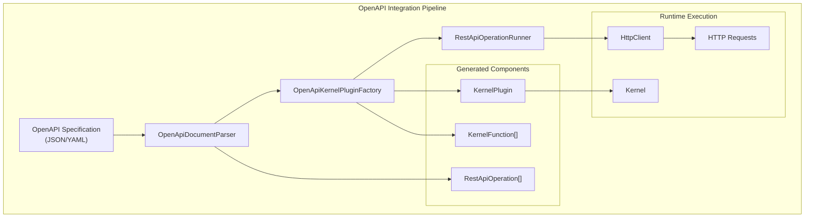
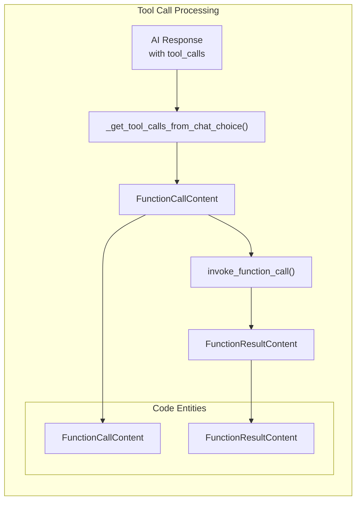
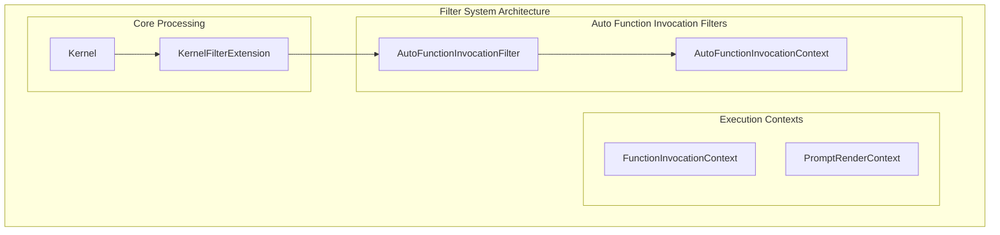
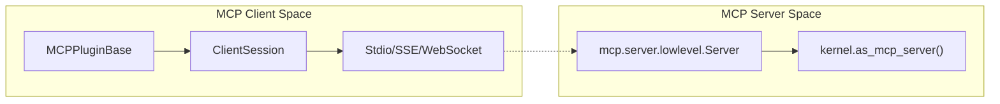

<!-- source: DeepWiki mcp.deepwiki.com · repo microsoft/semantic-kernel · page 6 Advanced Features · fetched 2026-10-26 -->

# Advanced Features

Relevant source files

The following files were used as context for generating this wiki page:

- [dotnet/nuget/nuget-package.props](dotnet/nuget/nuget-package.props)
- [dotnet/samples/Concepts/Memory/OpenAI_EmbeddingGeneration.cs](dotnet/samples/Concepts/Memory/OpenAI_EmbeddingGeneration.cs)
- [dotnet/src/Functions/Functions.OpenApi/CompatibilitySuppressions.xml](dotnet/src/Functions/Functions.OpenApi/CompatibilitySuppressions.xml)
- [dotnet/src/Functions/Functions.OpenApi/Extensions/OpenApiFunctionExecutionParameters.cs](dotnet/src/Functions/Functions.OpenApi/Extensions/OpenApiFunctionExecutionParameters.cs)
- [dotnet/src/Functions/Functions.OpenApi/Extensions/RestApiOperationExtensions.cs](dotnet/src/Functions/Functions.OpenApi/Extensions/RestApiOperationExtensions.cs)
- [dotnet/src/Functions/Functions.OpenApi/Model/RestApiOperation.cs](dotnet/src/Functions/Functions.OpenApi/Model/RestApiOperation.cs)
- [dotnet/src/Functions/Functions.OpenApi/OpenApi/OpenApiDocumentParser.cs](dotnet/src/Functions/Functions.OpenApi/OpenApi/OpenApiDocumentParser.cs)
- [dotnet/src/Functions/Functions.OpenApi/OpenApiKernelPluginFactory.cs](dotnet/src/Functions/Functions.OpenApi/OpenApiKernelPluginFactory.cs)
- [dotnet/src/Functions/Functions.OpenApi/RestApiOperationRunner.cs](dotnet/src/Functions/Functions.OpenApi/RestApiOperationRunner.cs)
- [dotnet/src/Functions/Functions.OpenApi/RestApiOperationServerUrlValidationOptions.cs](dotnet/src/Functions/Functions.OpenApi/RestApiOperationServerUrlValidationOptions.cs)
- [dotnet/src/Functions/Functions.OpenApi/ServerUrlValidator.cs](dotnet/src/Functions/Functions.OpenApi/ServerUrlValidator.cs)
- [dotnet/src/Functions/Functions.Prompty/Functions.Prompty.csproj](dotnet/src/Functions/Functions.Prompty/Functions.Prompty.csproj)
- [dotnet/src/Functions/Functions.UnitTests/OpenApi/Extensions/OpenApiKernelExtensionsTests.cs](dotnet/src/Functions/Functions.UnitTests/OpenApi/Extensions/OpenApiKernelExtensionsTests.cs)
- [dotnet/src/Functions/Functions.UnitTests/OpenApi/Extensions/RestApiOperationExtensionsTests.cs](dotnet/src/Functions/Functions.UnitTests/OpenApi/Extensions/RestApiOperationExtensionsTests.cs)
- [dotnet/src/Functions/Functions.UnitTests/OpenApi/OpenApiDocumentParserExtensionsTests.cs](dotnet/src/Functions/Functions.UnitTests/OpenApi/OpenApiDocumentParserExtensionsTests.cs)
- [dotnet/src/Functions/Functions.UnitTests/OpenApi/OpenApiDocumentParserV20Tests.cs](dotnet/src/Functions/Functions.UnitTests/OpenApi/OpenApiDocumentParserV20Tests.cs)
- [dotnet/src/Functions/Functions.UnitTests/OpenApi/OpenApiDocumentParserV30Tests.cs](dotnet/src/Functions/Functions.UnitTests/OpenApi/OpenApiDocumentParserV30Tests.cs)
- [dotnet/src/Functions/Functions.UnitTests/OpenApi/OpenApiDocumentParserV31Tests.cs](dotnet/src/Functions/Functions.UnitTests/OpenApi/OpenApiDocumentParserV31Tests.cs)
- [dotnet/src/Functions/Functions.UnitTests/OpenApi/OpenApiKernelPluginFactoryTests.cs](dotnet/src/Functions/Functions.UnitTests/OpenApi/OpenApiKernelPluginFactoryTests.cs)
- [dotnet/src/Functions/Functions.UnitTests/OpenApi/RestApiOperationRunnerTests.cs](dotnet/src/Functions/Functions.UnitTests/OpenApi/RestApiOperationRunnerTests.cs)
- [dotnet/src/Functions/Functions.UnitTests/OpenApi/RestApiOperationTests.cs](dotnet/src/Functions/Functions.UnitTests/OpenApi/RestApiOperationTests.cs)
- [dotnet/src/Functions/Functions.UnitTests/OpenApi/ServerUrlValidatorTests.cs](dotnet/src/Functions/Functions.UnitTests/OpenApi/ServerUrlValidatorTests.cs)
- [dotnet/src/Functions/Functions.UnitTests/OpenApi/TestPlugins/documentV2_0.json](dotnet/src/Functions/Functions.UnitTests/OpenApi/TestPlugins/documentV2_0.json)
- [dotnet/src/Functions/Functions.UnitTests/OpenApi/TestPlugins/documentV3_0.json](dotnet/src/Functions/Functions.UnitTests/OpenApi/TestPlugins/documentV3_0.json)
- [dotnet/src/Functions/Functions.UnitTests/OpenApi/TestPlugins/documentV3_1.yaml](dotnet/src/Functions/Functions.UnitTests/OpenApi/TestPlugins/documentV3_1.yaml)
- [dotnet/src/IntegrationTests/CrossLanguage/OpenApiTest.cs](dotnet/src/IntegrationTests/CrossLanguage/OpenApiTest.cs)
- [python/samples/concepts/mcp/README.md](python/samples/concepts/mcp/README.md)
- [python/samples/concepts/mcp/agent_with_mcp_plugin.py](python/samples/concepts/mcp/agent_with_mcp_plugin.py)
- [python/samples/concepts/mcp/agent_with_mcp_sampling.py](python/samples/concepts/mcp/agent_with_mcp_sampling.py)
- [python/samples/concepts/mcp/azure_ai_agent_with_mcp_plugin.py](python/samples/concepts/mcp/azure_ai_agent_with_mcp_plugin.py)
- [python/samples/concepts/mcp/mcp_as_plugin.py](python/samples/concepts/mcp/mcp_as_plugin.py)
- [python/samples/concepts/realtime/README.md](python/samples/concepts/realtime/README.md)
- [python/samples/concepts/realtime/realtime_agent_with_function_calling_webrtc.py](python/samples/concepts/realtime/realtime_agent_with_function_calling_webrtc.py)
- [python/samples/concepts/realtime/realtime_agent_with_function_calling_websocket.py](python/samples/concepts/realtime/realtime_agent_with_function_calling_websocket.py)
- [python/samples/concepts/realtime/simple_realtime_chat_webrtc.py](python/samples/concepts/realtime/simple_realtime_chat_webrtc.py)
- [python/samples/concepts/realtime/simple_realtime_chat_websocket.py](python/samples/concepts/realtime/simple_realtime_chat_websocket.py)
- [python/samples/concepts/realtime/utils.py](python/samples/concepts/realtime/utils.py)
- [python/semantic_kernel/connectors/ai/open_ai/prompt_execution_settings/open_ai_realtime_execution_settings.py](python/semantic_kernel/connectors/ai/open_ai/prompt_execution_settings/open_ai_realtime_execution_settings.py)
- [python/semantic_kernel/connectors/ai/open_ai/services/_open_ai_realtime.py](python/semantic_kernel/connectors/ai/open_ai/services/_open_ai_realtime.py)
- [python/semantic_kernel/connectors/ai/open_ai/services/azure_realtime.py](python/semantic_kernel/connectors/ai/open_ai/services/azure_realtime.py)
- [python/semantic_kernel/connectors/ai/open_ai/settings/open_ai_settings.py](python/semantic_kernel/connectors/ai/open_ai/settings/open_ai_settings.py)
- [python/semantic_kernel/connectors/mcp.py](python/semantic_kernel/connectors/mcp.py)
- [python/semantic_kernel/functions/kernel_function_extension.py](python/semantic_kernel/functions/kernel_function_extension.py)
- [python/semantic_kernel/functions/kernel_plugin.py](python/semantic_kernel/functions/kernel_plugin.py)
- [python/semantic_kernel/kernel.py](python/semantic_kernel/kernel.py)
- [python/tests/unit/connectors/ai/open_ai/services/test_openai_realtime.py](python/tests/unit/connectors/ai/open_ai/services/test_openai_realtime.py)
- [python/tests/unit/connectors/mcp/test_mcp.py](python/tests/unit/connectors/mcp/test_mcp.py)
- [python/tests/unit/functions/test_kernel_plugins.py](python/tests/unit/functions/test_kernel_plugins.py)
- [python/tests/unit/kernel/test_kernel.py](python/tests/unit/kernel/test_kernel.py)

This document covers the advanced capabilities of Semantic Kernel that extend beyond core functions and plugins. These features include OpenAPI integration for dynamic REST API function calling, advanced prompt execution settings and tool calling behaviors, filtering and extensibility mechanisms, the Model Context Protocol (MCP), the stateful Process Framework, and specialized tools for executing Python code in remote environments.

For information about core functions and plugins, see [Functions and Plugins](#3.2). For AI service integration fundamentals, see [AI Service Integration](#4).

## OpenAPI Integration

Semantic Kernel provides comprehensive OpenAPI integration that enables dynamic creation of kernel functions from OpenAPI/Swagger specifications. This allows REST API endpoints to be called as if they were native kernel functions.

### OpenAPI Plugin Factory Architecture

The `OpenApiKernelPluginFactory` serves as the main entry point for creating plugins from OpenAPI specifications [dotnet/src/Functions/Functions.OpenApi/OpenApiKernelPluginFactory.cs:25-26](). It supports multiple input formats including file paths, URIs, and streams [dotnet/src/Functions/Functions.OpenApi/OpenApiKernelPluginFactory.cs:35-117]().

### REST API Operation Execution

The `RestApiOperationRunner` handles the actual execution of REST API operations, managing URL construction via `BuildOperationUrl` [dotnet/src/Functions/Functions.OpenApi/Model/RestApiOperation.cs:165-176](), header building, and dynamic payload serialization [dotnet/src/Functions/Functions.OpenApi/RestApiOperationRunner.cs:129-133]().

For details, see [OpenAPI Integration](#6.1).

Sources: [dotnet/src/Functions/Functions.OpenApi/RestApiOperationRunner.cs:23-151](), [dotnet/src/Functions/Functions.OpenApi/OpenApiKernelPluginFactory.cs:25-134](), [dotnet/src/Functions/Functions.OpenApi/OpenApi/OpenApiDocumentParser.cs:30-53](), [dotnet/src/Functions/Functions.OpenApi/Model/RestApiOperation.cs:16-176]()

## Prompt Execution Settings and Tool Calling

Advanced prompt configuration allows developers to control model-specific behaviors like reasoning effort for o1/o3 models, structured JSON outputs, and automated tool invocation loops.

### Tool Call Processing Pipeline

The system supports automatic function invocation through `FunctionChoiceBehavior` configuration [python/semantic_kernel/kernel.py:48-51](). The kernel handles the mapping between `FunctionCallContent` [python/semantic_kernel/kernel.py:12-12]() and `FunctionResultContent` [python/semantic_kernel/kernel.py:13-13]() to maintain conversation state.

For details, see [Prompt Execution Settings and Tool Calling](#6.2).

Sources: [python/semantic_kernel/kernel.py:12-53](), [python/tests/unit/kernel/test_kernel.py:15-36]()

## Filtering and Extensibility

Semantic Kernel implements comprehensive filtering mechanisms (`IFunctionInvocationFilter`, `IPromptRenderFilter`, `IAutoFunctionInvocationFilter`) that allow interception and modification of the execution pipeline.

### Filter Pipeline Architecture

For details, see [Filtering and Extensibility](#6.3).

Sources: [python/semantic_kernel/kernel.py:62-75](), [python/semantic_kernel/filters/auto_function_invocation/auto_function_invocation_context.py:25-27]()

## Model Context Protocol (MCP) Integration

The Model Context Protocol (MCP) integration allows Semantic Kernel to act as either an MCP client or server, enabling interoperability with a broad ecosystem of external tools.

### MCP Integration Flow

The `MCPPluginBase` provides the foundation for connecting to external MCP servers using various transports like `stdio_client` or `sse_client` [python/semantic_kernel/connectors/mcp.py:18-21]().

For details, see [Model Context Protocol (MCP) Integration](#6.6).

Sources: [python/semantic_kernel/connectors/mcp.py:16-41](), [python/semantic_kernel/kernel.py:48-50]()

## Process Framework

The Process Framework models complex, stateful, and event-driven AI workflows. It uses `KernelProcess` to define a graph of `ProcessStep` entities that can run locally or in a distributed manner via Dapr actors.

For details, see [Process Framework](#6.5).

## Python Code Execution Tools

Specialized tools like the `SessionsPythonPlugin` enable the execution of Python code in secure, remote Azure Container Apps dynamic sessions. This is essential for data science and complex calculation tasks within an agentic workflow.

For details, see [Python Code Execution Tools](#6.4).

---

