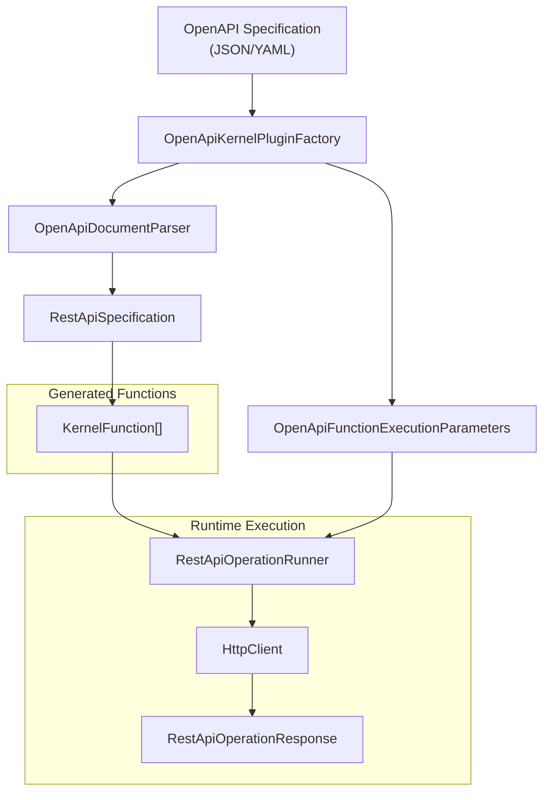
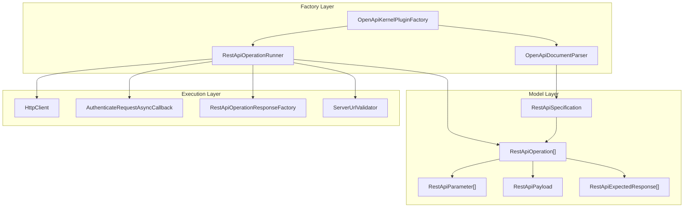
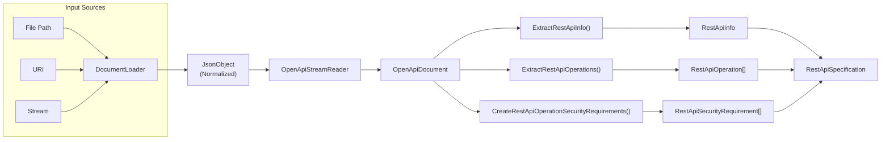
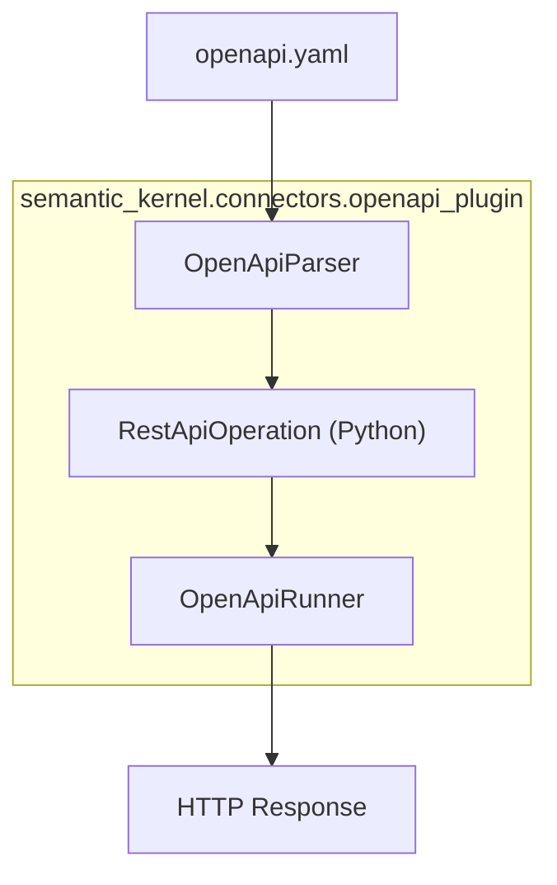

<!-- source: DeepWiki mcp.deepwiki.com · repo microsoft/semantic-kernel · page 6.1 OpenAPI Integration · fetched 2026-10-26 -->

# OpenAPI Integration

Relevant source files

The following files were used as context for generating this wiki page:

- [dotnet/nuget/nuget-package.props](dotnet/nuget/nuget-package.props)
- [dotnet/samples/Concepts/Memory/OpenAI_EmbeddingGeneration.cs](dotnet/samples/Concepts/Memory/OpenAI_EmbeddingGeneration.cs)
- [dotnet/samples/Concepts/Plugins/OpenApiPlugin_CustomHttpContentReader.cs](dotnet/samples/Concepts/Plugins/OpenApiPlugin_CustomHttpContentReader.cs)
- [dotnet/src/Functions/Functions.OpenApi.Extensions/Extensions/ApiManifestKernelExtensions.cs](dotnet/src/Functions/Functions.OpenApi.Extensions/Extensions/ApiManifestKernelExtensions.cs)
- [dotnet/src/Functions/Functions.OpenApi/CompatibilitySuppressions.xml](dotnet/src/Functions/Functions.OpenApi/CompatibilitySuppressions.xml)
- [dotnet/src/Functions/Functions.OpenApi/Extensions/OpenApiFunctionExecutionParameters.cs](dotnet/src/Functions/Functions.OpenApi/Extensions/OpenApiFunctionExecutionParameters.cs)
- [dotnet/src/Functions/Functions.OpenApi/Extensions/OpenApiKernelExtensions.cs](dotnet/src/Functions/Functions.OpenApi/Extensions/OpenApiKernelExtensions.cs)
- [dotnet/src/Functions/Functions.OpenApi/Extensions/RestApiOperationExtensions.cs](dotnet/src/Functions/Functions.OpenApi/Extensions/RestApiOperationExtensions.cs)
- [dotnet/src/Functions/Functions.OpenApi/Functions.OpenApi.csproj](dotnet/src/Functions/Functions.OpenApi/Functions.OpenApi.csproj)
- [dotnet/src/Functions/Functions.OpenApi/HttpResponseContentReader.cs](dotnet/src/Functions/Functions.OpenApi/HttpResponseContentReader.cs)
- [dotnet/src/Functions/Functions.OpenApi/HttpResponseContentReaderContext.cs](dotnet/src/Functions/Functions.OpenApi/HttpResponseContentReaderContext.cs)
- [dotnet/src/Functions/Functions.OpenApi/Model/RestApiOperation.cs](dotnet/src/Functions/Functions.OpenApi/Model/RestApiOperation.cs)
- [dotnet/src/Functions/Functions.OpenApi/OpenApi/OpenApiDocumentParser.cs](dotnet/src/Functions/Functions.OpenApi/OpenApi/OpenApiDocumentParser.cs)
- [dotnet/src/Functions/Functions.OpenApi/OpenApi/OpenApiDocumentParserOptions.cs](dotnet/src/Functions/Functions.OpenApi/OpenApi/OpenApiDocumentParserOptions.cs)
- [dotnet/src/Functions/Functions.OpenApi/OpenApi/OperationSelectionPredicateContext.cs](dotnet/src/Functions/Functions.OpenApi/OpenApi/OperationSelectionPredicateContext.cs)
- [dotnet/src/Functions/Functions.OpenApi/OpenApiKernelPluginFactory.cs](dotnet/src/Functions/Functions.OpenApi/OpenApiKernelPluginFactory.cs)
- [dotnet/src/Functions/Functions.OpenApi/RestApiOperationRunner.cs](dotnet/src/Functions/Functions.OpenApi/RestApiOperationRunner.cs)
- [dotnet/src/Functions/Functions.OpenApi/RestApiOperationServerUrlValidationOptions.cs](dotnet/src/Functions/Functions.OpenApi/RestApiOperationServerUrlValidationOptions.cs)
- [dotnet/src/Functions/Functions.OpenApi/ServerUrlValidator.cs](dotnet/src/Functions/Functions.OpenApi/ServerUrlValidator.cs)
- [dotnet/src/Functions/Functions.Prompty/Functions.Prompty.csproj](dotnet/src/Functions/Functions.Prompty/Functions.Prompty.csproj)
- [dotnet/src/Functions/Functions.UnitTests/Functions.UnitTests.csproj](dotnet/src/Functions/Functions.UnitTests/Functions.UnitTests.csproj)
- [dotnet/src/Functions/Functions.UnitTests/OpenApi/Extensions/OpenApiKernelExtensionsTests.cs](dotnet/src/Functions/Functions.UnitTests/OpenApi/Extensions/OpenApiKernelExtensionsTests.cs)
- [dotnet/src/Functions/Functions.UnitTests/OpenApi/Extensions/RestApiOperationExtensionsTests.cs](dotnet/src/Functions/Functions.UnitTests/OpenApi/Extensions/RestApiOperationExtensionsTests.cs)
- [dotnet/src/Functions/Functions.UnitTests/OpenApi/OpenApiDocumentParserExtensionsTests.cs](dotnet/src/Functions/Functions.UnitTests/OpenApi/OpenApiDocumentParserExtensionsTests.cs)
- [dotnet/src/Functions/Functions.UnitTests/OpenApi/OpenApiDocumentParserV20Tests.cs](dotnet/src/Functions/Functions.UnitTests/OpenApi/OpenApiDocumentParserV20Tests.cs)
- [dotnet/src/Functions/Functions.UnitTests/OpenApi/OpenApiDocumentParserV30Tests.cs](dotnet/src/Functions/Functions.UnitTests/OpenApi/OpenApiDocumentParserV30Tests.cs)
- [dotnet/src/Functions/Functions.UnitTests/OpenApi/OpenApiDocumentParserV31Tests.cs](dotnet/src/Functions/Functions.UnitTests/OpenApi/OpenApiDocumentParserV31Tests.cs)
- [dotnet/src/Functions/Functions.UnitTests/OpenApi/OpenApiKernelPluginFactoryTests.cs](dotnet/src/Functions/Functions.UnitTests/OpenApi/OpenApiKernelPluginFactoryTests.cs)
- [dotnet/src/Functions/Functions.UnitTests/OpenApi/RestApiOperationRunnerTests.cs](dotnet/src/Functions/Functions.UnitTests/OpenApi/RestApiOperationRunnerTests.cs)
- [dotnet/src/Functions/Functions.UnitTests/OpenApi/RestApiOperationTests.cs](dotnet/src/Functions/Functions.UnitTests/OpenApi/RestApiOperationTests.cs)
- [dotnet/src/Functions/Functions.UnitTests/OpenApi/ServerUrlValidatorTests.cs](dotnet/src/Functions/Functions.UnitTests/OpenApi/ServerUrlValidatorTests.cs)
- [dotnet/src/Functions/Functions.UnitTests/OpenApi/TestPlugins/documentV2_0.json](dotnet/src/Functions/Functions.UnitTests/OpenApi/TestPlugins/documentV2_0.json)
- [dotnet/src/Functions/Functions.UnitTests/OpenApi/TestPlugins/documentV3_0.json](dotnet/src/Functions/Functions.UnitTests/OpenApi/TestPlugins/documentV3_0.json)
- [dotnet/src/Functions/Functions.UnitTests/OpenApi/TestPlugins/documentV3_1.yaml](dotnet/src/Functions/Functions.UnitTests/OpenApi/TestPlugins/documentV3_1.yaml)
- [dotnet/src/IntegrationTests/CrossLanguage/OpenApiTest.cs](dotnet/src/IntegrationTests/CrossLanguage/OpenApiTest.cs)
- [python/semantic_kernel/connectors/openapi_plugin/__init__.py](python/semantic_kernel/connectors/openapi_plugin/__init__.py)
- [python/semantic_kernel/connectors/openapi_plugin/models/rest_api_operation.py](python/semantic_kernel/connectors/openapi_plugin/models/rest_api_operation.py)
- [python/semantic_kernel/connectors/openapi_plugin/models/rest_api_run_options.py](python/semantic_kernel/connectors/openapi_plugin/models/rest_api_run_options.py)
- [python/semantic_kernel/connectors/openapi_plugin/openapi_function_execution_parameters.py](python/semantic_kernel/connectors/openapi_plugin/openapi_function_execution_parameters.py)
- [python/semantic_kernel/connectors/openapi_plugin/openapi_manager.py](python/semantic_kernel/connectors/openapi_plugin/openapi_manager.py)
- [python/semantic_kernel/connectors/openapi_plugin/openapi_parser.py](python/semantic_kernel/connectors/openapi_plugin/openapi_parser.py)
- [python/semantic_kernel/connectors/openapi_plugin/openapi_runner.py](python/semantic_kernel/connectors/openapi_plugin/openapi_runner.py)
- [python/semantic_kernel/connectors/openapi_plugin/server_url_validator.py](python/semantic_kernel/connectors/openapi_plugin/server_url_validator.py)
- [python/tests/integration/cross_language/test_cross_language.py](python/tests/integration/cross_language/test_cross_language.py)
- [python/tests/unit/connectors/openapi_plugin/duplicate-operationid-openapi.yaml](python/tests/unit/connectors/openapi_plugin/duplicate-operationid-openapi.yaml)
- [python/tests/unit/connectors/openapi_plugin/no-operationid-openapi.yaml](python/tests/unit/connectors/openapi_plugin/no-operationid-openapi.yaml)
- [python/tests/unit/connectors/openapi_plugin/openapi.yaml](python/tests/unit/connectors/openapi_plugin/openapi.yaml)
- [python/tests/unit/connectors/openapi_plugin/test_openapi_manager.py](python/tests/unit/connectors/openapi_plugin/test_openapi_manager.py)
- [python/tests/unit/connectors/openapi_plugin/test_openapi_parser.py](python/tests/unit/connectors/openapi_plugin/test_openapi_parser.py)
- [python/tests/unit/connectors/openapi_plugin/test_openapi_runner.py](python/tests/unit/connectors/openapi_plugin/test_openapi_runner.py)
- [python/tests/unit/connectors/openapi_plugin/test_rest_api_operation_run_options.py](python/tests/unit/connectors/openapi_plugin/test_rest_api_operation_run_options.py)
- [python/tests/unit/connectors/openapi_plugin/test_server_url_validator.py](python/tests/unit/connectors/openapi_plugin/test_server_url_validator.py)
- [python/tests/unit/connectors/openapi_plugin/test_sk_openapi.py](python/tests/unit/connectors/openapi_plugin/test_sk_openapi.py)

This document describes the OpenAPI Integration system in Semantic Kernel, which enables dynamic creation of kernel functions from OpenAPI specifications. The system automatically parses OpenAPI/Swagger documents and generates executable functions that can make REST API calls.

For information about other plugin types, see [Functions and Plugins](3.2). For AI service integration patterns, see [AI Service Integration](4).

## Architecture Overview

The OpenAPI integration system transforms OpenAPI specifications into executable kernel functions through a multi-stage pipeline involving document parsing, operation modeling, and runtime execution.

### OpenAPI Integration Pipeline

**Sources:** [dotnet/src/Functions/Functions.OpenApi/OpenApiKernelPluginFactory.cs:25-160](), [dotnet/src/Functions/Functions.OpenApi/RestApiOperationRunner.cs:20-100]()

### Core Component Architecture

**Sources:** [dotnet/src/Functions/Functions.OpenApi/OpenApiKernelPluginFactory.cs:200-240](), [dotnet/src/Functions/Functions.OpenApi/Model/RestApiOperation.cs:15-160](), [dotnet/src/Functions/Functions.OpenApi/ServerUrlValidator.cs:15-30]()

## Document Processing Pipeline

The system processes OpenAPI specifications through several transformation stages, converting external API definitions into internal representations suitable for function generation.

### OpenAPI Parsing Flow

**Sources:** [dotnet/src/Functions/Functions.OpenApi/OpenApi/OpenApiDocumentParser.cs:30-55](), [dotnet/src/Functions/Functions.OpenApi/OpenApi/OpenApiDocumentParser.cs:164-240]()

## Core Components

### OpenApiKernelPluginFactory

The `OpenApiKernelPluginFactory` serves as the primary entry point for creating kernel plugins from OpenAPI specifications. It provides multiple factory methods for different input sources and orchestrates the entire conversion process.

| Method | Input Source | Description |
|--------|--------------|-------------|
| `CreateFromOpenApiAsync(string, string, ...)` | File Path | Creates plugin from local OpenAPI file |
| `CreateFromOpenApiAsync(string, Uri, ...)` | Remote URI | Downloads and creates plugin from remote OpenAPI spec |
| `CreateFromOpenApiAsync(string, Stream, ...)` | Stream | Creates plugin from OpenAPI specification stream |
| `CreateFromOpenApi(string, RestApiSpecification, ...)` | Parsed Model | Creates plugin from pre-parsed specification |

**Sources:** [dotnet/src/Functions/Functions.OpenApi/OpenApiKernelPluginFactory.cs:35-160]()

### OpenApiDocumentParser

The `OpenApiDocumentParser` handles the parsing and validation of OpenAPI documents. It supports multiple OpenAPI versions and automatically downgrades newer specifications to ensure compatibility.

Key features:
- **Version Normalization**: Automatically downgrades OpenAPI 3.1+ to 3.0.1 for compatibility [dotnet/src/Functions/Functions.OpenApi/OpenApi/OpenApiDocumentParser.cs:85-120]().
- **Format Support**: Handles both JSON and YAML input formats [dotnet/src/Functions/Functions.OpenApi/OpenApi/OpenApiDocumentParser.cs:124-140]().
- **Error Handling**: Provides options to ignore non-compliant document errors [dotnet/src/Functions/Functions.OpenApi/OpenApi/OpenApiDocumentParser.cs:47-48]().

**Sources:** [dotnet/src/Functions/Functions.OpenApi/OpenApi/OpenApiDocumentParser.cs:30-155]()

### RestApiOperationRunner

The `RestApiOperationRunner` executes REST API operations by building HTTP requests from operation metadata and kernel arguments.

Core responsibilities:
- **URL Construction**: Builds operation URLs with path parameters and query strings via `BuildOperationUrl` [dotnet/src/Functions/Functions.OpenApi/Model/RestApiOperation.cs:165-176]().
- **SSRF Protection**: Validates server URLs via `ServerUrlValidator` to prevent Server-Side Request Forgery [dotnet/src/Functions/Functions.OpenApi/ServerUrlValidator.cs:15-50]().
- **Payload Generation**: Supports dynamic payload construction [dotnet/src/Functions/Functions.OpenApi/RestApiOperationRunner.cs:129-131]().
- **Header Management**: Processes HTTP headers from operation parameters [dotnet/src/Functions/Functions.OpenApi/RestApiOperationRunner.cs:109-111]().

**Sources:** [dotnet/src/Functions/Functions.OpenApi/RestApiOperationRunner.cs:20-151](), [dotnet/src/Functions/Functions.OpenApi/Model/RestApiOperation.cs:15-160]()

## Python Implementation

The Python implementation follows a similar architectural pattern using the `openapi_manager` and `openapi_parser` modules.

### Python OpenAPI Components

- **OpenApiParser**: Parses OpenAPI documents into internal `RestApiOperation` models [python/semantic_kernel/connectors/openapi_plugin/openapi_manager.py:29-30]().
- **RestApiOperation**: Manages operation metadata, URL joining, and header building [python/semantic_kernel/connectors/openapi_plugin/models/rest_api_operation.py:28-63]().
- **ServerUrlValidator**: Python equivalent for protecting against SSRF by validating base URLs [python/semantic_kernel/connectors/openapi_plugin/server_url_validator.py:10-20]().

**Sources:** [python/semantic_kernel/connectors/openapi_plugin/models/rest_api_operation.py:28-201](), [python/tests/unit/connectors/openapi_plugin/test_sk_openapi.py:104-135]()

## Function Creation and Execution

### Parameter Processing and Sanitization

The system transforms OpenAPI parameters into kernel function parameters. It includes logic for sanitizing parameter names and mapping types.

- **Sanitization**: Uses regex to remove invalid symbols from parameter names [python/semantic_kernel/connectors/openapi_plugin/models/rest_api_operation.py:34-35]().
- **Dynamic Payload**: If `EnableDynamicPayload` is true, the runner constructs the JSON body based on the operation's schema metadata rather than requiring a pre-serialized string [dotnet/src/Functions/Functions.OpenApi/Extensions/OpenApiFunctionExecutionParameters.cs:45-50]().

**Sources:** [dotnet/src/Functions/Functions.OpenApi/Extensions/RestApiOperationExtensions.cs:29-55](), [dotnet/src/Functions/Functions.OpenApi/OpenApiKernelPluginFactory.cs:470-492]()

### Function Execution Flow

1. **Argument Resolution**: Map kernel arguments to REST API parameters.
2. **URL Construction**: Build the complete request URL using `RestApiOperation.BuildOperationUrl()` [dotnet/src/Functions/Functions.OpenApi/Model/RestApiOperation.cs:165-176]().
3. **SSRF Validation**: Validate the constructed URL against `RestApiOperationServerUrlValidationOptions` [dotnet/src/Functions/Functions.OpenApi/RestApiOperationServerUrlValidationOptions.cs:15-30]().
4. **HTTP Execution**: Send request through `RestApiOperationRunner.SendAsync()` [dotnet/src/Functions/Functions.OpenApi/RestApiOperationRunner.cs:174-194]().

**Sources:** [dotnet/src/Functions/Functions.OpenApi/OpenApiKernelPluginFactory.cs:271-291](), [dotnet/src/Functions/Functions.UnitTests/OpenApi/RestApiOperationRunnerTests.cs:102-140]()

## Configuration and Security

### OpenApiFunctionExecutionParameters

The `OpenApiFunctionExecutionParameters` class provides comprehensive configuration options:

| Parameter | Default | Description |
|-----------|---------|-------------|
| `EnableDynamicPayload` | `true` | Constructs payloads dynamically from operation metadata [dotnet/src/Functions/Functions.OpenApi/Extensions/OpenApiFunctionExecutionParameters.cs:50](). |
| `EnablePayloadNamespacing` | `false` | Uses namespaced parameter names (e.g., `parent.child`) [dotnet/src/Functions/Functions.OpenApi/Extensions/OpenApiFunctionExecutionParameters.cs:60](). |
| `ServerUrlValidationOptions` | `Default` | Options for validating server URLs to prevent SSRF [dotnet/src/Functions/Functions.OpenApi/Extensions/OpenApiFunctionExecutionParameters.cs:123](). |
| `AuthCallback` | `null` | Callback for adding authentication data to HTTP requests [dotnet/src/Functions/Functions.OpenApi/Extensions/OpenApiFunctionExecutionParameters.cs:25](). |

**Sources:** [dotnet/src/Functions/Functions.OpenApi/Extensions/OpenApiFunctionExecutionParameters.cs:15-130]()

### SSRF Protection via ServerUrlValidator

The `ServerUrlValidator` ensures that the plugin only makes requests to trusted hosts. By default, it blocks private network access unless explicitly allowed via `RestApiOperationServerUrlValidationOptions` [dotnet/src/Functions/Functions.OpenApi/RestApiOperationServerUrlValidationOptions.cs:102-120]().

**Sources:** [dotnet/src/Functions/Functions.OpenApi/ServerUrlValidator.cs:15-50](), [dotnet/src/Functions/Functions.OpenApi/RestApiOperationServerUrlValidationOptions.cs:15-50]()

---

