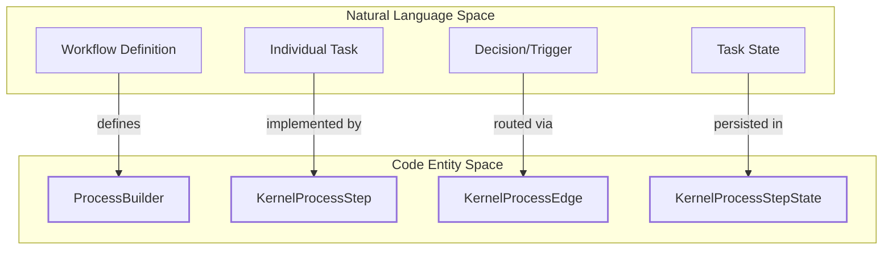
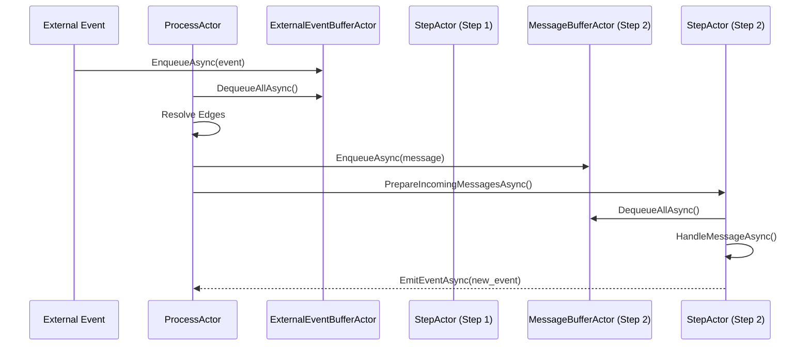

<!-- source: DeepWiki mcp.deepwiki.com · repo microsoft/semantic-kernel · page 6.5 Process Framework · fetched 2026-10-26 -->

# Process Framework

Relevant source files

The following files were used as context for generating this wiki page:

- [.vscode/extensions.json](.vscode/extensions.json)
- [.vscode/launch.json](.vscode/launch.json)
- [.vscode/settings.json](.vscode/settings.json)
- [.vscode/tasks.json](.vscode/tasks.json)
- [docs/decisions/0072-agents-with-memory.md](docs/decisions/0072-agents-with-memory.md)
- [dotnet/samples/Concepts/Agents/ChatCompletion_Mem0.cs](dotnet/samples/Concepts/Agents/ChatCompletion_Mem0.cs)
- [dotnet/samples/Concepts/Agents/ChatCompletion_Rag.cs](dotnet/samples/Concepts/Agents/ChatCompletion_Rag.cs)
- [dotnet/samples/Concepts/Agents/ChatCompletion_Whiteboard.cs](dotnet/samples/Concepts/Agents/ChatCompletion_Whiteboard.cs)
- [dotnet/samples/Demos/ProcessWithDapr/Controllers/ProcessController.cs](dotnet/samples/Demos/ProcessWithDapr/Controllers/ProcessController.cs)
- [dotnet/samples/Demos/ProcessWithDapr/ProcessWithDapr.csproj](dotnet/samples/Demos/ProcessWithDapr/ProcessWithDapr.csproj)
- [dotnet/samples/Demos/ProcessWithDapr/README.md](dotnet/samples/Demos/ProcessWithDapr/README.md)
- [dotnet/samples/GettingStartedWithProcesses/Step04/Steps/RenderMessageStep.cs](dotnet/samples/GettingStartedWithProcesses/Step04/Steps/RenderMessageStep.cs)
- [dotnet/src/Agents/Bedrock/Agents.Bedrock.csproj](dotnet/src/Agents/Bedrock/Agents.Bedrock.csproj)
- [dotnet/src/Experimental/Process.Abstractions/KernelProcess.cs](dotnet/src/Experimental/Process.Abstractions/KernelProcess.cs)
- [dotnet/src/Experimental/Process.Abstractions/KernelProcessState.cs](dotnet/src/Experimental/Process.Abstractions/KernelProcessState.cs)
- [dotnet/src/Experimental/Process.Abstractions/KernelProcessStepContext.cs](dotnet/src/Experimental/Process.Abstractions/KernelProcessStepContext.cs)
- [dotnet/src/Experimental/Process.Abstractions/KernelProcessStepInfo.cs](dotnet/src/Experimental/Process.Abstractions/KernelProcessStepInfo.cs)
- [dotnet/src/Experimental/Process.Abstractions/KernelProcessStepState.cs](dotnet/src/Experimental/Process.Abstractions/KernelProcessStepState.cs)
- [dotnet/src/Experimental/Process.Core/Internal/EndStep.cs](dotnet/src/Experimental/Process.Core/Internal/EndStep.cs)
- [dotnet/src/Experimental/Process.Core/ProcessBuilder.cs](dotnet/src/Experimental/Process.Core/ProcessBuilder.cs)
- [dotnet/src/Experimental/Process.Core/ProcessStepBuilder.cs](dotnet/src/Experimental/Process.Core/ProcessStepBuilder.cs)
- [dotnet/src/Experimental/Process.LocalRuntime/LocalKernelProcessContext.cs](dotnet/src/Experimental/Process.LocalRuntime/LocalKernelProcessContext.cs)
- [dotnet/src/Experimental/Process.LocalRuntime/LocalProcess.cs](dotnet/src/Experimental/Process.LocalRuntime/LocalProcess.cs)
- [dotnet/src/Experimental/Process.LocalRuntime/LocalStep.cs](dotnet/src/Experimental/Process.LocalRuntime/LocalStep.cs)
- [dotnet/src/Experimental/Process.Runtime.Dapr.UnitTests/DaprStepInfoTests.cs](dotnet/src/Experimental/Process.Runtime.Dapr.UnitTests/DaprStepInfoTests.cs)
- [dotnet/src/Experimental/Process.Runtime.Dapr.UnitTests/TypeInfoTests.cs](dotnet/src/Experimental/Process.Runtime.Dapr.UnitTests/TypeInfoTests.cs)
- [dotnet/src/Experimental/Process.Runtime.Dapr/Actors/ProcessActor.cs](dotnet/src/Experimental/Process.Runtime.Dapr/Actors/ProcessActor.cs)
- [dotnet/src/Experimental/Process.Runtime.Dapr/Actors/StepActor.cs](dotnet/src/Experimental/Process.Runtime.Dapr/Actors/StepActor.cs)
- [dotnet/src/Experimental/Process.Runtime.Dapr/DaprKernelProcessContext.cs](dotnet/src/Experimental/Process.Runtime.Dapr/DaprKernelProcessContext.cs)
- [dotnet/src/Experimental/Process.Runtime.Dapr/DaprProcessInfo.cs](dotnet/src/Experimental/Process.Runtime.Dapr/DaprProcessInfo.cs)
- [dotnet/src/Experimental/Process.Runtime.Dapr/DaprStepInfo.cs](dotnet/src/Experimental/Process.Runtime.Dapr/DaprStepInfo.cs)
- [dotnet/src/Experimental/Process.Runtime.Dapr/Interfaces/IProcess.cs](dotnet/src/Experimental/Process.Runtime.Dapr/Interfaces/IProcess.cs)
- [dotnet/src/Experimental/Process.Runtime.Dapr/KernelProcessDaprExtensions.cs](dotnet/src/Experimental/Process.Runtime.Dapr/KernelProcessDaprExtensions.cs)
- [dotnet/src/Experimental/Process.Runtime.Dapr/Serialization/KernelProcessEventSerializer.cs](dotnet/src/Experimental/Process.Runtime.Dapr/Serialization/KernelProcessEventSerializer.cs)
- [dotnet/src/Experimental/Process.Runtime.Dapr/Serialization/TypeInfo.cs](dotnet/src/Experimental/Process.Runtime.Dapr/Serialization/TypeInfo.cs)
- [dotnet/src/Experimental/Process.UnitTests/Core/ProcessBuilderTests.cs](dotnet/src/Experimental/Process.UnitTests/Core/ProcessBuilderTests.cs)
- [dotnet/src/Experimental/Process.UnitTests/Core/ProcessEdgeBuilderTests.cs](dotnet/src/Experimental/Process.UnitTests/Core/ProcessEdgeBuilderTests.cs)
- [dotnet/src/Experimental/Process.UnitTests/Core/ProcessStepEdgeBuilderTests.cs](dotnet/src/Experimental/Process.UnitTests/Core/ProcessStepEdgeBuilderTests.cs)
- [dotnet/src/Experimental/Process.UnitTests/KernelProcessTests.cs](dotnet/src/Experimental/Process.UnitTests/KernelProcessTests.cs)
- [dotnet/src/Experimental/Process.UnitTests/Runtime.Local/LocalProcessTests.cs](dotnet/src/Experimental/Process.UnitTests/Runtime.Local/LocalProcessTests.cs)
- [dotnet/src/IntegrationTests/Agents/CommonInterfaceConformance/AgentWithTextSearchProviderConformance/AgentWithTextSearchProvider.cs](dotnet/src/IntegrationTests/Agents/CommonInterfaceConformance/AgentWithTextSearchProviderConformance/AgentWithTextSearchProvider.cs)
- [dotnet/src/IntegrationTests/Memory/Mem0ProviderTests.cs](dotnet/src/IntegrationTests/Memory/Mem0ProviderTests.cs)
- [dotnet/src/InternalUtilities/process/Abstractions/ExceptionExtensions.cs](dotnet/src/InternalUtilities/process/Abstractions/ExceptionExtensions.cs)
- [dotnet/src/InternalUtilities/process/Abstractions/StepExtensions.cs](dotnet/src/InternalUtilities/process/Abstractions/StepExtensions.cs)
- [dotnet/src/SemanticKernel.Core/Data/TextSearchBehavior/TextSearchProvider.cs](dotnet/src/SemanticKernel.Core/Data/TextSearchBehavior/TextSearchProvider.cs)
- [dotnet/src/SemanticKernel.Core/Data/TextSearchBehavior/TextSearchProviderOptions.cs](dotnet/src/SemanticKernel.Core/Data/TextSearchBehavior/TextSearchProviderOptions.cs)
- [dotnet/src/SemanticKernel.Core/Data/TextSearchStore/TextSearchStore.cs](dotnet/src/SemanticKernel.Core/Data/TextSearchStore/TextSearchStore.cs)
- [dotnet/src/SemanticKernel.Core/Data/TextSearchStore/TextSearchStoreOptions.cs](dotnet/src/SemanticKernel.Core/Data/TextSearchStore/TextSearchStoreOptions.cs)
- [dotnet/src/SemanticKernel.Core/Memory/Mem0/Mem0Provider.cs](dotnet/src/SemanticKernel.Core/Memory/Mem0/Mem0Provider.cs)
- [dotnet/src/SemanticKernel.Core/Memory/Whiteboard/WhiteboardProvider.cs](dotnet/src/SemanticKernel.Core/Memory/Whiteboard/WhiteboardProvider.cs)
- [dotnet/src/SemanticKernel.UnitTests/Data/TextSearchProviderTests.cs](dotnet/src/SemanticKernel.UnitTests/Data/TextSearchProviderTests.cs)
- [dotnet/src/SemanticKernel.UnitTests/Data/TextSearchStoreTests.cs](dotnet/src/SemanticKernel.UnitTests/Data/TextSearchStoreTests.cs)
- [dotnet/src/SemanticKernel.UnitTests/Memory/Mem0ProviderTests.cs](dotnet/src/SemanticKernel.UnitTests/Memory/Mem0ProviderTests.cs)
- [dotnet/src/SemanticKernel.UnitTests/Memory/WhiteboardProviderTests.cs](dotnet/src/SemanticKernel.UnitTests/Memory/WhiteboardProviderTests.cs)
- [python/samples/demos/process_with_dapr/fastapi_app.py](python/samples/demos/process_with_dapr/fastapi_app.py)
- [python/samples/demos/process_with_dapr/process/process.py](python/samples/demos/process_with_dapr/process/process.py)
- [python/samples/demos/process_with_dapr/process/steps.py](python/samples/demos/process_with_dapr/process/steps.py)
- [python/samples/getting_started_with_processes/README.md](python/samples/getting_started_with_processes/README.md)
- [python/semantic_kernel/processes/__init__.py](python/semantic_kernel/processes/__init__.py)
- [python/semantic_kernel/processes/dapr_runtime/actors/process_actor.py](python/semantic_kernel/processes/dapr_runtime/actors/process_actor.py)
- [python/semantic_kernel/processes/dapr_runtime/actors/step_actor.py](python/semantic_kernel/processes/dapr_runtime/actors/step_actor.py)
- [python/semantic_kernel/processes/dapr_runtime/dapr_actor_registration.py](python/semantic_kernel/processes/dapr_runtime/dapr_actor_registration.py)
- [python/semantic_kernel/processes/dapr_runtime/dapr_kernel_process.py](python/semantic_kernel/processes/dapr_runtime/dapr_kernel_process.py)
- [python/semantic_kernel/processes/dapr_runtime/dapr_kernel_process_context.py](python/semantic_kernel/processes/dapr_runtime/dapr_kernel_process_context.py)
- [python/semantic_kernel/processes/dapr_runtime/dapr_process_info.py](python/semantic_kernel/processes/dapr_runtime/dapr_process_info.py)
- [python/semantic_kernel/processes/dapr_runtime/dapr_step_info.py](python/semantic_kernel/processes/dapr_runtime/dapr_step_info.py)
- [python/semantic_kernel/processes/dapr_runtime/interfaces/process_interface.py](python/semantic_kernel/processes/dapr_runtime/interfaces/process_interface.py)
- [python/semantic_kernel/processes/dapr_runtime/interfaces/step_interface.py](python/semantic_kernel/processes/dapr_runtime/interfaces/step_interface.py)
- [python/semantic_kernel/processes/kernel_process/kernel_process.py](python/semantic_kernel/processes/kernel_process/kernel_process.py)
- [python/semantic_kernel/processes/kernel_process/kernel_process_event.py](python/semantic_kernel/processes/kernel_process/kernel_process_event.py)
- [python/semantic_kernel/processes/kernel_process/kernel_process_state.py](python/semantic_kernel/processes/kernel_process/kernel_process_state.py)
- [python/semantic_kernel/processes/kernel_process/kernel_process_step_state.py](python/semantic_kernel/processes/kernel_process/kernel_process_step_state.py)
- [python/semantic_kernel/processes/local_runtime/local_kernel_process.py](python/semantic_kernel/processes/local_runtime/local_kernel_process.py)
- [python/semantic_kernel/processes/local_runtime/local_kernel_process_context.py](python/semantic_kernel/processes/local_runtime/local_kernel_process_context.py)
- [python/semantic_kernel/processes/local_runtime/local_process.py](python/semantic_kernel/processes/local_runtime/local_process.py)
- [python/semantic_kernel/processes/local_runtime/local_step.py](python/semantic_kernel/processes/local_runtime/local_step.py)
- [python/semantic_kernel/processes/process_builder.py](python/semantic_kernel/processes/process_builder.py)
- [python/semantic_kernel/processes/step_utils.py](python/semantic_kernel/processes/step_utils.py)
- [python/tests/unit/connectors/ai/ollama/services/test_ollama_chat_completion.py](python/tests/unit/connectors/ai/ollama/services/test_ollama_chat_completion.py)
- [python/tests/unit/processes/dapr_runtime/test_dapr_kernel_process.py](python/tests/unit/processes/dapr_runtime/test_dapr_kernel_process.py)
- [python/tests/unit/processes/dapr_runtime/test_dapr_kernel_process_context.py](python/tests/unit/processes/dapr_runtime/test_dapr_kernel_process_context.py)
- [python/tests/unit/processes/dapr_runtime/test_process_actor.py](python/tests/unit/processes/dapr_runtime/test_process_actor.py)
- [python/tests/unit/processes/dapr_runtime/test_step_actor.py](python/tests/unit/processes/dapr_runtime/test_step_actor.py)
- [python/tests/unit/processes/dapr_runtime/test_step_class_loading.py](python/tests/unit/processes/dapr_runtime/test_step_class_loading.py)
- [python/tests/unit/processes/kernel_process/test_kernel_process_event.py](python/tests/unit/processes/kernel_process/test_kernel_process_event.py)
- [python/tests/unit/processes/local_runtime/test_local_kernel_process_context.py](python/tests/unit/processes/local_runtime/test_local_kernel_process_context.py)
- [python/tests/unit/processes/local_runtime/test_local_process.py](python/tests/unit/processes/local_runtime/test_local_process.py)
- [python/tests/unit/processes/test_process_builder.py](python/tests/unit/processes/test_process_builder.py)
- [python/tests/unit/processes/test_step_utils.py](python/tests/unit/processes/test_step_utils.py)

The Process Framework is a stateful, event-driven workflow engine designed to model complex business processes integrated with AI capabilities. It allows developers to define directed graphs of steps where execution is triggered by events, enabling both local in-process execution and distributed execution via Dapr actors.

## Overview and Core Abstractions

The framework is built around three primary entities: the **Process**, the **Step**, and the **Event**. A process is a container for steps and the edges (event routes) that connect them.

### Key Classes
| Class | Responsibility | Source |
| :--- | :--- | :--- |
| `KernelProcess` | The model representing a collection of steps and their connections. | [dotnet/src/Experimental/Process.Abstractions/KernelProcess.cs:13-16]() |
| `ProcessBuilder` | A fluent API for defining steps and event routing. | [dotnet/src/Experimental/Process.Core/ProcessBuilder.cs:16-19]() |
| `ProcessStepBuilder` | Facilitates the definition of a single step and its output edges. | [dotnet/src/Experimental/Process.Core/ProcessStepBuilder.cs:16-17]() |
| `KernelProcessStep` | The base class for implementing custom logic within a step. | [dotnet/src/Experimental/Process.Abstractions/KernelProcessStep.cs:12-15]() |

### Natural Language to Code Entity Mapping
This diagram shows how high-level workflow concepts translate into specific code structures within the Semantic Kernel Process Framework.

**Sources:** [dotnet/src/Experimental/Process.Core/ProcessBuilder.cs:16-19](), [dotnet/src/Experimental/Process.Abstractions/KernelProcessStep.cs:12-15](), [dotnet/src/Experimental/Process.Abstractions/KernelProcessStepState.cs:10-12]()

---

## Process Building and Event Routing

Workflows are constructed using the `ProcessBuilder`. Steps are added to the builder, and their interactions are defined by mapping output events to specific functions on subsequent steps.

### Event Propagation
Events can be triggered by:
1. **Function Results**: Using `OnFunctionResult()` to route successful outputs [dotnet/src/Experimental/Process.Core/ProcessStepBuilder.cs:58-65]().
2. **Errors**: Using `OnFunctionError()` to handle exceptions [dotnet/src/Experimental/Process.Core/ProcessStepBuilder.cs:73-80]().
3. **Explicit Events**: Emitting custom events via `KernelProcessStepContext.EmitEventAsync` [dotnet/src/Experimental/Process.Abstractions/KernelProcessStepContext.cs:50-54]().

### Routing Logic
When a step emits an event, the framework resolves the `KernelProcessEdge` associated with that event ID. The edge defines the `TargetStepId` and the specific `TargetFunction` and `ParameterName` to receive the data [dotnet/src/Experimental/Process.Abstractions/KernelProcessEdge.cs:10-15]().

---

## Runtimes: Local vs. Distributed

The framework supports two primary execution environments. Both runtimes handle the "Superstep" logic, where all events emitted in one cycle are processed in the next to prevent race conditions.

### 1. Local Runtime
The `LocalProcess` and `LocalStep` classes implement the framework for in-process execution. It uses a `Channel<KernelProcessEvent>` for handling external events and manages an internal loop for superstep execution [dotnet/src/Experimental/Process.LocalRuntime/LocalProcess.cs:22-26]().

**Sources:** [dotnet/src/Experimental/Process.LocalRuntime/LocalProcess.cs:72-80](), [dotnet/src/Experimental/Process.LocalRuntime/LocalStep.cs:43-65]()

### 2. Dapr Distributed Runtime
For scalable, stateful workflows, the framework integrates with Dapr actors. Each process becomes a `ProcessActor` and each step becomes a `StepActor`.

*   **ProcessActor**: Orchestrates the supersteps and routes messages between StepActors [dotnet/src/Experimental/Process.Runtime.Dapr/Actors/ProcessActor.cs:20-21]().
*   **StepActor**: Wraps the `KernelProcessStep` and persists state using Dapr's `StateManager` [dotnet/src/Experimental/Process.Runtime.Dapr/Actors/StepActor.cs:20-21]().
*   **Message Buffering**: Uses `MessageBufferActor` and `EventBufferActor` to reliably queue events between steps [dotnet/src/Experimental/Process.Runtime.Dapr/Actors/StepActor.cs:131-135]().

### Runtime Architecture Diagram
The following diagram illustrates the interaction between the Process Orchestrator and the individual Step Actors in a Dapr environment.

**Sources:** [dotnet/src/Experimental/Process.Runtime.Dapr/Actors/ProcessActor.cs:101-108](), [dotnet/src/Experimental/Process.Runtime.Dapr/Actors/StepActor.cs:129-145]()

---

## Python Implementation

The Python implementation mirrors the .NET design, providing a `LocalProcess` for local execution and `StepActor`/`ProcessActor` for Dapr-based distributed workflows.

### Python Dapr Integration
Python steps are loaded dynamically using qualified names. The `StepActor` in Python uses a factory-based approach to instantiate `KernelProcessStep` classes [python/semantic_kernel/processes/dapr_runtime/actors/step_actor.py:55-74]().

**Key Python Classes:**
*   `LocalProcess`: Handles the local event loop using `asyncio.Task` [python/semantic_kernel/processes/local_runtime/local_process.py:36-49]().
*   `StepActor`: Implements `KernelProcessMessageChannel` to allow steps to emit events back to the Dapr-backed process [python/semantic_kernel/processes/dapr_runtime/actors/step_actor.py:52-53]().

**Sources:** [python/semantic_kernel/processes/local_runtime/local_process.py:83-92](), [python/semantic_kernel/processes/dapr_runtime/actors/step_actor.py:147-163]()

---

## Data Flow: Event to Function Call

The following table describes the transformation of data as it moves through the framework:

| Stage | Entity | Description |
| :--- | :--- | :--- |
| **Emission** | `KernelProcessEvent` | A named event containing data (e.g., `Result`) emitted by a step [dotnet/src/Experimental/Process.Abstractions/KernelProcessEvent.cs:9-12](). |
| **Routing** | `KernelProcessEdge` | Matches the `EventId` to a `TargetStepId` and `TargetFunction` [dotnet/src/Experimental/Process.Abstractions/KernelProcessEdge.cs:20-25](). |
| **Delivery** | `ProcessMessage` | The internal representation of the event data targeted at a specific function [dotnet/src/Experimental/Process.LocalRuntime/LocalStep.cs:171-174](). |
| **Execution** | `KernelFunction` | The `StepActor` or `LocalStep` invokes the kernel function using the values provided in the `ProcessMessage` [dotnet/src/Experimental/Process.LocalRuntime/LocalStep.cs:138-143](). |

**Sources:** [dotnet/src/Experimental/Process.LocalRuntime/LocalStep.cs:138-168](), [dotnet/src/Experimental/Process.Runtime.Dapr/Actors/StepActor.cs:151-163]()

---

