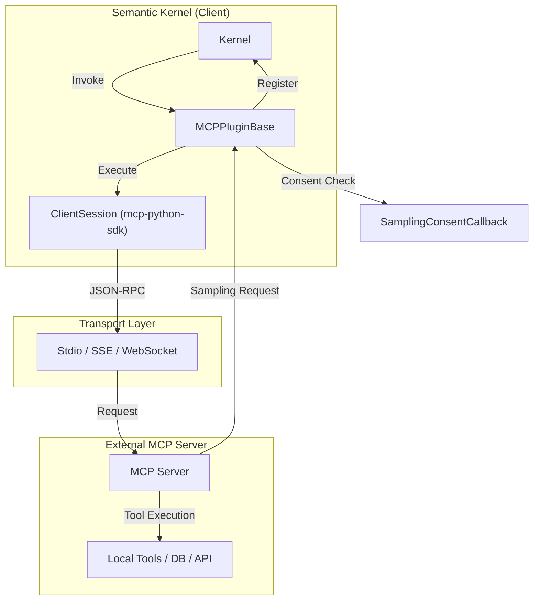
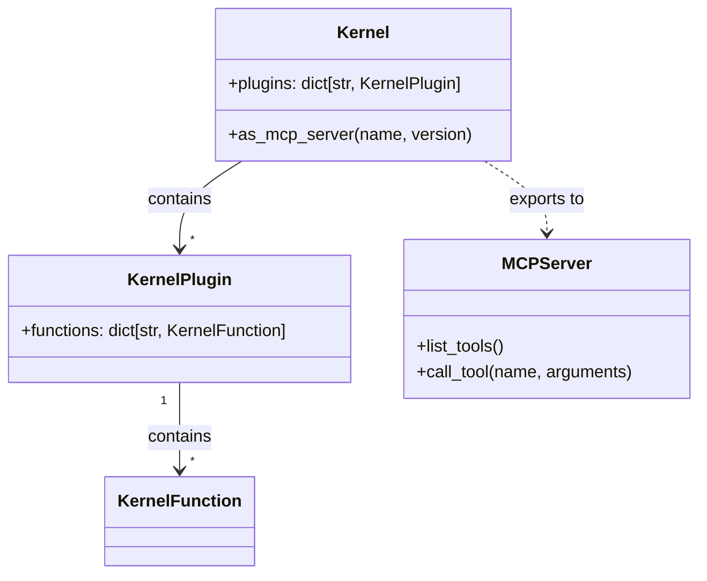

<!-- source: DeepWiki mcp.deepwiki.com · repo microsoft/semantic-kernel · page 6.6 Model Context Protocol (MCP) Integration · fetched 2026-10-26 -->

# Model Context Protocol (MCP) Integration

<details>
<summary>Relevant source files</summary>

The following files were used as context for generating this wiki page:

- [dotnet/samples/Demos/AgentFrameworkWithAspire/ChatWithAgent.AppHost/ChatWithAgent.AppHost.csproj](dotnet/samples/Demos/AgentFrameworkWithAspire/ChatWithAgent.AppHost/ChatWithAgent.AppHost.csproj)
- [dotnet/samples/Demos/BookingRestaurant/BookingRestaurant.csproj](dotnet/samples/Demos/BookingRestaurant/BookingRestaurant.csproj)
- [dotnet/samples/Demos/ModelContextProtocolClientServer/MCPClient/Extensions/PromptResultExtensions.cs](dotnet/samples/Demos/ModelContextProtocolClientServer/MCPClient/Extensions/PromptResultExtensions.cs)
- [dotnet/samples/Demos/ModelContextProtocolClientServer/MCPClient/Extensions/ReadResourceResultExtensions.cs](dotnet/samples/Demos/ModelContextProtocolClientServer/MCPClient/Extensions/ReadResourceResultExtensions.cs)
- [dotnet/samples/Demos/ModelContextProtocolClientServer/MCPClient/Extensions/RoleExtensions.cs](dotnet/samples/Demos/ModelContextProtocolClientServer/MCPClient/Extensions/RoleExtensions.cs)
- [dotnet/samples/Demos/ModelContextProtocolClientServer/MCPClient/MCPClient.csproj](dotnet/samples/Demos/ModelContextProtocolClientServer/MCPClient/MCPClient.csproj)
- [dotnet/samples/Demos/ModelContextProtocolClientServer/MCPClient/Program.cs](dotnet/samples/Demos/ModelContextProtocolClientServer/MCPClient/Program.cs)
- [dotnet/samples/Demos/ModelContextProtocolClientServer/MCPServer/Extensions/McpServerBuilderExtensions.cs](dotnet/samples/Demos/ModelContextProtocolClientServer/MCPServer/Extensions/McpServerBuilderExtensions.cs)
- [dotnet/samples/Demos/ModelContextProtocolClientServer/MCPServer/Extensions/VectorStoreExtensions.cs](dotnet/samples/Demos/ModelContextProtocolClientServer/MCPServer/Extensions/VectorStoreExtensions.cs)
- [dotnet/samples/Demos/ModelContextProtocolClientServer/MCPServer/MCPServer.csproj](dotnet/samples/Demos/ModelContextProtocolClientServer/MCPServer/MCPServer.csproj)
- [dotnet/samples/Demos/ModelContextProtocolClientServer/MCPServer/Program.cs](dotnet/samples/Demos/ModelContextProtocolClientServer/MCPServer/Program.cs)
- [dotnet/samples/Demos/ModelContextProtocolClientServer/MCPServer/Prompts/PromptDefinition.cs](dotnet/samples/Demos/ModelContextProtocolClientServer/MCPServer/Prompts/PromptDefinition.cs)
- [dotnet/samples/Demos/ModelContextProtocolClientServer/MCPServer/Properties/launchSettings.json](dotnet/samples/Demos/ModelContextProtocolClientServer/MCPServer/Properties/launchSettings.json)
- [dotnet/samples/Demos/ModelContextProtocolClientServer/MCPServer/Resources/ResourceDefinition.cs](dotnet/samples/Demos/ModelContextProtocolClientServer/MCPServer/Resources/ResourceDefinition.cs)
- [dotnet/samples/Demos/ModelContextProtocolClientServer/MCPServer/Resources/ResourceTemplateDefinition.cs](dotnet/samples/Demos/ModelContextProtocolClientServer/MCPServer/Resources/ResourceTemplateDefinition.cs)
- [dotnet/samples/Demos/ModelContextProtocolClientServer/MCPServer/Tools/DateTimeUtils.cs](dotnet/samples/Demos/ModelContextProtocolClientServer/MCPServer/Tools/DateTimeUtils.cs)
- [dotnet/samples/Demos/ModelContextProtocolClientServer/MCPServer/Tools/MailboxUtils.cs](dotnet/samples/Demos/ModelContextProtocolClientServer/MCPServer/Tools/MailboxUtils.cs)
- [dotnet/samples/Demos/ModelContextProtocolClientServer/MCPServer/Tools/OrderProcessingUtils.cs](dotnet/samples/Demos/ModelContextProtocolClientServer/MCPServer/Tools/OrderProcessingUtils.cs)
- [dotnet/samples/Demos/ModelContextProtocolClientServer/MCPServer/Tools/WeatherUtils.cs](dotnet/samples/Demos/ModelContextProtocolClientServer/MCPServer/Tools/WeatherUtils.cs)
- [dotnet/samples/Demos/ModelContextProtocolClientServer/MCPServer/appsettings.json](dotnet/samples/Demos/ModelContextProtocolClientServer/MCPServer/appsettings.json)
- [dotnet/samples/Demos/ModelContextProtocolClientServer/README.md](dotnet/samples/Demos/ModelContextProtocolClientServer/README.md)
- [dotnet/samples/Demos/ModelContextProtocolPlugin/ModelContextProtocolPlugin.csproj](dotnet/samples/Demos/ModelContextProtocolPlugin/ModelContextProtocolPlugin.csproj)
- [dotnet/samples/Demos/ModelContextProtocolPlugin/Program.cs](dotnet/samples/Demos/ModelContextProtocolPlugin/Program.cs)
- [dotnet/samples/Demos/ProcessFrameworkWithAspire/ProcessFramework.Aspire/ProcessFramework.Aspire.AppHost/ProcessFramework.Aspire.AppHost.csproj](dotnet/samples/Demos/ProcessFrameworkWithAspire/ProcessFramework.Aspire/ProcessFramework.Aspire.AppHost/ProcessFramework.Aspire.AppHost.csproj)
- [dotnet/samples/Demos/ProcessFrameworkWithAspire/ProcessFramework.Aspire/ProcessFramework.Aspire.AppHost/Program.cs](dotnet/samples/Demos/ProcessFrameworkWithAspire/ProcessFramework.Aspire/ProcessFramework.Aspire.AppHost/Program.cs)
- [dotnet/samples/Demos/ProcessFrameworkWithAspire/ProcessFramework.Aspire/ProcessFramework.Aspire.AppHost/appsettings.json](dotnet/samples/Demos/ProcessFrameworkWithAspire/ProcessFramework.Aspire/ProcessFramework.Aspire.AppHost/appsettings.json)
- [dotnet/samples/Demos/ProcessFrameworkWithAspire/ProcessFramework.Aspire/ProcessFramework.Aspire.ProcessOrchestrator/Models/ProcessEvents.cs](dotnet/samples/Demos/ProcessFrameworkWithAspire/ProcessFramework.Aspire/ProcessFramework.Aspire.ProcessOrchestrator/Models/ProcessEvents.cs)
- [dotnet/samples/Demos/ProcessFrameworkWithAspire/ProcessFramework.Aspire/ProcessFramework.Aspire.ProcessOrchestrator/ProcessFramework.Aspire.ProcessOrchestrator.csproj](dotnet/samples/Demos/ProcessFrameworkWithAspire/ProcessFramework.Aspire/ProcessFramework.Aspire.ProcessOrchestrator/ProcessFramework.Aspire.ProcessOrchestrator.csproj)
- [dotnet/samples/Demos/ProcessFrameworkWithAspire/ProcessFramework.Aspire/ProcessFramework.Aspire.ProcessOrchestrator/ProcessFramework.Aspire.ProcessOrchestrator.http](dotnet/samples/Demos/ProcessFrameworkWithAspire/ProcessFramework.Aspire/ProcessFramework.Aspire.ProcessOrchestrator/ProcessFramework.Aspire.ProcessOrchestrator.http)
- [dotnet/samples/Demos/ProcessFrameworkWithAspire/ProcessFramework.Aspire/ProcessFramework.Aspire.ProcessOrchestrator/Program.cs](dotnet/samples/Demos/ProcessFrameworkWithAspire/ProcessFramework.Aspire/ProcessFramework.Aspire.ProcessOrchestrator/Program.cs)
- [dotnet/samples/Demos/ProcessFrameworkWithAspire/ProcessFramework.Aspire/ProcessFramework.Aspire.ProcessOrchestrator/Steps/SummarizeStep.cs](dotnet/samples/Demos/ProcessFrameworkWithAspire/ProcessFramework.Aspire/ProcessFramework.Aspire.ProcessOrchestrator/Steps/SummarizeStep.cs)
- [dotnet/samples/Demos/ProcessFrameworkWithAspire/ProcessFramework.Aspire/ProcessFramework.Aspire.ServiceDefaults/CommonExtensions.cs](dotnet/samples/Demos/ProcessFrameworkWithAspire/ProcessFramework.Aspire/ProcessFramework.Aspire.ServiceDefaults/CommonExtensions.cs)
- [dotnet/samples/Demos/ProcessFrameworkWithAspire/ProcessFramework.Aspire/ProcessFramework.Aspire.SummaryAgent/ProcessFramework.Aspire.SummaryAgent.csproj](dotnet/samples/Demos/ProcessFrameworkWithAspire/ProcessFramework.Aspire/ProcessFramework.Aspire.SummaryAgent/ProcessFramework.Aspire.SummaryAgent.csproj)
- [dotnet/samples/Demos/ProcessFrameworkWithAspire/ProcessFramework.Aspire/ProcessFramework.Aspire.SummaryAgent/Program.cs](dotnet/samples/Demos/ProcessFrameworkWithAspire/ProcessFramework.Aspire/ProcessFramework.Aspire.SummaryAgent/Program.cs)
- [dotnet/samples/Demos/ProcessFrameworkWithAspire/ProcessFramework.Aspire/ProcessFramework.Aspire.TranslatorAgent/ProcessFramework.Aspire.TranslatorAgent.csproj](dotnet/samples/Demos/ProcessFrameworkWithAspire/ProcessFramework.Aspire/ProcessFramework.Aspire.TranslatorAgent/ProcessFramework.Aspire.TranslatorAgent.csproj)
- [dotnet/samples/Demos/ProcessFrameworkWithAspire/ProcessFramework.Aspire/ProcessFramework.Aspire.TranslatorAgent/Program.cs](dotnet/samples/Demos/ProcessFrameworkWithAspire/ProcessFramework.Aspire/ProcessFramework.Aspire.TranslatorAgent/Program.cs)
- [dotnet/samples/Demos/README.md](dotnet/samples/Demos/README.md)
- [dotnet/samples/GettingStarted/GettingStarted.csproj](dotnet/samples/GettingStarted/GettingStarted.csproj)
- [dotnet/src/Connectors/Connectors.MistralAI.UnitTests/Connectors.MistralAI.UnitTests.csproj](dotnet/src/Connectors/Connectors.MistralAI.UnitTests/Connectors.MistralAI.UnitTests.csproj)
- [dotnet/src/Plugins/Plugins.Document/Plugins.Document.csproj](dotnet/src/Plugins/Plugins.Document/Plugins.Document.csproj)
- [dotnet/src/Plugins/Plugins.MsGraph/Plugins.MsGraph.csproj](dotnet/src/Plugins/Plugins.MsGraph/Plugins.MsGraph.csproj)
- [python/samples/concepts/mcp/README.md](python/samples/concepts/mcp/README.md)
- [python/samples/concepts/mcp/agent_with_mcp_agent.py](python/samples/concepts/mcp/agent_with_mcp_agent.py)
- [python/samples/concepts/mcp/agent_with_mcp_plugin.py](python/samples/concepts/mcp/agent_with_mcp_plugin.py)
- [python/samples/concepts/mcp/agent_with_mcp_sampling.py](python/samples/concepts/mcp/agent_with_mcp_sampling.py)
- [python/samples/concepts/mcp/azure_ai_agent_with_local_server.py](python/samples/concepts/mcp/azure_ai_agent_with_local_server.py)
- [python/samples/concepts/mcp/azure_ai_agent_with_mcp_plugin.py](python/samples/concepts/mcp/azure_ai_agent_with_mcp_plugin.py)
- [python/samples/concepts/mcp/local_agent_with_local_server.py](python/samples/concepts/mcp/local_agent_with_local_server.py)
- [python/samples/concepts/mcp/mcp_as_plugin.py](python/samples/concepts/mcp/mcp_as_plugin.py)
- [python/samples/concepts/mcp/servers/menu_agent_server.py](python/samples/concepts/mcp/servers/menu_agent_server.py)
- [python/samples/concepts/mcp/servers/restaurant_booking_agent_server.py](python/samples/concepts/mcp/servers/restaurant_booking_agent_server.py)
- [python/samples/concepts/realtime/README.md](python/samples/concepts/realtime/README.md)
- [python/samples/concepts/realtime/realtime_agent_with_function_calling_webrtc.py](python/samples/concepts/realtime/realtime_agent_with_function_calling_webrtc.py)
- [python/samples/concepts/realtime/realtime_agent_with_function_calling_websocket.py](python/samples/concepts/realtime/realtime_agent_with_function_calling_websocket.py)
- [python/samples/concepts/realtime/simple_realtime_chat_webrtc.py](python/samples/concepts/realtime/simple_realtime_chat_webrtc.py)
- [python/samples/concepts/realtime/simple_realtime_chat_websocket.py](python/samples/concepts/realtime/simple_realtime_chat_websocket.py)
- [python/samples/concepts/realtime/utils.py](python/samples/concepts/realtime/utils.py)
- [python/samples/demos/mcp_server/README.md](python/samples/demos/mcp_server/README.md)
- [python/samples/demos/mcp_server/agent_as_server.py](python/samples/demos/mcp_server/agent_as_server.py)
- [python/samples/demos/mcp_server/mcp_server_with_prompts.py](python/samples/demos/mcp_server/mcp_server_with_prompts.py)
- [python/samples/demos/mcp_server/mcp_server_with_sampling.py](python/samples/demos/mcp_server/mcp_server_with_sampling.py)
- [python/samples/demos/mcp_server/sk_mcp_server.py](python/samples/demos/mcp_server/sk_mcp_server.py)
- [python/semantic_kernel/connectors/ai/open_ai/prompt_execution_settings/open_ai_realtime_execution_settings.py](python/semantic_kernel/connectors/ai/open_ai/prompt_execution_settings/open_ai_realtime_execution_settings.py)
- [python/semantic_kernel/connectors/ai/open_ai/services/_open_ai_realtime.py](python/semantic_kernel/connectors/ai/open_ai/services/_open_ai_realtime.py)
- [python/semantic_kernel/connectors/ai/open_ai/services/azure_realtime.py](python/semantic_kernel/connectors/ai/open_ai/services/azure_realtime.py)
- [python/semantic_kernel/connectors/ai/open_ai/settings/open_ai_settings.py](python/semantic_kernel/connectors/ai/open_ai/settings/open_ai_settings.py)
- [python/semantic_kernel/connectors/mcp.py](python/semantic_kernel/connectors/mcp.py)
- [python/semantic_kernel/functions/kernel_function_extension.py](python/semantic_kernel/functions/kernel_function_extension.py)
- [python/semantic_kernel/functions/kernel_plugin.py](python/semantic_kernel/functions/kernel_plugin.py)
- [python/semantic_kernel/kernel.py](python/semantic_kernel/kernel.py)
- [python/semantic_kernel/utils/validation.py](python/semantic_kernel/utils/validation.py)
- [python/tests/unit/connectors/ai/open_ai/services/test_openai_realtime.py](python/tests/unit/connectors/ai/open_ai/services/test_openai_realtime.py)
- [python/tests/unit/connectors/mcp/test_mcp.py](python/tests/unit/connectors/mcp/test_mcp.py)
- [python/tests/unit/connectors/memory/azure_cosmos_db/test_azure_cosmos_db_mongodb_collection.py](python/tests/unit/connectors/memory/azure_cosmos_db/test_azure_cosmos_db_mongodb_collection.py)
- [python/tests/unit/functions/test_kernel_function_metadata.py](python/tests/unit/functions/test_kernel_function_metadata.py)
- [python/tests/unit/functions/test_kernel_plugins.py](python/tests/unit/functions/test_kernel_plugins.py)
- [python/tests/unit/kernel/test_kernel.py](python/tests/unit/kernel/test_kernel.py)
- [python/tests/unit/processes/local_runtime/test_local_step.py](python/tests/unit/processes/local_runtime/test_local_step.py)

</details>


The Model Context Protocol (MCP) integration in Semantic Kernel enables agents and kernels to communicate with external tools, prompts, and resources using a standardized open protocol. This integration allows Semantic Kernel to act as both an **MCP Client** (consuming tools from external servers) and an **MCP Server** (exposing Kernel functions and agents to other MCP-compatible applications).

## Overview of MCP Architecture

Semantic Kernel's MCP implementation bridges the gap between the `KernelPlugin` abstraction and the MCP specification. It supports multiple transport layers and provides mechanisms for sampling consent, ensuring secure interaction when external servers request LLM completions.

### Data Flow and Component Interaction

The following diagram illustrates how an MCP Plugin interacts with a `Kernel` and an external MCP Server.

**MCP Integration Data Flow**

Sources: [python/semantic_kernel/connectors/mcp.py:60-152](), [python/semantic_kernel/kernel.py:62-102]()

## MCP Client Integration

Semantic Kernel provides several concrete implementations of `MCPPluginBase` based on the required transport protocol. These plugins automatically discover tools on the MCP server and expose them as `KernelFunction` objects within a `KernelPlugin`.

### Supported Transports

| Transport Type | Class Name | Description |
| :--- | :--- | :--- |
| **Stdio** | `MCPStdioPlugin` | Connects to local servers via standard input/output. |
| **SSE** | `MCPSsePlugin` | Connects to remote servers via Server-Sent Events. |
| **WebSocket** | `MCPWebsocketPlugin` | Connects to servers via persistent WebSocket connections. |
| **HTTP Stream** | `MCPStreamableHttpPlugin` | Connects via streamable HTTP transport. |

Sources: [python/semantic_kernel/connectors/mcp.py:355-460](), [python/tests/unit/connectors/mcp/test_mcp.py:59-65]()

### Implementation Detail: Name Normalization
MCP tool names often contain characters (like slashes or spaces) that are invalid in Semantic Kernel function names. The `MCPPluginBase` uses a regex-based normalization process to ensure compatibility:
- Non-alphanumeric characters are replaced with underscores.
- Resulting names are validated against `PLUGIN_NAME_REGEX`.

Sources: [python/semantic_kernel/connectors/mcp.py:220-235](), [python/semantic_kernel/utils/validation.py:1-20]()

## Sampling and Security

MCP servers can request "sampling" from the client, effectively asking the client's LLM to generate a response. Semantic Kernel implements a strict consent model to prevent unauthorized LLM usage.

### Sampling Consent Callback
By default, sampling requests are denied unless a `sampling_consent_callback` is provided. This callback allows developers to inspect the `CreateMessageRequestParams` before granting permission.

- **`sampling_auto_approve`**: If set to `True`, the plugin skips the callback (logs a warning) and proceeds with the request.
- **`sampling_callback`**: The internal handler that converts MCP messages to `ChatMessageContent`, invokes the Kernel's chat service, and returns the result to the MCP server.

Sources: [python/semantic_kernel/connectors/mcp.py:62-73](), [python/semantic_kernel/connectors/mcp.py:530-580](), [python/tests/unit/connectors/mcp/test_mcp.py:93-150]()

## SK-as-MCP-Server

Semantic Kernel can expose its internal state as an MCP Server. This is particularly useful for making SK Agents or specialized plugins available to other tools like Claude Desktop or custom MCP clients.

### .NET Implementation
In .NET, the `AddMcpServer()` extension on `IServiceCollection` is used to host a server. It can automatically map Kernel plugins to MCP tools.

```csharp
// Example: Exposing SK Functions as MCP Tools
builder.Services
    .AddMcpServer()
    .WithStdioServerTransport()
    .WithTools(); // Automatically adds registered KernelPlugins as MCP Tools
```
Sources: [dotnet/samples/Demos/ModelContextProtocolClientServer/MCPServer/Program.cs:36-42](), [dotnet/samples/Demos/ModelContextProtocolClientServer/MCPServer/Extensions/McpServerBuilderExtensions.cs:24-59]()

### Python Implementation
In Python, the `kernel.as_mcp_server()` method (experimental) wraps the kernel in a `mcp.server.lowlevel.Server` instance.

**Code Entity Mapping: Kernel to MCP Server**

Sources: [python/semantic_kernel/kernel.py:72-75](), [python/semantic_kernel/functions/kernel_plugin.py:36-79](), [python/samples/demos/mcp_server/sk_mcp_server.py:1-50]()

## Content Mapping

Semantic Kernel provides helper functions to translate between MCP types and SK `Content` types, ensuring multimodal support (Text, Image, Audio, and Tool Calls).

| MCP Type | SK Content Type | Conversion Function |
| :--- | :--- | :--- |
| `types.TextContent` | `TextContent` | `_mcp_content_types_to_kernel_content` |
| `types.ImageContent` | `ImageContent` | `_mcp_content_types_to_kernel_content` |
| `types.AudioContent` | `AudioContent` | `_mcp_content_types_to_kernel_content` |
| `types.ToolUseContent` | `FunctionCallContent` | `_mcp_content_types_to_kernel_content` |
| `types.EmbeddedResource` | `BinaryContent` | `_mcp_content_types_to_kernel_content` |

Sources: [python/semantic_kernel/connectors/mcp.py:102-152](), [python/semantic_kernel/connectors/mcp.py:156-180]()

## Advanced Demos and Samples

The repository includes comprehensive demos for both .NET and Python:

1.  **.NET MCP Client/Server Demo**: Demonstrates a .NET client interacting with a .NET server that hosts `DateTimeUtils`, `WeatherUtils`, and a `SalesAssistantAgent` as MCP tools.
    - [dotnet/samples/Demos/ModelContextProtocolClientServer/MCPServer/Program.cs:1-57]()
    - [dotnet/samples/Demos/ModelContextProtocolClientServer/MCPClient/Program.cs:1-31]()
2.  **GitHub MCP Plugin**: A sample showing how to use `npx @modelcontextprotocol/server-github` via `StdioClientTransport` to allow an SK Agent to summarize repository commits.
    - [dotnet/samples/Demos/ModelContextProtocolPlugin/Program.cs:22-45]()
3.  **Python Agent with MCP**: Demonstrates an `Agent` using an `MCPSsePlugin` to access external tools with sampling enabled.
    - [python/samples/concepts/mcp/agent_with_mcp_sampling.py:1-60]()

---

