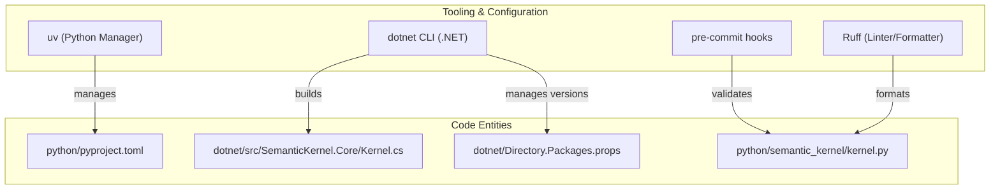
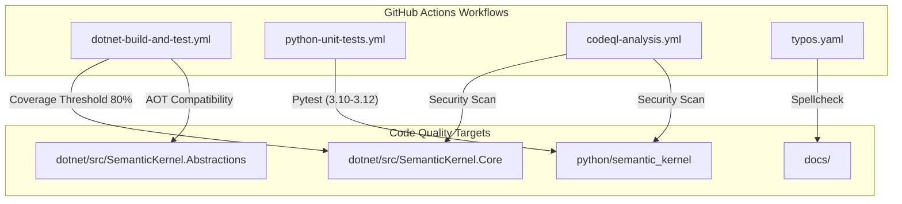

<!-- source: DeepWiki mcp.deepwiki.com · repo microsoft/semantic-kernel · page 7 Development Guide · fetched 2026-10-26 -->

# Development Guide

Relevant source files

The following files were used as context for generating this wiki page:

- [.github/workflows/codeql-analysis.yml](.github/workflows/codeql-analysis.yml)
- [.github/workflows/dotnet-build-and-test.yml](.github/workflows/dotnet-build-and-test.yml)
- [.github/workflows/dotnet-ci.yml](.github/workflows/dotnet-ci.yml)
- [.github/workflows/dotnet-format.yml](.github/workflows/dotnet-format.yml)
- [.github/workflows/dotnet-integration-tests.yml](.github/workflows/dotnet-integration-tests.yml)
- [.github/workflows/markdown-link-check.yml](.github/workflows/markdown-link-check.yml)
- [.github/workflows/python-build.yml](.github/workflows/python-build.yml)
- [.github/workflows/python-integration-tests.yml](.github/workflows/python-integration-tests.yml)
- [.github/workflows/python-lint.yml](.github/workflows/python-lint.yml)
- [.github/workflows/python-manual-release.yml](.github/workflows/python-manual-release.yml)
- [.github/workflows/python-test-coverage-report.yml](.github/workflows/python-test-coverage-report.yml)
- [.github/workflows/python-test-coverage.yml](.github/workflows/python-test-coverage.yml)
- [.github/workflows/python-unit-tests.yml](.github/workflows/python-unit-tests.yml)
- [.github/workflows/typos.yaml](.github/workflows/typos.yaml)
- [FEATURE_MATRIX.md](FEATURE_MATRIX.md)
- [README.md](README.md)
- [docs/decisions/0033-kernel-filters.md](docs/decisions/0033-kernel-filters.md)
- [docs/decisions/0034-rag-in-sk.md](docs/decisions/0034-rag-in-sk.md)
- [docs/images/sk_logo.png](docs/images/sk_logo.png)
- [dotnet/README.md](dotnet/README.md)
- [dotnet/notebooks/05-using-function-calling.ipynb](dotnet/notebooks/05-using-function-calling.ipynb)
- [dotnet/notebooks/README.md](dotnet/notebooks/README.md)
- [dotnet/src/Plugins/Plugins.Memory/TextMemoryPlugin.cs](dotnet/src/Plugins/Plugins.Memory/TextMemoryPlugin.cs)
- [python/.coveragerc](python/.coveragerc)
- [python/.vscode/tasks.json](python/.vscode/tasks.json)
- [python/DEV_SETUP.md](python/DEV_SETUP.md)
- [python/README.md](python/README.md)
- [python/mypy.ini](python/mypy.ini)
- [python/samples/demos/call_automation/.env.example](python/samples/demos/call_automation/.env.example)
- [python/samples/demos/call_automation/readme.md](python/samples/demos/call_automation/readme.md)
- [python/semantic_kernel/connectors/ai/function_choice_behavior.py](python/semantic_kernel/connectors/ai/function_choice_behavior.py)
- [python/tests/conftest.py](python/tests/conftest.py)
- [python/tests/unit/contents/test_function_call_content.py](python/tests/unit/contents/test_function_call_content.py)

This guide provides technical guidance for developers working with, building, and contributing to the Semantic Kernel framework. It covers the CI/CD infrastructure, development environment configuration, and sample applications across the multi-language codebase.

For details on specific areas, see the child pages:
- [CI/CD and Build System](#7.1) — Details on GitHub Actions, build scripts, and automated quality gates.
- [Sample Applications and Getting Started](#7.2) — Overview of available samples, notebooks, and demo apps.
- [Configuration and Setup](#7.3) — Guidance on environment variables, secret management, and IDE configuration.

## Development Environment Setup

Semantic Kernel supports .NET, Python, and Java. Each implementation has specific toolchain requirements to ensure consistency and quality.

### .NET Development
The .NET implementation targets **.NET 10.0** [README.md:22](). Developers typically use Visual Studio 2022 or VS Code. The build system relies on `dotnet` CLI and global configuration files like `global.json` to pin SDK versions [dotnet/global.json]().

### Python Development
The Python implementation requires **Python 3.10+** [python/README.md:27](). The project uses `uv` for high-performance dependency management and virtual environment orchestration [python/DEV_SETUP.md:16-20](). 

### Bridge: Development Tooling to Code Entities
The following diagram maps development tools and configurations to the core code entities they manage or validate.

**Development Tooling Mapping**

Sources: [python/DEV_SETUP.md:21-44](), [dotnet/README.md:16-24](), [.github/workflows/dotnet-format.yml:88-94]()

## Building and Testing

### .NET Build System
The .NET side uses Central Package Management via `Directory.Packages.props`. Building is performed by iterating through solution files (`.slnx`) [dotnet-build-and-test.yml:81-87](). Unit tests are identified by the `*.UnitTests.csproj` pattern [dotnet-build-and-test.yml:118-121]().

### Python Build System
Python development is driven by a `Makefile` for common tasks like `make install` [python/DEV_SETUP.md:50-53](). Testing is handled by `pytest`, with specific configurations for standard unit tests and Dapr-based process tests [python-unit-tests.yml:56-65]().

## Configuration and Telemetry

Managing secrets and service endpoints is critical for AI orchestration. 

- **Secret Management**: .NET uses `TestConfiguration.cs` to load settings from environment variables or `testsettings.json` [dotnet/src/InternalUtilities/samples/InternalUtilities/TestConfiguration.cs:1-30](). Python uses `pydantic-settings` to load from `.env` files [python/DEV_SETUP.md:114-116]().
- **Telemetry**: The framework is built for observability, supporting integration with tools like Application Insights via standard logging abstractions [README.md:36]().

### Bridge: CI/CD Pipeline to Code Quality
This diagram associates CI/CD workflow triggers with the specific code areas they protect.

**CI/CD Quality Gates**

Sources: [.github/workflows/dotnet-build-and-test.yml:16](), [.github/workflows/python-unit-tests.yml:20](), [.github/workflows/codeql-analysis.yml:27](), [.github/workflows/typos.yaml:1-10]()

## Sample Applications

The repository serves as a learning resource through various sample categories:
- **Concept Samples**: Focused snippets illustrating specific features like `FunctionCalling` or `VectorStores` [dotnet/README.md:95-101]().
- **Notebooks**: Interactive Jupyter notebooks for both .NET and Python [dotnet/README.md:72-90]().
- **Agents & Processes**: Complex multi-agent orchestration and event-driven workflow samples [README.md:181-185]().

For details on setting up these samples, see [Sample Applications and Getting Started](#7.2).

## Contribution Workflow

1. **Setup**: Follow language-specific setup in `DEV_SETUP.md` (Python) or `README.md` (.NET).
2. **Implementation**: Ensure code follows the [Google Docstring](https://github.com/google/styleguide/blob/gh-pages/pyguide.md#383-functions-and-methods) style for Python [python/DEV_SETUP.md:177]().
3. **Verification**: Run local tests (`uv run pytest` or `dotnet test`) and verify formatting [python/DEV_SETUP.md:141-159]().
4. **PR**: GitHub Actions will enforce linting, formatting, and a minimum 80% code coverage threshold for .NET [dotnet-build-and-test.yml:16]().

Sources: [python/DEV_SETUP.md:1-180](), [README.md:1-132](), [.github/workflows/dotnet-build-and-test.yml:1-244]()

---

