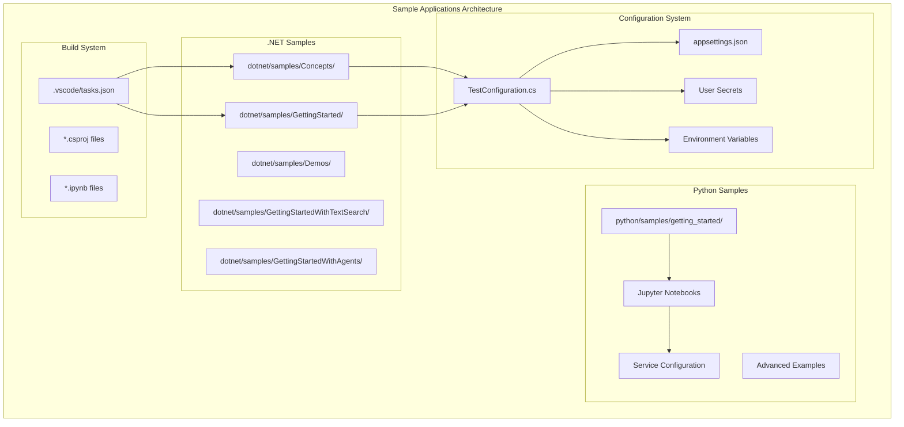
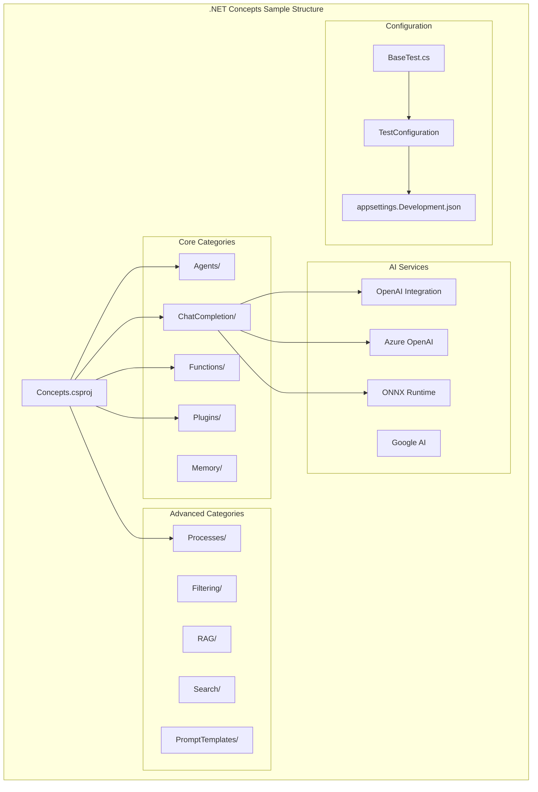
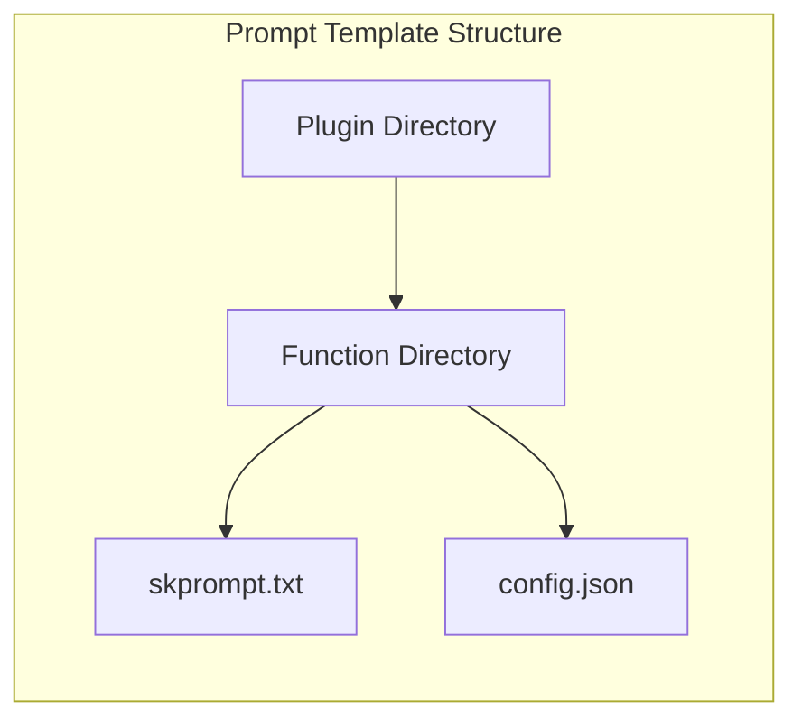
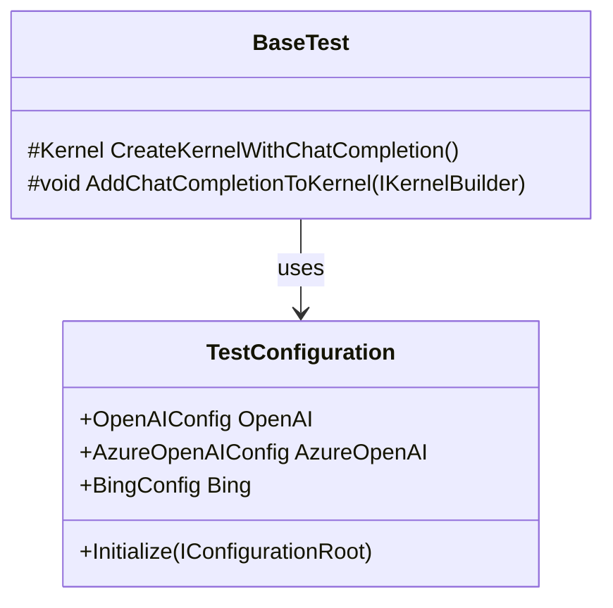

<!-- source: DeepWiki mcp.deepwiki.com · repo microsoft/semantic-kernel · page 7.2 Sample Applications and Getting Started · fetched 2026-10-26 -->

# Sample Applications and Getting Started

Relevant source files

The following files were used as context for generating this wiki page:

- [dotnet/notebooks/00-getting-started.ipynb](dotnet/notebooks/00-getting-started.ipynb)
- [dotnet/notebooks/01-basic-loading-the-kernel.ipynb](dotnet/notebooks/01-basic-loading-the-kernel.ipynb)
- [dotnet/notebooks/02-running-prompts-from-file.ipynb](dotnet/notebooks/02-running-prompts-from-file.ipynb)
- [dotnet/notebooks/03-semantic-function-inline.ipynb](dotnet/notebooks/03-semantic-function-inline.ipynb)
- [dotnet/notebooks/04-kernel-arguments-chat.ipynb](dotnet/notebooks/04-kernel-arguments-chat.ipynb)
- [dotnet/notebooks/07-DALL-E-3.ipynb](dotnet/notebooks/07-DALL-E-3.ipynb)
- [dotnet/notebooks/08-chatGPT-with-DALL-E-3.ipynb](dotnet/notebooks/08-chatGPT-with-DALL-E-3.ipynb)
- [dotnet/samples/Concepts/Agents/OpenAIAssistant_Templating.cs](dotnet/samples/Concepts/Agents/OpenAIAssistant_Templating.cs)
- [dotnet/samples/Concepts/ChatCompletion/Onnx_ChatCompletion.cs](dotnet/samples/Concepts/ChatCompletion/Onnx_ChatCompletion.cs)
- [dotnet/samples/Concepts/ChatCompletion/Onnx_ChatCompletionStreaming.cs](dotnet/samples/Concepts/ChatCompletion/Onnx_ChatCompletionStreaming.cs)
- [dotnet/samples/Concepts/ChatCompletion/OpenAI_ReasonedFunctionCalling.cs](dotnet/samples/Concepts/ChatCompletion/OpenAI_ReasonedFunctionCalling.cs)
- [dotnet/samples/Concepts/ChatCompletion/OpenAI_RepeatedFunctionCalling.cs](dotnet/samples/Concepts/ChatCompletion/OpenAI_RepeatedFunctionCalling.cs)
- [dotnet/samples/Concepts/Memory/Onnx_EmbeddingGeneration.cs](dotnet/samples/Concepts/Memory/Onnx_EmbeddingGeneration.cs)
- [dotnet/samples/Concepts/PromptTemplates/ChatLoopWithPrompt.cs](dotnet/samples/Concepts/PromptTemplates/ChatLoopWithPrompt.cs)
- [dotnet/samples/Concepts/PromptTemplates/SafeChatPrompts.cs](dotnet/samples/Concepts/PromptTemplates/SafeChatPrompts.cs)
- [dotnet/samples/Demos/AgentFrameworkWithAspire/ChatWithAgent.ApiService/Controllers/AgentCompletionsController.cs](dotnet/samples/Demos/AgentFrameworkWithAspire/ChatWithAgent.ApiService/Controllers/AgentCompletionsController.cs)
- [dotnet/samples/Demos/OnnxSimpleRAG/Facts/KernelMemory.txt](dotnet/samples/Demos/OnnxSimpleRAG/Facts/KernelMemory.txt)
- [dotnet/samples/Demos/OnnxSimpleRAG/Facts/SemanticKernel.txt](dotnet/samples/Demos/OnnxSimpleRAG/Facts/SemanticKernel.txt)
- [dotnet/samples/Demos/OnnxSimpleRAG/OnnxSimpleRAG.csproj](dotnet/samples/Demos/OnnxSimpleRAG/OnnxSimpleRAG.csproj)
- [dotnet/samples/Demos/OnnxSimpleRAG/Program.cs](dotnet/samples/Demos/OnnxSimpleRAG/Program.cs)
- [dotnet/samples/Demos/ProcessFrameworkWithSignalR/src/ProcessFramework.Aspire.SignalR.ReactFrontend/package-lock.json](dotnet/samples/Demos/ProcessFrameworkWithSignalR/src/ProcessFramework.Aspire.SignalR.ReactFrontend/package-lock.json)
- [dotnet/samples/Demos/ProcessFrameworkWithSignalR/src/ProcessFramework.Aspire.SignalR.ReactFrontend/package.json](dotnet/samples/Demos/ProcessFrameworkWithSignalR/src/ProcessFramework.Aspire.SignalR.ReactFrontend/package.json)
- [dotnet/samples/Demos/ProcessFrameworkWithSignalR/src/ProcessFramework.Aspire.SignalR.ReactFrontend/src/components/GenerateDocumentsChat.tsx](dotnet/samples/Demos/ProcessFrameworkWithSignalR/src/ProcessFramework.Aspire.SignalR.ReactFrontend/src/components/GenerateDocumentsChat.tsx)
- [dotnet/samples/Demos/ProcessFrameworkWithSignalR/src/ProcessFramework.Aspire.SignalR.ReactFrontend/src/services/signalr/documentGeneration.client.ts](dotnet/samples/Demos/ProcessFrameworkWithSignalR/src/ProcessFramework.Aspire.SignalR.ReactFrontend/src/services/signalr/documentGeneration.client.ts)
- [dotnet/samples/Demos/ProcessFrameworkWithSignalR/src/ProcessFramework.Aspire.SignalR.ReactFrontend/yarn.lock](dotnet/samples/Demos/ProcessFrameworkWithSignalR/src/ProcessFramework.Aspire.SignalR.ReactFrontend/yarn.lock)
- [dotnet/samples/Demos/ProcessWithCloudEvents/ProcessWithCloudEvents.Client/package-lock.json](dotnet/samples/Demos/ProcessWithCloudEvents/ProcessWithCloudEvents.Client/package-lock.json)
- [dotnet/samples/Demos/ProcessWithCloudEvents/ProcessWithCloudEvents.Client/package.json](dotnet/samples/Demos/ProcessWithCloudEvents/ProcessWithCloudEvents.Client/package.json)
- [dotnet/samples/Demos/ProcessWithCloudEvents/ProcessWithCloudEvents.Client/src/App.tsx](dotnet/samples/Demos/ProcessWithCloudEvents/ProcessWithCloudEvents.Client/src/App.tsx)
- [dotnet/samples/Demos/ProcessWithCloudEvents/ProcessWithCloudEvents.Client/src/components/GenerateDocumentsChat.tsx](dotnet/samples/Demos/ProcessWithCloudEvents/ProcessWithCloudEvents.Client/src/components/GenerateDocumentsChat.tsx)
- [dotnet/samples/Demos/ProcessWithCloudEvents/ProcessWithCloudEvents.Client/yarn.lock](dotnet/samples/Demos/ProcessWithCloudEvents/ProcessWithCloudEvents.Client/yarn.lock)
- [dotnet/samples/GettingStartedWithAgents/AzureAIAgent/Step01_AzureAIAgent.cs](dotnet/samples/GettingStartedWithAgents/AzureAIAgent/Step01_AzureAIAgent.cs)
- [dotnet/samples/GettingStartedWithAgents/AzureAIAgent/Step02_AzureAIAgent_Plugins.cs](dotnet/samples/GettingStartedWithAgents/AzureAIAgent/Step02_AzureAIAgent_Plugins.cs)
- [dotnet/samples/GettingStartedWithAgents/AzureAIAgent/Step04_AzureAIAgent_CodeInterpreter.cs](dotnet/samples/GettingStartedWithAgents/AzureAIAgent/Step04_AzureAIAgent_CodeInterpreter.cs)
- [dotnet/samples/GettingStartedWithAgents/AzureAIAgent/Step05_AzureAIAgent_FileSearch.cs](dotnet/samples/GettingStartedWithAgents/AzureAIAgent/Step05_AzureAIAgent_FileSearch.cs)
- [dotnet/samples/GettingStartedWithAgents/AzureAIAgent/Step06_AzureAIAgent_OpenAPI.cs](dotnet/samples/GettingStartedWithAgents/AzureAIAgent/Step06_AzureAIAgent_OpenAPI.cs)
- [dotnet/samples/GettingStartedWithAgents/AzureAIAgent/Step07_AzureAIAgent_Functions.cs](dotnet/samples/GettingStartedWithAgents/AzureAIAgent/Step07_AzureAIAgent_Functions.cs)
- [dotnet/samples/GettingStartedWithAgents/OpenAIAssistant/Step01_Assistant.cs](dotnet/samples/GettingStartedWithAgents/OpenAIAssistant/Step01_Assistant.cs)
- [dotnet/samples/GettingStartedWithAgents/OpenAIAssistant/Step02_Assistant_Plugins.cs](dotnet/samples/GettingStartedWithAgents/OpenAIAssistant/Step02_Assistant_Plugins.cs)
- [dotnet/samples/GettingStartedWithAgents/OpenAIAssistant/Step03_Assistant_Vision.cs](dotnet/samples/GettingStartedWithAgents/OpenAIAssistant/Step03_Assistant_Vision.cs)
- [dotnet/samples/GettingStartedWithAgents/OpenAIAssistant/Step04_AssistantTool_CodeInterpreter.cs](dotnet/samples/GettingStartedWithAgents/OpenAIAssistant/Step04_AssistantTool_CodeInterpreter.cs)
- [dotnet/samples/GettingStartedWithAgents/OpenAIAssistant/Step05_AssistantTool_FileSearch.cs](dotnet/samples/GettingStartedWithAgents/OpenAIAssistant/Step05_AssistantTool_FileSearch.cs)
- [dotnet/samples/GettingStartedWithAgents/Plugins/MenuPlugin.cs](dotnet/samples/GettingStartedWithAgents/Plugins/MenuPlugin.cs)
- [dotnet/samples/GettingStartedWithAgents/Step01_Agent.cs](dotnet/samples/GettingStartedWithAgents/Step01_Agent.cs)
- [dotnet/samples/GettingStartedWithAgents/Step02_Plugins.cs](dotnet/samples/GettingStartedWithAgents/Step02_Plugins.cs)
- [dotnet/samples/GettingStartedWithTextSearch/GettingStartedWithTextSearch.csproj](dotnet/samples/GettingStartedWithTextSearch/GettingStartedWithTextSearch.csproj)
- [dotnet/samples/GettingStartedWithVectorStores/GettingStartedWithVectorStores.csproj](dotnet/samples/GettingStartedWithVectorStores/GettingStartedWithVectorStores.csproj)
- [dotnet/src/Agents/OpenAI/Extensions/OpenAIClientExtensions.cs](dotnet/src/Agents/OpenAI/Extensions/OpenAIClientExtensions.cs)
- [dotnet/src/Agents/UnitTests/AgentTests.cs](dotnet/src/Agents/UnitTests/AgentTests.cs)
- [dotnet/src/Agents/UnitTests/OpenAI/Extensions/OpenAIClientExtensionsTests.cs](dotnet/src/Agents/UnitTests/OpenAI/Extensions/OpenAIClientExtensionsTests.cs)
- [dotnet/src/InternalUtilities/samples/InternalUtilities/BaseTest.cs](dotnet/src/InternalUtilities/samples/InternalUtilities/BaseTest.cs)
- [dotnet/test/VectorData/VectorData.ConformanceTests/VectorData.ConformanceTests.csproj](dotnet/test/VectorData/VectorData.ConformanceTests/VectorData.ConformanceTests.csproj)
- [python/samples/SAMPLE_GUIDELINES.md](python/samples/SAMPLE_GUIDELINES.md)
- [python/samples/concepts/auto_function_calling/chat_completion_with_auto_function_calling.py](python/samples/concepts/auto_function_calling/chat_completion_with_auto_function_calling.py)
- [python/samples/concepts/auto_function_calling/chat_completion_with_auto_function_calling_streaming.py](python/samples/concepts/auto_function_calling/chat_completion_with_auto_function_calling_streaming.py)
- [python/samples/concepts/auto_function_calling/chat_completion_with_manual_function_calling.py](python/samples/concepts/auto_function_calling/chat_completion_with_manual_function_calling.py)
- [python/samples/concepts/auto_function_calling/chat_completion_with_manual_function_calling_streaming.py](python/samples/concepts/auto_function_calling/chat_completion_with_manual_function_calling_streaming.py)
- [python/samples/concepts/chat_completion/simple_chatbot.py](python/samples/concepts/chat_completion/simple_chatbot.py)
- [python/samples/concepts/chat_completion/simple_chatbot_kernel_function.py](python/samples/concepts/chat_completion/simple_chatbot_kernel_function.py)
- [python/samples/concepts/chat_completion/simple_chatbot_logit_bias.py](python/samples/concepts/chat_completion/simple_chatbot_logit_bias.py)
- [python/samples/concepts/chat_completion/simple_chatbot_streaming.py](python/samples/concepts/chat_completion/simple_chatbot_streaming.py)
- [python/samples/concepts/chat_completion/simple_chatbot_with_image.py](python/samples/concepts/chat_completion/simple_chatbot_with_image.py)
- [python/samples/concepts/chat_history/README.md](python/samples/concepts/chat_history/README.md)
- [python/samples/concepts/chat_history/serialize_chat_history.py](python/samples/concepts/chat_history/serialize_chat_history.py)
- [python/samples/concepts/chat_history/store_chat_history_in_cosmosdb.py](python/samples/concepts/chat_history/store_chat_history_in_cosmosdb.py)
- [python/samples/concepts/setup/chat_completion_services.py](python/samples/concepts/setup/chat_completion_services.py)
- [python/samples/getting_started/00-getting-started.ipynb](python/samples/getting_started/00-getting-started.ipynb)
- [python/samples/getting_started/01-basic-loading-the-kernel.ipynb](python/samples/getting_started/01-basic-loading-the-kernel.ipynb)
- [python/samples/getting_started/02-running-prompts-from-file.ipynb](python/samples/getting_started/02-running-prompts-from-file.ipynb)
- [python/samples/getting_started/03-prompt-function-inline.ipynb](python/samples/getting_started/03-prompt-function-inline.ipynb)
- [python/samples/getting_started/04-kernel-arguments-chat.ipynb](python/samples/getting_started/04-kernel-arguments-chat.ipynb)
- [python/semantic_kernel/contents/kernel_content.py](python/semantic_kernel/contents/kernel_content.py)

This document covers the sample applications, tutorials, and getting started resources available in the Semantic Kernel repository. These samples demonstrate practical usage patterns, configuration approaches, and implementation examples across both .NET and Python implementations of Semantic Kernel.

For information about the core architecture and components, see [Architecture](#2). For development environment setup and CI/CD processes, see [CI/CD and Build System](#7.1).

## Overview

The Semantic Kernel repository provides comprehensive sample applications organized by programming language and complexity level. The samples serve multiple purposes: demonstrating feature usage, providing getting started tutorials, and showcasing real-world implementation patterns.

**Sample Organization by Language and Purpose**

Sources: [dotnet/samples/Concepts/README.md:1-323](), [python/samples/getting_started/00-getting-started.ipynb:1-242](), [.vscode/tasks.json:1-325]()

## .NET Sample Applications

The .NET samples are organized into several distinct categories, each serving different learning objectives and complexity levels.

### Concepts Samples

The `Concepts` project provides the most comprehensive collection of .NET examples, organized by Semantic Kernel features and capabilities. It utilizes a `BaseTest` class to handle common setup tasks like kernel creation and AI service registration [dotnet/src/InternalUtilities/samples/InternalUtilities/BaseTest.cs:15-70]().

**Major Sample Categories in .NET Concepts**

| Category | Examples | Purpose |
|----------|----------|---------|
| **Agents** | `OpenAIAssistant_Templating` | Demonstrates templating for OpenAI assistants [dotnet/samples/Concepts/Agents/OpenAIAssistant_Templating.cs:1-15](). |
| **ChatCompletion** | `OpenAI_ReasonedFunctionCalling`, `Onnx_ChatCompletion` | Covers advanced reasoning models and local ONNX execution [dotnet/samples/Concepts/ChatCompletion/OpenAI_ReasonedFunctionCalling.cs:1-20](), [dotnet/samples/Concepts/ChatCompletion/Onnx_ChatCompletion.cs:1-25](). |
| **Processes** | `ProcessFrameworkWithSignalR` | Stateful, event-driven workflows with SignalR UI [dotnet/samples/Demos/ProcessFrameworkWithSignalR/src/ProcessFramework.Aspire.SignalR.ReactFrontend/package.json:1-20](). |
| **Templates** | `ChatLoopWithPrompt`, `SafeChatPrompts` | Shows prompt rendering and safety filtering [dotnet/samples/Concepts/PromptTemplates/ChatLoopWithPrompt.cs:1-20](), [dotnet/samples/Concepts/PromptTemplates/SafeChatPrompts.cs:1-15](). |

Sources: [dotnet/samples/Concepts/README.md:19-239](), [dotnet/src/InternalUtilities/samples/InternalUtilities/BaseTest.cs:52-94](), [dotnet/samples/Concepts/ChatCompletion/Onnx_ChatCompletion.cs:1-40]()

### Getting Started with Agents and Processes

Specialized directories provide step-by-step guides for the Agent and Process frameworks.
- **Agents**: Progression from simple agents to plugins and specific providers like `AzureAIAgent` and `OpenAIAssistant` [dotnet/samples/GettingStartedWithAgents/Step01_Agent.cs:1-20](), [dotnet/samples/GettingStartedWithAgents/AzureAIAgent/Step01_AzureAIAgent.cs:1-25]().
- **Processes**: Demonstrates the `KernelProcess` framework for modeling multi-step AI workflows [dotnet/samples/Demos/ProcessWithCloudEvents/ProcessWithCloudEvents.Client/package.json:1-20]().

### Demo Applications

- **ProcessFrameworkWithSignalR**: A complex demo using .NET Aspire and React to visualize AI processes in real-time [dotnet/samples/Demos/ProcessFrameworkWithSignalR/src/ProcessFramework.Aspire.SignalR.ReactFrontend/src/components/GenerateDocumentsChat.tsx:1-50]().
- **OnnxSimpleRAG**: Local RAG implementation using ONNX models [dotnet/samples/Demos/OnnxSimpleRAG/Program.cs:1-30]().
- **TelemetryWithAppInsights**: Demonstrates observability and tracing integration.

Sources: [dotnet/samples/Demos/ProcessFrameworkWithSignalR/src/ProcessFramework.Aspire.SignalR.ReactFrontend/package.json:1-39](), [dotnet/samples/Demos/OnnxSimpleRAG/Program.cs:1-50]()

## Python Sample Applications

Python samples use Jupyter notebooks and specific scripts to demonstrate `Kernel` orchestration.

### Getting Started Notebooks

Notebooks guide users from installation to building a chatbot with history.

| Notebook | Focus | Key Operations |
|----------|-------|--------------|
| `00-getting-started.ipynb` | Setup | Kernel instantiation and `FunPlugin` invocation [python/samples/getting_started/00-getting-started.ipynb:114-218](). |
| `02-running-prompts-from-file.ipynb` | File Plugins | Loading `skprompt.txt` and `config.json` from directory [python/samples/getting_started/02-running-prompts-from-file.ipynb:165-195](). |
| `03-prompt-function-inline.ipynb` | Inline Prompts | Creating functions directly from strings [python/samples/getting_started/03-prompt-function-inline.ipynb:121-161](). |
| `04-kernel-arguments-chat.ipynb` | Context | Using `KernelArguments` to manage `{{$history}}` [python/samples/getting_started/04-kernel-arguments-chat.ipynb:193-210](). |

Sources: [python/samples/getting_started/00-getting-started.ipynb:1-220](), [python/samples/getting_started/02-running-prompts-from-file.ipynb:1-200]()

### Learn Resources and Concepts
Python samples also include `concepts/` scripts for:
- **Auto Function Calling**: Using `chat_completion_with_auto_function_calling.py`.
- **Streaming**: Implementing real-time response generation in `simple_chatbot_streaming.py`.
- **Multimodal**: Handling images in `simple_chatbot_with_image.py`.

Sources: [python/samples/concepts/auto_function_calling/chat_completion_with_auto_function_calling.py:1-30](), [python/samples/concepts/chat_completion/simple_chatbot_streaming.py:1-25]()

## Prompt Template Samples Directory

The `prompt_template_samples/` directory is a shared resource across languages containing reusable prompt definitions.

- **FunPlugin**: Contains the `Joke` function with `skprompt.txt` and `config.json` [python/samples/getting_started/02-running-prompts-from-file.ipynb:19-195]().
- **WriterPlugin**: Includes templates for document generation and summarization.

Sources: [python/samples/getting_started/00-getting-started.ipynb:200-218](), [dotnet/notebooks/00-getting-started.ipynb:140-155]()

## Configuration Management

### .NET Configuration System

The `TestConfiguration` utility manages service credentials for all .NET samples [dotnet/src/InternalUtilities/samples/InternalUtilities/TestConfiguration.cs:8-81]().

Sources: [dotnet/src/InternalUtilities/samples/InternalUtilities/TestConfiguration.cs:8-81](), [dotnet/src/InternalUtilities/samples/InternalUtilities/BaseTest.cs:15-94]()

### Python Configuration System

Python samples rely on `ServiceSettings` and `.env` files [python/samples/getting_started/00-getting-started.ipynb:56-98]().

1.  **Environment Setup**: Copy `.env.example` to `.env`.
2.  **Service Selection**: `GLOBAL_LLM_SERVICE` determines if `OpenAIChatCompletion` or `AzureChatCompletion` is registered [python/samples/getting_started/00-getting-started.ipynb:132-182]().

Sources: [python/samples/getting_started/00-getting-started.ipynb:56-182]()

## Running Samples

### Command Line (.NET)
- **Run Concept**: `dotnet run --project dotnet/samples/Concepts/Concepts.csproj <SampleName>`
- **Run Agent Sample**: `dotnet run --project dotnet/samples/GettingStartedWithAgents/GettingStartedWithAgents.csproj`

### Jupyter Notebooks
Both .NET and Python support interactive notebooks.
- **.NET**: Requires .NET 10 SDK and Polyglot Notebooks extension [dotnet/notebooks/00-getting-started.ipynb:8-12]().
- **Python**: Requires `semantic-kernel` package and standard Jupyter environment [python/samples/getting_started/00-getting-started.ipynb:19-25]().

Sources: [dotnet/notebooks/00-getting-started.ipynb:1-65](), [python/samples/getting_started/00-getting-started.ipynb:1-50]()

---

