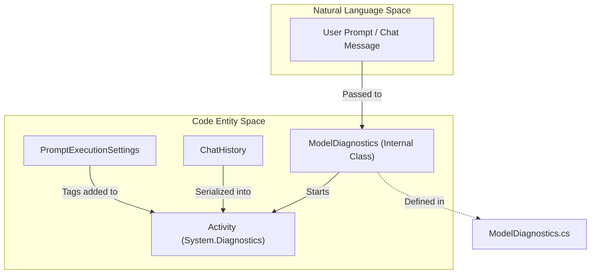
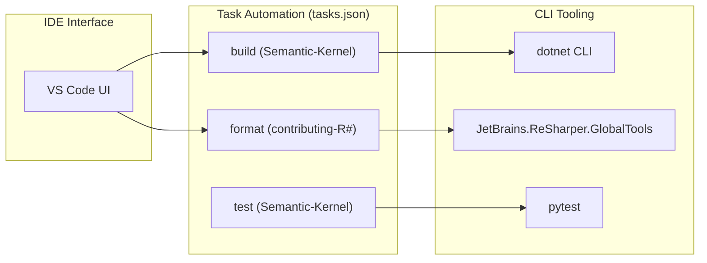

<!-- source: DeepWiki mcp.deepwiki.com · repo microsoft/semantic-kernel · page 7.3 Configuration and Setup · fetched 2026-10-26 -->

# Configuration and Setup

Relevant source files

The following files were used as context for generating this wiki page:

- [.vscode/extensions.json](.vscode/extensions.json)
- [.vscode/launch.json](.vscode/launch.json)
- [.vscode/settings.json](.vscode/settings.json)
- [.vscode/tasks.json](.vscode/tasks.json)
- [dotnet/samples/Demos/ProcessWithDapr/Controllers/ProcessController.cs](dotnet/samples/Demos/ProcessWithDapr/Controllers/ProcessController.cs)
- [dotnet/samples/Demos/ProcessWithDapr/ProcessWithDapr.csproj](dotnet/samples/Demos/ProcessWithDapr/ProcessWithDapr.csproj)
- [dotnet/samples/Demos/ProcessWithDapr/README.md](dotnet/samples/Demos/ProcessWithDapr/README.md)
- [dotnet/samples/Demos/TelemetryWithAppInsights/Program.cs](dotnet/samples/Demos/TelemetryWithAppInsights/Program.cs)
- [dotnet/samples/Demos/TelemetryWithAppInsights/README.md](dotnet/samples/Demos/TelemetryWithAppInsights/README.md)
- [dotnet/samples/Demos/TelemetryWithAppInsights/TelemetryWithAppInsights.csproj](dotnet/samples/Demos/TelemetryWithAppInsights/TelemetryWithAppInsights.csproj)
- [dotnet/samples/Demos/TelemetryWithAppInsights/TestConfiguration.cs](dotnet/samples/Demos/TelemetryWithAppInsights/TestConfiguration.cs)
- [dotnet/samples/GettingStartedWithProcesses/Step04/Steps/RenderMessageStep.cs](dotnet/samples/GettingStartedWithProcesses/Step04/Steps/RenderMessageStep.cs)
- [dotnet/src/Connectors/Connectors.AzureAIInference.UnitTests/Services/AzureAIInferenceChatCompletionServiceOpenTelemetryTests.cs](dotnet/src/Connectors/Connectors.AzureAIInference.UnitTests/Services/AzureAIInferenceChatCompletionServiceOpenTelemetryTests.cs)
- [dotnet/src/Connectors/Connectors.AzureAIInference/Extensions/AzureAIInferenceKernelBuilderExtensions.cs](dotnet/src/Connectors/Connectors.AzureAIInference/Extensions/AzureAIInferenceKernelBuilderExtensions.cs)
- [dotnet/src/Connectors/Connectors.OpenAI/Core/ClientCore.TextToImage.cs](dotnet/src/Connectors/Connectors.OpenAI/Core/ClientCore.TextToImage.cs)
- [dotnet/src/Connectors/Connectors.OpenAI/Services/OpenAITextToImageService.cs](dotnet/src/Connectors/Connectors.OpenAI/Services/OpenAITextToImageService.cs)
- [dotnet/src/Connectors/Connectors.OpenAI/Settings/OpenAITextToImageExecutionSettings.cs](dotnet/src/Connectors/Connectors.OpenAI/Settings/OpenAITextToImageExecutionSettings.cs)
- [dotnet/src/Experimental/Orchestration.Flow.IntegrationTests/README.md](dotnet/src/Experimental/Orchestration.Flow.IntegrationTests/README.md)
- [dotnet/src/Experimental/Orchestration.Flow.IntegrationTests/testsettings.json](dotnet/src/Experimental/Orchestration.Flow.IntegrationTests/testsettings.json)
- [dotnet/src/Experimental/Process.Abstractions/KernelProcessStepContext.cs](dotnet/src/Experimental/Process.Abstractions/KernelProcessStepContext.cs)
- [dotnet/src/Experimental/Process.Runtime.Dapr/DaprProcessInfo.cs](dotnet/src/Experimental/Process.Runtime.Dapr/DaprProcessInfo.cs)
- [dotnet/src/Experimental/Process.Runtime.Dapr/KernelProcessDaprExtensions.cs](dotnet/src/Experimental/Process.Runtime.Dapr/KernelProcessDaprExtensions.cs)
- [dotnet/src/IntegrationTests/Connectors/AzureOpenAI/AzureOpenAITextToImageTests.cs](dotnet/src/IntegrationTests/Connectors/AzureOpenAI/AzureOpenAITextToImageTests.cs)
- [dotnet/src/IntegrationTests/Connectors/OpenAI/OpenAITextToImageTests.cs](dotnet/src/IntegrationTests/Connectors/OpenAI/OpenAITextToImageTests.cs)
- [dotnet/src/IntegrationTests/README.md](dotnet/src/IntegrationTests/README.md)
- [dotnet/src/IntegrationTests/TestSettings/AzureOpenAIConfiguration.cs](dotnet/src/IntegrationTests/TestSettings/AzureOpenAIConfiguration.cs)
- [dotnet/src/IntegrationTests/TestSettings/OpenAIConfiguration.cs](dotnet/src/IntegrationTests/TestSettings/OpenAIConfiguration.cs)
- [dotnet/src/IntegrationTests/prompts/GenerateStory.yaml](dotnet/src/IntegrationTests/prompts/GenerateStory.yaml)
- [dotnet/src/IntegrationTests/prompts/GenerateStoryHandlebars.yaml](dotnet/src/IntegrationTests/prompts/GenerateStoryHandlebars.yaml)
- [dotnet/src/IntegrationTests/testsettings.json](dotnet/src/IntegrationTests/testsettings.json)
- [dotnet/src/InternalUtilities/src/Diagnostics/ActivityExtensions.cs](dotnet/src/InternalUtilities/src/Diagnostics/ActivityExtensions.cs)
- [dotnet/src/InternalUtilities/src/Diagnostics/ModelDiagnostics.cs](dotnet/src/InternalUtilities/src/Diagnostics/ModelDiagnostics.cs)
- [java/README.md](java/README.md)
- [python/.env.example](python/.env.example)
- [python/.pre-commit-config.yaml](python/.pre-commit-config.yaml)
- [python/LICENSE](python/LICENSE)
- [python/Makefile](python/Makefile)
- [python/samples/__init__.py](python/samples/__init__.py)
- [python/samples/getting_started/.env.example](python/samples/getting_started/.env.example)
- [python/samples/getting_started/third_party/.env.example](python/samples/getting_started/third_party/.env.example)
- [python/samples/getting_started_with_agents/multi_agent_orchestration/observability.py](python/samples/getting_started_with_agents/multi_agent_orchestration/observability.py)
- [python/samples/getting_started_with_agents/multi_agent_orchestration/step4c_handoff_mix_agent_types.py](python/samples/getting_started_with_agents/multi_agent_orchestration/step4c_handoff_mix_agent_types.py)
- [python/samples/learn_resources/.env.example](python/samples/learn_resources/.env.example)
- [python/samples/learn_resources/README.md](python/samples/learn_resources/README.md)
- [python/samples/learn_resources/ai_services.py](python/samples/learn_resources/ai_services.py)
- [python/samples/learn_resources/configuring_prompts.py](python/samples/learn_resources/configuring_prompts.py)
- [python/samples/learn_resources/creating_functions.py](python/samples/learn_resources/creating_functions.py)
- [python/samples/learn_resources/evaluate_with_prompt_flow.py](python/samples/learn_resources/evaluate_with_prompt_flow.py)
- [python/samples/learn_resources/functions_within_prompts.py](python/samples/learn_resources/functions_within_prompts.py)
- [python/samples/learn_resources/plugin.py](python/samples/learn_resources/plugin.py)
- [python/samples/learn_resources/plugins/MathPlugin/Math.py](python/samples/learn_resources/plugins/MathPlugin/Math.py)
- [python/samples/learn_resources/serializing_prompts.py](python/samples/learn_resources/serializing_prompts.py)
- [python/samples/learn_resources/templates.py](python/samples/learn_resources/templates.py)
- [python/samples/learn_resources/using_the_kernel.py](python/samples/learn_resources/using_the_kernel.py)
- [python/samples/learn_resources/your_first_prompt.py](python/samples/learn_resources/your_first_prompt.py)
- [python/semantic_kernel/__init__.py](python/semantic_kernel/__init__.py)
- [python/semantic_kernel/functions/kernel_arguments.py](python/semantic_kernel/functions/kernel_arguments.py)
- [python/semantic_kernel/utils/telemetry/model_diagnostics/function_tracer.py](python/semantic_kernel/utils/telemetry/model_diagnostics/function_tracer.py)
- [python/semantic_kernel/utils/telemetry/model_diagnostics/gen_ai_attributes.py](python/semantic_kernel/utils/telemetry/model_diagnostics/gen_ai_attributes.py)
- [python/tests/unit/functions/test_kernel_arguments.py](python/tests/unit/functions/test_kernel_arguments.py)
- [python/tests/unit/utils/agent_diagnostics/conftest.py](python/tests/unit/utils/agent_diagnostics/conftest.py)

This document covers development environment setup, configuration management, and tooling for the Semantic Kernel repository. It provides detailed guidance for developers working with both .NET and Python implementations, focusing on local setup, integration test configuration, and IDE integration.

## .NET Development Setup

The .NET implementation of Semantic Kernel uses a standard MSBuild-based structure with specialized tooling for code quality and integration testing.

### Local Configuration Management

Developers can configure their environment using two primary methods for managing sensitive AI service credentials:

1.  **Secret Manager (Recommended)**: Uses the .NET `user-secrets` tool to store credentials outside the source tree.
    *   Initialize: `dotnet user-secrets init` within `dotnet/src/IntegrationTests` [[dotnet/src/IntegrationTests/README.md:41-43]]().
    *   Set Secrets: Use `dotnet user-secrets set "Service:Key" "Value"` for services like `OpenAI`, `AzureOpenAI`, and `Bing` [[dotnet/src/IntegrationTests/README.md:45-101]]().
2.  **Configuration Files**: A `testsettings.json` file provides defaults, while a `testsettings.development.json` (ignored by git) can be used for local overrides [[dotnet/src/IntegrationTests/README.md:103-112]]().

### Integration Test Configuration (`TestConfiguration.cs`)

The integration tests rely on a centralized configuration system defined in `TestConfiguration.cs`. This class reads from the configuration providers and maps them to typed configuration objects.

| Configuration Class | Purpose | Key Properties |
| :--- | :--- | :--- |
| `OpenAIConfiguration` | OpenAI Service Settings | `ModelId`, `ChatModelId`, `ApiKey` [[dotnet/src/IntegrationTests/TestSettings/OpenAIConfiguration.cs:10-25]]() |
| `AzureOpenAIConfiguration` | Azure OpenAI Settings | `DeploymentName`, `Endpoint`, `ApiKey` [[dotnet/src/IntegrationTests/TestSettings/AzureOpenAIConfiguration.cs:12-32]]() |

### Model Diagnostics and Telemetry

Semantic Kernel supports OpenTelemetry (OTel) for tracing AI model activities. This is controlled via AppContext switches or environment variables:
*   **Enable Diagnostics**: `SEMANTICKERNEL_EXPERIMENTAL_GENAI_ENABLE_OTEL_DIAGNOSTICS` [[dotnet/src/InternalUtilities/src/Diagnostics/ModelDiagnostics.cs:32-35]]().
*   **Sensitive Data**: `SEMANTICKERNEL_EXPERIMENTAL_GENAI_ENABLE_OTEL_DIAGNOSTICS_SENSITIVE` allows tracing of prompts and messages [[dotnet/src/InternalUtilities/src/Diagnostics/ModelDiagnostics.cs:33-36]]().

**Sources:** [dotnet/src/InternalUtilities/src/Diagnostics/ModelDiagnostics.cs:25-144](), [dotnet/samples/Demos/TelemetryWithAppInsights/Program.cs:40-41]()

---

## Python Development Setup

The Python implementation emphasizes a streamlined environment using `uv` or `poetry` and standard `.env` files for configuration.

### Environment Configuration (`.env`)

Python samples and tests use `python-dotenv` to load configurations. A template is provided in `python/.env.example` [[python/.env.example:1-40]]().

**Key Variables:**
*   `OPENAI_API_KEY`: Global key for OpenAI services [[python/.env.example:1]]().
*   `AZURE_OPENAI_ENDPOINT`: Endpoint for Azure-hosted models [[python/.env.example:9]]().
*   `AZURE_AI_SEARCH_ENDPOINT`: Configuration for vector store integration [[python/.env.example:12]]().

### Tooling and Pre-commit Hooks

The Python environment uses a `Makefile` for common tasks and `pre-commit` for linting:
*   **Setup**: `make install` or `python DEV_SETUP.md` instructions.
*   **Formatting**: Uses `ruff` and `mypy` for static type checking.
*   **Hooks**: Configured in `.pre-commit-config.yaml` to run `ruff` and `check-yaml` before commits.

---

## IDE Integration (Visual Studio Code)

The repository provides deep integration for VS Code to unify the multi-language development experience.

### Tasks and Launch Configurations

`.vscode/tasks.json` defines complex build and test sequences:
*   **Setup Task**: `setup (contributing-R#)` installs ReSharper Global Tools [[.vscode/tasks.json:8-13]]().
*   **Format Task**: `format (contributing-R#)` runs `jb cleanupcode` using project-specific settings [[.vscode/tasks.json:62-78]]().
*   **Test Task**: `test (Semantic-Kernel)` executes unit tests with code coverage collection [[.vscode/tasks.json:115-129]]().

`.vscode/launch.json` provides debug targets:
*   **.NET Concepts**: `C#: Concept Samples` launches the main demo project [[.vscode/launch.json:21-34]]().
*   **Python Tests**: `Python: Test Module` runs `pytest` on the currently active file [[.vscode/launch.json:41-47]]().

**Sources:** [.vscode/tasks.json:1-200](), [.vscode/launch.json:1-74]()

### Recommended Extensions

The `.vscode/extensions.json` file suggests critical plugins:
*   `ms-dotnettools.csharp`: Primary C# support [[.vscode/extensions.json:6]]().
*   `ms-semantic-kernel.semantic-kernel`: Specialized tools for prompt engineering [[.vscode/extensions.json:10]]().
*   `ms-azuretools.vscode-dapr`: Support for Process Framework debugging [[.vscode/extensions.json:12]]().

---

## Testing Infrastructure

### .NET Test Settings (`testsettings.json`)

The `dotnet/src/IntegrationTests/testsettings.json` file serves as the schema for all external service integrations required for tests.

| Service | Configuration Block |
| :--- | :--- |
| **OpenAI** | `OpenAI` (ApiKey, ModelId) [[dotnet/src/IntegrationTests/testsettings.json:2-7]]() |
| **HuggingFace** | `HuggingFace` (ApiKey, Endpoints) [[dotnet/src/IntegrationTests/testsettings.json:65-73]]() |
| **Vector Stores** | `Postgres`, `MongoDB`, `AzureCosmosDBNoSQL` [[dotnet/src/IntegrationTests/testsettings.json:101-111]]() |

### Python Testing

Python tests are managed via `pytest` and configured to look in the `python/tests` directory [[.vscode/settings.json:86-88]](). Coverage is typically reported via `pytest-cov` as part of the CI pipeline or local `make` commands.

**Sources:** [.vscode/settings.json:86-89](), [dotnet/src/IntegrationTests/testsettings.json:1-139]()

---

