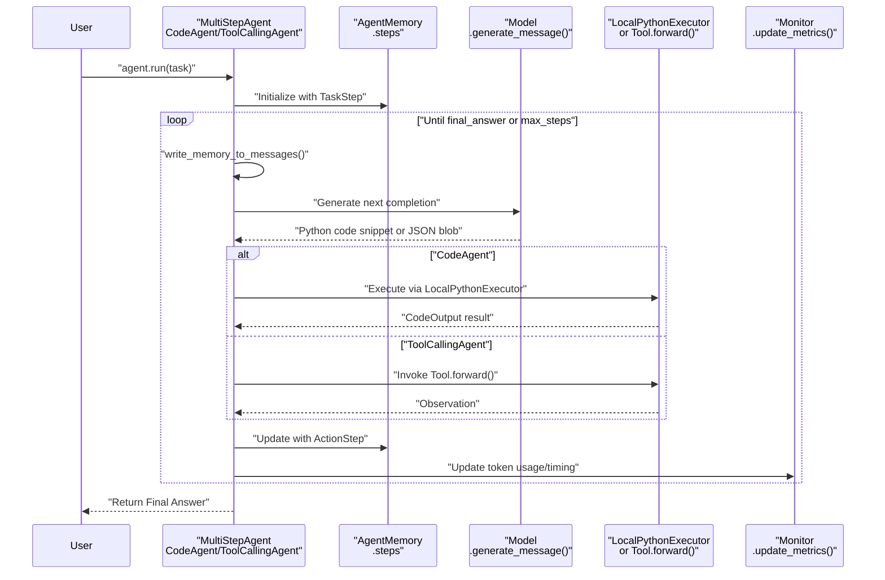
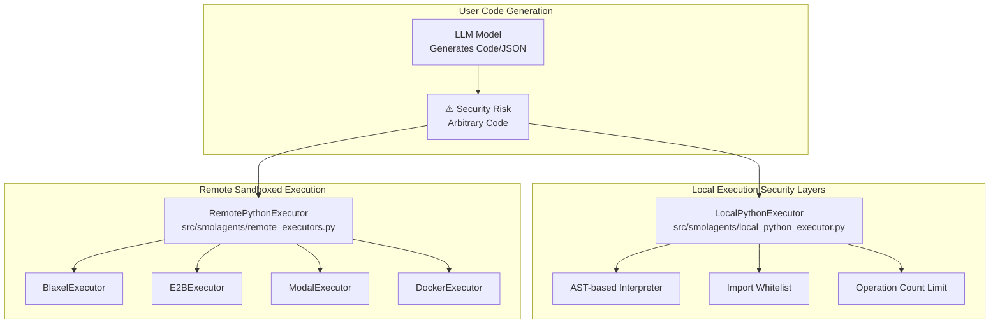

<!-- source: DeepWiki mcp.deepwiki.com · repo huggingface/smolagents · page 1 Overview · fetched 2026-10-26 -->

# Overview

Relevant source files

The following files were used as context for generating this wiki page:

- [README.md](README.md)
- [docs/source/en/examples/using_different_models.md](docs/source/en/examples/using_different_models.md)
- [docs/source/en/guided_tour.md](docs/source/en/guided_tour.md)
- [docs/source/en/index.md](docs/source/en/index.md)
- [docs/source/en/reference/models.md](docs/source/en/reference/models.md)
- [docs/source/en/tutorials/secure_code_execution.md](docs/source/en/tutorials/secure_code_execution.md)
- [pyproject.toml](pyproject.toml)
- [src/smolagents/__init__.py](src/smolagents/__init__.py)

This page describes the purpose, design philosophy, and high-level architecture of `smolagents`. It is a map for understanding how the library's subsystems fit together. For installation steps see page [2.1](), for a working first example see [2.2](), and for detailed definitions of individual concepts see [2.3]().

---

## What smolagents Is

`smolagents` is an open-source Python library designed to build and run agents with minimal code [docs/source/en/index.md:9](). Its design goal is minimal abstraction: the core agent logic fits in roughly 1,000 lines of code [README.md:36]().

The library is published on PyPI as `smolagents`. Its current version is defined in [src/smolagents/__init__.py:17]() and [pyproject.toml:7]().

The public API is a flat namespace: everything user-facing is re-exported from [src/smolagents/__init__.py]() via wildcard imports from submodules including `agents`, `models`, `tools`, and `memory` [src/smolagents/__init__.py:19-32]().

---

## Design Philosophy

Two principles drive every design decision:

1. **Code-centric actions.** Rather than having the LLM emit a JSON dictionary of tool names and arguments, `CodeAgent` has the LLM write Python code to invoke tools or perform computations [docs/source/en/index.md:15](). Research shows that code is a better way to express actions due to its composability, object management, and generality [docs/source/en/tutorials/secure_code_execution.md:10-22]().
2. **Minimal abstractions.** The library avoids large inheritance hierarchies. The agent loop, memory, and model interfaces are kept in their simplest forms [README.md:36]().

---

## The Two Agent Paradigms

`smolagents` provides two concrete agent implementations that both extend the base `MultiStepAgent` [src/smolagents/agents.py:268]().

| Agent class | How it acts | Execution target |
|---|---|---|
| `CodeAgent` | Generates tool calls as Python code snippets [docs/source/en/guided_tour.md:12]() | `LocalPythonExecutor` or a `RemotePythonExecutor` subclass |
| `ToolCallingAgent` | Writes tool calls as structured JSON [docs/source/en/guided_tour.md:29]() | `Tool.forward()` called directly |

**CodeAgent path:** The LLM output is parsed for code blocks, which are then executed by a `PythonExecutor`. This allows for complex logic, loops, and dynamic tool composition [docs/source/en/index.md:15]().

**ToolCallingAgent path:** The LLM output contains tool calls that follow the model's native tool-calling interface (JSON/text-based). This is preferred for scenarios where the standard tool-calling paradigm is required [docs/source/en/index.md:17]().

Sources: [src/smolagents/agents.py:268](), [docs/source/en/guided_tour.md:7-61](), [docs/source/en/index.md:15-17]()

---

## Major Subsystems

**Figure 1: Overall System Architecture**

```mermaid
graph TB
    subgraph UserInterfaces["User Interfaces"]
        CLI["smolagent CLI<br/>smolagents.cli"]
        Gradio["GradioUI<br/>smolagents.gradio_ui"]
        WebAgent["webagent<br/>smolagents.vision_web_browser"]
        API["Python API<br/>Direct Integration"]
    end
    
    subgraph CoreAgentSystem["Core Agent System"]
        MA["MultiStepAgent<br/>Base ReAct Framework<br/>src/smolagents/agents.py:268"]
        CA["CodeAgent<br/>Python Code Generation<br/>src/smolagents/agents.py"]
        TCA["ToolCallingAgent<br/>JSON Tool Calls<br/>src/smolagents/agents.py"]
    end
    
    subgraph ModelLayer["Model Layer"]
        ModelAbstraction["Model Interface<br/>src/smolagents/models.py"]
        Local["Local Models<br/>TransformersModel, MLXModel, VLLMModel"]
        Cloud["Cloud APIs<br/>OpenAIModel, LiteLLMModel, AzureOpenAIModel"]
        HF["Hugging Face<br/>InferenceClientModel"]
    end
    
    subgraph ToolSystem["Tool System"]
        ToolDef["Tool Definition<br/>@tool decorator / Tool class<br/>src/smolagents/tools.py"]
        DefaultTools["Default Tools<br/>src/smolagents/default_tools.py"]
        CustomTools["Custom Tools<br/>User-defined"]
        ToolCollections["ToolCollections<br/>Hub/MCP/LangChain"]
    end
    
    subgraph ExecutionEnvironments["Execution Environments"]
        LocalExec["LocalPythonExecutor<br/>AST-based Security<br/>src/smolagents/local_python_executor.py"]
        RemoteExec["RemotePythonExecutor<br/>Sandboxed Environments<br/>src/smolagents/remote_executors.py"]
        Blaxel["BlaxelExecutor"]
        E2B["E2BExecutor"]
        Docker["DockerExecutor"]
        Modal["ModalExecutor"]
    end
    
    subgraph StateObservability["State & Observability"]
        Memory["AgentMemory<br/>Execution History<br/>src/smolagents/memory.py"]
        Logger["AgentLogger<br/>Structured Logging<br/>src/smolagents/monitoring.py"]
        Monitor["Monitor<br/>Token/Time Metrics<br/>src/smolagents/monitoring.py"]
    end
    
    CLI --> MA
    Gradio --> MA
    WebAgent --> MA
    API --> MA
    
    MA --> CA
    MA --> TCA
    
    CA --> ModelAbstraction
    TCA --> ModelAbstraction
    
    ModelAbstraction --> Local
    ModelAbstraction --> Cloud
    ModelAbstraction --> HF
    
    CA --> ToolDef
    TCA --> ToolDef
    
    ToolDef --> DefaultTools
    ToolDef --> CustomTools
    ToolDef --> ToolCollections
    
    CA --> LocalExec
    CA --> RemoteExec
    
    RemoteExec --> Blaxel
    RemoteExec --> E2B
    RemoteExec --> Modal
    RemoteExec --> Docker
    
    MA --> Memory
    MA --> Logger
    MA --> Monitor
```

The system is organized into several major subsystems:
1. **User Interfaces**: CLI tools (`smolagent`, `webagent`), `GradioUI`, and direct Python API integration [pyproject.toml:139-141]().
2. **Core Agent System**: `MultiStepAgent` implements the ReAct (Reasoning + Acting) loop [src/smolagents/agents.py:268]().
3. **Model Layer**: Supports local inference (`TransformersModel`, `MLXModel`, `VLLMModel`) and cloud providers via `InferenceClientModel`, `LiteLLMModel`, `OpenAIModel`, `AzureOpenAIModel`, or `AmazonBedrockModel` [README.md:78-173]().
4. **Tool System**: Extensible framework supporting the `@tool` decorator, MCP servers, LangChain tools, and Hub integrations [README.md:46]().
5. **Execution Environments**: Multiple security levels from local AST-based execution to remote sandboxes like E2B, Blaxel, Modal, or Docker [README.md:38]().
6. **State & Observability**: Structured memory tracking steps (`AgentMemory`) and monitoring for token/timing metrics [src/smolagents/monitoring.py]().

Sources: [src/smolagents/__init__.py](), [src/smolagents/agents.py](), [src/smolagents/models.py](), [src/smolagents/tools.py](), [pyproject.toml:139-141]()

---

**Figure 2: Agent Execution Flow (Natural Language → Code Entities)**

Key architectural features:
- **Memory-Driven**: Every step is stored in `AgentMemory`, including `SystemPromptStep`, `TaskStep`, and `ActionStep` [src/smolagents/memory.py]().
- **ReAct Loop**: Implementation of the Reason + Act framework via `MultiStepAgent` [src/smolagents/agents.py:268]().
- **Monitoring**: Token usage and timing tracked via the `Monitor` class [src/smolagents/monitoring.py]().

Sources: [src/smolagents/agents.py](), [src/smolagents/memory.py](), [src/smolagents/monitoring.py]()

---

## Module Map

The following table maps each major concept to its primary source file.

| Concept | Module | Key classes / functions |
|---|---|---|
| Agent base & loop | `smolagents.agents` | `MultiStepAgent`, `CodeAgent`, `ToolCallingAgent` |
| Memory | `smolagents.memory` | `AgentMemory`, `ActionStep`, `PlanningStep`, `TaskStep` |
| Models | `smolagents.models` | `Model`, `InferenceClientModel`, `LiteLLMModel`, `OpenAIModel`, `TransformersModel`, `VLLMModel`, `MLXModel` |
| Tools | `smolagents.tools` | `Tool`, `ToolCollection`, `@tool` decorator |
| Built-in tools | `smolagents.default_tools` | `FinalAnswerTool`, `WebSearchTool`, `VisitWebpageTool` |
| Local execution | `smolagents.local_python_executor` | `LocalPythonExecutor`, `CodeOutput` |
| Remote execution | `smolagents.remote_executors` | `RemotePythonExecutor`, `E2BExecutor`, `DockerExecutor`, `ModalExecutor`, `BlaxelExecutor` |
| Logging & metrics | `smolagents.monitoring` | `AgentLogger`, `Monitor`, `TokenUsage` |
| CLI | `smolagents.cli` | `main`, `smolagent` command |

Sources: [src/smolagents/__init__.py](), [pyproject.toml:139-141](), [src/smolagents/agents.py](), [src/smolagents/models.py](), [src/smolagents/tools.py]()

---

## Optional Dependency Groups

The library uses optional extras to keep the base install lightweight [pyproject.toml:24-94]().

| Extra | What it enables |
|---|---|
| `toolkit` | `DuckDuckGoSearchTool`, `VisitWebpageTool`, `WebSearchTool` |
| `gradio` | `GradioUI` interface |
| `transformers` | `TransformersModel` (local inference) |
| `litellm` | `LiteLLMModel` and `LiteLLMRouterModel` |
| `openai` | `OpenAIModel` and `AzureOpenAIModel` |
| `bedrock` | `AmazonBedrockModel` |
| `e2b` | `E2BExecutor` for sandboxed execution |
| `docker` | `DockerExecutor` for containerized execution |
| `mcp` | `MCPClient` for Model Context Protocol tools |

Sources: [pyproject.toml:24-94]()

---

## Security Model

**Figure 3: Execution Environment Security Layers**

### Local Security
`LocalPythonExecutor` implements security by loading the Abstract Syntax Tree (AST) and executing it operation by operation [docs/source/en/tutorials/secure_code_execution.md:54]().
1. **Import Whitelist**: Imports are disallowed unless explicitly added to an authorization list [docs/source/en/tutorials/secure_code_execution.md:55]().
2. **Operation Limit**: The total count of elementary operations is capped to prevent infinite loops [docs/source/en/tutorials/secure_code_execution.md:58]().
3. **Restricted Submodules**: Access to submodules is disabled by default [docs/source/en/tutorials/secure_code_execution.md:56]().

### Remote Security
For complete isolation, agents can use remote executors which run code in isolated sandboxed environments [README.md:38](). Supported providers include Blaxel, E2B, Modal, or Docker [README.md:38]().

Sources: [src/smolagents/local_python_executor.py](), [src/smolagents/remote_executors.py](), [docs/source/en/tutorials/secure_code_execution.md:49-102]()

---

## Where to Go Next

| Goal | Page |
|---|---|
| Install the library | [Installation & Dependencies](#2.1) |
| Run your first agent | [Quick Start Guide](#2.2) |
| Understand core vocabulary | [Key Concepts](#2.3) |
| Deep-dive into agent execution | [Agent Framework](#3) |
| Choose and configure an LLM backend | [Model Integration](#4) |
| Define or load tools | [Tool System](#5) |
| Understand code execution and security | [Code Execution & Security](#6) |
| Add logging and tracing | [Monitoring & Observability](#7) |

---

