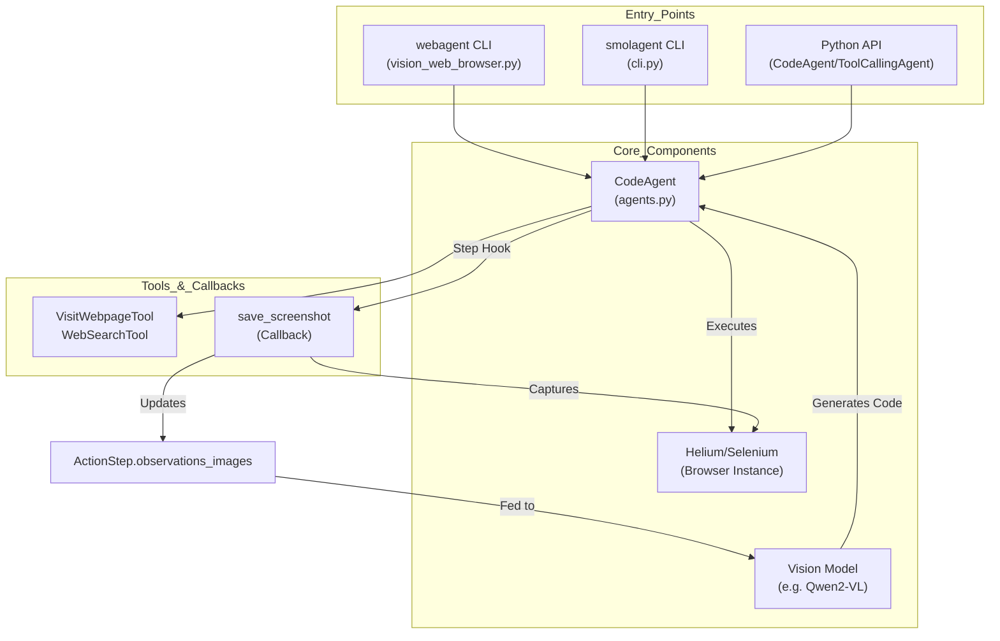
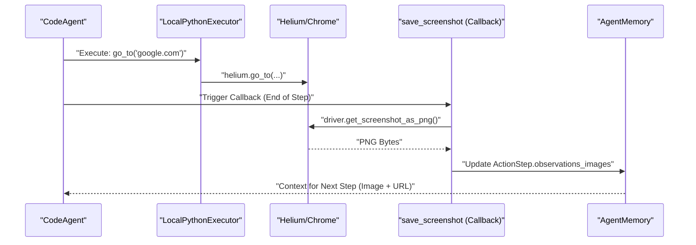
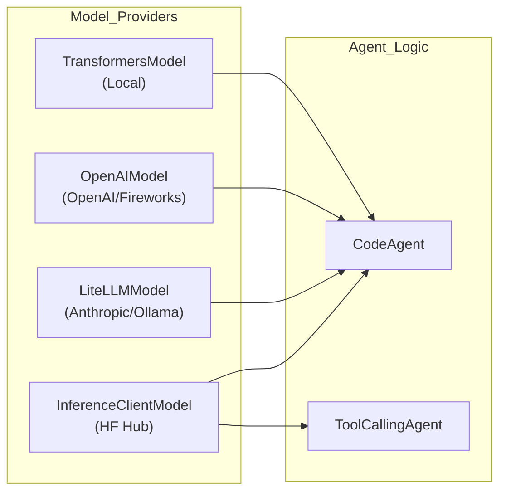

<!-- source: DeepWiki mcp.deepwiki.com · repo huggingface/smolagents · page 10.2 Web Automation & Browser Control · fetched 2026-10-26 -->

# Web Automation & Browser Control

<details>
<summary>Relevant source files</summary>

The following files were used as context for generating this wiki page:

- [docs/source/en/examples/web_browser.md](docs/source/en/examples/web_browser.md)
- [examples/agent_from_any_llm.py](examples/agent_from_any_llm.py)
- [src/smolagents/cli.py](src/smolagents/cli.py)
- [src/smolagents/vision_web_browser.py](src/smolagents/vision_web_browser.py)
- [tests/test_cli.py](tests/test_cli.py)
- [tests/test_vision_web_browser.py](tests/test_vision_web_browser.py)

</details>


This page documents **smolagents**' capabilities for web automation and browser control, ranging from text-based scraping with `VisitWebpageTool` to full vision-based interaction using `helium` and `selenium`. These features enable agents to gather information from the web, navigate complex SPAs (Single Page Applications), and perform automated browser tasks.

---

## Overview of Web Automation Capabilities

smolagents provides three primary approaches to web automation:

1.  **Text-based web tools**: High-efficiency tools that fetch and parse web content into Markdown (e.g., `VisitWebpageTool`, `WebSearchTool`).
2.  **Vision-based browser control**: Using the `webagent` CLI or `vision_web_browser.py` to drive a real browser instance, capturing screenshots for VLM (Vision Language Model) interpretation.
3.  **Programmatic Browser Scripting**: Direct use of libraries like `helium` within a `CodeAgent`'s execution environment.

**Architecture Overview**

Title: "Web Automation Architecture"


Sources: [src/smolagents/vision_web_browser.py:148-157](), [src/smolagents/cli.py:45-107](), [docs/source/en/examples/web_browser.md:111-132]()

---

## Vision-Based Browser Control

The framework supports advanced browser automation where the agent "sees" the page via screenshots. This is primarily implemented in `vision_web_browser.py` and exposed via the `webagent` command.

### Key Components

1.  **Helium Integration**: Uses `helium` for high-level browser actions (e.g., `click()`, `go_to()`) which are more robust than raw Selenium selectors [src/smolagents/vision_web_browser.py:160-181]().
2.  **Screenshot Callbacks**: The `save_screenshot` function is registered as a `step_callbacks` entry. It captures the current state of the browser after each agent step, attaching it to the `ActionStep` [src/smolagents/vision_web_browser.py:66-84]().
3.  **Memory Management**: To prevent context window overflow, `save_screenshot` iterates through `agent.memory.steps` and clears older images from previous steps, keeping only the most recent visual context [src/smolagents/vision_web_browser.py:71-73]().

### Specialized Browser Tools

Beyond standard search, the vision-based agent uses specific tools defined in `vision_web_browser.py`:

*   **`search_item_ctrl_f`**: Uses XPath to find text occurrences and scrolls them into view using `driver.execute_script` [src/smolagents/vision_web_browser.py:106-122](). It includes a safety wrapper `_escape_xpath_string` to prevent XPath injection [src/smolagents/vision_web_browser.py:87-103]().
*   **`go_back`**: Navigates to the previous page in history using `driver.back()` [src/smolagents/vision_web_browser.py:125-128]().
*   **`close_popups`**: Sends an `ESCAPE` key command via `webdriver.ActionChains` to dismiss modals [src/smolagents/vision_web_browser.py:131-136]().

### Browser Automation Data Flow

Title: "Browser Automation Step Lifecycle"


Sources: [src/smolagents/vision_web_browser.py:66-84](), [docs/source/en/examples/web_browser.md:91-109](), [tests/test_vision_web_browser.py:78-133]()

---

## webagent CLI

The `webagent` CLI is a specialized entry point for browser tasks. It pre-configures a `CodeAgent` with the `helium` environment and vision-specific instructions.

**Example Command:**
```bash
webagent "Navigate to Wikipedia, find Chicago, and find a 1992 accident" --model-id "gpt-4o"
```

**Internal Configuration:**
*   **Imports**: Automatically authorizes `helium` in `additional_authorized_imports` [src/smolagents/vision_web_browser.py:153]().
*   **Instructions**: Appends `helium_instructions` to the prompt, teaching the agent how to use `click()`, `scroll_down()`, and `.exists()` [src/smolagents/vision_web_browser.py:160-203]().
*   **Model Loading**: Uses `load_model` from the CLI module to initialize `LiteLLMModel`, `OpenAIModel`, or `InferenceClientModel` [src/smolagents/cli.py:188-212]().

Sources: [src/smolagents/vision_web_browser.py:27-63](), [src/smolagents/cli.py:110-185]()

---

## Web Search & Page Visiting Tools

For tasks not requiring a full visual browser, smolagents provides high-performance text tools.

### WebSearchTool Variants
The framework maps the string `"web_search"` to different implementations based on configuration in `TOOL_MAPPING` [src/smolagents/cli.py:37]().

| Tool | Backend | Features |
| :--- | :--- | :--- |
| `DuckDuckGoSearchTool` | DuckDuckGo | No API key required, includes rate limiting. |
| `GoogleSearchTool` | SerpAPI/Serper | Requires API key, supports advanced filtering. |
| `ApiWebSearchTool` | Brave/Custom | Customizable endpoint and JSON extraction. |

### VisitWebpageTool
This tool is the primary way agents "read" the web. It fetches a URL and converts the HTML to Markdown using the `markdownify` library.

**Implementation Logic:**
1.  **Fetch**: Uses `requests.get` with a defined timeout.
2.  **Convert**: Transforms HTML to Markdown to reduce token usage.
3.  **Truncate**: Limits output length to protect the LLM context window.

Sources: [src/smolagents/cli.py:37-38](), [src/smolagents/cli.py:131-144]()

---

## Implementation Patterns

### Pattern: Vision-Language Model (VLM) Setup
When using models like `Qwen2-VL` or `gpt-4o`, the agent is initialized with vision capabilities and a screenshot callback.

```python
model = InferenceClientModel(model_id="Qwen/Qwen2-VL-72B-Instruct")
agent = CodeAgent(
    tools=[WebSearchTool(), go_back, close_popups],
    model=model,
    additional_authorized_imports=["helium"],
    step_callbacks=[save_screenshot]
)
# Initialize helium in the agent's state
agent.python_executor("from helium import *", agent.state)
```
Sources: [docs/source/en/examples/web_browser.md:114-132](), [src/smolagents/vision_web_browser.py:148-157]()

### Pattern: Safe XPath Interaction
To interact with specific text safely, the framework uses an escaping utility `_escape_xpath_string` to prevent injection during `driver.find_elements` calls [src/smolagents/vision_web_browser.py:87-103](). This handles single quotes, double quotes, and mixed quotes by utilizing the XPath `concat()` function [src/smolagents/vision_web_browser.py:101-102]().

```python
def _escape_xpath_string(s: str) -> str:
    if "'" not in s: return f"'{s}'"
    if '"' not in s: return f'"{s}"'
    parts = s.split("'")
    return "concat(" + ', "\'", '.join(f"'{p}'" for p in parts) + ")"
```
Sources: [src/smolagents/vision_web_browser.py:87-103](), [tests/test_vision_web_browser.py:19-76]()

### Pattern: Multi-Inference Web Agent
The CLI and examples demonstrate how to swap backends (OpenAI, LiteLLM, Transformers) while maintaining the same web automation logic [examples/agent_from_any_llm.py:19-40]().

Title: "Model Provider to Agent Association"

Sources: [examples/agent_from_any_llm.py:19-40](), [src/smolagents/cli.py:188-212](), [tests/test_cli.py:16-56]()

---

