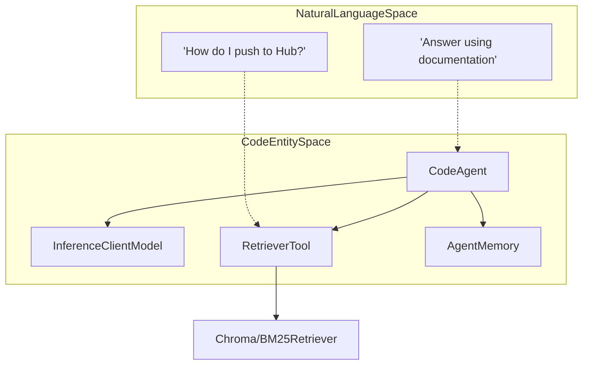
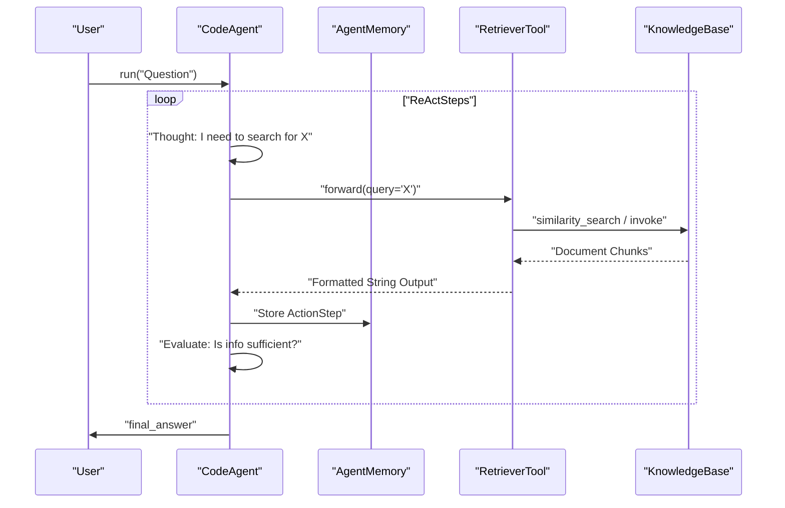

<!-- source: DeepWiki mcp.deepwiki.com · repo huggingface/smolagents · page 10.3 Retrieval-Augmented Generation (RAG) · fetched 2026-10-26 -->

# Retrieval-Augmented Generation (RAG)

Relevant source files

The following files were used as context for generating this wiki page:

- [docs/source/en/conceptual_guides/intro_agents.md](docs/source/en/conceptual_guides/intro_agents.md)
- [docs/source/en/examples/rag.md](docs/source/en/examples/rag.md)
- [docs/source/en/examples/text_to_sql.md](docs/source/en/examples/text_to_sql.md)
- [docs/source/en/tutorials/building_good_agents.md](docs/source/en/tutorials/building_good_agents.md)
- [docs/source/en/tutorials/tools.md](docs/source/en/tutorials/tools.md)
- [examples/multiple_tools.py](examples/multiple_tools.py)
- [examples/rag.py](examples/rag.py)
- [examples/rag_using_chromadb.py](examples/rag_using_chromadb.py)

This page documents Retrieval-Augmented Generation (RAG) implementation in `smolagents`, demonstrating how to build systems that combine LLM reasoning with external knowledge retrieval. The framework emphasizes **Agentic RAG**, where retrieval is treated as a tool within a ReAct loop, enabling multi-step reasoning, query refinement, and self-correction.

Sources: [docs/source/en/examples/rag.md:1-44]()

## Traditional RAG vs. Agentic RAG

Traditional RAG follows a linear pipeline (Retrieve -> Augment -> Generate). `smolagents` shifts this to an iterative process where the agent can critique its own search results and refine its strategy.

| Feature | Traditional RAG | Agentic RAG (`smolagents`) |
| :--- | :--- | :--- |
| **Workflow** | Fixed Pipeline | Dynamic ReAct Loop [docs/source/en/conceptual_guides/intro_agents.md:25-33]() |
| **Retrieval** | Single Step | Multi-turn/Iterative [docs/source/en/examples/rag.md:37-37]() |
| **Query Logic** | Raw User Query | Optimized/HyDE Queries [docs/source/en/examples/rag.md:42-42]() |
| **Reasoning** | Limited to Generation | Synthesis across multiple hops [docs/source/en/examples/rag.md:38-38]() |

Sources: [docs/source/en/examples/rag.md:19-44](), [docs/source/en/conceptual_guides/intro_agents.md:25-33]()

## System Architecture

### Component Overview
The architecture bridges the "Natural Language Space" (user intent) to the "Code Entity Space" (executable tools and agents).

**Natural Language to Code Entity Mapping**

Sources: [examples/rag.py:58-65](), [examples/rag_using_chromadb.py:119-125](), [docs/source/en/tutorials/tools.md:13-20]()

### Data Flow: The RAG ReAct Loop
The `CodeAgent` executes a loop where retrieval is an action that produces an observation for the next thought step.

Sources: [docs/source/en/conceptual_guides/intro_agents.md:25-33](), [examples/rag.py:58-67](), [docs/source/en/tutorials/building_good_agents.md:128-135]()

## Implementation: RetrieverTool

The core of a RAG system in `smolagents` is a subclass of `Tool`. This allows the agent to call retrieval logic just like any other function.

### Lexical Retrieval (BM25)
Used for keyword-heavy search where exact matches are important.

- **Class**: `RetrieverTool` [examples/rag.py:29-52]()
- **Engine**: `BM25Retriever` from `langchain_community` [examples/rag.py:7-7]()
- **Data Flow**: `forward()` accepts a string `query`, calls `self.retriever.invoke(query)`, and returns a formatted string of chunks [examples/rag.py:44-52]().

### Semantic Retrieval (ChromaDB)
Used for concept-based search using vector embeddings.

- **Class**: `RetrieverTool` [examples/rag_using_chromadb.py:71-93]()
- **Engine**: `Chroma` vector store [examples/rag_using_chromadb.py:6-6]()
- **Embeddings**: `HuggingFaceEmbeddings` (e.g., `sentence-transformers/all-MiniLM-L6-v2`) [examples/rag_using_chromadb.py:63-63]()
- **Logic**: Uses `self.vector_store.similarity_search(query, k=3)` [examples/rag_using_chromadb.py:90-90]().

Sources: [examples/rag.py:29-52](), [examples/rag_using_chromadb.py:71-93]()

## Data Processing Pipeline

Before the agent can retrieve, documents must be processed and indexed. For PDF processing, `PyPDFLoader` can be used to populate `source_docs` [examples/rag_using_chromadb.py:28-38]().

| Step | Entity/Function | Configuration |
| :--- | :--- | :--- |
| **Loading** | `datasets.load_dataset` | `m-ric/huggingface_doc` [examples/rag.py:10-10]() |
| **Splitting** | `RecursiveCharacterTextSplitter` | `chunk_size=500`, `chunk_overlap=50` [examples/rag.py:17-23]() |
| **Tokenization** | `AutoTokenizer` | `thenlper/gte-small` (for Chroma example) [examples/rag_using_chromadb.py:41-41]() |
| **Indexing** | `Chroma.from_documents` | `persist_directory="./chroma_db"` [examples/rag_using_chromadb.py:68-68]() |

Sources: [examples/rag.py:10-24](), [examples/rag_using_chromadb.py:28-68]()

## Key Classes and Roles

| Class | Role |
| :--- | :--- |
| `Tool` | Abstract base for creating the `RetrieverTool`. [docs/source/en/tutorials/tools.md:26-46]() |
| `CodeAgent` | Orchestrates the RAG loop, writing Python code to call the retriever. [examples/rag.py:59-65]() |
| `InferenceClientModel` | The LLM engine (e.g., Qwen2.5) that decides which queries to run. [examples/rag.py:61-61]() |
| `RetrieverTool` | Custom implementation wrapping retrieval logic for the agent. [examples/rag.py:29-52]() |

Sources: [examples/rag.py:55-65](), [examples/rag_using_chromadb.py:14-15](), [docs/source/en/tutorials/tools.md:48-54]()

## Specialized RAG: Text-to-SQL

RAG is not limited to unstructured text. `smolagents` supports structured RAG through SQL tools.

- **Tool Definition**: Use the `@tool` decorator to wrap a SQL engine execution [docs/source/en/examples/text_to_sql.md:99-119]().
- **Metadata**: The tool's `description` should include the database schema (table names and columns) so the LLM knows how to construct queries [docs/source/en/examples/text_to_sql.md:103-109]().
- **Agentic Advantage**: Unlike standard text-to-SQL, an agent can inspect query results, identify errors, and rewrite the SQL until it satisfies the task [docs/source/en/examples/text_to_sql.md:11-12]().

Sources: [docs/source/en/examples/text_to_sql.md:99-135]()

## Best Practices for Agentic RAG

### 1. Descriptive Tool Metadata
The `description` and `inputs` dictionary are crucial. They tell the LLM *how* to search. For example, advising the agent to use "affirmative forms" helps implement **HyDE** (Hypothetical Document Embeddings) naturally.
- **Source**: [examples/rag.py:31-37]()

### 2. Logging and Error Handling
Tools should provide clear feedback. Each tool should log (e.g., using `print` statements in its logic) information useful for the LLM engine to self-correct [docs/source/en/tutorials/building_good_agents.md:41-42](). If a search returns no results or an error, raising informative exceptions or returning descriptive strings helps the agent reverse engineer the fix [docs/source/en/tutorials/building_good_agents.md:79-81]().

### 3. Model Selection
RAG performance scales with the model's reasoning capability. High-parameter models like `Qwen/Qwen3-Next-80B-A3B-Thinking` are recommended for complex synthesis and handling difficult queries [examples/rag.py:61-61](), [docs/source/en/tutorials/building_good_agents.md:125-127]().

### 4. Simplified Workflows
Whenever possible, group related logic. If the agent always needs two pieces of info (e.g., weather and distance), create one tool that returns both to reduce LLM calls, costs, and latency [docs/source/en/tutorials/building_good_agents.md:12-23]().

Sources: [docs/source/en/tutorials/building_good_agents.md:12-101](), [examples/rag.py:31-37]()

---

