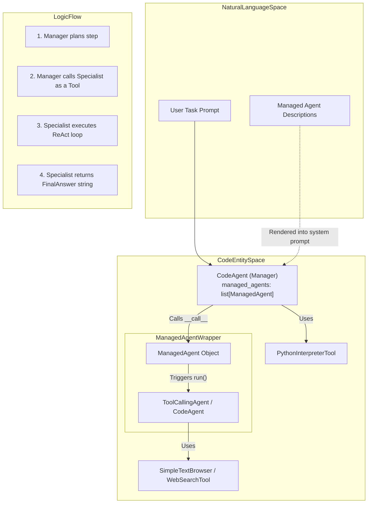
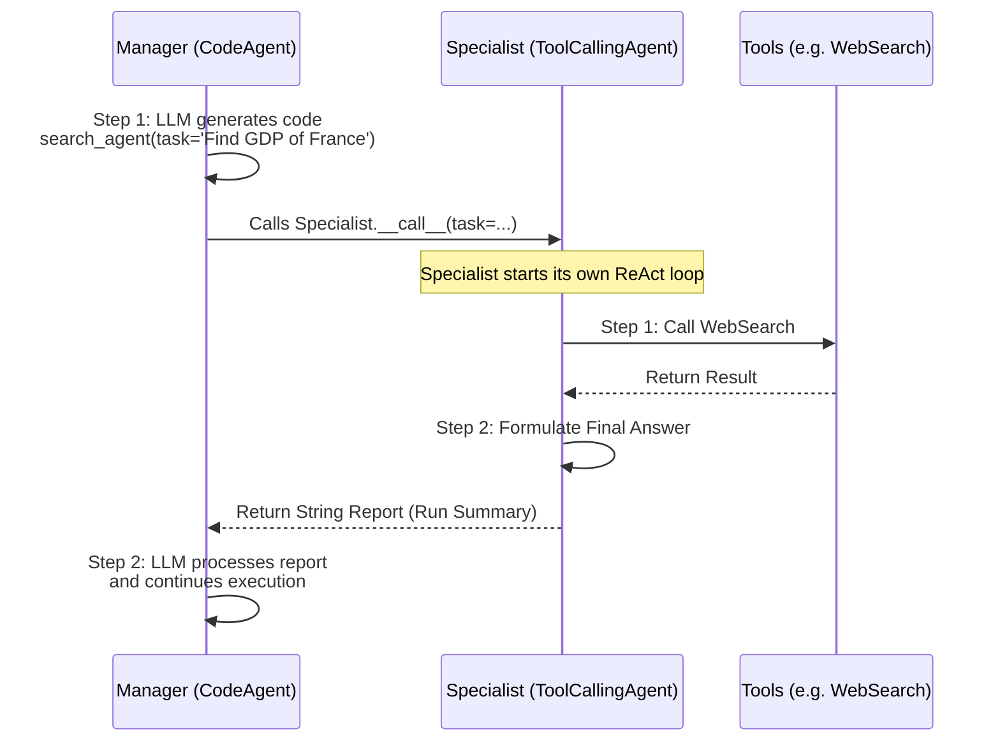
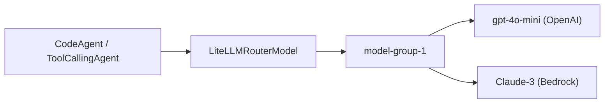

<!-- source: DeepWiki mcp.deepwiki.com · repo huggingface/smolagents · page 10.5 Multi-Agent Orchestration · fetched 2026-10-26 -->

# Multi-Agent Orchestration

<details>
<summary>Relevant source files</summary>

The following files were used as context for generating this wiki page:

- [examples/inspect_multiagent_run.py](examples/inspect_multiagent_run.py)
- [examples/multi_llm_agent.py](examples/multi_llm_agent.py)
- [examples/open_deep_research/README.md](examples/open_deep_research/README.md)
- [examples/open_deep_research/app.py](examples/open_deep_research/app.py)
- [examples/open_deep_research/run.py](examples/open_deep_research/run.py)
- [examples/open_deep_research/run_gaia.py](examples/open_deep_research/run_gaia.py)
- [examples/open_deep_research/visual_vs_text_browser.ipynb](examples/open_deep_research/visual_vs_text_browser.ipynb)

</details>


Multi-agent orchestration enables hierarchical delegation where a manager agent coordinates multiple specialist agents to solve complex tasks. Each specialist agent has its own tools and memory, allowing efficient specialization. This architecture empirically yields better performance on benchmarks like **GAIA** and **Open Deep Research** by decomposing complex tasks into subtasks handled by domain experts.

For general information about managed agents as a feature, see [Multi-Agent Systems]().

## Purpose and Scope

This page demonstrates practical patterns for building multi-agent systems in `smolagents`, including:
- Hierarchical agent orchestration with manager-specialist relationships.
- Implementation of the **Open Deep Research** agent achieving 55% on GAIA.
- Configuring agents for delegation and task decomposition.
- Communication patterns between manager and managed agents.
- Real-world examples with web search, vision, and code generation specialists.

## Multi-Agent Architecture

The following diagram bridges the conceptual "Natural Language Space" (how the manager thinks about the team) to the "Code Entity Space" (how `smolagents` implements it).

### Agent Hierarchy and Entity Mapping

**Sources:** [examples/open_deep_research/run.py:82-109](), [examples/open_deep_research/run_gaia.py:105-134]()

## Setting Up Managed Agents

Managed agents must have `name` and `description` attributes. These are mandatory because the manager agent treats the managed agent as a tool. The `description` is what the manager's LLM uses to decide when to delegate a task.

| Attribute | Role in Orchestration |
| :--- | :--- |
| `name` | Used as the function name in the manager's code or tool-call block [examples/open_deep_research/run.py:88-88](). |
| `description` | Injected into the manager's system prompt to explain the specialist's capabilities [examples/open_deep_research/run.py:89-94](). |
| `provide_run_summary` | If `True`, the specialist returns a summary of its internal steps to the manager [examples/open_deep_research/run.py:95-95](). |

```python
# Implementation pattern from Open Deep Research
text_webbrowser_agent = ToolCallingAgent(
    model=model,
    tools=WEB_TOOLS,
    max_steps=20,
    name="search_agent", # Identifier for the manager
    description="A team member that will search the internet to answer your question.",
    provide_run_summary=True,
)

manager_agent = CodeAgent(
    model=model,
    tools=[visualizer, TextInspectorTool(model, text_limit)],
    managed_agents=[text_webbrowser_agent], # Orchestration link
)
```
**Sources:** [examples/open_deep_research/run.py:82-109](), [examples/open_deep_research/run_gaia.py:105-134]()

## Case Study: Open Deep Research (GAIA Benchmark)

The `smolagents` repository includes a replication of OpenAI's Deep Research. This system uses a hierarchical structure to achieve **55% pass@1** on the GAIA validation set [examples/open_deep_research/README.md:8-9]().

### Orchestration Structure
In `examples/open_deep_research/run.py`, the system is orchestrated with a `CodeAgent` manager and a `ToolCallingAgent` specialist for web browsing.

| Agent | Class | Role | Tools |
|-------|-------|------|-------|
| **Manager** | `CodeAgent` | Planning, reasoning, and visual inspection of local files [examples/open_deep_research/run.py:101-109](). | `visualizer`, `TextInspectorTool` |
| **Search Specialist** | `ToolCallingAgent` | Navigating the web, searching, and reading online documents [examples/open_deep_research/run.py:82-96](). | `GoogleSearchTool`, `VisitTool`, `FinderTool`, `ArchiveSearchTool` |

### Code Implementation
The `create_agent` function demonstrates how to bridge these entities:

```python
# From examples/open_deep_research/run.py
def create_agent(model_id="o1"):
    # ... model setup ...
    
    # 1. Define Specialist Tools
    WEB_TOOLS = [
        GoogleSearchTool(provider="serper"),
        VisitTool(browser),
        PageUpTool(browser),
        PageDownTool(browser),
        FinderTool(browser),
        FindNextTool(browser),
        ArchiveSearchTool(browser),
        TextInspectorTool(model, text_limit),
    ]
    
    # 2. Create the Specialist (Search Agent)
    text_webbrowser_agent = ToolCallingAgent(
        model=model,
        tools=WEB_TOOLS,
        max_steps=20,
        name="search_agent",
        description="""A team member that will search the internet to answer your question...""",
        provide_run_summary=True 
    )

    # 3. Create the Manager
    manager_agent = CodeAgent(
        model=model,
        tools=[visualizer, TextInspectorTool(model, text_limit)],
        managed_agents=[text_webbrowser_agent], # Orchestration link
        planning_interval=4 # Re-evaluates plan every 4 steps
    )
    return manager_agent
```
**Sources:** [examples/open_deep_research/run.py:60-111](), [examples/open_deep_research/run_gaia.py:82-134]()

## Task Delegation Flow

The interaction between a manager and a managed agent follows a specific sequence where the manager's action triggers the specialist's entire lifecycle.

### Sequential Delegation Logic

**Sources:** [examples/open_deep_research/run_gaia.py:105-134](), [examples/open_deep_research/run.py:119-121](), [examples/inspect_multiagent_run.py:21-37]()

## Evaluation and Benchmarking

`smolagents` provides robust evaluation scripts for testing multi-agent systems against standard benchmarks like GAIA.

### GAIA Evaluation Pipeline
The `run_gaia.py` script provides a full evaluation pipeline using `ThreadPoolExecutor` for high concurrency [examples/open_deep_research/run_gaia.py:1-6]().

- **Concurrency**: Configurable via `--concurrency` (default 8) to run multiple questions in parallel [examples/open_deep_research/run_gaia.py:51-51]().
- **Annotated Data**: Uses `smolagents/GAIA-annotated` which includes manual screenshots of PDFs and Excel files to aid vision-based reasoning [examples/open_deep_research/README.md:58-64]().
- **Token Tracking**: Uses `agent.monitor.get_total_token_counts()` to aggregate costs across the manager and all specialists via a callback [examples/open_deep_research/run_gaia.py:99-103]().
- **Custom Tools**: Incorporates specialized tools like `TextInspectorTool` for document parsing [examples/open_deep_research/run_gaia.py:195-195]() and `visualizer` for image analysis [examples/open_deep_research/run_gaia.py:30-30]().

**Sources:** [examples/open_deep_research/run_gaia.py:82-104](), [examples/open_deep_research/run_gaia.py:137-169](), [examples/open_deep_research/README.md:58-64]()

## Load Balancing and Multi-LLM Orchestration

For high-volume multi-agent tasks, `smolagents` supports distributing the model workload across different providers or instances using `LiteLLMRouterModel`.

### Multi-LLM Routing Diagram


In `examples/multi_llm_agent.py`, a `LiteLLMRouterModel` is configured with a `routing_strategy="simple-shuffle"` to load balance between OpenAI and AWS Bedrock endpoints [examples/multi_llm_agent.py:37-41](). This is particularly useful in multi-agent systems where many parallel calls are made by different specialists.

**Sources:** [examples/multi_llm_agent.py:8-41]()

## Best Practices for Orchestration

1. **Agent Selection**: Use `CodeAgent` for the manager to allow complex data manipulation and `ToolCallingAgent` for specialists performing linear tasks like web browsing [examples/open_deep_research/run.py:82-109]().
2. **Task Summarization**: Set `provide_run_summary=True` on managed agents. This ensures the manager receives a concise summary of the specialist's actions rather than just the final answer [examples/open_deep_research/run.py:95-95]().
3. **Planning Intervals**: Use the `planning_interval` parameter in the manager (e.g., `planning_interval=4`) to force the manager to re-evaluate the global goal after several delegation steps [examples/open_deep_research/run.py:107-107]().
4. **Authorized Imports**: When the manager is a `CodeAgent`, provide necessary libraries for data processing (e.g., `additional_authorized_imports=["*"]`) so it can process the data returned by specialists [examples/open_deep_research/run.py:106-106]().
5. **Specialized Inspection**: Use a `TextInspectorTool` for large text files to prevent context window overflow by having the model summarize the document before passing it to the manager [examples/open_deep_research/run_gaia.py:195-195]().
6. **Token Monitoring**: Aggregate token usage from managed agents using `monitor.get_total_token_counts()` in a `final_answer_checks` callback to get a complete view of the system cost [examples/open_deep_research/run_gaia.py:99-103]().

**Sources:** [examples/open_deep_research/run.py:82-109](), [examples/open_deep_research/run_gaia.py:195-195](), [examples/multi_llm_agent.py:37-41](), [examples/open_deep_research/run_gaia.py:99-103]()

---

