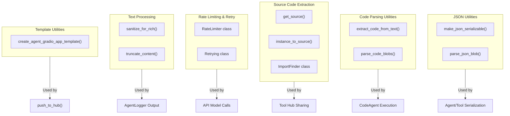
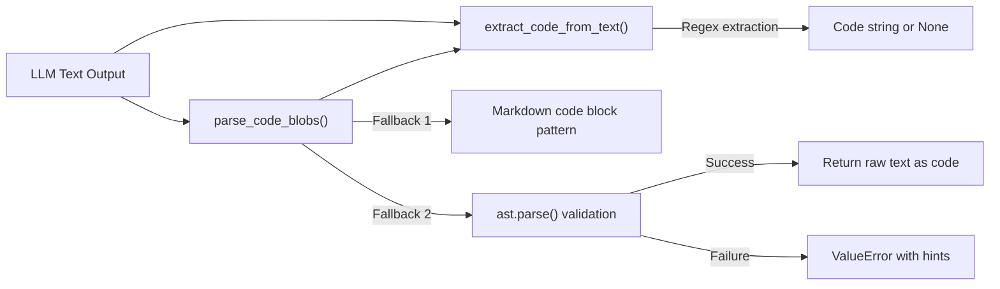
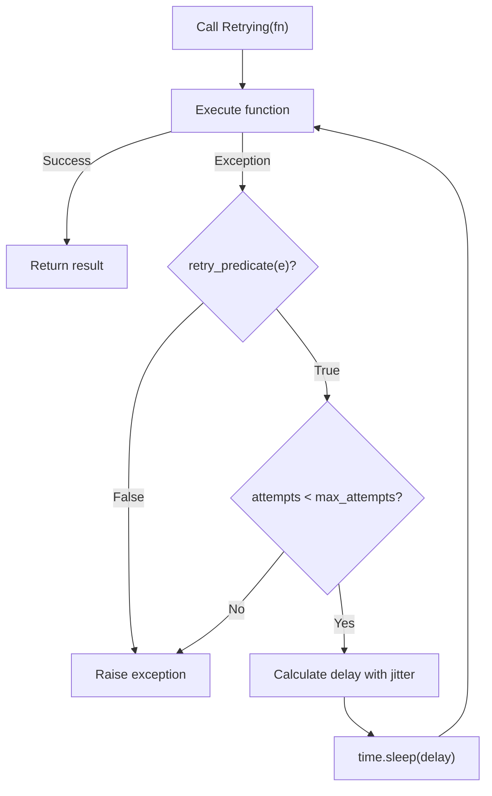

<!-- source: DeepWiki mcp.deepwiki.com · repo huggingface/smolagents · page 11.3 Utility Functions & Helpers · fetched 2026-10-26 -->

# Utility Functions & Helpers

<details>
<summary>Relevant source files</summary>

The following files were used as context for generating this wiki page:

- [src/smolagents/utils.py](src/smolagents/utils.py)
- [tests/test_utils.py](tests/test_utils.py)

</details>


This page documents the utility functions and helper classes in [src/smolagents/utils.py]() that support core framework functionality. These low-level utilities handle tasks like JSON serialization, code parsing, source code extraction, rate limiting, retry logic, and text processing.

For error types and exception handling, see [Error Types & Exception Hierarchy (11.2)](). For agent-level configuration and structure, see [Project Structure & Dependencies (11.1)]().

---

## Overview of Utility Categories

The utilities in `smolagents` are organized into functional categories that bridge the gap between high-level agent logic and low-level system execution.

### System Architecture Diagram



**Sources:** [src/smolagents/utils.py:1-607]()

---

## JSON Utilities

### make_json_serializable

The `make_json_serializable()` function recursively converts arbitrary Python objects into JSON-serializable data structures. It handles nested structures and attempts to parse strings that look like JSON objects.

**Function Signature:**
```python
def make_json_serializable(obj: Any) -> Any
```

**Conversion Rules:**

| Input Type | Output |
|------------|--------|
| `None`, `str`, `int`, `float`, `bool` | Unchanged (native JSON types) [src/smolagents/utils.py:142-144]() |
| `str` starting with `{` or `[` | Attempts `json.loads()`, recursively converts result [src/smolagents/utils.py:146-152]() |
| `list`, `tuple` | List with recursively converted items [src/smolagents/utils.py:154-155]() |
| `dict` | Dict with string keys and recursively converted values [src/smolagents/utils.py:156-157]() |
| Custom objects with `__dict__` | Dict with `{"_type": class_name, ...attributes}` [src/smolagents/utils.py:158-160]() |
| Other types | Converted to string via `str()` [src/smolagents/utils.py:163-163]() |

**Sources:** [src/smolagents/utils.py:140-164]()

### parse_json_blob

The `parse_json_blob()` function extracts JSON data from text that may contain additional content before or after the JSON. It is specifically designed to handle LLM outputs where the model provides a "thought" followed by a JSON action.

**Function Signature:**
```python
def parse_json_blob(json_blob: str) -> tuple[dict[str, str], str]
```

**Returns:**
- `tuple[0]`: Parsed JSON data as dictionary.
- `tuple[1]`: Text appearing before the JSON blob (the "thought" prefix) [src/smolagents/utils.py:173-173]().

**Error Handling:**
- Raises `ValueError` if no JSON blob found (no `{` or `}` characters) [src/smolagents/utils.py:174-175]().
- Raises `ValueError` with specific message if multiple tool calls detected (the `},\n` pattern) [src/smolagents/utils.py:178-181]().
- Provides context on decoding errors, showing characters around the failure point [src/smolagents/utils.py:182-186]().

**Sources:** [src/smolagents/utils.py:166-187](), [tests/test_utils.py:31-31]()

---

## Code Parsing Utilities

These utilities extract Python code from LLM-generated text that may include markdown formatting or custom tags.

### Data Flow for Code Extraction



**Sources:** [src/smolagents/utils.py:189-251]()

### extract_code_from_text

Extracts code using custom delimiter tags via regex pattern matching.

**Function Signature:**
```python
def extract_code_from_text(text: str, code_block_tags: tuple[str, str]) -> str | None
```

**Behavior:**
- Uses regex pattern: `{opening_tag}(.*?){closing_tag}` with `re.DOTALL` [src/smolagents/utils.py:191-192]().
- Joins multiple code blocks with `\n\n` [src/smolagents/utils.py:194-194]().

**Sources:** [src/smolagents/utils.py:189-195]()

### parse_code_blobs

Primary code extraction function used by `CodeAgent`. It attempts multiple extraction strategies in order.

**Extraction Strategy:**
1. **Custom tags**: Try `extract_code_from_text()` with provided tags [src/smolagents/utils.py:212-212]().
2. **Markdown fallback**: Try markdown pattern ````python` or ````py` [src/smolagents/utils.py:214-214]().
3. **Raw code validation**: Attempt `ast.parse()` on raw text [src/smolagents/utils.py:218-220]().
4. **Final Answer Hint**: If text contains "final" and "answer", raises error suggesting `final_answer()` [src/smolagents/utils.py:224-227]().

**Sources:** [src/smolagents/utils.py:198-251](), [tests/test_utils.py:103-143]()

---

## Source Code Extraction

These utilities extract source code from Python objects, supporting both standard environments and interactive shells (Jupyter/IPython).

### get_source

Extracts source code from classes or functions, with fallback for IPython history.

**Function Signature:**
```python
def get_source(obj) -> str
```

**Extraction Strategy:**
1. **Standard**: Use `inspect.getsource()` [src/smolagents/utils.py:387-388]().
2. **IPython Fallback**: If `inspect` fails (common in Jupyter), it parses the IPython history [src/smolagents/utils.py:391-423]().
   - Accesses `IPython.get_ipython().user_ns['In']` [src/smolagents/utils.py:403-403]().
   - Uses `ast.parse` on cell history to find the definition node matching `obj.__name__` [src/smolagents/utils.py:408-417]().

**Sources:** [src/smolagents/utils.py:376-427](), [tests/test_utils.py:155-203]()

### instance_to_source

Converts a class instance to complete source code representation, including required imports and class attributes. This is used when pushing tools to the Hub.

**Generated Code Structure:**
1. **Imports**: Auto-discovered via `ImportFinder` [src/smolagents/utils.py:284-290]().
2. **Class Declaration**: Includes base class if provided [src/smolagents/utils.py:314-315]().
3. **Methods**: Excludes methods with identical bytecode to the base class [src/smolagents/utils.py:349-355]().

**ImportFinder Class:**
An `ast.NodeVisitor` that scans the object's source code for `import` and `from ... import` statements to identify external dependencies [src/smolagents/utils.py:268-281]().

**Sources:** [src/smolagents/utils.py:268-373](), [tests/test_utils.py:205-265]()

---

## Rate Limiting & Retry Logic

### RateLimiter

Enforces a minimum delay between consecutive requests, typically used for API models.

**Implementation:**
- Calculates a `_interval` based on `requests_per_minute` [src/smolagents/utils.py:503-503]().
- The `throttle()` method checks `time.time()` against `_last_call` and sleeps if the interval hasn't passed [src/smolagents/utils.py:515-523]().

**Sources:** [src/smolagents/utils.py:497-525]()

### Retrying

A controller for executing functions with exponential backoff and jitter.

**Logic Flow:**


**Backoff Calculation:**
The delay increases exponentially using `exponential_base` and adds a random jitter if `jitter=True` [src/smolagents/utils.py:584-585]().

**Sources:** [src/smolagents/utils.py:528-606]()

---

## Text Processing

### sanitize_for_rich

Converts values into safe strings for the Rich library, handling bytes and control characters.

- Decodes bytes using UTF-8 with replacement [src/smolagents/utils.py:75-76]().
- Replaces ASCII control characters (code < 32 or 127) with visible escape sequences like `\xNN`, while preserving `\n`, `\t`, and `\r` [src/smolagents/utils.py:83-88]().

**Sources:** [src/smolagents/utils.py:64-89]()

### truncate_content

Truncates long strings (default > 20,000 chars) by keeping the start and end and inserting a truncation notice in the middle [src/smolagents/utils.py:254-265]().

**Sources:** [src/smolagents/utils.py:254-265]()

---

## Additional Helper Utilities

### Package and Import Helpers
- `_is_package_available(package_name)`: Uses `importlib.util.find_spec` to check if a dependency is installed [src/smolagents/utils.py:45-46]().

### JSON Schema Generation
The utility `get_json_schema(func)` (internal helper, often used in model integration) generates a tool-compatible JSON schema from a function's docstring and type hints. It supports:
- **Google-style docstrings**: Extracts descriptions for `Args` and `Returns`.
- **Enum Choices**: Parses `(choices: ["a", "b"])` patterns in docstrings.
- **Complex Types**: Handles `Union`, `Optional`, `List`, `Dict`, and `Tuple` type hints.

---

## Reference Constants

| Constant | Description | Value |
|----------|-------------|-------|
| `BASE_BUILTIN_MODULES` | Whitelisted modules for `LocalPythonExecutor` | `collections`, `datetime`, `math`, `re`, etc. [src/smolagents/utils.py:49-61]() |
| `MAX_LENGTH_TRUNCATE_CONTENT` | Default threshold for text truncation | `20000` [src/smolagents/utils.py:254-254]() |

**Sources:** [src/smolagents/utils.py:49-61](), [src/smolagents/utils.py:254-254]()

---

