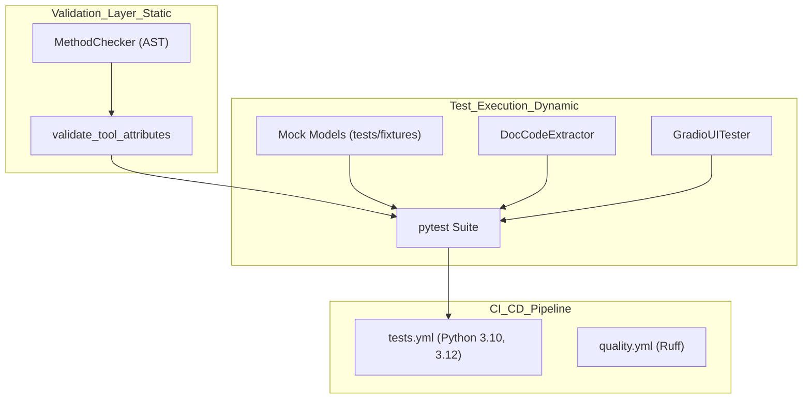
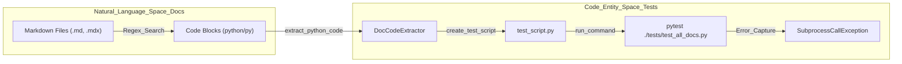

<!-- source: DeepWiki mcp.deepwiki.com · repo huggingface/smolagents · page 11.4 Testing & Validation · fetched 2026-10-26 -->

# Testing & Validation

<details>
<summary>Relevant source files</summary>

The following files were used as context for generating this wiki page:

- [.github/workflows/quality.yml](.github/workflows/quality.yml)
- [.github/workflows/tests.yml](.github/workflows/tests.yml)
- [tests/conftest.py](tests/conftest.py)
- [tests/fixtures/agents.py](tests/fixtures/agents.py)
- [tests/test_all_docs.py](tests/test_all_docs.py)
- [tests/test_final_answer.py](tests/test_final_answer.py)
- [tests/test_gradio_ui.py](tests/test_gradio_ui.py)
- [tests/test_import.py](tests/test_import.py)
- [tests/test_search.py](tests/test_search.py)
- [tests/test_types.py](tests/test_types.py)

</details>


This page documents the testing infrastructure, validation utilities, and testing patterns used in the `smolagents` framework. It covers tool validation via AST analysis, test fixtures, global configuration, CI workflows, and specialized components like `DocCodeExtractor` for documentation testing.

## Overview of Testing Architecture

The `smolagents` testing strategy combines static analysis for tool safety and compatibility with dynamic functional testing for agents, models, and UI components.

Title: Testing Pipeline Architecture


**Sources:** [.github/workflows/tests.yml:1-44](), [.github/workflows/quality.yml:1-32](), [tests/test_all_docs.py:59-80](), [tests/fixtures/agents.py:4-130](), [tests/test_gradio_ui.py:31-41]()

## Tool & Type Validation

To ensure tools and custom types can be safely handled by agents, `smolagents` employs rigorous validation of both data structures and code logic.

### Static Analysis with MethodChecker
The `MethodChecker` class (referenced in tool validation) performs static analysis on tool methods to ensure they are self-contained and secure. It tracks assigned names, argument names, and imports to detect usage of undefined variables across various Python scopes.

### Agent Type Integrity
Tests in `tests/test_types.py` validate the behavior of `AgentAudio`, `AgentImage`, and `AgentText` [tests/test_types.py:22-24]().
*   **Tensor Management**: Validates that `AgentAudio` [tests/test_types.py:34-67]() and `AgentImage` [tests/test_types.py:70-110]() correctly wrap tensors and can convert them to raw formats (e.g., `PIL.Image.Image`) or file paths.
*   **Persistence**: Ensures that generated temporary files (from `to_string()`) persist even after the agent type object is deleted [tests/test_types.py:48-49](), [tests/test_types.py:84-85]().

### Final Answer Tool Validation
The `FinalAnswerTool` [tests/test_final_answer.py:31]() is a critical component that concludes agent loops. Its validation ensures:
*   **Argument Handling**: It correctly processes answers provided as positional arguments or keyword arguments [tests/test_final_answer.py:33-39]().
*   **Output Sanitization**: When `sanitize_inputs_outputs=True` is set, the tool wraps raw outputs into their corresponding `AgentType` using `_AGENT_TYPE_MAPPING` [tests/test_final_answer.py:41-46]().

**Sources:** [tests/test_types.py:22-119](), [tests/test_final_answer.py:21-57]()

## Test Infrastructure & Fixtures

### Versioned Agent Fixtures
The `tests/fixtures/agents.py` file maintains a registry called `AGENT_DICTS` [tests/fixtures/agents.py:4](). This registry stores serialized agent configurations for different versions to test backward compatibility:
*   **v1.9**: Baseline configuration including `prompt_templates` and `model` data [tests/fixtures/agents.py:5-44]().
*   **v1.10**: Introduces `executor_type`, `executor_kwargs`, and `max_print_outputs_length` [tests/fixtures/agents.py:46-88]().
*   **v1.20**: Refines the schema by removing legacy fields like `grammar` and token counts from the model data [tests/fixtures/agents.py:90-129]().

### Global Configuration (conftest.py)
The framework uses `tests/conftest.py` to manage global test behavior. A key utility is the automatic patching of `MultiStepAgent.__init__` to suppress logging during tests unless explicitly enabled, ensuring clean test output [tests/conftest.py:15-24]().

**Sources:** [tests/fixtures/agents.py:4-138](), [tests/conftest.py:1-24]()

## Documentation Testing (DocCodeExtractor)

To prevent "documentation rot," `smolagents` includes a system to extract and execute code snippets from Markdown files.

Title: Documentation Code Extraction Pipeline


The `DocCodeExtractor` [tests/test_all_docs.py:59-80]() logic:
1.   **Extraction**: Uses regex `r"```(?:python|py)\n(.*?)\n```"` to identify Python blocks [tests/test_all_docs.py:63-67]().
2.   **Exclusion**: Skips snippets containing keywords like `ToolCollection`, `image_generation_tool`, or `from_langchain` to avoid heavy dependencies or expensive API calls during CI [tests/test_all_docs.py:114-129]().
3.   **Syntax Check**: Every extracted block is passed through `ast.parse(block)` to ensure valid Python syntax before execution [tests/test_all_docs.py:134-135]().
4.   **Execution**: Blocks are merged into a single script, tokens (like `HF_TOKEN`) are injected from environment variables, and the script is run via `subprocess` [tests/test_all_docs.py:140-149]().

**Sources:** [tests/test_all_docs.py:31-154]()

## CI Workflow Structure

The repository uses GitHub Actions to automate validation across environments.

| Workflow | Purpose | Key Commands / Steps |
| :--- | :--- | :--- |
| **Python tests** | Functional testing on Ubuntu (3.10, 3.12) | `uv pip install "smolagents[test] @ ."` [ .github/workflows/tests.yml:38](), `pytest ./tests/` [ .github/workflows/tests.yml:43]() |
| **Quality Check** | Linting and formatting | `ruff check`, `ruff format --check` [ .github/workflows/quality.yml:30-31]() |

**Sources:** [.github/workflows/tests.yml:1-44](), [.github/workflows/quality.yml:1-32]()

## UI and Integration Testing

Testing for interactive components like `GradioUI` focuses on security and the streaming pipeline.

*   **File Upload Security**: `GradioUITester` validates that `GradioUI.upload_file` correctly enforces `allowed_file_types`. It ensures `.pdf` and `.txt` are accepted while `.exe` or `.py` are rejected with a "File type disallowed" message [tests/test_gradio_ui.py:43-69]().
*   **Streaming Logic**: The `TestStreamToGradio` class validates `stream_to_gradio` [tests/test_gradio_ui.py:134](). It uses `unittest.mock.patch` to verify that `ActionStep` objects trigger `pull_messages_from_step` and that `ChatMessageStreamDelta` content is correctly yielded to the UI [tests/test_gradio_ui.py:137-163]().
*   **Dependency Isolation**: `test_import_smolagents_without_extras` verifies that the core package can be imported in a clean environment without optional dependencies, ensuring modularity [tests/test_import.py:6-31]().

**Sources:** [tests/test_gradio_ui.py:31-173](), [tests/test_import.py:6-31]()

---

