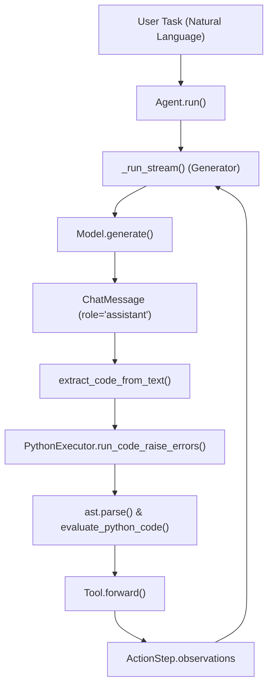
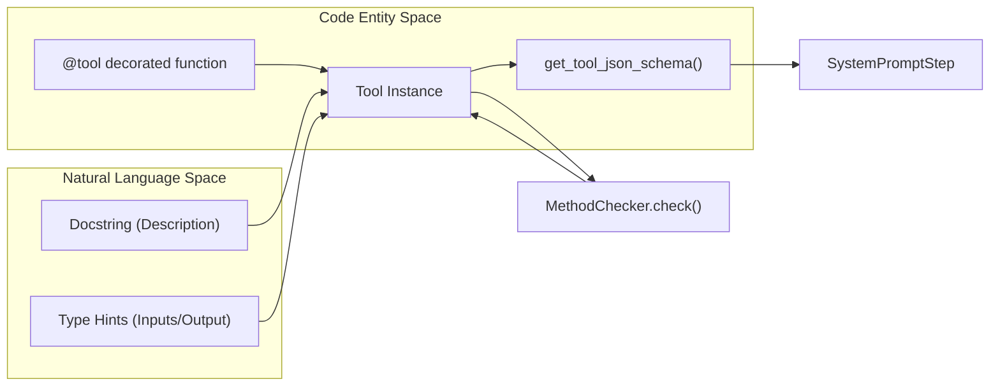

<!-- source: DeepWiki mcp.deepwiki.com · repo huggingface/smolagents · page 12 Glossary · fetched 2026-10-26 -->

# Glossary

Relevant source files

The following files were used as context for generating this wiki page:

- [pyproject.toml](pyproject.toml)
- [src/smolagents/__init__.py](src/smolagents/__init__.py)
- [src/smolagents/agents.py](src/smolagents/agents.py)
- [src/smolagents/local_python_executor.py](src/smolagents/local_python_executor.py)
- [src/smolagents/models.py](src/smolagents/models.py)
- [src/smolagents/remote_executors.py](src/smolagents/remote_executors.py)
- [src/smolagents/tools.py](src/smolagents/tools.py)
- [tests/test_agents.py](tests/test_agents.py)
- [tests/test_local_python_executor.py](tests/test_local_python_executor.py)
- [tests/test_models.py](tests/test_models.py)
- [tests/test_remote_executors.py](tests/test_remote_executors.py)
- [tests/test_tools.py](tests/test_tools.py)

This glossary defines codebase-specific terms, jargon, and domain concepts used within the `smolagents` framework. It provides technical definitions and pointers to the underlying implementation to assist onboarding engineers in navigating the system.

## Core Concepts

### Agent
An autonomous entity that uses a Large Language Model (LLM) to perform tasks by interacting with tools. In `smolagents`, agents are primarily "code-centric," meaning they generate and execute Python code to achieve goals rather than just predicting JSON or text.
*   **Base Class**: `MultiStepAgent` [src/smolagents/agents.py:270-272]()
*   **Implementation**: `CodeAgent` [src/smolagents/agents.py:917-919]() and `ToolCallingAgent` [src/smolagents/agents.py:1164-1166]()

### ReAct Loop
A "Reason-then-Act" execution pattern where the agent iterates through steps consisting of a thought (reasoning) and an action (tool call or code execution).
*   **Logic**: Handled within `MultiStepAgent.run()` [src/smolagents/agents.py:724-726]() and the step generator `_run_stream()` [src/smolagents/agents.py:534-536]().

### Tool
A Python function or class wrapped to be callable by an agent. Tools provide the agent with external capabilities like web searching, image generation, or mathematical computation.
*   **Base Class**: `Tool` [src/smolagents/tools.py:106-108]()
*   **Key Method**: `forward()` (the logic executed when the tool is called).

---

## Technical Jargon & Abbreviations

### AST (Abstract Syntax Tree)
The `smolagents` framework uses Python's `ast` module to parse and execute code generated by the agent in a secure, controlled manner without using the dangerous `exec()` or `eval()` functions directly.
*   **Implementation**: `LocalPythonExecutor` [src/smolagents/local_python_executor.py:465-467]() uses `ast.parse` [src/smolagents/local_python_executor.py:1042-1044]() and recursive node evaluation in `evaluate_python_code` [src/smolagents/local_python_executor.py:1042-1044]().

### Dunder Methods
Double-underscore methods in Python (e.g., `__init__`, `__call__`). The framework explicitly restricts access to most dunder methods in its execution environments for security.
*   **Restriction**: `nodunder_getattr` [src/smolagents/local_python_executor.py:68-71]() and `ALLOWED_DUNDER_METHODS` [src/smolagents/local_python_executor.py:61]().

### Managed Agent
An agent that is treated as a "tool" by another agent (the manager). This allows for hierarchical multi-agent systems where a manager delegates complex sub-tasks to specialized workers.
*   **Class**: `ManagedAgent` [src/smolagents/agents.py:1241-1243]()
*   **Logic**: The manager calls the worker via its `__call__` method [src/smolagents/agents.py:1274-1276]().

### MCP (Model Context Protocol)
A protocol used to integrate external tool servers. `smolagents` can connect to MCP servers to dynamically pull tool definitions.
*   **Implementation**: `ToolCollection.from_mcp()` [src/smolagents/tools.py:1015-1017]().

---

## Code-Centric Entities

### ActionStep
A single iteration of the agent's loop stored in memory. It contains the model's reasoning (thought), the action taken (tool call or code), and the resulting observation.
*   **Class**: `ActionStep` [src/smolagents/memory.py:133-135]()

### PythonExecutor
An abstraction for running Python code. It has two primary flavors: local (AST-based) and remote (sandboxed).
*   **Base Class**: `PythonExecutor` [src/smolagents/local_python_executor.py:377-379]()
*   **Local**: `LocalPythonExecutor` [src/smolagents/local_python_executor.py:465-467]()
*   **Remote**: `RemotePythonExecutor` [src/smolagents/remote_executors.py:53-55]()

### PromptTemplates
A dictionary structure containing Jinja2 templates for system prompts, planning, and agent communication.
*   **Type**: `PromptTemplates` [src/smolagents/agents.py:166-168]()
*   **Default**: Loaded from YAML files like `code_agent.yaml` [src/smolagents/agents.py:937-939]().

---

## Data Flow Diagrams

### From Natural Language Task to Code Execution
The following diagram bridges the gap between a user's natural language request and the internal code entities that process it.

**Task Execution Flow**

Sources: [src/smolagents/agents.py:724-730](), [src/smolagents/agents.py:534-550](), [src/smolagents/utils.py:189-195](), [src/smolagents/local_python_executor.py:465-480](), [src/smolagents/local_python_executor.py:1042-1055]()

### Tool Definition and Validation
How a Python function becomes a tool entity usable by the LLM.

**Tool Transformation Flow**

Sources: [src/smolagents/tools.py:797-805](), [src/smolagents/tools.py:144-160](), [src/smolagents/models.py:382-385](), [src/smolagents/tool_validation.py:53-55]()

---

## Key Class Summary

| Term | Code Pointer | Description |
| :--- | :--- | :--- |
| **Model** | [src/smolagents/models.py:277]() | Abstract base class for LLM providers (OpenAI, Transformers, etc.). |
| **AgentMemory** | [src/smolagents/memory.py:280]() | Manages the sequence of `MemoryStep` objects. |
| **ActionOutput** | [src/smolagents/agents.py:111]() | Dataclass holding the result of an agent action and whether it's final. |
| **TokenUsage** | [src/smolagents/monitoring.py:38]() | Tracks input, output, and total tokens during a run. |
| **SafeSerializer** | [src/smolagents/serialization.py:28]() | Handles secure serialization for remote execution environments. |
| **ChatMessage** | [src/smolagents/models.py:124]() | Standardized message format for communication with models. |
| **ToolCall** | [src/smolagents/memory.py:45]() | Dataclass representing a specific tool invocation within a step. |
| **CodeOutput** | [src/smolagents/local_python_executor.py:365]() | Structure containing the result of code execution and associated logs. |

**Sources:**
*   `src/smolagents/agents.py`
*   `src/smolagents/models.py`
*   `src/smolagents/tools.py`
*   `src/smolagents/memory.py`
*   `src/smolagents/local_python_executor.py`
*   `src/smolagents/remote_executors.py`
*   `src/smolagents/utils.py`
*   `src/smolagents/monitoring.py`
*   `src/smolagents/serialization.py`
*   `src/smolagents/tool_validation.py`