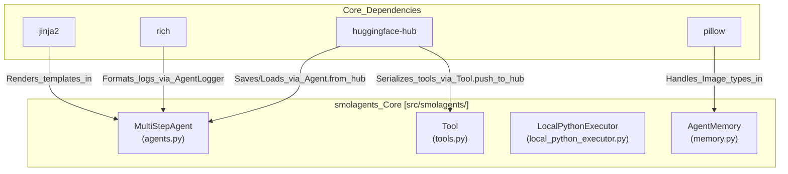
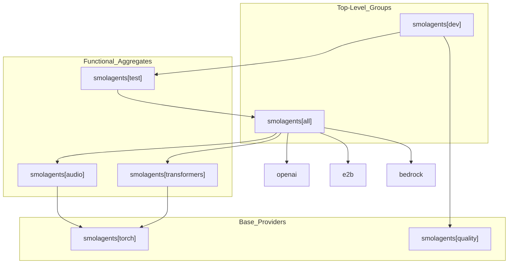

<!-- source: DeepWiki mcp.deepwiki.com · repo huggingface/smolagents · page 2.1 Installation & Dependencies · fetched 2026-10-26 -->

# Installation & Dependencies

<details>
<summary>Relevant source files</summary>

The following files were used as context for generating this wiki page:

- [docs/source/en/installation.md](docs/source/en/installation.md)
- [pyproject.toml](pyproject.toml)
- [src/smolagents/__init__.py](src/smolagents/__init__.py)

</details>


This document explains how to install `smolagents`, describes its core and optional dependencies, and guides you through selecting the appropriate dependency groups for your use case.

## Installation Methods

### Prerequisites
- **Python**: Version 3.10 or newer is required [[pyproject.toml:13](), [docs/source/en/installation.md:6]()].
- **Package Manager**: Supports `pip` or `uv` [[docs/source/en/installation.md:7]()].

### Basic Installation
The minimal installation provides core agent functionality, prompt templating, and basic tool structures without specific model provider SDKs or remote execution environments.

```bash
pip install smolagents
```

This installs the core dependencies defined in [[pyproject.toml:14-22]()]:
- `huggingface-hub>=0.31.2`: Integration for sharing and loading agents/tools.
- `requests>=2.32.3`: HTTP client for API interactions.
- `rich>=13.9.4`: Formatted console logging and trace visualization.
- `jinja2>=3.1.4`: Engine for rendering system and user prompt templates.
- `pillow>=10.0.1`: Image processing (includes security fix for CVE-2023-4863) [[pyproject.toml:20]()].
- `python-dotenv`: Management of environment variables (e.g., API keys).

### Installation with Extras
`smolagents` uses optional dependency groups to keep the core package lightweight. You can install multiple groups using comma-separated values:

```bash
pip install "smolagents[toolkit,openai,e2b]"
```

For a complete installation of all features (audio, vision, all model providers, and all executors):
```bash
pip install "smolagents[all]"
```
The `all` extra aggregates nearly all other optional groups [[pyproject.toml:92-94]()].

**Sources:** [[pyproject.toml:1-142](), [docs/source/en/installation.md:1-250]()]

## Core Dependencies Overview

The following diagram illustrates how core dependencies power the internal systems of `smolagents`.

**Core System Data Flow**

**Sources:** [[src/smolagents/__init__.py:19-32](), [pyproject.toml:14-22]()]

## Optional Dependency Groups

### Model Integration Groups
These enable specific `Model` subclasses for different inference providers.

| Group | Dependencies | Target Component |
| :--- | :--- | :--- |
| `openai` | `openai>=1.58.1` | `OpenAIModel` [[pyproject.toml:66-68]()] |
| `transformers`| `accelerate`, `transformers>=4.0.0`, `smolagents[torch]` | `TransformersModel` [[pyproject.toml:79-83]()] |
| `litellm` | `litellm>=1.60.2` | `LiteLLMModel` [[pyproject.toml:52-54]()] |
| `bedrock` | `boto3>=1.36.18` | `AmazonBedrockModel` [[pyproject.toml:25-27]()] |
| `vllm` | `vllm>=0.10.2`, `torch` | `VLLMModel` [[pyproject.toml:88-91]()] |
| `mlx-lm` | `mlx-lm` | `MLXModel` [[pyproject.toml:59-61]()] |

### Execution & Sandbox Groups
Required for running generated code in isolated environments.

| Group | Dependencies | Target Component |
| :--- | :--- | :--- |
| `e2b` | `e2b-code-interpreter>=1.0.3`, `python-dotenv>=1.0.1` | `E2BExecutor` [[pyproject.toml:45-48]()] |
| `docker` | `docker>=7.1.0`, `websocket-client` | `DockerExecutor` [[pyproject.toml:41-44]()] |
| `blaxel` | `blaxel>=0.2.19`, `websocket-client` | `BlaxelExecutor` [[pyproject.toml:28-31]()] |
| `modal` | `modal>=1.1.3`, `websocket-client` | `ModalExecutor` [[pyproject.toml:62-65]()] |

### Tooling & UI Groups
| Group | Dependencies | Target Component |
| :--- | :--- | :--- |
| `toolkit` | `ddgs>=9.0.0`, `markdownify>=0.14.1` | `DuckDuckGoSearchTool`, `VisitWebpageTool` [[pyproject.toml:75-78]()] |
| `mcp` | `mcp`, `mcpadapt>=0.1.13` | `MCPClient`, `ToolCollection.from_mcp` [[pyproject.toml:55-58]()] |
| `gradio` | `gradio>=5.14.0` | `GradioUI` [[pyproject.toml:49-51]()] |
| `vision` | `helium`, `selenium` | `webagent` CLI (Browser automation) [[pyproject.toml:84-87]()] |
| `telemetry`| `arize-phoenix`, `opentelemetry-sdk`, `opentelemetry-exporter-otlp`, `openinference-instrumentation-smolagents>=0.1.15` | `Monitor` (Tracing) [[pyproject.toml:69-74]()] |

**Sources:** [[pyproject.toml:24-94]()]

## Dependency Hierarchy

The library uses a nested dependency structure where high-level groups (like `all` or `dev`) pull in lower-level functional groups.

**Dependency Resolution Map**

**Sources:** [[pyproject.toml:92-113]()]

## Development Setup

For contributors, a specific set of tools is provided via the `dev` extra.

1. **Clone and Install**:
   ```bash
   git clone https://github.com/huggingface/smolagents.git
   cd smolagents
   pip install -e ".[dev]"
   ```
   This installs `ruff` for linting and `pytest` for testing [[pyproject.toml:95-109]()].

2. **Quality Checks**:
   The `pyproject.toml` defines configuration for maintenance:
   - `ruff`: Configured with line-length 119 and specific lint selections `E`, `F`, `I`, `W` [[pyproject.toml:119-126]()].
   - `pytest`: Configured with `-sv --durations=0` [[pyproject.toml:115-117]()].

**Sources:** [[pyproject.toml:95-135]()]

## Verifying Installation

To verify the installation and check the current version (currently `1.27.0.dev0`):

```python
import smolagents
print(smolagents.__version__)
```
[[src/smolagents/__init__.py:17](), [pyproject.toml:7]()]

### CLI Verification
Installation also registers two global commands via `project.scripts`:
- `smolagent`: The primary CLI for running agents, calling `smolagents.cli:main` [[pyproject.toml:140]()].
- `webagent`: A specialized CLI for vision-based web browsing, calling `smolagents.vision_web_browser:main` [[pyproject.toml:141]()].

**Sources:** [[pyproject.toml:139-142](), [src/smolagents/__init__.py:32]()]

---

