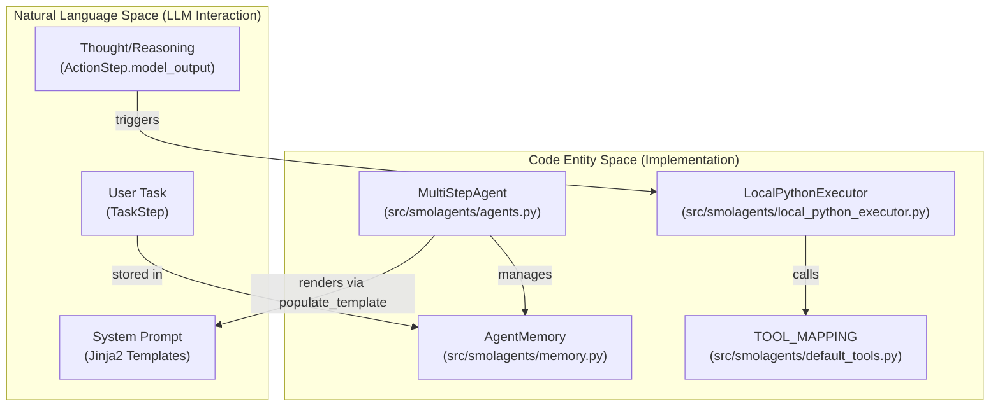
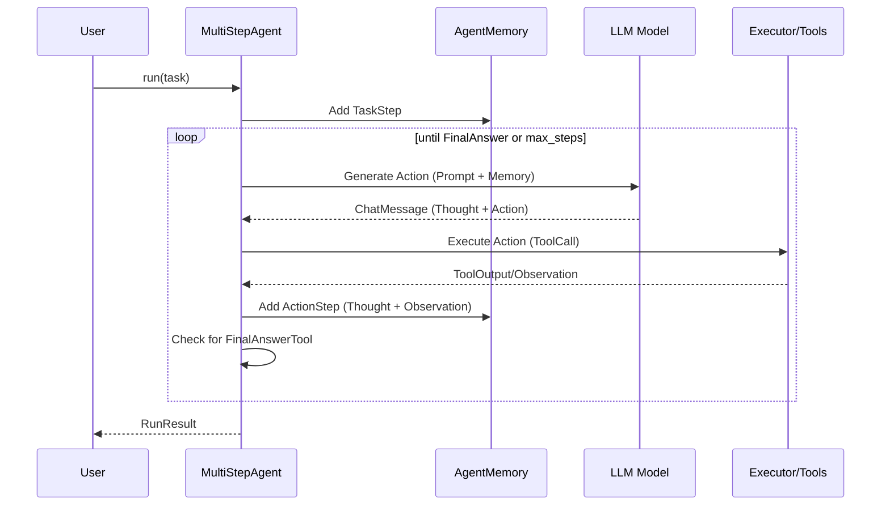

<!-- source: DeepWiki mcp.deepwiki.com · repo huggingface/smolagents · page 3 Agent Framework · fetched 2026-10-26 -->

# Agent Framework

Relevant source files

The following files were used as context for generating this wiki page:

- [docs/source/en/reference/agents.md](docs/source/en/reference/agents.md)
- [docs/source/hi/reference/agents.md](docs/source/hi/reference/agents.md)
- [docs/source/zh/reference/agents.md](docs/source/zh/reference/agents.md)
- [src/smolagents/agents.py](src/smolagents/agents.py)
- [tests/test_agents.py](tests/test_agents.py)

This document provides comprehensive documentation of the agent system, the core component of `smolagents`. It covers the agent class hierarchy, execution patterns, memory management, and lifecycle hooks.

For information about specific model integrations, see [Model Integration](#4). For details on the tool system, see [Tool System](#5). For code execution environments, see [Code Execution & Security](#6).

## Architecture Overview

The agent framework implements a **ReAct** (Reasoning + Acting) pattern where agents iteratively think about a task, take actions using tools, observe results, and continue until reaching a final answer. The system is built on three key abstractions:

| Component | Purpose | Key Classes |
|-----------|---------|-------------|
| **Agent Types** | Define how actions are generated and executed | `MultiStepAgent`, `CodeAgent`, `ToolCallingAgent` |
| **Memory System** | Store conversation history and execution steps | `AgentMemory`, `MemoryStep` subclasses |
| **Monitoring & Callbacks** | Track execution and enable custom hooks | `CallbackRegistry`, `Monitor`, `AgentLogger` |

The framework supports two distinct agent paradigms:
- **Code-based agents** (`CodeAgent`): Generate Python code to invoke tools as functions. [src/smolagents/agents.py:891-1177]()
- **Tool-calling agents** (`ToolCallingAgent`): Generate structured JSON tool calls. [src/smolagents/agents.py:1179-1495]()

### System Component Map

The following diagram maps high-level concepts to the specific code entities that implement them.

**Sources:** [src/smolagents/agents.py:268-889](), [src/smolagents/memory.py:214-278](), [src/smolagents/local_python_executor.py:186-210](), [src/smolagents/agents.py:102-108]()

## Agent Type Hierarchy

### MultiStepAgent: Abstract Base Class

`MultiStepAgent` is the abstract base class that defines the core agent interface and execution loop. All concrete agent implementations inherit from this class. [src/smolagents/agents.py:268-293]()

**Key Initialization Parameters:**

| Parameter | Type | Description |
|-----------|------|-------------|
| `tools` | `list[Tool]` | Tools available to the agent. [src/smolagents/agents.py:301]() |
| `model` | `Model` | LLM that generates agent actions. [src/smolagents/agents.py:302]() |
| `prompt_templates` | `PromptTemplates` | YAML-based prompt configuration. [src/smolagents/agents.py:304]() |
| `max_steps` | `int` | Maximum iterations (default: 20). [src/smolagents/agents.py:307]() |
| `planning_interval` | `int \| None` | Frequency of planning steps. [src/smolagents/agents.py:311]() |
| `managed_agents` | `list \| None` | Sub-agents for hierarchical delegation. [src/smolagents/agents.py:308]() |

**Sources:** [src/smolagents/agents.py:268-367]()

### CodeAgent: Python Code Generation

`CodeAgent` generates Python code snippets to invoke tools as functions. Code is executed in a `PythonExecutor`. [src/smolagents/agents.py:891-1177]()

**Key Characteristics:**
- Generates code blocks wrapped in `code_block_tags` (default: `<code>...</code>`). [src/smolagents/agents.py:944]()
- Uses `LocalPythonExecutor` by default to run generated code. [src/smolagents/agents.py:925]()
- Tools are exposed as callable Python functions within the execution context. [src/smolagents/agents.py:1012-1025]()

For details, see [CodeAgent](#3.2).

### ToolCallingAgent: JSON Tool Calling

`ToolCallingAgent` generates structured JSON tool calls following standard tool-calling conventions. [src/smolagents/agents.py:1179-1495]()

**Key Characteristics:**
- Model generates `ChatMessageToolCall` objects. [src/smolagents/agents.py:1263-1275]()
- Tools are invoked via `tool.forward(**arguments)`. [src/smolagents/agents.py:1330-1340]()
- Supports parallel tool execution via `ThreadPoolExecutor`. [src/smolagents/agents.py:1321-1335]()

For details, see [ToolCallingAgent](#3.3).

## ReAct Execution Loop

The ReAct loop is the core execution pattern implemented in `MultiStepAgent.run()` and `_run_stream()`. [src/smolagents/agents.py:436-538]()

### Execution Lifecycle

**Main Entry Points:**
- `run()`: Execute agent with task and return a `RunResult`. [src/smolagents/agents.py:436-538]()
- `_run_stream()`: Generator yielding each step as it occurs for real-time monitoring. [src/smolagents/agents.py:540-612]()

For details, see [MultiStepAgent & ReAct Loop](#3.1).

## Agent Memory & State Management

The memory system stores the agent's conversation history as a sequence of typed steps in `AgentMemory`. [src/smolagents/memory.py:214-278]()

### Memory Step Types
- `SystemPromptStep`: Initial instructions and tool definitions. [src/smolagents/memory.py:153-162]()
- `TaskStep`: The user's request and optional images. [src/smolagents/memory.py:165-182]()
- `PlanningStep`: Generated plans and updates based on `planning_interval`. [src/smolagents/memory.py:185-211]()
- `ActionStep`: Core ReAct step containing thought, tool calls, and observations. [src/smolagents/memory.py:50-150]()
- `FinalAnswerStep`: The terminal step containing the agent's conclusive output. [src/smolagents/memory.py:213]()

For details, see [Agent Memory & State Management](#3.4).

## Callbacks & Agent Lifecycle

The `CallbackRegistry` system allows users to hook into the agent's execution lifecycle at various points. [src/smolagents/memory.py:280-317]()

**Lifecycle Hooks:**
- `step_callbacks`: Functions executed after every memory step is completed. [src/smolagents/agents.py:309]()
- `final_answer_checks`: Validation functions for the final output before finishing. [src/smolagents/agents.py:310]()

For details, see [Callbacks & Agent Lifecycle](#3.5).

## Prompt Templates & System Instructions

Agents use Jinja2-templated strings, often loaded from YAML files, to define their behavior. [src/smolagents/agents.py:102-108]()

**Key Templates in `PromptTemplates`:**
- `system_prompt`: The core personality and tool-usage instructions. [src/smolagents/agents.py:177]()
- `planning`: Templates for creating and updating task plans (`initial_plan`, `update_plan_pre_messages`, etc.). [src/smolagents/agents.py:178]()
- `managed_agent`: Templates for interacting with sub-agents (`task`, `report`). [src/smolagents/agents.py:179]()
- `final_answer`: Templates for formatting the terminal response. [src/smolagents/agents.py:180]()

For details, see [Prompt Templates & System Instructions](#3.6).

**Sources:** [src/smolagents/agents.py:102-192](), [src/smolagents/memory.py:280-317](), [src/smolagents/memory.py:42-213]()

---

