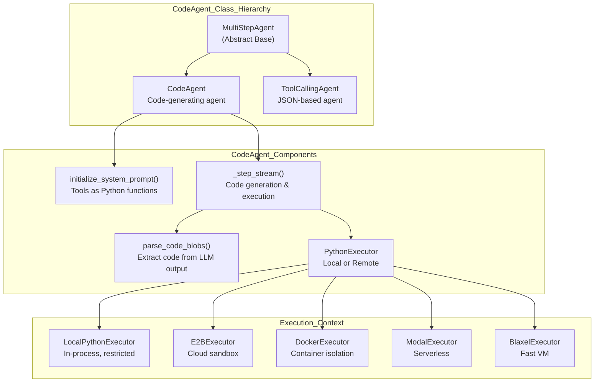
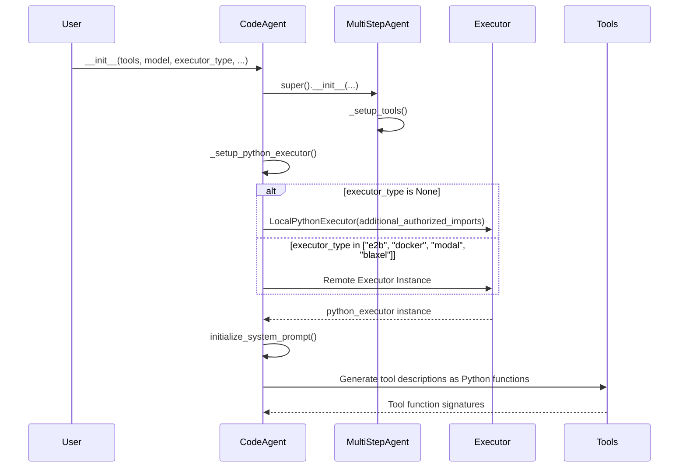
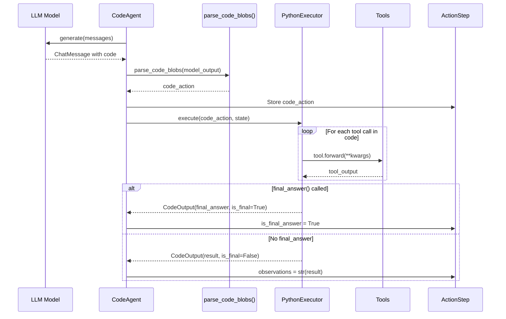

<!-- source: DeepWiki mcp.deepwiki.com · repo huggingface/smolagents · page 3.2 CodeAgent · fetched 2026-10-26 -->

# CodeAgent

<details>
<summary>Relevant source files</summary>

The following files were used as context for generating this wiki page:

- [README.md](README.md)
- [docs/source/en/index.md](docs/source/en/index.md)
- [docs/source/en/tutorials/secure_code_execution.md](docs/source/en/tutorials/secure_code_execution.md)
- [src/smolagents/agents.py](src/smolagents/agents.py)
- [tests/test_agents.py](tests/test_agents.py)

</details>


`CodeAgent` is an agent implementation that generates and executes Python code snippets to perform actions and solve tasks. Unlike `ToolCallingAgent` which outputs structured JSON tool calls, `CodeAgent` writes its actions as executable Python code, allowing for more expressive multi-step reasoning, control flow, and dynamic tool composition.

For information about the base agent abstraction and ReAct loop, see [3.1 MultiStepAgent & ReAct Loop](). For the alternative JSON-based agent paradigm, see [3.3 ToolCallingAgent](). For code execution security, see [6.1 Execution Environment Overview]().

---

## Overview & Design Philosophy

`CodeAgent` implements a code-centric agent paradigm where the LLM generates Python code snippets rather than structured API calls. This approach provides several advantages:

- **Expressiveness**: Full Python language capabilities including loops, conditionals, variable assignment, and function composition [src/smolagents/agents.py:908-920]().
- **Tool Composition**: Natural chaining and transformation of tool outputs through standard Python syntax.
- **Object Management**: Ability to store complex outputs (like images or dataframes) in variables for subsequent tool calls [docs/source/en/tutorials/secure_code_execution.md:15-17]().
- **Performance**: Research suggests higher benchmark performance compared to JSON-based tool calling [docs/source/en/tutorials/secure_code_execution.md:10-22]().

The tradeoff is increased complexity in code parsing, execution sandboxing, and security management [src/smolagents/local_python_executor.py:49-55]().

**Sources:** [src/smolagents/agents.py:908-920](), [src/smolagents/local_python_executor.py:49-55](), [docs/source/en/tutorials/secure_code_execution.md:10-22]()

---

## Architecture Overview

### System Components Diagram
The following diagram illustrates the relationship between the `CodeAgent` class, its core components, and the available execution environments.



**Sources:** [src/smolagents/agents.py:908-920](), [src/smolagents/agents.py:951-1000](), [src/smolagents/remote_executors.py:1-80]()

---

## Initialization and Configuration

### Constructor Parameters

`CodeAgent` extends `MultiStepAgent` with code execution-specific parameters:

| Parameter | Type | Description |
|-----------|------|-------------|
| `executor_type` | `str \| None` | Executor type: `None` (local), `"e2b"`, `"docker"`, `"modal"`, `"blaxel"` [src/smolagents/agents.py:925-926]() |
| `additional_authorized_imports` | `list[str] \| None` | Whitelist of additional Python modules to allow importing [src/smolagents/agents.py:921-922]() |
| `verbose_code_output` | `bool` | Whether to show detailed code execution logs (default: `True`) [src/smolagents/agents.py:928-928]() |
| `python_executor` | `PythonExecutor \| None` | Custom executor instance (overrides `executor_type`) [src/smolagents/agents.py:923-924]() |
| `code_block_tags` | `list[str]` | List of tags to identify code blocks in LLM output (default: `["```python", "```", "<code>"]`) [src/smolagents/agents.py:927-927]() |

It inherits all `MultiStepAgent` parameters including `tools`, `model`, `prompt_templates`, `max_steps`, and `managed_agents` [src/smolagents/agents.py:908-949]().

### Initialization Sequence
When initialized, the agent sets up its execution environment and constructs the system prompt based on the provided tools.



**Sources:** [src/smolagents/agents.py:951-1000](), [src/smolagents/agents.py:389-402]()

---

## System Prompt Construction

`CodeAgent` generates a system prompt that presents tools as callable Python functions. This allows the LLM to treat the environment as a standard Python coding task.

### Tool Function Generation
For each tool, `CodeAgent` generates a Python function signature [src/smolagents/agents.py:1002-1100](). This includes:
- Function name matching `tool.name`.
- Docstring containing `tool.description`.
- Type-hinted parameters based on `tool.inputs`.
- Return type annotation from `tool.output_type`.

### Prompt Components
The system prompt is typically loaded from YAML templates (e.g., `code_agent.yaml`) and includes:
1. **ReAct Cycle Instructions**: Guidance on using `Thought:`, `Code:`, and `Observation:` sequences [src/smolagents/agents.py:1102-1120]().
2. **Authorized Imports**: Modules listed in `additional_authorized_imports` [src/smolagents/agents.py:921-922]().
3. **Tool Function Signatures**: Dynamically generated signatures for all provided tools [src/smolagents/agents.py:1002-1050]().
4. **Final Answer Instruction**: Requirement to use the `final_answer` tool to conclude the task [src/smolagents/agents.py:48-48]().

**Sources:** [src/smolagents/agents.py:1002-1100](), [src/smolagents/agents.py:921-922]()

---

## Code Generation and Execution Flow

### Single Step Execution
The core of the agent's logic resides in the `_step_stream` generator, which handles the interaction between the LLM and the code executor.



**Sources:** [src/smolagents/agents.py:1102-1238](), [src/smolagents/utils.py:94-94]()

### Code Parsing
The `parse_code_blobs()` utility extracts Python code from LLM output. It identifies code blocks based on configured tags [src/smolagents/utils.py:94-94](). By default, it handles triple-backtick blocks or specific `<code>` tags [src/smolagents/utils.py:91-91](). The `code_block_tags` parameter in `CodeAgent`'s constructor allows customization of these tags [src/smolagents/agents.py:927-927]().

### Variable Persistence
`CodeAgent` maintains state across steps through the executor's `state` dictionary [src/smolagents/agents.py:1146-1147](). Variables assigned in one step remain available in subsequent steps, allowing the agent to perform complex, stateful operations [tests/test_agents.py:562-571]().

**Sources:** [src/smolagents/agents.py:927-927](), [src/smolagents/agents.py:1146-1147](), [src/smolagents/utils.py:91-91](), [src/smolagents/utils.py:94-94](), [tests/test_agents.py:562-571]()

---

## Code Execution Environments

`CodeAgent` supports multiple execution backends with different security profiles.

| Executor | Security | Use Case |
|----------|----------|----------|
| `LocalPythonExecutor` | ⚠️ Restricted (AST-based) | Local development, trusted environments [src/smolagents/local_python_executor.py:49-49]() |
| `E2BExecutor` | ✅ High (Sandboxed) | Production, untrusted code [src/smolagents/remote_executors.py:80-80]() |
| `DockerExecutor` | ✅ High (Isolated) | Self-hosted isolation [src/smolagents/remote_executors.py:80-80]() |
| `ModalExecutor` | ✅ High (Sandboxed) | Serverless execution [src/smolagents/remote_executors.py:80-80]() |
| `BlaxelExecutor` | ✅ High (Sandboxed) | Fast VM execution [src/smolagents/remote_executors.py:80-80]() |

### Import Authorization
`LocalPythonExecutor` restricts imports to a whitelist. By default, it allows a set of safe modules defined in `BASE_BUILTIN_MODULES` [src/smolagents/local_python_executor.py:49-49](). Users can authorize additional modules via `additional_authorized_imports` [src/smolagents/agents.py:921-922]().

**Sources:** [src/smolagents/agents.py:921-922](), [src/smolagents/local_python_executor.py:49-49](), [src/smolagents/remote_executors.py:80-80]()

---

## Error Handling

`CodeAgent` handles various error types during the generation and execution phases:

- **`AgentParsingError`**: Raised when the LLM output does not contain valid code blocks [src/smolagents/utils.py:87-87]().
- **`AgentExecutionError`**: Raised when the generated code fails to execute (e.g., SyntaxError, ImportError) [src/smolagents/utils.py:84-84]().
- **`AgentToolExecutionError`**: Raised when a tool called within the code snippet fails [src/smolagents/utils.py:89-89]().

Errors are captured and fed back into the agent's memory as observations, allowing the LLM to "see" the traceback and attempt to fix the code in the next step [src/smolagents/agents.py:1169-1238]().

**Sources:** [src/smolagents/agents.py:1102-1238](), [src/smolagents/utils.py:83-96]()

---

