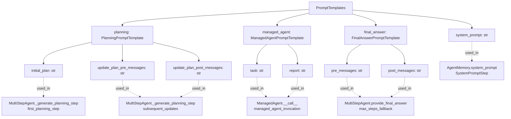
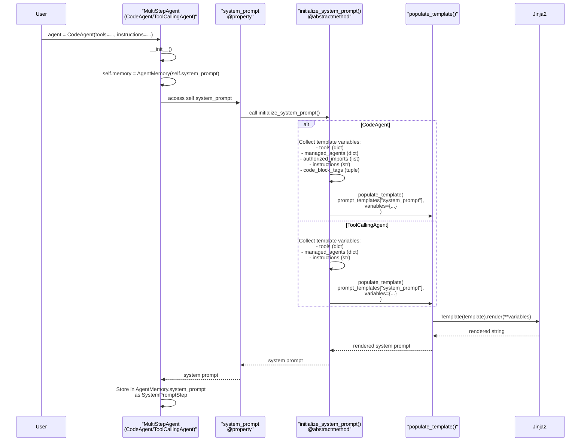
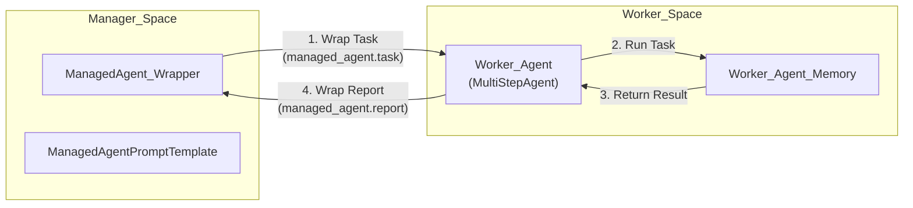

<!-- source: DeepWiki mcp.deepwiki.com · repo huggingface/smolagents · page 3.6 Prompt Templates & System Instructions · fetched 2026-10-26 -->

# Prompt Templates & System Instructions

<details>
<summary>Relevant source files</summary>

The following files were used as context for generating this wiki page:

- [src/smolagents/agents.py](src/smolagents/agents.py)
- [src/smolagents/prompts/code_agent.yaml](src/smolagents/prompts/code_agent.yaml)
- [src/smolagents/prompts/structured_code_agent.yaml](src/smolagents/prompts/structured_code_agent.yaml)
- [src/smolagents/prompts/toolcalling_agent.yaml](src/smolagents/prompts/toolcalling_agent.yaml)
- [tests/test_agents.py](tests/test_agents.py)

</details>


This page documents the prompt template system that controls how agents communicate with LLMs. It covers the structure of `PromptTemplates`, how system prompts are generated, template variables, and customization patterns. For information about agent execution and the ReAct loop, see [MultiStepAgent & ReAct Loop](#3.1). For memory management, see [Agent Memory & State Management](#3.4).

---

## Template Structure & Types

smolagents uses a structured prompt template system defined by the `PromptTemplates` `TypedDict` [src/smolagents/agents.py:166-181](), which organizes all agent prompts into four main categories. The framework also provides an `EMPTY_PROMPT_TEMPLATES` constant as a starting point for full customization [src/smolagents/agents.py:183-192]().

```python
class PromptTemplates(TypedDict):
    system_prompt: str
    planning: PlanningPromptTemplate
    managed_agent: ManagedAgentPromptTemplate
    final_answer: FinalAnswerPromptTemplate
```

### Template Hierarchy

The hierarchy bridges the "Natural Language Space" (Jinja2 strings) to "Code Entity Space" (Memory steps and Agent methods).

**Diagram: Prompt Template to Code Entity Mapping**



Sources: [src/smolagents/agents.py:125-181](), [src/smolagents/agents.py:183-192](), [src/smolagents/agents.py:639-747](), [src/smolagents/agents.py:810-853](), [src/smolagents/agents.py:868-890]()

| Template Type | Purpose | When Used |
|---------------|---------|-----------|
| `system_prompt` | Main instruction set for the agent | Initialization, stored in `AgentMemory` as `SystemPromptStep` |
| `planning.initial_plan` | Request initial plan from LLM | First planning step (step 1) |
| `planning.update_plan_pre_messages` | Context for plan updates | Planning interval steps (system message) |
| `planning.update_plan_post_messages` | Request updated plan | Planning interval steps (user message) |
| `managed_agent.task` | Wrap task for sub-agent | When calling managed agents via `__call__` |
| `managed_agent.report` | Wrap sub-agent output | After managed agent completes |
| `final_answer.pre_messages` | Setup for final answer synthesis | When `max_steps` reached |
| `final_answer.post_messages` | Request final answer | When `max_steps` reached |

Sources: [src/smolagents/agents.py:125-181](), [src/smolagents/agents.py:639-747](), [src/smolagents/agents.py:810-853](), [src/smolagents/agents.py:868-890]()

---

## System Prompt Generation

The system prompt is the foundation of agent behavior. It is generated dynamically by the `initialize_system_prompt()` method, which is implemented differently for each agent type.

### System Prompt Flow

This diagram illustrates how code entities like `CodeAgent` and `ToolCallingAgent` transform raw YAML templates into the final instructions stored in `AgentMemory`.

**Diagram: System Prompt Lifecycle**



Sources: [src/smolagents/agents.py:102-108](), [src/smolagents/agents.py:354-362](), [src/smolagents/agents.py:749-752](), [src/smolagents/agents.py:1265-1274](), [src/smolagents/agents.py:1621-1637]()

### Implementation Differences

**CodeAgent.initialize_system_prompt()** [src/smolagents/agents.py:1621-1637]():
- Includes `authorized_imports` to tell the LLM which Python packages it can use.
- Passes `code_block_opening_tag` and `code_block_closing_tag` (defaulting to `<code>` and `</code>`) to define the code block syntax [src/smolagents/agents.py:1556-1557]().
- Uses `tool.to_code_prompt()` for tool descriptions [src/smolagents/prompts/code_agent.yaml:135]().

**ToolCallingAgent.initialize_system_prompt()** [src/smolagents/agents.py:1265-1274]():
- Focuses on JSON-based tool call formats.
- Uses `tool.to_tool_calling_prompt()` for tool descriptions [src/smolagents/prompts/toolcalling_agent.yaml:94]().
- Does not require code block tags or import whitelists.

### Read-Only Property

The `system_prompt` property in `MultiStepAgent` is read-only and dynamically computed [src/smolagents/agents.py:354-362](). Attempting to set it directly via `agent.system_prompt = "..."` will raise an `AttributeError`. Users should instead modify `self.prompt_templates["system_prompt"]` [tests/test_agents.py:1015-1023]().

Sources: [src/smolagents/agents.py:354-362](), [tests/test_agents.py:996-1023]()

---

## Template Variables & Jinja2 Rendering

All templates are rendered using Jinja2 through the `populate_template()` function [src/smolagents/agents.py:102-108](), which uses `StrictUndefined` to ensure that any missing variables in the template cause an immediate error [src/smolagents/agents.py:103]().

### Available Variables by Template Type

| Template | Available Variables | Type | Purpose |
|----------|-------------------|------|---------|
| `system_prompt` | `tools` | `dict[str, Tool]` | Tool definitions for the agent |
| | `managed_agents` | `dict[str, MultiStepAgent]` | Sub-agents available for delegation |
| | `custom_instructions` | `str \| None` | User-provided instructions |
| | `authorized_imports` | `str` | (CodeAgent only) Import whitelist |
| | `code_block_opening_tag` | `str` | (CodeAgent only) e.g., `"<code>"` |
| | `code_block_closing_tag` | `str` | (CodeAgent only) e.g., `"</code>"` |
| `planning.initial_plan` | `task` | `str` | Current task description |
| | `tools` | `dict[str, Tool]` | Available tools |
| | `managed_agents` | `dict[str, MultiStepAgent]` | Available sub-agents |
| `planning.update_plan_pre_messages` | `task` | `str` | Current task description |
| `planning.update_plan_post_messages` | `task` | `str` | Current task description |
| | `tools` | `dict[str, Tool]` | Available tools |
| | | `managed_agents` | `dict[str, MultiStepAgent]` | Available sub-agents |
| | `remaining_steps` | `int` | Steps left before max_steps |
| `managed_agent.task` | `name` | `str` | Managed agent's name |
| | `task` | `str` | Task to delegate |
| `managed_agent.report` | `name` | `str` | Managed agent's name |
| | `final_answer` | `Any` | Result from managed agent |

Sources: [src/smolagents/agents.py:650-710](), [src/smolagents/agents.py:839-842](), [src/smolagents/agents.py:872-882](), [src/smolagents/agents.py:1265-1274](), [src/smolagents/agents.py:1621-1637]()

---

## Default Prompt Templates

Each agent type loads default templates from YAML files. These files define the "personality" and operational logic of the agent.

### YAML File Locations

| Agent Type | Condition | YAML File |
|------------|-----------|-----------|
| `CodeAgent` | Default | `smolagents.prompts/code_agent.yaml` [src/smolagents/agents.py:1548-1554]() |
| `CodeAgent` | `use_structured_outputs_internally=True` | `smolagents.prompts/structured_code_agent.yaml` [src/smolagents/agents.py:1548-1554]() |
| `ToolCallingAgent` | Default | `smolagents.prompts/toolcalling_agent.yaml` [src/smolagents/agents.py:1241-1243]() |

The `code_agent.yaml` template specifically instructs the model to use a cycle of `Thought:`, `Code:`, and `Observation:` [src/smolagents/prompts/code_agent.yaml:4-10](). The `toolcalling_agent.yaml` uses an `Action:`/`Observation:` pattern with JSON blobs [src/smolagents/prompts/toolcalling_agent.yaml:5-25](). For models requiring strict JSON schemas, `structured_code_agent.yaml` provides a format with `"thought"` and `"code"` keys [src/smolagents/prompts/structured_code_agent.yaml:10-16]().

---

## Planning Strategies

Planning is handled by the `_generate_planning_step()` method [src/smolagents/agents.py:639-747](). If a `planning_interval` is set, the agent will periodically step back to assess facts and update its strategy.

### Facts Survey Methodology
The default planning templates [src/smolagents/prompts/toolcalling_agent.yaml:121-144](), [src/smolagents/prompts/code_agent.yaml:166-180]() require the LLM to perform a "Facts survey" with three specific headings:
1. **Facts given in the task**: Explicit data provided by the user [src/smolagents/prompts/toolcalling_agent.yaml:128-129]().
2. **Facts to look up**: Information requiring tool use (e.g., search, database) [src/smolagents/prompts/toolcalling_agent.yaml:131-133]().
3. **Facts to derive**: Logical conclusions or computations needed [src/smolagents/prompts/toolcalling_agent.yaml:135-136]().

This strategy forces the model to ground its plan in verified or verifiable information before generating tool calls.

Sources: [src/smolagents/prompts/toolcalling_agent.yaml:121-144](), [src/smolagents/prompts/code_agent.yaml:166-180](), [src/smolagents/agents.py:639-747]()

---

## Managed Agent Integration

Managed agents are treated as special tools within the prompt templates. Their integration allows for hierarchical task delegation.

**Diagram: Managed Agent Prompt Flow**



In the system prompt, managed agents are presented as callable functions (for `CodeAgent`) or tools (for `ToolCallingAgent`). The `managed_agent.task` template is used to format the request sent to the sub-agent, and `managed_agent.report` formats the sub-agent's response for the manager's memory [src/smolagents/agents.py:839-842](), [src/smolagents/agents.py:872-882]().

Sources: [src/smolagents/agents.py:140-151](), [src/smolagents/agents.py:810-890](), [src/smolagents/prompts/code_agent.yaml:139-158](), [src/smolagents/prompts/toolcalling_agent.yaml:97-107]()

---

## Serialization & Hub Integration

Prompt templates are fully serializable. When an agent is saved using `agent.save(output_dir)`, the templates are written to a `prompts.yaml` file [src/smolagents/agents.py:925-937]().

When pushing to the Hugging Face Hub via `push_to_hub()`, these templates are uploaded as part of the agent repository [src/smolagents/agents.py:1064-1117](). This ensures that when someone else loads the agent using `CodeAgent.from_hub()`, they receive the exact same system instructions and planning logic configured by the original author [src/smolagents/agents.py:1159-1215]().

Sources: [src/smolagents/agents.py:925-937](), [src/smolagents/agents.py:1064-1117](), [src/smolagents/agents.py:1159-1215]()

---

