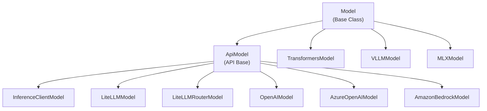
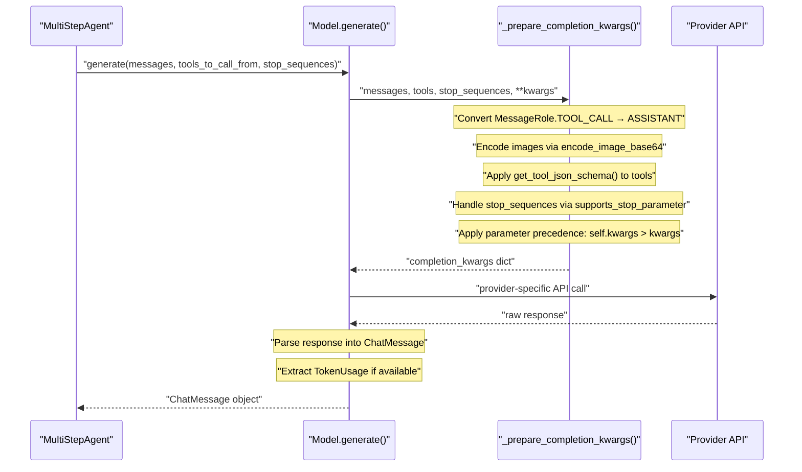
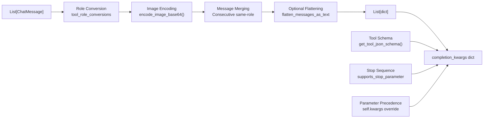

<!-- source: DeepWiki mcp.deepwiki.com · repo huggingface/smolagents · page 4 Model Integration · fetched 2026-10-26 -->

# Model Integration

Relevant source files

The following files were used as context for generating this wiki page:

- [docs/source/en/examples/using_different_models.md](docs/source/en/examples/using_different_models.md)
- [docs/source/en/guided_tour.md](docs/source/en/guided_tour.md)
- [docs/source/en/reference/models.md](docs/source/en/reference/models.md)
- [src/smolagents/models.py](src/smolagents/models.py)
- [tests/test_models.py](tests/test_models.py)

## Purpose and Scope

This document provides an overview of the model abstraction layer in `smolagents`, which enables agents to work with diverse LLM providers through a unified interface. The model integration system handles message formatting, tool schema conversion, parameter management, and API communication across multiple model implementations, including local and remote backends. [src/smolagents/models.py:452-460]()

For information about how agents use these models, see [Agent Framework](#3). For detailed API documentation, see the individual sub-pages below.

## Model Abstraction Layer

The model abstraction layer allows agents to swap between different LLM providers (Hugging Face, OpenAI, Anthropic, AWS Bedrock, etc.) without changing agent code. All model implementations inherit from the `Model` base class and implement a standard `__call__` interface. [src/smolagents/models.py:452-460]()

**Key responsibilities of the model layer:**
- Convert agent memory into provider-specific message formats via `get_clean_message_list`. [src/smolagents/models.py:332-340]()
- Transform tool definitions into JSON schemas compatible with each provider using `get_tool_json_schema`. [src/smolagents/models.py:288-295]()
- Handle stop sequences, streaming, and parameter precedence. [src/smolagents/models.py:502-515]()
- Manage rate limiting and retries for API-based models via `RateLimiter` and `Retrying`. [src/smolagents/models.py:633-645]()
- Parse model outputs into standardized `ChatMessage` objects. [src/smolagents/models.py:124-130]()

**Model Class Hierarchy**

Sources: [src/smolagents/models.py:452-460](), [src/smolagents/models.py:633-640](), [src/smolagents/models.py:1006-1015](), [src/smolagents/models.py:1212-1220](), [docs/source/en/examples/using_different_models.md:10-19]()

## Model-Agent Integration

Agents interact with models through a standardized interface. The agent passes messages and tool definitions to the model, and the model returns a `ChatMessage` with the LLM's response. [src/smolagents/models.py:553-565]()

**Agent-Model Communication Flow**

Sources: [src/smolagents/models.py:502-551](), [src/smolagents/models.py:553-578](), [src/smolagents/models.py:332-397]()

## Model Categories

The framework organizes models into two primary categories:

**Local Inference Models**

These models run on the user's hardware using local libraries: [docs/source/en/examples/using_different_models.md:12-14]()

| Model Class | Backend | Use Case |
|-------------|---------|----------|
| `TransformersModel` | HF Transformers | Local execution with high customizability. [src/smolagents/models.py:1006-1015]() |
| `VLLMModel` | vLLM | High-throughput serving and optimized inference. [src/smolagents/models.py:1212-1220]() |
| `MLXModel` | MLX | Optimized for Apple Silicon devices. [src/smolagents/models.py:1174-1180]() |

**API-Based Models**

These models make HTTP requests to external LLM providers and inherit from `ApiModel`. [src/smolagents/models.py:633-640]()

| Model Class | Provider | Authentication |
|-------------|----------|----------------|
| `InferenceClientModel` | Hugging Face Hub | `token` or `HF_TOKEN` env var. [src/smolagents/models.py:751-760]() |
| `LiteLLMModel` | 100+ Providers | Provider-specific env vars. [src/smolagents/models.py:860-870]() |
| `OpenAIModel` | OpenAI-compatible | `api_key` or `OPENAI_API_KEY` env var. [src/smolagents/models.py:1106-1115]() |
| `AzureOpenAIModel` | Azure OpenAI | `api_key`, `azure_endpoint`. [src/smolagents/models.py:1138-1145]() |
| `AmazonBedrockModel` | AWS Bedrock | AWS credentials via boto3. [src/smolagents/models.py:1248-1255]() |

Sources: [src/smolagents/models.py:633-1255](), [docs/source/en/examples/using_different_models.md:11-19]()

## Message Processing Pipeline

All models follow a common pipeline for processing messages before sending them to the LLM:

**Message Transformation Steps**

The pipeline is implemented in `get_clean_message_list()` and `_prepare_completion_kwargs()`. [src/smolagents/models.py:332-397](), [src/smolagents/models.py:502-551]()

Sources: [src/smolagents/models.py:332-397](), [src/smolagents/models.py:502-551](), [src/smolagents/models.py:288-329]()

## Parameter Management

Models support flexible parameter configuration through a precedence system. The `REMOVE_PARAMETER` sentinel value allows explicit exclusion of parameters for models that do not support them (e.g., `stop` parameter for certain OpenAI `o3` or Grok models). [src/smolagents/models.py:441-449](), [tests/test_models.py:50-78](), [docs/source/en/examples/using_different_models.md:85-87]()

**Parameter Precedence Hierarchy (highest to lowest)**

1.  **`self.kwargs`**: Parameters passed during model instantiation. [src/smolagents/models.py:488-491]()
2.  **`generate()` kwargs**: Parameters passed during the specific call. [src/smolagents/models.py:502-505]()
3.  **Specific parameters**: Internal defaults like `stop_sequences` or `tools`. [src/smolagents/models.py:512-515]()

Sources: [src/smolagents/models.py:441-449](), [src/smolagents/models.py:502-551](), [tests/test_models.py:50-78]()

## Tool Integration

Models automatically convert `Tool` objects into provider-compatible JSON schemas using `get_tool_json_schema()`. This function handles type normalization (e.g., converting `"any"` to `"string"`) and nullable parameter detection. [src/smolagents/models.py:288-329]()

For `CodeAgent`, tools are typically rendered as Python function signatures in the system prompt. For `ToolCallingAgent`, they are passed as JSON schemas in the model's `tools` parameter. [docs/source/en/guided_tour.md:12-32]()

Sources: [src/smolagents/models.py:288-329](), [docs/source/en/guided_tour.md:12-32]()

## Stop Sequence Handling

The framework detects if a model supports the `stop` parameter via `supports_stop_parameter()`. If unsupported (e.g., OpenAI `o3`/`o4` models), the framework post-processes the generated text using `remove_content_after_stop_sequences()`. [src/smolagents/models.py:418-438](), [src/smolagents/models.py:79-91](), [tests/test_models.py:141-168]()

Sources: [src/smolagents/models.py:418-438](), [src/smolagents/models.py:79-91](), [tests/test_models.py:141-168]()

## Streaming Support

Models can generate responses in streaming mode, yielding `ChatMessageStreamDelta` objects. These deltas are accumulated into a final `ChatMessage` using `agglomerate_stream_deltas()`, which handles concatenating content and merging tool call arguments into `ChatMessageToolCall` structures. [src/smolagents/models.py:204-219](), [src/smolagents/models.py:220-279]()

Sources: [src/smolagents/models.py:204-219](), [src/smolagents/models.py:220-279](), [tests/test_models.py:80-139]()

## Next Steps

- **Model Interface & Data Structures** — See [Model Interface & Data Structures](#4.1) for details on `Model`, `ChatMessage`, `ChatMessageStreamDelta`, and `MessageRole`.
- **API-Based Models** — See [API-Based Models](#4.2) for details on `InferenceClientModel`, `LiteLLMModel`, `OpenAIModel`, and provider-specific configurations.
- **Local Inference Models** — See [Local Inference Models](#4.3) for details on `TransformersModel`, `VLLMModel`, and `MLXModel`.
- **Model Configuration & Advanced Features** — See [Model Configuration & Advanced Features](#4.4) for details on `REMOVE_PARAMETER`, stop sequences, and tool schema generation.

---

