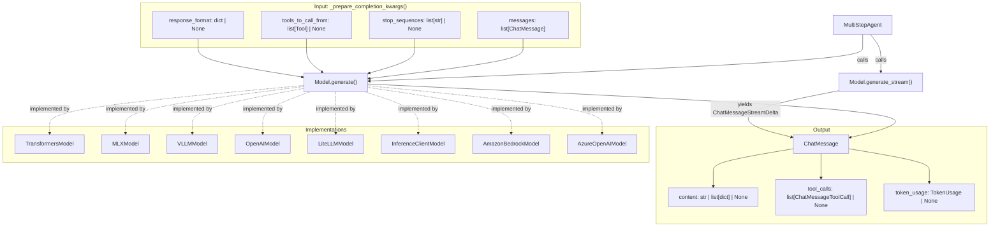
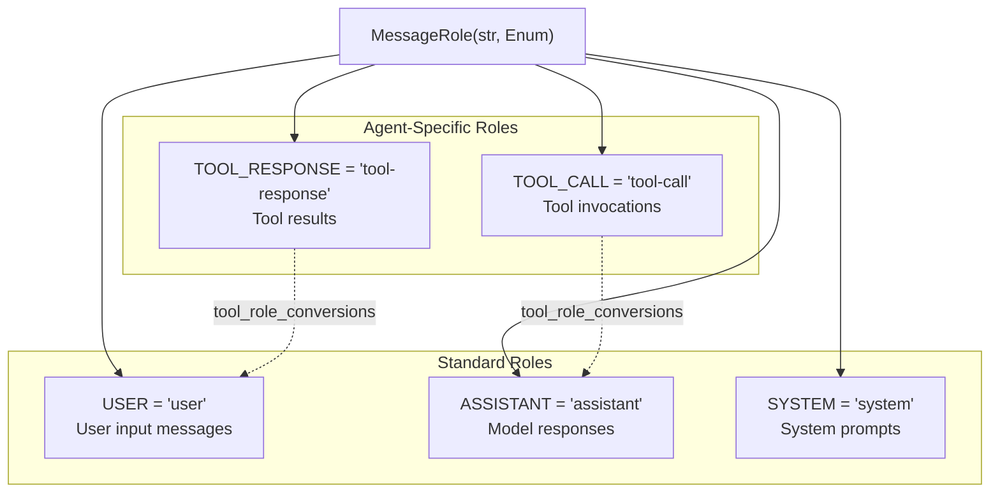
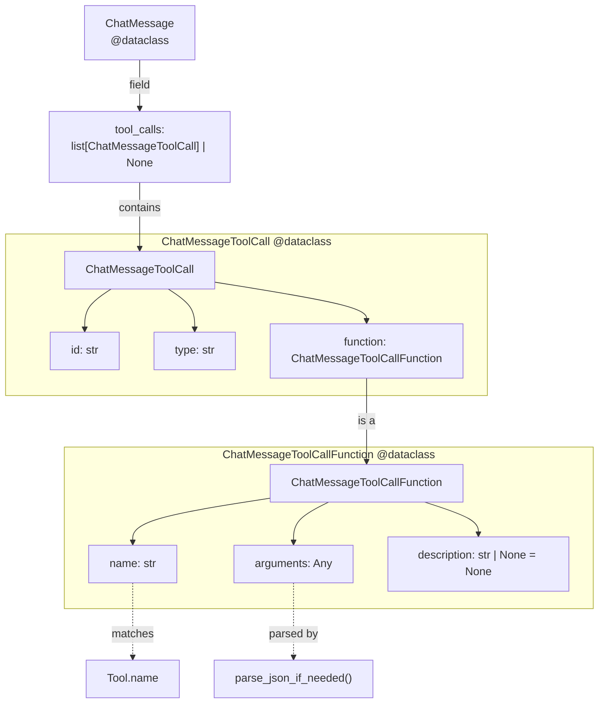

<!-- source: DeepWiki mcp.deepwiki.com · repo huggingface/smolagents · page 4.1 Model Interface & Data Structures · fetched 2026-10-26 -->

# Model Interface & Data Structures

<details>
<summary>Relevant source files</summary>

The following files were used as context for generating this wiki page:

- [src/smolagents/models.py](src/smolagents/models.py)
- [tests/test_models.py](tests/test_models.py)

</details>


This page documents the core data structures and interfaces that enable model-agnostic agent execution in `smolagents`. All model implementations (local or cloud-based) must conform to these contracts to work with agents. For specific model implementations, see [API-Based Models](4.2) and [Local Inference Models](4.3). For configuration details, see [Model Configuration & Advanced Features](4.4).

**Scope**: This page covers the `Model` base class, message formats, tool call structures, streaming deltas, and utility functions for message processing. It does not cover specific model implementations or configuration parameters.

## Overview: Model Abstraction Layer

The model abstraction layer provides a unified interface between agents and language models. All models inherit from the `Model` base class defined in [src/smolagents/models.py:484-496]() and communicate using standardized `ChatMessage` objects.

**Model Interface Flow**



**Sources**: [src/smolagents/models.py:484-496](), [src/smolagents/models.py:892-1168](), [src/smolagents/models.py:1170-1235](), [src/smolagents/models.py:1237-1393](), [src/smolagents/models.py:1488-1676](), [src/smolagents/models.py:1678-1825](), [src/smolagents/models.py:1831-1885](), [src/smolagents/models.py:1891-2092]()

## Core Message Structures

### MessageRole Enum

The `MessageRole` enum at [src/smolagents/models.py:111-121]() defines valid message roles in conversation history. It extends standard chat roles with agent-specific roles for tool interactions.

**MessageRole Structure**



| Role | Value | Usage |
|------|-------|-------|
| `USER` | `"user"` | User input messages |
| `ASSISTANT` | `"assistant"` | Model-generated responses |
| `SYSTEM` | `"system"` | System prompts and instructions |
| `TOOL_CALL` | `"tool-call"` | Agent tool invocations (converted to ASSISTANT by `tool_role_conversions`) |
| `TOOL_RESPONSE` | `"tool-response"` | Tool execution results (converted to USER by `tool_role_conversions`) |

**Sources**: [src/smolagents/models.py:111-121](), [src/smolagents/models.py:314-317]()

### ChatMessage Dataclass

The `ChatMessage` dataclass is the fundamental unit of conversation. It represents a single message in the agent's execution history.

```python
@dataclass
class ChatMessage:
    role: MessageRole
    content: str | list[dict[str, Any]] | None = None
    tool_calls: list[ChatMessageToolCall] | None = None
    raw: Any | None = None
    token_usage: TokenUsage | None = None
```

| Field | Type | Description |
|-------|------|-------------|
| `role` | `MessageRole` | Message author (user, assistant, system, tool-call, tool-response) |
| `content` | `str \| list[dict] \| None` | Text content or multimodal content list (text + images) |
| `tool_calls` | `list[ChatMessageToolCall] \| None` | Tool invocations made by the model |
| `raw` | `Any \| None` | Raw API response for debugging (excluded from serialization) |
| `token_usage` | `TokenUsage \| None` | Token consumption metrics |

**Content Format**: Content can be a simple string or a list of content blocks for multimodal messages. Multimodal content is supported via `AgentImage` and `AgentAudio` types which handle serialization to base64 or temporary paths [src/smolagents/agent_types.py:74-215]().

**Key Methods**:

| Method | Return Type | Purpose |
|--------|-------------|---------|
| `model_dump_json()` | `str` | Serialize to JSON string (excludes `raw` field) [src/smolagents/models.py:136-137]() |
| `from_dict(data)` | `ChatMessage` | Deserialize from dictionary [src/smolagents/models.py:139-155]() |
| `dict()` | `dict` | Convert to dictionary [src/smolagents/models.py:157-158]() |
| `render_as_markdown()` | `str` | Render content and tool calls as markdown [src/smolagents/models.py:160-169]() |

**Sources**: [src/smolagents/models.py:123-170](), [src/smolagents/agent_types.py:74-215]()

## Tool Call Structures

Tool calls enable models to invoke external functions during generation. The structures support both single and parallel tool invocations and are defined in [src/smolagents/models.py:94-108]().

**Tool Call Data Structure**



### ChatMessageToolCallFunction

Represents the function invocation details within a tool call.

```python
@dataclass
class ChatMessageToolCallFunction:
    arguments: Any  # Tool arguments as dict or JSON string
    name: str  # Tool name matching Tool.name
    description: str | None = None
```

**Sources**: [src/smolagents/models.py:94-98]()

### ChatMessageToolCall

Wraps a tool invocation with metadata for tracking and debugging.

```python
@dataclass
class ChatMessageToolCall:
    function: ChatMessageToolCallFunction
    id: str  # Unique identifier
    type: str  # Usually "function"
```

**String Representation**: The `__str__` method formats tool calls for logging:
`Call: {id}: Calling {name} with arguments: {arguments}` [src/smolagents/models.py:107-108]().

**Sources**: [src/smolagents/models.py:101-108]()

### Parsing Tool Calls from Text

Models that don't natively support structured tool calls can have them extracted using `get_tool_call_from_text()` [src/smolagents/models.py:432-447]():

This function parses JSON blobs from text using `parse_json_blob()` and converts them into `ChatMessageToolCall` instances.

**Sources**: [src/smolagents/models.py:432-447]()

## Streaming Structures

Streaming enables real-time token generation and progressive tool call updates. The streaming system uses delta objects defined in [src/smolagents/models.py:203-217]() that accumulate into complete messages via `agglomerate_stream_deltas()` at [src/smolagents/models.py:220-279]().

**Streaming Delta Accumulation Flow**

```mermaid
graph TB
    GenStream["Model.generate_stream()"]
    
    subgraph "Stream Deltas (Generator)"
        Delta1["ChatMessageStreamDelta<br/>content='The'<br/>tool_calls=[index=0, name='search']"]
        Delta2["ChatMessageStreamDelta<br/>content=' weather'<br/>tool_calls=[index=0, args=' {']"]
        Delta3["ChatMessageStreamDelta<br/>content=' is'<br/>tool_calls=[index=0, args='\"q\":\"paris\"}']"]
        DeltaN["ChatMessageStreamDelta<br/>token_usage=TokenUsage(...)"]
    end
    
    Accumulator["agglomerate_stream_deltas()"]
    
    subgraph "Accumulation Logic"
        AccContent["accumulated_content += delta.content"]
        AccToolCalls["accumulated_tool_calls[index] += delta.tool_calls"]
        AccUsage["total_tokens += delta.token_usage"]
    end
    
    Final["ChatMessage<br/>content='The weather is'<br/>tool_calls=[ChatMessageToolCall(...)]<br/>token_usage=TokenUsage(...)"]
    
    GenStream -->|yields| Delta1
    GenStream -->|yields| Delta2
    GenStream -->|yields| Delta3
    GenStream -->|yields| DeltaN
    
    Delta1 --> Accumulator
    Delta2 --> Accumulator
    Delta3 --> Accumulator
    DeltaN --> Accumulator
    
    Accumulator --> AccContent
    Accumulator --> AccToolCalls
    Accumulator --> AccUsage
    
    Accumulator -->|returns| Final
```

### ChatMessageStreamDelta

Represents an incremental update during streaming generation.

```python
@dataclass
class ChatMessageStreamDelta:
    content: str | None = None  # Text chunk
    tool_calls: list[ChatMessageToolCallStreamDelta] | None = None
    token_usage: TokenUsage | None = None  # Cumulative or per-delta
```

**Sources**: [src/smolagents/models.py:213-218]()

### ChatMessageToolCallStreamDelta

Represents an incremental update to a tool call during streaming.

```python
@dataclass
class ChatMessageToolCallStreamDelta:
    index: int | None = None  # Tool call position in list
    id: str | None = None
    type: str | None = None
    function: ChatMessageToolCallFunction | None = None
```

**Sources**: [src/smolagents/models.py:203-211]()

### agglomerate_stream_deltas()

Converts a list of streaming deltas into a single complete `ChatMessage`. Defined at [src/smolagents/models.py:220-279]().

**Algorithm**:
1. Initialize `accumulated_tool_calls` keyed by tool call index [src/smolagents/models.py:227]().
2. For each `stream_delta`, append `content` and accumulate `token_usage` [src/smolagents/models.py:233-241]().
3. Update `tool_calls` by index, appending `function.arguments` incrementally [src/smolagents/models.py:246-271]().
4. Return a `ChatMessage` containing the final merged state [src/smolagents/models.py:273-279]().

**Sources**: [src/smolagents/models.py:220-279](), [tests/test_models.py:80-139]()

## Model Base Class

The `Model` class defines the core interface that all model implementations must follow.

### Class Definition

```python
class Model:
    def __init__(
        self,
        flatten_messages_as_text: bool = False,
        tool_name_key: str = "name",
        tool_arguments_key: str = "arguments",
        model_id: str | None = None,
        **kwargs
    )
```

**Sources**: [src/smolagents/models.py:484-496]()

### Core Interface: generate()

The `generate()` method is the primary interface that all subclasses must implement [src/smolagents/models.py:585-610]().

**Contract**:
1. **Input**: List of `ChatMessage` objects representing conversation history.
2. **Output**: Single `ChatMessage` with model's response.
3. **Stop Sequences**: Must halt generation before any `stop_sequences` string.
4. **Tools**: When provided, model should generate tool calls.

**Sources**: [src/smolagents/models.py:585-610]()

### Parameter Precedence and REMOVE_PARAMETER

The `_prepare_completion_kwargs()` method implements a three-tier parameter precedence system where `self.kwargs` (initialized in the constructor) have the highest precedence [src/smolagents/models.py:534-583]().

**REMOVE_PARAMETER Sentinel**: A special value that explicitly removes a parameter from the final request, even if it would otherwise be included [src/smolagents/models.py:473-481]().

**Sources**: [src/smolagents/models.py:473-481](), [src/smolagents/models.py:534-583](), [tests/test_models.py:50-78]()

### supports_stop_parameter Property

Determines whether a model supports stop sequences based on its `model_id` [src/smolagents/models.py:450-470](). Models like `o3` or `o4-mini` often require post-generation truncation via `remove_content_after_stop_sequences()` because they do not support the `stop` parameter in their API [src/smolagents/models.py:79-91](), [tests/test_models.py:141-169]().

**Sources**: [src/smolagents/models.py:450-470](), [src/smolagents/models.py:79-91](), [tests/test_models.py:141-169]()

## Utility Functions

### get_clean_message_list()

Converts mixed message formats into standardized dictionaries compatible with model APIs. Defined at [src/smolagents/models.py:364-429]().

**Role Conversions**: Uses `tool_role_conversions` to map internal agent roles to standard API roles [src/smolagents/models.py:314-317]().

**Sources**: [src/smolagents/models.py:364-429](), [src/smolagents/models.py:314-317]()

### get_tool_json_schema()

Converts a `Tool` object into OpenAI-compatible JSON schema format for model consumption [src/smolagents/models.py:320-361]().

**Sources**: [src/smolagents/models.py:320-361](), [tests/test_models.py:210-223]()

### Agent Types for Multimodal Data

The framework uses specialized types to handle non-text data [src/smolagents/agent_types.py:32-215]():
- `AgentText`: Behaves as a string [src/smolagents/agent_types.py:62-72]().
- `AgentImage`: Wraps `PIL.Image.Image`, handling serialization to base64 or temporary paths [src/smolagents/agent_types.py:74-175]().
- `AgentAudio`: Wraps audio tensors or paths, requiring `soundfile` and `torch` [src/smolagents/agent_types.py:176-215]().

**Sources**: [src/smolagents/agent_types.py:32-215](), [tests/test_types.py:1-119]()

---

