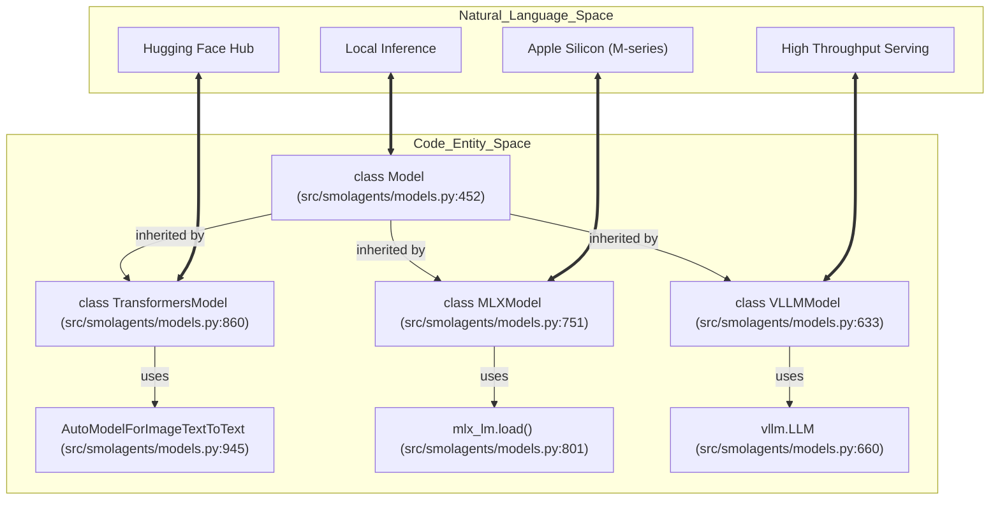
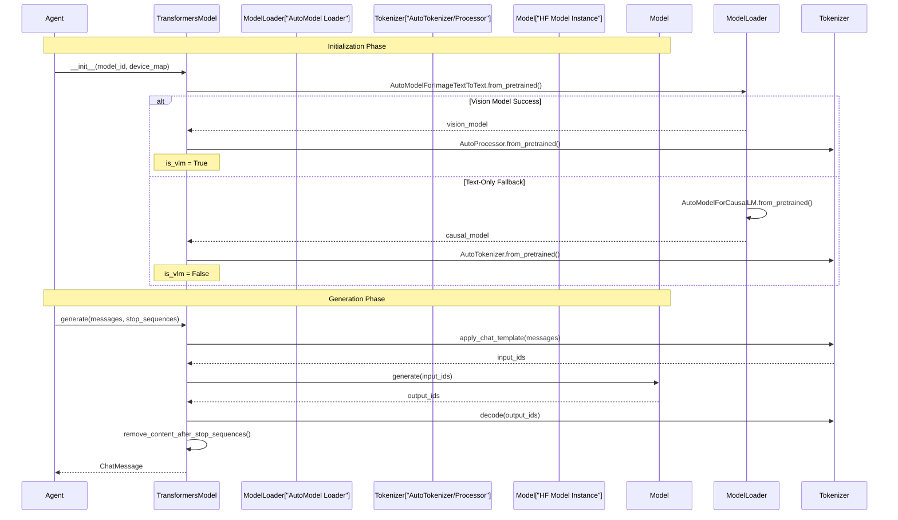
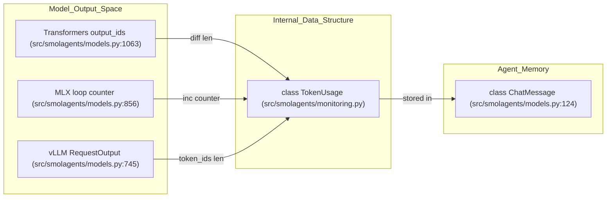

<!-- source: DeepWiki mcp.deepwiki.com · repo huggingface/smolagents · page 4.3 Local Inference Models · fetched 2026-10-26 -->

# Local Inference Models

Relevant source files

The following files were used as context for generating this wiki page:

- [src/smolagents/models.py](src/smolagents/models.py)
- [tests/test_models.py](tests/test_models.py)

This page documents the local model implementations in **smolagents** that enable on-device LLM inference without external API calls: `TransformersModel`, `MLXModel`, and `VLLMModel`. These models run directly on your hardware (CPU/GPU) and are alternatives to cloud-based API models.

For the base `Model` interface and common data structures, see [src/smolagents/models.py:452-631](). For configuration options like rate limiting and streaming that apply across all models, see [src/smolagents/models.py:1149-1234]().

## Local vs API-Based Models

Local inference models differ from API-based models in several key ways:

| Aspect | Local Models | API Models |
|--------|--------------|------------|
| **Execution** | On your hardware | Remote servers |
| **Dependencies** | Heavy (`transformers`, `torch`, `vllm`, `mlx-lm`) | Light (API clients) |
| **Cost** | Hardware/electricity | Per-token charges |
| **Privacy** | Complete data control | Data sent to provider |
| **Latency** | Hardware-dependent | Network + processing |
| **Setup** | Model download required | API key only |

All three local models inherit from the `Model` base class and implement the same core interface, making them interchangeable in agent workflows.

Sources: [src/smolagents/models.py:633-633](), [src/smolagents/models.py:751-751](), [src/smolagents/models.py:860-860]()

## Class Hierarchy and Inheritance

The diagram below bridges the natural language concepts of local inference to the specific code entities in `smolagents/models.py`.

**Bridge: Natural Language to Code Entity Space**

**Key Inheritance Details:**
- All three inherit `_prepare_completion_kwargs()` from the `Model` base class [src/smolagents/models.py:502-551]().
- All override the `generate()` method with library-specific implementations.
- `TransformersModel` additionally implements `generate_stream()` for real-time output [src/smolagents/models.py:1110-1147]().
- `MLXModel` forces `flatten_messages_as_text` to `True` [src/smolagents/models.py:810]().

Sources: [src/smolagents/models.py:452-1147](), [tests/test_models.py:50-79]()

## TransformersModel - Hugging Face Transformers Integration

`TransformersModel` is the most versatile local option, supporting both text-only and vision-language models (VLM) using the Hugging Face Transformers library.

### Initialization Parameters

| Parameter | Type | Default | Description |
|-----------|------|---------|-------------|
| `model_id` | str | "HuggingFaceTB/SmolLM2-1.7B-Instruct" | HF Hub model identifier [src/smolagents/models.py:906]() |
| `device_map` | str \| None | "cuda" if available | Device placement strategy [src/smolagents/models.py:907]() |
| `torch_dtype` | str \| None | None | Model precision (e.g., "float16") [src/smolagents/models.py:908]() |
| `trust_remote_code` | bool | False | Allow remote code execution [src/smolagents/models.py:909]() |
| `model_kwargs` | dict \| None | None | Kwargs for `from_pretrained()` [src/smolagents/models.py:910]() |

### Architecture and Execution Flow

**Key Implementation Details:**

1.  **Model Loading Strategy** [src/smolagents/models.py:945-984](): Attempts `AutoModelForImageTextToText` first to detect VLMs. If it fails, it falls back to `AutoModelForCausalLM`.
2.  **Streaming Support** [src/smolagents/models.py:1110-1147](): Uses `TextIteratorStreamer` in a separate thread to yield `ChatMessageStreamDelta` objects incrementally.
3.  **Stop Sequence Handling** [src/smolagents/models.py:1061-1070](): Uses a custom `StoppingCriteria` class [src/smolagents/models.py:1022-1036]() to check decoded text at each generation step.

Sources: [src/smolagents/models.py:860-1147]()

## MLXModel - Apple Silicon Optimization

`MLXModel` provides optimized inference for Apple Silicon devices (M1/M2/M3) using the MLX framework and `mlx-lm` library.

### Implementation Details

1.  **Forced Text Flattening** [src/smolagents/models.py:810](): Always sets `flatten_messages_as_text=True` because MLX implementation targets text-based causal models.
2.  **Manual Stop Sequence Handling** [src/smolagents/models.py:841-848](): Since `mlx_lm` does not support a `stop` parameter natively, `MLXModel` manually checks the accumulated text for stop sequences during the generation loop and breaks early if found.
3.  **Token Usage Tracking** [src/smolagents/models.py:853-856](): Calculates `input_tokens` from the length of the prompt IDs and increments `output_tokens` for every yielded token in the stream.

Sources: [src/smolagents/models.py:751-858]()

## VLLMModel - High-Performance Serving

`VLLMModel` leverages vLLM for optimized inference, featuring PagedAttention and continuous batching.

### Implementation Details

1.  **Structured Outputs** [src/smolagents/models.py:706-708](): Supports OpenAI-style `response_format`. It extracts the JSON schema and passes it to vLLM's `GuidedDecodingParams` (if available) or `StructuredOutputsParams` for grammar-constrained generation.
2.  **Resource Management** [src/smolagents/models.py:670-685](): Includes a `cleanup()` method that explicitly destroys the model parallel and distributed environments and clears the CUDA cache.
3.  **Sampling Parameters** [src/smolagents/models.py:723-729](): Maps standard model parameters (temperature, max_tokens, stop) to vLLM's `SamplingParams`.

Sources: [src/smolagents/models.py:633-749]()

## Feature Comparison Matrix

| Feature | TransformersModel | MLXModel | VLLMModel |
|---------|------------------|----------|-----------|
| **Platform** | Any (CPU/GPU) | Apple Silicon only | GPU (CUDA/ROCm) |
| **Vision Support** | ✅ Yes [src/smolagents/models.py:945]() | ❌ No | ❌ No |
| **Streaming** | ✅ Native [src/smolagents/models.py:1110]() | ⚠️ Internal only | ❌ No |
| **Structured Outputs** | ❌ No | ❌ No | ✅ Yes [src/smolagents/models.py:706]() |
| **Stop Sequences** | ✅ Criteria [src/smolagents/models.py:1022]() | ⚠️ Manual [src/smolagents/models.py:841]() | ✅ Native [src/smolagents/models.py:726]() |

## Token Usage Tracking

All local models implement token usage tracking, enabling the `Monitor` to report costs and performance.

**Bridge: Token Tracking Data Flow**

Sources: [src/smolagents/models.py:1060-1069](), [src/smolagents/models.py:853-856](), [src/smolagents/models.py:745-746](), [src/smolagents/models.py:124-130]()

---

