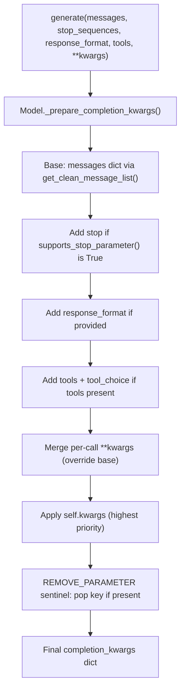
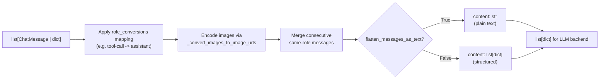
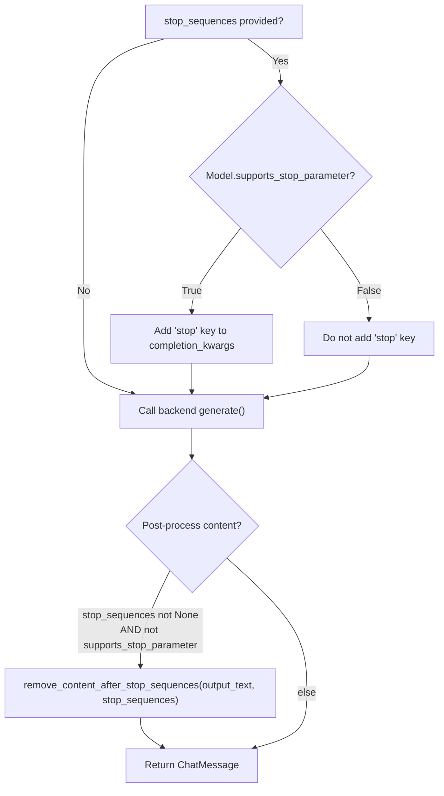
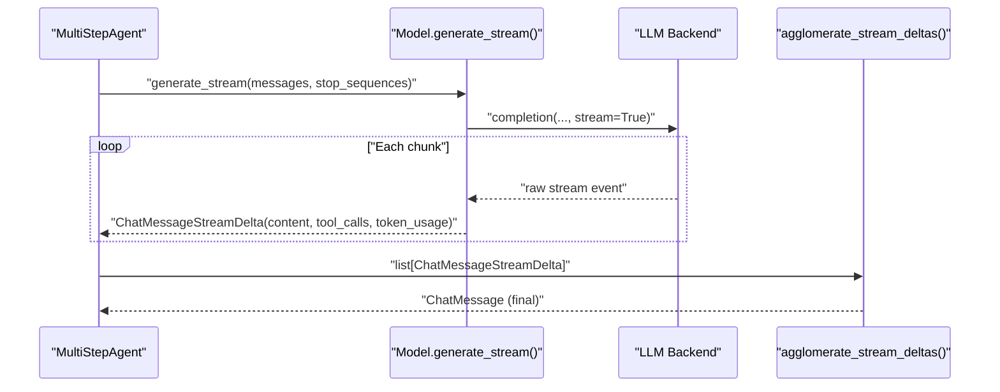

<!-- source: DeepWiki mcp.deepwiki.com · repo huggingface/smolagents · page 4.4 Model Configuration & Advanced Features · fetched 2026-10-26 -->

# Model Configuration & Advanced Features

<details>
<summary>Relevant source files</summary>

The following files were used as context for generating this wiki page:

- [src/smolagents/_function_type_hints_utils.py](src/smolagents/_function_type_hints_utils.py)
- [src/smolagents/agent_types.py](src/smolagents/agent_types.py)
- [src/smolagents/models.py](src/smolagents/models.py)
- [tests/test_function_type_hints_utils.py](tests/test_function_type_hints_utils.py)
- [tests/test_models.py](tests/test_models.py)
- [tests/utils/markers.py](tests/utils/markers.py)

</details>


This page covers configuration options and behavioral features that are shared across model classes in `smolagents`: parameter precedence, message normalization, stop sequences, tool schema generation, and streaming aggregation. It describes the internal mechanics that all models rely on to interact with LLM backends consistently.

- For information about specific model classes and their initialization parameters, see [API-Based Models](#4.2) and [Local Inference Models](#4.3).
- For the abstract `Model` base class and core data structures (`ChatMessage`, `MessageRole`, etc.), see [Model Interface & Data Structures](#4.1).

---

## Parameter Preparation: `_prepare_completion_kwargs`

Every model subclass calls `Model._prepare_completion_kwargs` to assemble the final dictionary of arguments passed to the underlying backend (API call or local inference). This method provides consistent handling of messages, stop sequences, tools, and arbitrary extra parameters.

[src/smolagents/models.py:502-551]()

**Parameter precedence** (highest to lowest):

| Priority | Source | Mechanism |
|---|---|---|
| 1 (highest) | `self.kwargs` | Set at model construction time; always applied last [src/smolagents/models.py:543-544]() |
| 2 | Per-call `**kwargs` | Arguments passed directly to `generate()` [src/smolagents/models.py:541-542]() |
| 3 (lowest) | Explicit named params | `stop_sequences`, `response_format`, `tools_to_call_from` [src/smolagents/models.py:503-539]() |

This means that a value set at construction time (e.g. `max_tokens=100` in `Model(max_tokens=100)`) will always override a per-call override.

**Model Parameter Resolution Flow**

Sources: [src/smolagents/models.py:502-551](), [tests/test_models.py:50-79]()

### `REMOVE_PARAMETER` Sentinel

When you need to explicitly remove a parameter that might be set by lower-priority sources, pass `REMOVE_PARAMETER` as its value in `self.kwargs` at construction time. This is useful for disabling default behaviors of underlying providers.

```python
from smolagents.models import REMOVE_PARAMETER, Model

model = Model(max_tokens=REMOVE_PARAMETER, temperature=0.7)
```

`_prepare_completion_kwargs` checks for this sentinel and calls `completion_kwargs.pop(kwarg_name, None)` to remove the key.

[src/smolagents/models.py:441-449](), [src/smolagents/models.py:546-550]()

---

## Message Normalization: `get_clean_message_list`

All models pass their message lists through `get_clean_message_list` inside `_prepare_completion_kwargs`. This function performs the necessary transformations to convert internal agent state into provider-compatible payloads.

[src/smolagents/models.py:332-397]()

**Message Normalization Pipeline**

Sources: [src/smolagents/models.py:332-397]()

### `flatten_messages_as_text`

When `True`, the `content` field of each message is a plain string rather than a list of typed dicts. This is required for models that do not accept structured (multi-part) message content.

Default values per model class:

| Model Class | Default | Condition |
|---|---|---|
| `InferenceClientModel` | `False` | Always [src/smolagents/models.py:688-692]() |
| `OpenAIModel` | `False` | Configurable via constructor [src/smolagents/models.py:785-789]() |
| `AzureOpenAIModel` | `False` | Inherits from `OpenAIModel` [src/smolagents/models.py:917]() |
| `AmazonBedrockModel` | `False` | Always [src/smolagents/models.py:1044-1048]() |
| `LiteLLMModel` | `True` | When `model_id` starts with `"ollama"`, `"groq"`, or `"cerebras"` [src/smolagents/models.py:1243-1247]() |
| `LiteLLMModel` | `False` | All other `model_id` values [src/smolagents/models.py:1243-1247]() |
| `TransformersModel` | `False` | Loaded as vision-language model (`AutoModelForImageTextToText`) [src/smolagents/models.py:809-810]() |
| `TransformersModel` | `True` | Loaded as text-only model (`AutoModelForCausalLM`) [src/smolagents/models.py:809-810]() |
| `MLXModel` | `True` | Always (mlx-lm has no VLM support) [src/smolagents/models.py:976-978]() |

---

## Stop Sequences

### `stop_sequences` Parameter

All `generate()` methods accept `stop_sequences: list[str] | None`. When provided and the backend supports it, the strings are forwarded as the `"stop"` key in the completion call. Generation halts when any of the sequences is encountered.

### `supports_stop_parameter`

Some reasoning models (like OpenAI's o1/o3 series) do not accept a `stop` parameter. The module-level function `supports_stop_parameter(model_id)` and the property `Model.supports_stop_parameter` determine whether to include `"stop"` in the completion arguments.

[src/smolagents/models.py:418-438](), [src/smolagents/models.py:498-500]()

Models that **do not** support the `stop` parameter include those matching patterns for `o1`, `o3`, `o4-mini`, `gpt-5`, or `grok-3`. [src/smolagents/models.py:422-436]()

### `remove_content_after_stop_sequences`

For models that do not support the `stop` parameter natively, the output is post-processed using `remove_content_after_stop_sequences`. Any content appearing at or after the first match of a stop sequence is truncated.

[src/smolagents/models.py:79-91]()

**Stop Sequence Logic Flow**

Sources: [src/smolagents/models.py:418-438](), [src/smolagents/models.py:79-91](), [src/smolagents/models.py:534-536]()

---

## Tool Schema Generation

The framework provides two primary ways to generate tool schemas for LLM consumption.

### `get_tool_json_schema` (Model Utility)

This utility in `models.py` generates a JSON schema for a `Tool` instance. It is used to populate the `tools` parameter in API calls for standard tool-calling. It extracts metadata from the tool's `inputs` attribute and `output_type`.

[src/smolagents/models.py:288-329]()

### `get_json_schema` (Function Utility)

The internal `_function_type_hints_utils.py` contains a more general-purpose `get_json_schema` function. It uses Python type hints and Google-style docstrings to generate a schema for any callable. This is particularly useful for chat templates that require tool descriptions in a specific JSON format.

[src/smolagents/_function_type_hints_utils.py:97-203]()

**Schema Generation logic:**
1. **Docstring Parsing**: Extracts the main description and argument descriptions using `inspect.getdoc` and regex. [src/smolagents/_function_type_hints_utils.py:204-230]()
2. **Type Hint Resolution**: Maps Python types (e.g., `int`, `str`, `list`, `Union`) to JSON schema types (e.g., `integer`, `string`, `array`). [src/smolagents/_function_type_hints_utils.py:251-272]()
3. **Enum Support**: Parses `(choices: [...])` from docstrings to populate `enum` fields. [src/smolagents/_function_type_hints_utils.py:172-184]()

---

## Structured Output (`response_format`)

The `generate()` signature accepts `response_format: dict[str, str] | None`. When provided, it is forwarded in the completion call to request JSON-schema-constrained output from the model.

### `CODEAGENT_RESPONSE_FORMAT`

A pre-built response format schema is defined for `CodeAgent` to ensure the model returns a valid JSON object containing `thought` and `code` keys. This is used by providers in `STRUCTURED_GENERATION_PROVIDERS`.

[src/smolagents/models.py:43-67]()

---

## Streaming

Several model classes implement `generate_stream()` in addition to `generate()`. Streaming returns a generator of `ChatMessageStreamDelta` objects.

### `ChatMessageStreamDelta`

[src/smolagents/models.py:214-217]()

| Field | Type | Description |
|---|---|---|
| `content` | `str \| None` | Incremental text content |
| `tool_calls` | `list[ChatMessageToolCallStreamDelta] \| None` | Incremental tool call info |
| `token_usage` | `TokenUsage \| None` | Token counts, typically provided on final chunk |

### `agglomerate_stream_deltas`

Converts a completed list of `ChatMessageStreamDelta` objects into a single `ChatMessage`. It accumulates text content, merges tool call arguments by index, and sums token usage.

[src/smolagents/models.py:220-279]()

**Streaming Aggregation Sequence**

Sources: [src/smolagents/models.py:220-279](), [src/smolagents/models.py:214-217](), [tests/test_models.py:80-139]()

---

## Configuration Reference Summary

**Model Configuration Class Diagram**
```mermaid
classDiagram
    class "Model" {
        +flatten_messages_as_text: bool
        +tool_name_key: str
        +tool_arguments_key: str
        +kwargs: dict
        +supports_stop_parameter: bool
        +_prepare_completion_kwargs() dict
        +parse_tool_calls(message) ChatMessage
    }

    class "ChatMessage" {
        +role: MessageRole
        +content: str | list
        +tool_calls: list[ChatMessageToolCall]
        +token_usage: TokenUsage
    }

    class "get_clean_message_list" {
        "Applies role_conversions"
        "Encodes images"
        "Merges consecutive roles"
    }

    class "REMOVE_PARAMETER" {
        "Sentinel: removes key from completion_kwargs"
    }

    class "agglomerate_stream_deltas" {
        "list[ChatMessageStreamDelta] -> ChatMessage"
    }

    "Model" --> "get_clean_message_list" : "uses in _prepare_completion_kwargs"
    "Model" --> "REMOVE_PARAMETER" : "checks in _prepare_completion_kwargs"
    "Model" ..> "ChatMessage" : "returns"
    "Model" ..> "agglomerate_stream_deltas" : "used for streaming"
```
Sources: [src/smolagents/models.py:452-631](), [src/smolagents/models.py:220-279](), [src/smolagents/models.py:418-438]()

---

