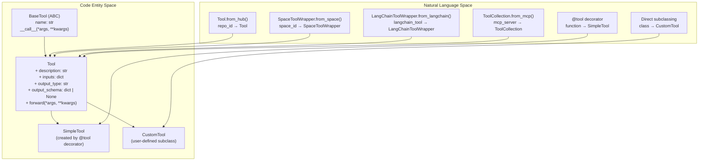
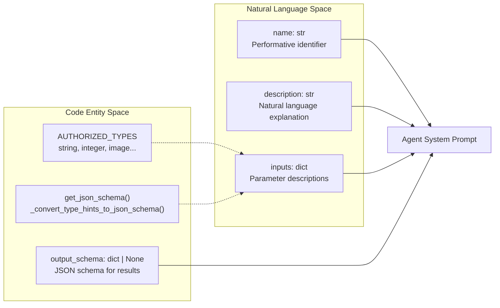
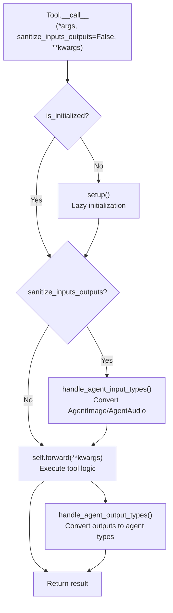

<!-- source: DeepWiki mcp.deepwiki.com · repo huggingface/smolagents · page 5 Tool System · fetched 2026-10-26 -->

# Tool System

<details>
<summary>Relevant source files</summary>

The following files were used as context for generating this wiki page:

- [docs/source/en/_toctree.yml](docs/source/en/_toctree.yml)
- [docs/source/en/reference/default_tools.md](docs/source/en/reference/default_tools.md)
- [docs/source/en/reference/tools.md](docs/source/en/reference/tools.md)
- [src/smolagents/tools.py](src/smolagents/tools.py)
- [tests/test_tools.py](tests/test_tools.py)

</details>


The Tool System provides the abstraction layer that enables agents to perform actions beyond text generation. This document covers tool definition interfaces, validation rules, serialization mechanisms, external integration pathways, and the toolbox ecosystem. For information on how agents invoke tools during execution, see [Agent Framework](#3).

## Tool Base Abstraction

The tool system is built around two core classes: `BaseTool` and `Tool`. `BaseTool` defines the minimal interface requiring only a `name` attribute and a `__call__` method [src/smolagents/tools.py:98-104](), while `Tool` extends this with metadata attributes required for LLM-based agent interaction.



**Figure 1: Tool Class Hierarchy and Creation Pathways**

The `Tool` class validates its attributes on initialization through the `validate_after_init` decorator [src/smolagents/tools.py:70-79]() and the `validate_arguments` method [src/smolagents/tools.py:144-227](). Validation ensures:

| Validation Rule | Purpose | Implementation |
|----------------|---------|----------------|
| Required attributes | All tools must have `name`, `description`, `inputs`, `output_type` | [src/smolagents/tools.py:145-159]() |
| Valid name | Name must be valid Python identifier, not reserved keyword | [src/smolagents/tools.py:167-170]() |
| Authorized types | Input/output types must be in `AUTHORIZED_TYPES` | [src/smolagents/tools.py:82-93]() |
| Forward signature match | `forward()` parameters must match `inputs` keys | [src/smolagents/tools.py:203-210]() |
| Nullable consistency | Nullable arguments in `inputs` must match function signature | [src/smolagents/tools.py:219-226]() |

**Sources:** [src/smolagents/tools.py:70-227](), [tests/test_tools.py:86-125]()

## Tool Metadata Schema

Every tool exposes a structured metadata schema that agents use to understand tool capabilities. The schema consists of four required components plus one optional component:



**Figure 2: Tool Metadata Schema Mapping**

The `inputs` dictionary follows this structure [src/smolagents/tools.py:116-119]():

```python
{
    "parameter_name": {
        "type": "string", # one of AUTHORIZED_TYPES
        "description": "string explaining parameter",
        "nullable": True # optional boolean
    }
}
```

`AUTHORIZED_TYPES` includes: `"string"`, `"boolean"`, `"integer"`, `"number"`, `"image"`, `"audio"`, `"array"`, `"object"`, `"any"`, `"null"` [src/smolagents/tools.py:82-93]().

The `output_schema` attribute is used for tools that return structured data (e.g., MCP tools). When present, it helps agents understand the expected structure of the tool output [src/smolagents/tools.py:122-124]().

**Sources:** [src/smolagents/tools.py:82-136](), [src/smolagents/tools.py:116-119]()

## Tool Creation: Decorator vs Subclassing

There are two primary methods to define custom tools: the `@tool` decorator for simple function-based tools, and direct subclassing for complex tools requiring initialization logic. For details, see [Creating Custom Tools](#5.3).

### Decorator-Based Tool Creation

The `@tool` decorator converts a typed Python function into a `Tool` instance. It extracts metadata from type hints and docstrings using `get_json_schema()` [src/smolagents/_function_type_hints_utils.py:50]().

The decorator performs several transformations [src/smolagents/tools.py:1456-1563]():
1. Extracts function source code and stores it in `forward.__source__`.
2. Converts type hints to JSON schema via `_convert_type_hints_to_json_schema()`.
3. Parses docstring to extract parameter descriptions.
4. Creates `SimpleTool` class with extracted metadata.

**Sources:** [src/smolagents/tools.py:1456-1563](), [src/smolagents/_function_type_hints_utils.py:45-51]()

### Subclass-Based Tool Creation

For tools requiring complex initialization (e.g., loading models via `setup()`), direct subclassing provides more control. Key requirements include setting class-level metadata and implementing the `forward` method. For details, see [Tool Definition & Interface](#5.1).

**Sources:** [src/smolagents/tools.py:106-142](), [src/smolagents/default_tools.py:39-80]()

## Tool Validation System

The validation system operates at two levels: class-level validation for tool definitions and runtime validation for tool arguments. For details, see [Tool Validation & Serialization](#5.5).

### Class-Level Validation

The `validate_tool_attributes()` function [src/smolagents/tool_validation.py:157-263]() inspects tool classes to ensure they follow serialization requirements. It uses `MethodChecker` [src/smolagents/tool_validation.py:11-155]() to perform AST traversal to detect undefined variable references or unauthorized imports.

### Runtime Argument Validation

The `validate_arguments()` method [src/smolagents/tools.py:144-227]() validates tool instances at initialization, checking attribute types and signature consistency.

**Sources:** [src/smolagents/tool_validation.py:11-263](), [src/smolagents/tools.py:144-227]()

## Tool Serialization and Hub Integration

Tools can be serialized to code strings and pushed to the Hugging Face Hub as Gradio Spaces. The `instance_to_source()` utility [src/smolagents/utils.py:58]() is used to convert tool instances back to source code for sharing. For details, see [Tool Validation & Serialization](#5.5).

**Sources:** [src/smolagents/tools.py:292-598](), [src/smolagents/utils.py:58]()

## External Tool Sources

The tool system integrates with multiple external ecosystems. For details, see [External Tool Sources](#5.4).

- **MCP (Model Context Protocol):** Load tools from MCP servers using `ToolCollection.from_mcp()` [src/smolagents/tools.py:947-1064]().
- **Hugging Face Hub:** Load tools from Hub Spaces using `Tool.from_hub()` [src/smolagents/tools.py:421-569]().
- **LangChain:** Wrap LangChain tools using `LangChainToolWrapper.from_langchain()` [src/smolagents/tools.py:793-844]().
- **Gradio Spaces:** Load tools directly from Spaces via `SpaceToolWrapper` [src/smolagents/tools.py:636-791]().

**Sources:** [src/smolagents/tools.py:421-1064]()

## Tool Execution Flow

Tools support lazy initialization and automatic type handling during execution [src/smolagents/tools.py:231-256]().



**Figure 3: Tool Execution Flow**

The `sanitize_inputs_outputs` flag controls whether `AgentImage` and `AgentAudio` types are automatically converted [src/smolagents/tools.py:244-248]().

**Sources:** [src/smolagents/tools.py:231-256](), [src/smolagents/agent_types.py:52-109]()

## Built-in Tools

The framework provides several default tools:
- `PythonInterpreterTool`: Evaluates Python code using the internal interpreter [src/smolagents/default_tools.py:39-80]().
- `DuckDuckGoSearchTool`: Performs web searches using the `DDGS` client [src/smolagents/default_tools.py:104-160]().
- `FinalAnswerTool`: Provides the final response to the agent's task [src/smolagents/default_tools.py:83-91]().
- `UserInputTool`: Requests interactive input from the user [src/smolagents/default_tools.py:93-101]().
- `WikipediaSearchTool`: Retrieves information from Wikipedia [docs/source/en/reference/default_tools.md:64]().
- `VisitWebpageTool`: Fetches and processes content from specific web pages [docs/source/en/reference/default_tools.md:55]().
- `SpeechToTextTool`: Converts audio to textual data [docs/source/en/reference/default_tools.md:47]().

For a full list and details, see [Built-in Tools](#5.2).

**Sources:** [src/smolagents/default_tools.py:1-160](), [docs/source/en/reference/default_tools.md:1-66]()

---

