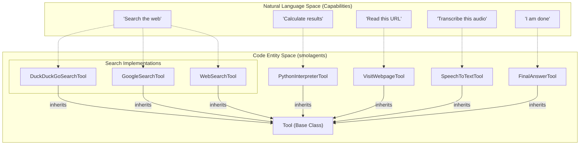
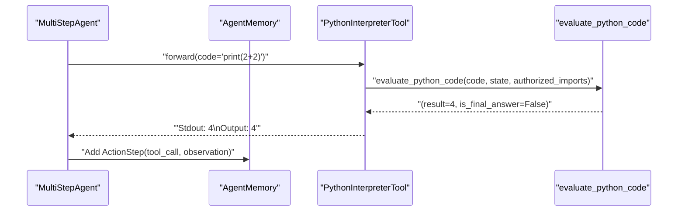

<!-- source: DeepWiki mcp.deepwiki.com · repo huggingface/smolagents · page 5.2 Built-in Tools · fetched 2026-10-26 -->

# Built-in Tools

Relevant source files

The following files were used as context for generating this wiki page:

- [docs/source/en/_toctree.yml](docs/source/en/_toctree.yml)
- [docs/source/en/reference/default_tools.md](docs/source/en/reference/default_tools.md)
- [docs/source/en/reference/tools.md](docs/source/en/reference/tools.md)
- [src/smolagents/default_tools.py](src/smolagents/default_tools.py)
- [tests/test_default_tools.py](tests/test_default_tools.py)

This page documents the default tools provided by `smolagents`. These tools are pre-built, production-ready implementations that agents can use for common tasks including web search, code execution, webpage reading, knowledge retrieval, and audio processing.

For information about the `Tool` base class and creating custom tools, see [Tool Definition & Interface](5.1) and [Creating Custom Tools](5.3). For loading tools from external sources like the Hub or MCP servers, see [External Tool Sources](5.4).

## Overview

Built-in tools are primarily defined in [src/smolagents/default_tools.py:1-661](). All tools inherit from the `Tool` base class [src/smolagents/tools.py:98-106]() and follow a standard interface requiring a `name`, `description`, `inputs` schema, `output_type`, and a `forward()` method.

### Available Built-in Tools

| Tool Class | Tool Name | Purpose | Key Dependencies |
|------------|-----------|---------|------------------|
| `PythonInterpreterTool` | `python_interpreter` | Execute Python code safely | `local_python_executor` |
| `DuckDuckGoSearchTool` | `web_search` | Web search via DuckDuckGo | `ddgs` |
| `GoogleSearchTool` | `web_search` | Web search via Google API | `requests`, `serpapi`/`serper` keys |
| `ApiWebSearchTool` | `web_search` | API-based web search (Brave default) | `requests`, `BRAVE_API_KEY` |
| `WebSearchTool` | `web_search` | Generic web search with HTML parsing | `requests`, `BeautifulSoup` |
| `VisitWebpageTool` | `visit_webpage` | Fetch and convert webpages to markdown | `markdownify`, `requests` |
| `WikipediaSearchTool` | `wikipedia_search` | Search Wikipedia articles | `wikipedia-api` |
| `SpeechToTextTool` | `transcriber` | Transcribe audio to text | `transformers`, `Whisper` |
| `FinalAnswerTool` | `final_answer` | Provide final answer to task | None |
| `UserInputTool` | `user_input` | Request user input interactively | Python `input()` |

Sources: [src/smolagents/default_tools.py:39-661](), [src/smolagents/tools.py:98-106]()

## Tool Architecture

The following diagram maps the Natural Language concepts of "Agent Capabilities" to the specific Code Entities in the `smolagents` library.

### Capability to Code Mapping

Sources: [src/smolagents/default_tools.py:39-661](), [src/smolagents/tools.py:98-106]()

## Code Execution Tools

### PythonInterpreterTool

The `PythonInterpreterTool` evaluates Python code in a restricted execution environment. It is the primary tool used by `CodeAgent` to perform multi-step reasoning and calculations [src/smolagents/default_tools.py:39-41]().

**Key Features:**
- **Import Whitelist**: Configurable via `authorized_imports`. By default, it includes `BASE_BUILTIN_MODULES` [src/smolagents/default_tools.py:51-54]().
- **Safety**: Uses the AST-based `evaluate_python_code` from the `local_python_executor` module [src/smolagents/default_tools.py:65-77]().
- **State Persistence**: Maintains a `state` dictionary to capture `_print_outputs` [src/smolagents/default_tools.py:70-80]().
- **Timeouts**: Respects a `timeout_seconds` parameter (defaulting to `MAX_EXECUTION_TIME_SECONDS`) to prevent long-running operations [src/smolagents/default_tools.py:50, 66]().

**Implementation Detail:**
The `forward()` method returns a string combining `Stdout` (captured print statements) and the final `Output` (the last evaluated expression) [src/smolagents/default_tools.py:80]().

Sources: [src/smolagents/default_tools.py:39-81](), [tests/test_default_tools.py:48-119]()

## Web Search Tools

`smolagents` provides several variants of the `web_search` tool to accommodate different API needs and rate limits.

### DuckDuckGoSearchTool
Uses the `ddgs` package. It is the default for many examples because it requires no API key [src/smolagents/default_tools.py:104-123]().
- **Rate Limiting**: Implements `_enforce_rate_limit()` to prevent IP bans, defaulting to 1 query per second [src/smolagents/default_tools.py:126-131, 148-159]().
- **Output**: Returns a markdown-formatted string of search results containing titles, URLs, and snippets [src/smolagents/default_tools.py:145-146]().

### GoogleSearchTool
Supports `serpapi` and `serper` providers [src/smolagents/default_tools.py:175-185]().
- **Filtering**: Allows an optional `filter_year` input to restrict results [src/smolagents/default_tools.py:167-171]().
- **Requirements**: Requires `SERPAPI_API_KEY` or `SERPER_API_KEY` in environment variables [src/smolagents/default_tools.py:186-189]().

### WebSearchTool (Generic & Exa)
A unified search tool that supports multiple engines including `google`, `duckduckgo`, `brave`, and `exa` [src/smolagents/default_tools.py:246-261]().
- **Exa Integration**: Supports the Exa AI search engine with specialized highlighting features [src/smolagents/default_tools.py:317-347]().
- **Parsing**: When using basic search, it can parse HTML content using `BeautifulSoup` to extract text from result pages [src/smolagents/default_tools.py:397-408]().

### VisitWebpageTool
Fetches a URL and converts its content to Markdown using the `markdownify` library [src/smolagents/default_tools.py:454-460]().
- **Truncation**: Content is truncated to `max_output_length` (default 40,000) to fit within LLM context windows [src/smolagents/default_tools.py:466, 471-476]().
- **Cleaning**: Automatically removes excessive line breaks (more than two) to save tokens [src/smolagents/default_tools.py:497-498]().

Sources: [src/smolagents/default_tools.py:104-507](), [tests/test_default_tools.py:36-47, 138-180]()

## Specialized Content Tools

### WikipediaSearchTool
A specialized tool for high-quality knowledge retrieval [src/smolagents/default_tools.py:510-515]().
- **Modes**: Supports `summary` (short) or `text` (full article) content types [src/smolagents/default_tools.py:534-537]().
- **Policy**: Enforces a non-empty `user_agent` string as required by Wikimedia Foundation policy [src/smolagents/default_tools.py:550-554]().

### SpeechToTextTool
Transcribes audio using Hugging Face `transformers` [src/smolagents/default_tools.py:609-613]().
- **Inheritance**: Subclasses `PipelineTool` to leverage standardized model loading [src/smolagents/default_tools.py:609]().
- **Default Model**: Uses `openai/whisper-large-v3-turbo` [src/smolagents/default_tools.py:618]().
- **Pipeline Flow**:
    1. `encode()`: Prepares the audio tensor using `WhisperProcessor` [src/smolagents/default_tools.py:628-631]().
    2. `forward()`: Runs model inference [src/smolagents/default_tools.py:633-634]().
    3. `decode()`: Converts token IDs back to text using `batch_decode` [src/smolagents/default_tools.py:636-638]().

Sources: [src/smolagents/default_tools.py:510-638](), [tests/test_default_tools.py:120-137]()

## Agent Control & Interaction

### FinalAnswerTool
Used by the agent to return its concluding response. In a `CodeAgent`, calling `final_answer(answer)` [src/smolagents/default_tools.py:89]() returns the answer directly to the agent loop. It supports various output types including strings, images (via `AgentImage`), and audio (via `AgentAudio`).

### UserInputTool
Enables human-in-the-loop workflows by pausing execution to wait for a terminal input using Python's `input()` function [src/smolagents/default_tools.py:93-101]().

### Execution Data Flow
The following diagram illustrates how tools interact with the agent's internal state during a single step.

Sources: [src/smolagents/default_tools.py:69-80](), [src/smolagents/local_python_executor.py:20-25]()

## Tool Registration

Default tools are mapped in the `TOOL_MAPPING` for easy lookup by name [src/smolagents/default_tools.py:641-648]().

| Name | Class |
| :--- | :--- |
| `python_interpreter` | `PythonInterpreterTool` |
| `web_search` | `DuckDuckGoSearchTool` |
| `visit_webpage` | `VisitWebpageTool` |

Sources: [src/smolagents/default_tools.py:641-648]()

---

