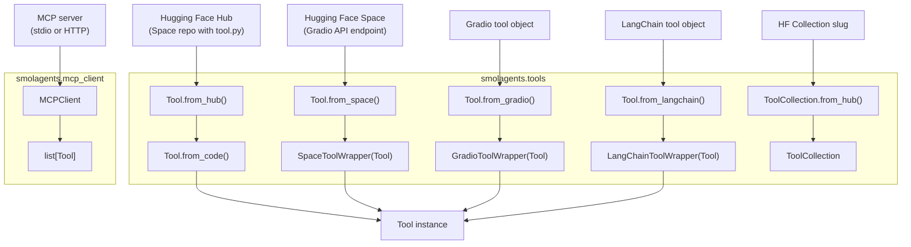
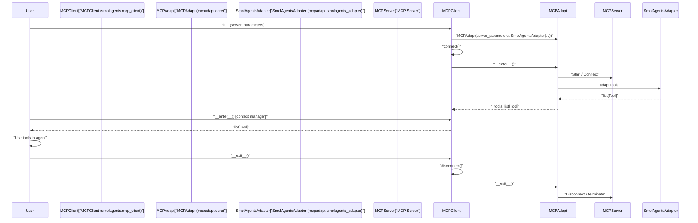
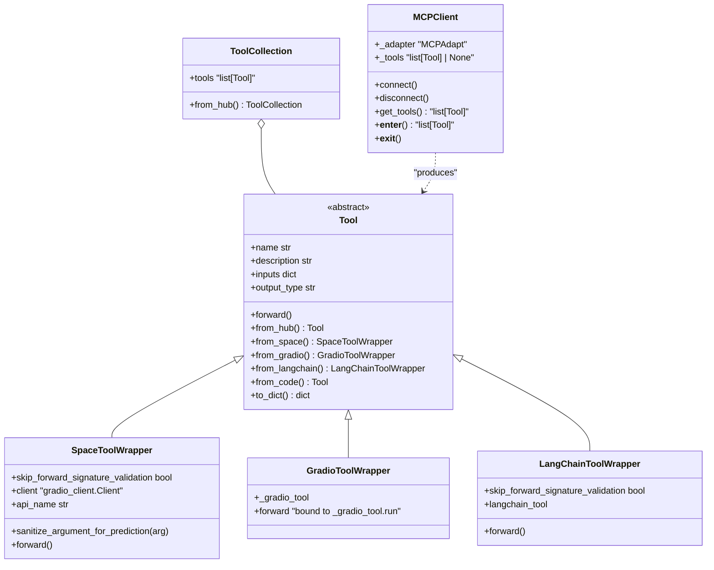

<!-- source: DeepWiki mcp.deepwiki.com · repo huggingface/smolagents · page 5.4 External Tool Sources · fetched 2026-10-26 -->

# External Tool Sources

<details>
<summary>Relevant source files</summary>

The following files were used as context for generating this wiki page:

- [examples/structured_output_tool.py](examples/structured_output_tool.py)
- [src/smolagents/mcp_client.py](src/smolagents/mcp_client.py)
- [src/smolagents/tools.py](src/smolagents/tools.py)
- [tests/test_mcp_client.py](tests/test_mcp_client.py)
- [tests/test_tools.py](tests/test_tools.py)

</details>


This page covers how to load and integrate tools from sources outside of Python code defined in the local project: the Hugging Face Hub, Hugging Face Spaces, Gradio tools, LangChain tools, Hub tool collections, and MCP servers.

For how to define tools from scratch in Python (via subclass or decorator), see **5.3 Creating Custom Tools**. For the core `Tool` class interface and its required attributes, see **5.1 Tool Definition & Interface**.

---

## Overview

All external loading methods are static or class methods on `Tool` and `ToolCollection`, defined in `src/smolagents/tools.py` [src/smolagents/tools.py:1-951](). `MCPClient` is defined separately in `src/smolagents/mcp_client.py` [src/smolagents/mcp_client.py:33-172](). Each method returns standard `Tool` instances (or lists thereof) that are passed directly to an agent's `tools` parameter.

**Loading method summary:**

| Method | Source type | Returns | Serializable |
|---|---|---|---|
| `Tool.from_hub()` | HF Space repo (`tool.py`) | `Tool` | Yes |
| `load_tool()` | HF Space repo (alias) | `Tool` | Yes |
| `Tool.from_space()` | HF Space (Gradio API) | `SpaceToolWrapper` | No |
| `Tool.from_gradio()` | Gradio tool object | `GradioToolWrapper` | No |
| `Tool.from_langchain()` | LangChain tool object | `LangChainToolWrapper` | No |
| `ToolCollection.from_hub()` | HF collection slug | `ToolCollection` | — |
| `MCPClient` | MCP server (stdio/HTTP) | `list[Tool]` | — |

**Loading path diagram:**

Title: External Tool Integration Paths


Sources: [src/smolagents/tools.py:516-791](), [src/smolagents/mcp_client.py:1-172]()

---

## `Tool.from_hub` and `load_tool`

Downloads a tool's source code from a Hugging Face Space repository and instantiates it locally.

**Signature** ([src/smolagents/tools.py:516-569]()):
```python
Tool.from_hub(repo_id, token=None, trust_remote_code=False, **kwargs)
```

**Behavior:**
1. Requires `trust_remote_code=True` — raises `ValueError` otherwise [src/smolagents/tools.py:545-549]().
2. Downloads `tool.py` from the Space repo using `hf_hub_download` [src/smolagents/tools.py:556-562]().
3. Passes the source text to `Tool.from_code()` [src/smolagents/tools.py:568]().

`Tool.from_code()` ([src/smolagents/tools.py:571-597]()) executes the code in a fresh `types.ModuleType`, then scans for a class that is a subclass of `Tool` and instantiates it.

`load_tool()` ([src/smolagents/tools.py:840-879]()) is a module-level function that delegates to `Tool.from_hub` with the same signature. It exists as a convenience alias.

**Security note:** The downloaded code is executed in the local Python process. Inspect the space repo before loading, exactly as you would inspect a package before installing it.

**Hub format:** The Space must contain a `tool.py` file at the root that defines a single `Tool` subclass. Tools are pushed to this format using `Tool.push_to_hub()` or `Tool.save()`.

**Example:**
```python
from smolagents import load_tool

tool = load_tool("m-ric/text-to-image", trust_remote_code=True)
```

Sources: [src/smolagents/tools.py:516-597](), [src/smolagents/tools.py:840-879]()

---

## `Tool.from_space`

Creates a `Tool` wrapper around a Hugging Face Space that exposes a Gradio API.

**Signature** ([src/smolagents/tools.py:599-739]()):
```python
Tool.from_space(space_id, name, description="", api_name=None, token=None)
```

**Behavior:**
1. Instantiates a `gradio_client.Client` connecting to the Space [src/smolagents/tools.py:642-644]().
2. Calls `client.view_api(return_format="dict")` to introspect available endpoints [src/smolagents/tools.py:645]().
3. If `api_name` is not specified, uses the first available endpoint (with a warning) [src/smolagents/tools.py:650-655]().
4. Maps the Space's parameter types to smolagents input types. Object-typed parameters are mapped to `"any"` [src/smolagents/tools.py:669-693]().
5. Determines `output_type` from the Gradio component: `Image` → `"image"`, `Audio` → `"audio"`, anything else → `"any"` [src/smolagents/tools.py:702-710]().
6. Returns a `SpaceToolWrapper` instance [src/smolagents/tools.py:739]().

`SpaceToolWrapper` sets `skip_forward_signature_validation = True` because its `forward` uses `*args, **kwargs` [src/smolagents/tools.py:344](). File and PIL Image arguments are converted to Gradio's `handle_file` format automatically before the API call [src/smolagents/tools.py:410-418]().

**Output handling:** If the Space returns a tuple, `SpaceToolWrapper.forward` takes index 0 (handles spaces that also return a seed) [src/smolagents/tools.py:430-431](). File path outputs with image or audio extensions are wrapped in `AgentImage` or `AgentAudio` [src/smolagents/tools.py:435-442]().

**Limitations:** `SpaceToolWrapper` instances cannot be serialized via `to_dict()` or saved to Hub. Attempting this raises `ValueError` [src/smolagents/tools.py:348-351]().

**Example:**
```python
image_generator = Tool.from_space(
    space_id="black-forest-labs/FLUX.1-schnell",
    name="image_generator",
    description="Generate an image from a prompt"
)
```

**Requires:** `pip install gradio-client`

Sources: [src/smolagents/tools.py:599-739]()

---

## `Tool.from_gradio`

Wraps an existing Gradio tool object (e.g., from a `gradio.Tool` subclass) into a smolagents `Tool`.

**Signature** ([src/smolagents/tools.py:741-760]()):
```python
Tool.from_gradio(gradio_tool)
```

**Behavior:**
1. Creates a `GradioToolWrapper` instance [src/smolagents/tools.py:759]().
2. Copies `name` and `description` from the Gradio tool [src/smolagents/tools.py:454-455]().
3. Inspects `gradio_tool.run`'s signature to build `inputs`. Type annotations are converted using `CONVERSION_DICT` (`str` → `"string"`, `int` → `"integer"`, `float` → `"number"`) [src/smolagents/tools.py:461-468]().
4. Sets `output_type = "string"` [src/smolagents/tools.py:456]().
5. Binds `forward` directly to `gradio_tool.run` [src/smolagents/tools.py:470]().

**Limitations:** `GradioToolWrapper` instances cannot be serialized.

**Example:**
```python
from smolagents import Tool

smolagents_tool = Tool.from_gradio(my_gradio_tool)
```

Sources: [src/smolagents/tools.py:741-760](), [src/smolagents/tools.py:451-470]()

---

## `Tool.from_langchain`

Wraps a LangChain tool object into a smolagents `Tool`.

**Signature** ([src/smolagents/tools.py:762-791]()):
```python
Tool.from_langchain(langchain_tool)
```

**Behavior:**
1. Creates a `LangChainToolWrapper` [src/smolagents/tools.py:790]().
2. Copies `name` (lowercased) and `description` from the LangChain tool [src/smolagents/tools.py:483-484]().
3. Copies `args` as `inputs`, stripping the `"title"` key from each input and adding an empty `"description"` [src/smolagents/tools.py:487-493]().
4. Sets `output_type = "string"` [src/smolagents/tools.py:485]().
5. `forward` calls `langchain_tool.run(tool_input)` [src/smolagents/tools.py:504-506]().

`LangChainToolWrapper` sets `skip_forward_signature_validation = True` because its `forward` uses `*args, **kwargs` [src/smolagents/tools.py:481]().

**Limitations:** `LangChainToolWrapper` instances cannot be serialized.

**Example:**
```python
from langchain.agents import load_tools
from smolagents import Tool

lc_tool = load_tools(["serpapi"])[0]
smolagents_tool = Tool.from_langchain(lc_tool)
```

Sources: [src/smolagents/tools.py:762-791](), [src/smolagents/tools.py:473-506]()

---

## `ToolCollection.from_hub`

Loads all Space-based tools from a Hugging Face collection.

**Signature** ([src/smolagents/tools.py:909-950]()):
```python
ToolCollection.from_hub(collection_slug, token=None, trust_remote_code=False)
```

**Behavior:**
1. Fetches the collection metadata via `huggingface_hub.get_collection(collection_slug)` [src/smolagents/tools.py:935]().
2. Iterates over items. Only items of type Space are loaded; models and datasets are skipped [src/smolagents/tools.py:938-941]().
3. Calls `Tool.from_hub(item.item_id, token=token, trust_remote_code=trust_remote_code)` for each Space [src/smolagents/tools.py:943-945]().
4. Returns a `ToolCollection` whose `.tools` list contains all loaded tools [src/smolagents/tools.py:950]().

**`ToolCollection`** ([src/smolagents/tools.py:895-907]()) is a plain container with a single attribute `tools: list[Tool]`. It does not wrap or transform the tools in any way.

**Usage pattern:**
```python
from smolagents import ToolCollection, CodeAgent

collection = ToolCollection.from_hub(
    collection_slug="huggingface-tools/diffusion-tools-6630bb19a942c2306a2cdb6f",
    token="<HF_TOKEN>",
    trust_remote_code=True
)
agent = CodeAgent(tools=[*collection.tools], model=model)
```

Sources: [src/smolagents/tools.py:895-950]()

---

## `MCPClient`

`MCPClient` ([src/smolagents/mcp_client.py:33-171]()) connects to one or more MCP (Model Context Protocol) servers and exposes their tools as standard smolagents `Tool` instances.

### Transport Options

| Transport | `server_parameters` type | Notes |
|---|---|---|
| Stdio subprocess | `mcp.StdioServerParameters` | Spawns a local process [src/smolagents/mcp_client.py:44-45]() |
| Streamable HTTP | `dict` with `"url"` and `"transport": "streamable-http"` | Default for dict input [src/smolagents/mcp_client.py:49-50]() |
| SSE (legacy) | `dict` with `"url"` and `"transport": "sse"` | Deprecated [src/smolagents/mcp_client.py:50]() |

Multiple servers can be connected by passing a list of parameters [src/smolagents/mcp_client.py:42]().

### Constructor Parameters

| Parameter | Type | Description |
|---|---|---|
| `server_parameters` | `StdioServerParameters | dict | list[...]` | Server connection config [src/smolagents/mcp_client.py:87]() |
| `adapter_kwargs` | `dict | None` | Passed to `MCPAdapt` [src/smolagents/mcp_client.py:88]() |
| `structured_output` | `bool | None` | Enables structured output support; defaults to `False` [src/smolagents/mcp_client.py:89-101]() |

### Connection Lifecycle

Title: MCP Tool Bridge Lifecycle


Sources: [src/smolagents/mcp_client.py:85-172]()

### Usage Patterns

**Context manager (recommended):**
```python
from smolagents import MCPClient
from mcp import StdioServerParameters

server_params = StdioServerParameters(command="python", args=["-c", server_script])

with MCPClient(server_params, structured_output=True) as tools:
    agent = CodeAgent(tools=tools, model=model)
    agent.run("...")
```

**Manual connect/disconnect with `try/finally`:**
```python
mcp_client = MCPClient(server_params)
try:
    tools = mcp_client.get_tools()
    # use tools
finally:
    mcp_client.disconnect()
```

**Multiple MCP servers simultaneously:**
```python
with MCPClient([server_params_1, server_params_2]) as tools:
    # tools is a flat list of all tools from both servers
    ...
```

### `structured_output` Parameter

When `structured_output=True`:
- MCP tools that define an `outputSchema` have `output_type = "object"` and `output_schema` populated [tests/test_mcp_client.py:64-77]().
- `structuredContent` in MCP responses is handled by the adapter [src/smolagents/mcp_client.py:56-57]().
- `output_schema` is derived from the tool's JSON schema [tests/test_mcp_client.py:72-76]().

When `structured_output=False` (legacy):
- All tool outputs are typically returned as plain strings [tests/test_mcp_client.py:87-101]().

**Note:** The default will change from `False` to `True` in version 1.25. Until then, omitting the parameter raises a `FutureWarning` [src/smolagents/mcp_client.py:92-101]().

**Requires:** `pip install 'smolagents[mcp]'` (installs the `mcpadapt` package) [src/smolagents/mcp_client.py:103-107]() and the `mcp` extra.

Sources: [src/smolagents/mcp_client.py:85-122](), [tests/test_mcp_client.py:55-131](), [examples/structured_output_tool.py:55-77]()

---

## Wrapper Class Relationships

Title: External Tool Wrapper Class Hierarchy


**Serialization constraint:** `to_dict()` raises `ValueError` for `SpaceToolWrapper`, `GradioToolWrapper`, and `LangChainToolWrapper`. These wrapper instances cannot be saved to disk or pushed to Hub [src/smolagents/tools.py:348-351]().

Sources: [src/smolagents/tools.py:98-791](), [src/smolagents/mcp_client.py:33-171]()

---

## Dependency Requirements

| Feature | Install command |
|---|---|
| `Tool.from_hub` | Base install |
| `Tool.from_space` | `pip install gradio-client` [src/smolagents/tools.py:642-644]() |
| `Tool.from_gradio` | Gradio tool object in scope |
| `Tool.from_langchain` | LangChain tool object in scope |
| `ToolCollection.from_hub` | Base install |
| `MCPClient` | `pip install 'smolagents[mcp]'` [src/smolagents/mcp_client.py:103-107]() |

Sources: [src/smolagents/tools.py:642-644](), [src/smolagents/mcp_client.py:103-107]()

---

